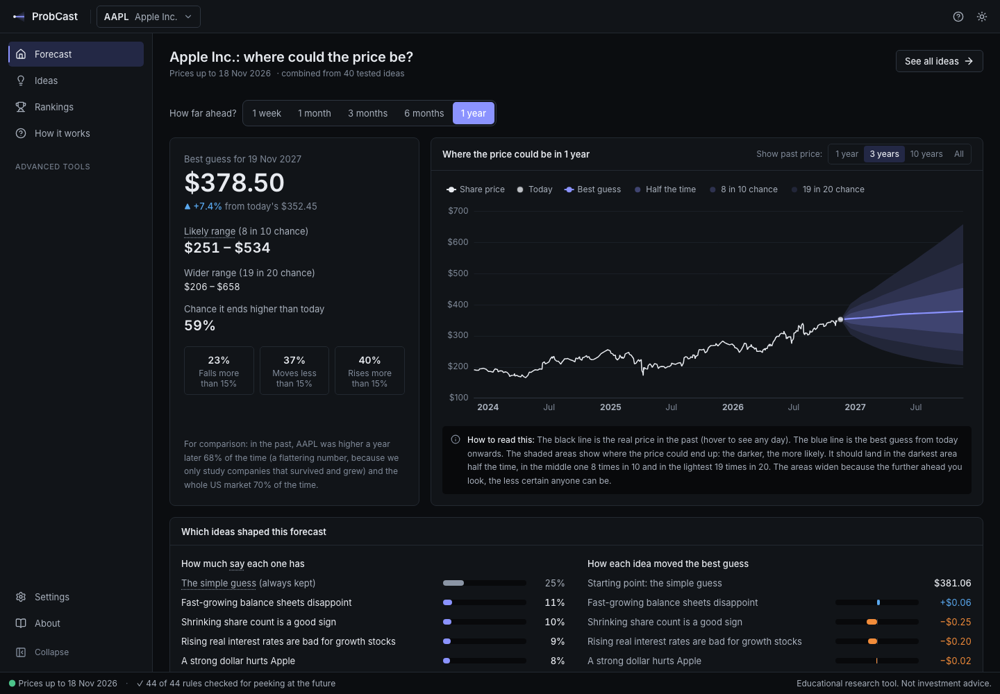
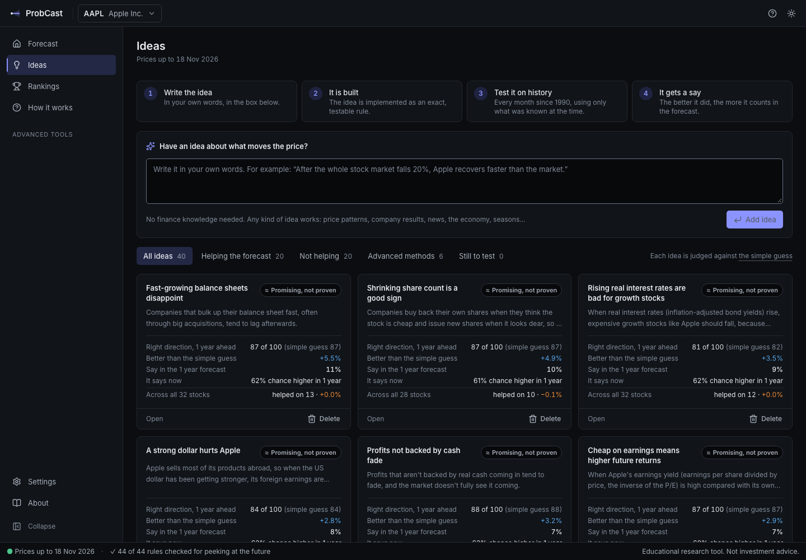
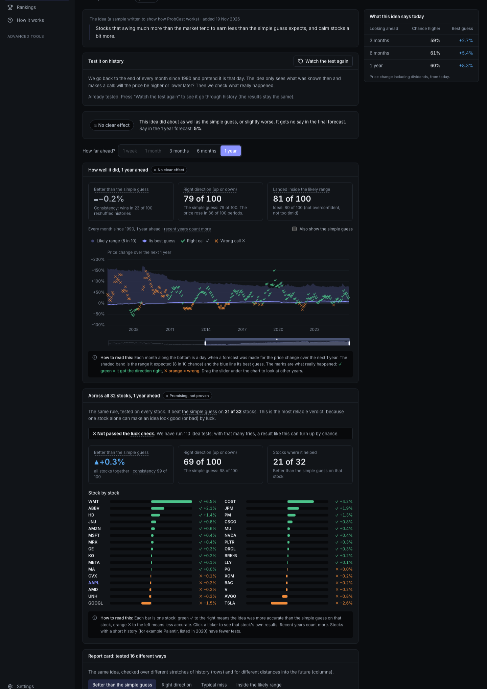
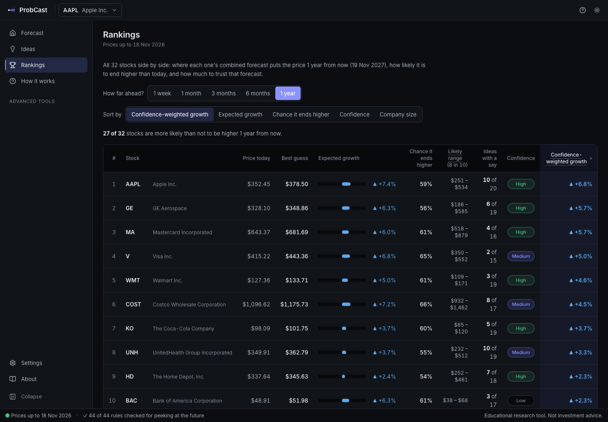
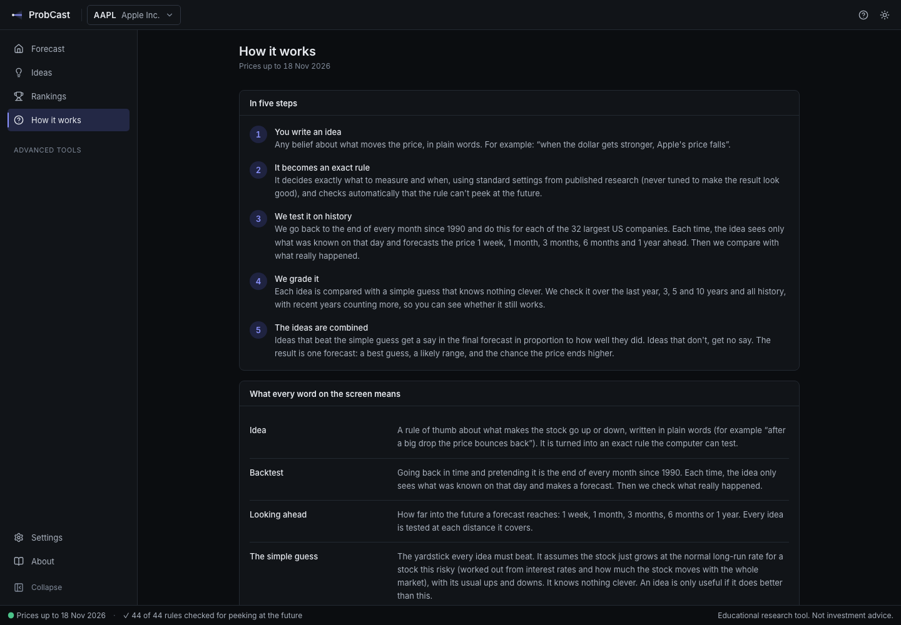
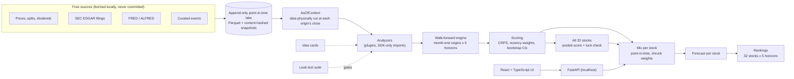

# ProbCast

**Probabilistic stock forecasts you can trust because they cannot see the future.**

ProbCast turns ideas about what moves a stock price into a full probability distribution of future
returns, and then checks each idea honestly: it is replayed month by month since 1990 using only the
information that was public at the time, scored against a simple market-based guess, and checked for
luck before it is allowed to shape a forecast.

It covers the **32 largest US companies** by market value and forecasts five horizons (1 week, 1, 3, 6
and 12 months). It was built as the project for the **Financial Institutions and Markets** module of my
MSc in Software Systems Engineering at UCL.

> **Educational research tool, not investment advice.** ProbCast is not affiliated with, authorised or
> endorsed by any company it covers. Market data is never redistributed: you fetch it yourself from
> free public sources.



---

## What it does

1. **Write an idea in plain words**, for example "after a big drop the price bounces back". Each idea
   lives on an idea card and is implemented as a small analyzer plugin with fixed, published parameters.
2. **Backtest it walk-forward.** At every month-end since 1990, the analyzer sees only data whose
   `available_at` timestamp is before that day's close, and returns 23 quantiles of the future return.
3. **Score it against a simple guess.** Forecasts are compared with a CAPM anchor using the continuous
   ranked probability score (CRPS), over look-back windows from 1 year to all history, with recent years
   weighted more and bootstrap confidence intervals.
4. **Check it on every stock and for luck.** Each idea is scored on all 32 stocks, and a
   Benjamini–Hochberg false-discovery correction runs over every idea and horizon ever tested, including
   deleted ideas. An idea that could be chance is labelled "promising, not proven".
5. **Combine and rank.** Ideas are mixed into one forecast per stock, weighted by their point-in-time
   record and shrunk towards equal weights. All 32 stocks are then ranked for any horizon by expected
   growth, chance of ending higher and confidence.

## Screenshots

| Ideas | One idea's track record |
|---|---|
|  |  |
| **Rankings** | **How it works** |
|  |  |

## Why it is different

Most backtests flatter themselves without meaning to. ProbCast is built to make that hard.

| Common shortcut | What ProbCast does instead |
|---|---|
| Vendor "adjusted" prices, which leak future splits and dividends into the past | Raw as-traded prices, forward split adjustment and a forward-built total-return index |
| Restated company fundamentals | SEC EDGAR filings **as first reported**, timestamped to the second they were accepted |
| "Trust me, there's no look-ahead" | Six automated leak tests for every analyzer, including future-poisoning and drift-neutrality tests |
| Buy/sell signals and a Sharpe ratio | A full predictive distribution (23 quantiles) at five horizons, scored with CRPS |
| The best of many tries, reported as a discovery | A hash-chained registry of every trial and a false-discovery correction across all of them |
| The stock's own past return as the expected return | A CAPM anchor, because a stock's historical drift is survivor-biased |

## Ideas included

40 sample ideas across price, fundamental, macro and event families, plus six advanced methods:
GJR-GARCH, HAR volatility, regime switching, a Kalman filter, gradient-boosted trees and the
pretrained Chronos-Bolt time-series model.

## Quickstart

Requirements: [uv](https://docs.astral.sh/uv/) with Python 3.13+, Node 22.18+ and
[pnpm](https://pnpm.io); [just](https://github.com/casey/just) is optional.

```bash
uv sync
uv run probcast demo             # end to end on synthetic data: no keys, no downloads
uv run probcast leak-test --all  # prove that no analyzer can see the future
```

**Real data** (all free sources):

```bash
cp .env.example .env             # add a free FRED API key and a contact address for SEC EDGAR
uv run probcast ingest           # prices, splits and dividends, FRED/ALFRED, SEC EDGAR, events
uv run probcast snapshot create dev-$(date +%Y%m%d)
uv run probcast run technical.tsmom_12_1
uv run probcast report build     # figures, tables and a numbers ledger
```

**The web app** (Forecast, Ideas, Rankings, How it works):

```bash
cd web && pnpm install && pnpm build && cd ..
uv run probcast serve-warm       # backtest, score, mix and leak-test every idea (cached)
uv run probcast serve            # http://127.0.0.1:8000
```

**Advanced methods** (optional, CPU only, about 1 GB):

```bash
uv sync --extra ml
uv run python scripts/fetch_models.py   # pinned Chronos-Bolt weights, verified by SHA-256
```

Bulk runs use half the CPU cores (or `PROBCAST_WORKERS`) at lowered priority and pause new work while
the machine is busy.

## Adding an idea

1. Write the idea on the **Ideas** page, or add a YAML card under `ideas/cards/`.
2. Implement it as an analyzer in `src/probcast_analyzers/`. Analyzers may import only the public SDK
   (`probcast.sdk`) and the numeric libraries; this boundary is enforced by import-linter, so an analyzer
   cannot touch files, the network or future data.
3. Run `uv run probcast leak-test <analyzer>`. An analyzer that fails a leak test is never scored.

Parameters come from the card or from the literature, never from tuning on results, and every
evaluated configuration is recorded as a trial.

## Architecture



## Methodology in one paragraph

Every row in the data lake carries `available_at`, the moment the public could know it. An analyzer at
origin *t* receives a context physically truncated to rows with `available_at` ≤ the close of *t* and
returns 23 quantiles of the forward log total return; probabilities, means and intervals are derived
from those quantiles, never self-reported. Calibration works on returns in excess of a CAPM anchor and
re-centres each shape, so a stock's survivor-biased historical drift cannot leak into a forecast.
Forecasts are scored with CRPS against the anchor over all history, with a five-year recency half-life
and a stationary block bootstrap. Bias is controlled by the walk-forward design, the all-stocks verdict,
the false-discovery correction and the trials registry. The mix that combines ideas uses, at each date,
only outcomes known by then, so its own track record is out of sample too. Full specifications are in
[`docs/kb/`](docs/kb/README.md).

## Engineering

- **Python 3.13**: pandas, NumPy, SciPy, statsmodels, arch; Typer CLI; FastAPI server.
- **Web**: React, TypeScript and Vite.
- **Quality**: pytest (including the leak suite on synthetic fixtures), ruff, import-linter boundaries,
  Biome and Vitest for the web app, and a CI job that blocks any market data from being committed.

## Repository layout

```
src/probcast/            contract, calendar, lake, point-in-time layer, SDK, ingest, engine,
                         statistics, scoring, committee, studio, report, validation, server, CLI
src/probcast_analyzers/  built-in analyzers and idea plugins
ideas/cards/             idea cards (YAML)
web/                     React + TypeScript UI
configs/                 universes, tickers, committees, point-in-time rules
data/seed/               curated seeds (events, corporate actions), CC BY 4.0
scripts/                 universe selection, model download, data guard
docs/kb/                 knowledge base: plan, decisions, ADRs, requirements, architecture
docs/screenshots/        the screenshots above
```

## Licence

Code: MIT. Documentation, knowledge base and curated seed data: CC BY 4.0. Market data is never
redistributed; it is fetched locally from each provider under its own terms.
