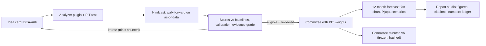

# A1 — Product vision, personas, journeys & feature catalogue

| Field | Value |
|---|---|
| Agent | A1 — Product strategist |
| ID prefix | `PRD-` (features `PRD-001…PRD-100`; personas `PRD-P#`; journeys `PRD-J#`; wow items `PRD-WP#` / `PRD-WR#`; anti-features `PRD-AF##`; names `PRD-N##`; metrics `PRD-KPI##`; questions `PRD-Q##`; assumptions `PRD-ASM##`; recommendations `PRD-REC##`; principles `PRD-PR#`) |
| Written | 2026-11-17 (planning phase, Session 1) |
| Inputs read | `01-brief/agent-shared-context.md`, `01-brief/coursework-brief.md`, `01-brief/user-vision.md`, an internal brief (not published) (and skimmed A2–A7 briefs to avoid overlap) |
| Scope | The *what* and *why* of features. Methodology detail → A2; data sources → A3; AAPL facts & events → A4; analyzer library → A5; screens & visual design → A6; stack & architecture → A7. |
| Status | Draft for critic (R1) and synthesiser (R2) |

**Labels used in this document.** **[F]** = fact, with a source in §13 (accessed 2026-11-17 unless stated). **[A]** = assumption (also listed in §11). **[R]** = recommendation, meaning my opinion as product strategist. `UNVERIFIED` = I could not confirm it from a primary source this session.

---

## 0. Executive summary

1. **[R] Orchard should be forecast-first, not P&L-first.** Every idea becomes a *predictive distribution* of AAPL's forward return at standard horizons (5d to 252d). It is judged with proper scoring rules and calibration against naive baselines. Backtest Sharpe ratios are a poor guide to out-of-sample performance: on 888 Quantopian algorithms, in-sample Sharpe explained only about 1–2% of out-of-sample behaviour [F, S22].
2. **[R] Point-in-time integrity must be *visible*, not just true.** The "PIT-verified" badge comes from an automated future-poisoning test (PRD-017). Paired with the blind time-machine replay and reveal (PRD-014), these are the two features most likely to win over a finance professor.
3. **[R] The "committee" is the product's centre of gravity.** Teammates' analyzers are combined with weights that use only past scores (PRD-067). The result is explained with a contribution waterfall and a "marginal contribution" score (PRD-069), inspired by Numerai's meta-model contribution [F, S10] and the multi-team ensemble of the US COVID-19 Forecast Hub [F, S17].
4. **[R] The scientific method is built into the product.** Pre-registration (PRD-029), a sealed holdout (PRD-045), a trials counter with multiple-testing adjustment (PRD-056) and an evidence grade (PRD-057) answer the data-snooping critique of Harvey, Liu & Zhu [F, S25] and Bailey & López de Prado [F, S26].
5. **[R] Orchard is built for the graded report, not a trading desk.** Its output layer is a report studio: academic figure export with captions and source lines, a Harvard bibliography and a numbers ledger. It never writes prose (PRD-AF03). This maps straight onto the 15% for figures, the 15% for citations and the 20% for data analysis.
6. **[R] Idea intake can start tomorrow, before any code exists.** Idea cards are a template and the coding-agent implementation protocol is a process (PRD-026, PRD-028). Teammates should not wait for the platform to start submitting ideas.
7. **[A/R] R1 scope is the main delivery risk.** The proposed R0+R1 slice (55 features, 31 of them small) comes to about 110 build-hours before roughly 25% integration overhead (§5.20). That is at the edge of what 18–26 Nov allows. It needs parallel coding-agent work streams, an R1-a/R1-b split and a cut order agreed in advance.
8. **[F] Two calendar facts affect planning.** The coursework brief says "Thursday 4 December 2026", but 4 Dec 2026 is a **Friday**; Thursday is 3 Dec (PRD-Q01). US markets are closed on Thu 26 Nov 2026 (Thanksgiving) and close early at 13:00 ET on Fri 27 Nov [F, S30]. This matters for the forecast's data cut-off.
9. **[F/R] Naming.** "Orchard" is usable as a product name but crowded as a package or repo name. PyPI `orchard` is "a compute platform for Apple Silicon" and `zcash/orchard` is a Rust crate [F, S32, S33]. Recommendation: product **Orchard**, repo and package **`orchard-lab`** (free on PyPI and npm on 2026-11-17). Apple's third-party guidelines rule out Apple marks and logo variations, so the logo should not use apple imagery [F, S29].
10. **[R] Be honest about the null result.** For a single mega-cap at a 12-month horizon, most ideas will probably not beat a random walk with drift (Welch & Goyal's equity-premium findings point the same way [F, S27]). The product should make "insufficient evidence" a first-class, well-presented result (PRD-058). That honesty is itself what impresses an examiner.

---

## 1. Positioning

### 1.1 Positioning statement (one sentence)

> **Orchard is an open-source, point-in-time forecasting lab that turns every teammate's idea about a stock (technical, fundamental, macro or event-driven) into a probabilistic forecast that is backtested without hindsight, scored honestly against naive baselines, and combined with everyone else's into one transparent, fully cited 12-month view of Apple.**

Long form (classic template): *For student and small research teams who must defend a stock forecast, Orchard is the point-in-time forecasting lab that turns each person's idea into a scored probability distribution and combines them into a transparent committee forecast. Charting backtesters and screeners report hindsight-prone P&L for one strategy at a time. Orchard instead proves that no future data was used, judges forecasts the way meteorologists and central banks do, and gives the report figures and citations it can actually use.*

Tagline candidates: "Ex-ante by construction." · "Many ideas. One honest forecast." · "What did we know, and when?"

### 1.2 The three core promises

| # | Promise | What it means in the product | Proof the user can see |
|---|---|---|---|
| 1 | **Nothing from the future.** | Every datum has an `available_at`. Analyzers can only read the world as it was published at the forecast origin (PRD-002, PRD-018). | PIT-verified badge from the future-poisoning test (PRD-017); the blind replay and reveal (PRD-014). |
| 2 | **Every idea gets an honest score.** | Ideas output distributions, not buy/sell signals. They are scored with proper scoring rules against random-walk and bootstrap baselines, with overlap-aware confidence intervals and multiple-testing accounting (PRD-053 to PRD-058). | Tear sheet with skill vs baselines, reliability diagram, effective N and an evidence grade. "Insufficient evidence" is stated plainly. |
| 3 | **Many minds, one transparent forecast, with receipts.** | A committee combines analyzers with weights learned only from past performance, explains itself, and freezes a citable version (PRD-066 to PRD-072). Every number carries provenance (PRD-007, PRD-084). | Fan chart with P(up), attribution waterfall, committee minutes vN, Harvard bibliography, numbers ledger. |

### 1.3 What makes Orchard different

| ID | Differentiator | Nearest existing practice (see §2) |
|---|---|---|
| PRD-D1 | **Forecast-first.** The unit of output is a predictive distribution, scored with CRPS, log score and calibration (Gneiting & Raftery 2007 [S37]), not an equity curve. | Retail backtesters (TradingView, Composer) score P&L. QuantConnect "Insights" carry direction, magnitude and confidence but feed portfolio construction rather than distribution scoring [F, S3]. |
| PRD-D2 | **PIT across *all* data types**, including curated events and user uploads, with automated, user-visible leak tests. | Portfolio123 and Qlib offer PIT fundamentals [F, S8, S13]. No retail tool I found shows a leak test to the user. |
| PRD-D3 | **Multi-author committee** with PIT weights, attribution and marginal contribution, for one stock and a small team. | Numerai meta-model (anonymous, cross-sectional, crypto-staked) [F, S10]; COVID-19 Forecast Hub (epidemiology) [F, S17]; Metaculus community prediction (human forecasts) [F, S15]. |
| PRD-D4 | **Anti-p-hacking productised**: pre-registration, sealed holdout, trials counter, evidence grade. | Academic practice (OSF preregistration [F, S28]); rarely found in tools. |
| PRD-D5 | **Academic output layer**: figure export with captions and source lines, Harvard citations, numbers ledger. | None of the scanned tools target a graded report. |
| PRD-D6 | **Idea → analyzer pipeline that works without in-app AI** (R1: the coding agent protocol), then with sandboxed, validated AI (R2). | Composer "Trade With AI" turns natural language into a strategy, but for trading and without PIT validation gates [F, S9]. |
| PRD-D7 | **Local-first, open, licence-aware.** Licensed data never leaves the laptop; a static demo serves the public. | OpenBB is open and connector-based but not a backtesting or forecasting lab [F, S11]. |

### 1.4 Product principles (product-level; A6 owns design principles)

| ID | Principle | Consequence |
|---|---|---|
| PRD-PR1 | **Every number has a birthday.** | No datum enters the store without `available_at`. Uploads that lack it are rejected or need a declared lag rule (PRD-077). |
| PRD-PR2 | **Baselines first.** | No metric is shown without the random-walk-with-drift comparison next to it. |
| PRD-PR3 | **Honest nulls beat exciting noise.** | "Cannot distinguish from baseline" is a designed state (PRD-058), not an error. |
| PRD-PR4 | **The team owns the ideas; the platform owns the discipline.** | The coding agent implements, but the idea's author approves every assumption (PRD-028). Rules such as holdout, trials and PIT are enforced by software, not goodwill. |
| PRD-PR5 | **Never write the report.** | Captions get auto-filled *facts* (period, source); interpretation is always typed by a human (PRD-080, PRD-AF03). |
| PRD-PR6 | **Distributions, not targets.** | Any point estimate is shown together with an interval (PRD-AF12). |
| PRD-PR7 | **AAPL-first, ticker-agnostic by design.** | Nothing hard-codes AAPL below the configuration layer, which keeps R3 multi-ticker (PRD-097) cheap. |

### 1.5 Scope boundary (V-16)

Orchard provides **data, forecasts and probabilities for research and education**. It has no order execution, no brokerage links, no personalised advice and no buy/sell/hold language (PRD-100, PRD-AF01, PRD-AF02).

### 1.6 The product loop

---

## 2. Competitive scan

Method: web research on 2026-11-17. Sources are in §13. Where only secondary or vendor sources were available, I say so. The columns "Gap Orchard fills" and "Idea we borrow" are my assessment [R].

### 2.1 Tool-by-tool

| # | Tool | What it does well [F] | Gap Orchard fills [R] | Idea we borrow [R] |
|---|---|---|---|---|
| 1 | **QuantConnect / LEAN** | Open-source (Apache-2.0; about 22.6k GitHub stars on 2026-11-17) multi-asset algorithmic trading engine in Python/C#, with cloud research, backtesting and live trading. The docs cite a dataset library of about 400 TB [S1, S2, S4]. Its "Algorithm Framework" separates Alpha (Insights with direction, magnitude, confidence and period) from portfolio construction and execution [S3]. | Built for strategy P&L and execution. Requires coding. Insights are not scored as calibrated distributions. No multi-author committee or academic outputs. Too heavy for a 5-person, mostly non-coding team. | Separation of the forecast ("insight") from the action. Our `ForecastSet` (PRD-059) is a richer insight. |
| 2 | **TradingView** (Pine Script Strategy Tester) | Best-in-class charting and community scripts. "Deep Backtesting" (Premium and above) handles up to 2 million bars and 1 million trades [S5]. | Trade-simulation, P&L-centred. Repainting and default no-commission settings are known pitfalls [S6, secondary]. No PIT fundamentals or event discipline, no probabilistic scoring, no combination of authors. | Immediacy of "indicator on chart"; crosshair and polish (A6). |
| 3 | **Koyfin** | Web terminal for fundamentals, charting (fundamental, technical, cross-asset, relative, scatter), dashboards and macro, with a free tier [S7, partly secondary; pricing changed in 2026, current tiers `UNVERIFIED`]. | Research and visualisation only. No backtesting or forecast scoring. PIT treatment of restated fundamentals not documented (`UNVERIFIED`). | Clean multi-company fundamental charts; dashboard templates; "Bloomberg-lite" information density. |
| 4 | **Portfolio123** | Screens, ranking systems, simulations and ML ranking; 20 years of backtest data for US, Canada and Europe [S8]. Backtests use a PIT database (secondary source cites Compustat licensing) [S8]. | Cross-sectional stock *selection*, not single-stock probabilistic forecasting. Paid. Fundamentals not exportable (forum report, secondary). | "Point-in-time by default" as a headline promise; weighted-factor ranking UI. |
| 5 | **Composer** (now "Composer by SoFi") | No-code visual strategies ("symphonies"), natural-language "Trade With AI" assistant, fast backtests, automated execution, and an MCP server so LLM agents can run backtests [S9, partly secondary]. | Aimed at deploying real money. No calibration or proper scoring. The NL→strategy step has no look-ahead validation gate. | No-code block composition (PRD-034); NL→analyzer UX (PRD-035); MCP integration (PRD-096). |
| 6 | **Numerai** | Crowdsourced hedge-fund tournament. Only *staked* predictions feed the "Stake-Weighted Meta Model". Payouts weight correlation and meta-model contribution (MMC) [S10]. | Obfuscated cross-sectional data, crypto staking, no human-readable ideas, single objective. | **Score analyzers by marginal contribution to the ensemble**, not only standalone skill (PRD-069). |
| 7 | **OpenBB** (ODP / Workspace) | Open-source investment research data platform with many connectors. On 25 Aug 2026 OpenBB announced it would open-source the whole suite under a permissive licence; an edit on 1 Oct 2026 named a non-profit (OpenBQ) and FINOS stewardship of Workspace [S11]. GitHub repo now under `openbq-org` (about 75.5k stars) [S4]. | Data access and analysis workspace. No PIT backtesting, forecast scoring or committee. | Provider/connector abstraction for data adapters (A3/A7 may evaluate ODP as an ingestion source once the licence is final, `UNVERIFIED`). |
| 8 | **Python backtest libraries**: backtrader, zipline-reloaded, vectorbt, backtesting.py, NautilusTrader | Mature engines. Licences and activity on 2026-11-17 [S12]: backtrader GPL-3.0, last push Aug 2024; zipline-reloaded Apache-2.0, community-maintained successor to Quantopian's Zipline; vectorbt (fast, vectorised; PRO edition commercial); backtesting.py AGPL-3.0; NautilusTrader LGPL-3.0, high-performance. | Libraries, not products. Trade-simulation-centric. No forecast scoring, combination or UI. GPL/AGPL licences matter if embedded. | Vectorised evaluation speed (vectorbt). Do **not** build Orchard's core on an order simulator: our core is forecast evaluation, and a simple long/flat translation (PRD-050) is enough. |
| 9 | **Microsoft Qlib** | MIT-licensed AI-oriented quant platform (about 50k stars) with a **PIT database** for quarterly and annual financial data (`date, period, value, _next`), shipped in March 2022 [S13]. | Cross-sectional ML research. Code-heavy. No team, committee or report layer. | Precedent for our bitemporal store design (A7). |
| 10 | **Bloomberg Terminal** (BT, BTST; BQuant) | BT does backtesting and optimisation. BTST ranks popular trading strategies by historical return and risk. BQuant is a Python platform for factor backtesting [S14]. UCL has 9 terminals (coursework brief). | Licensed, in-person only, data not redistributable, technical-strategy oriented, no probabilistic combination. | Use as a **data source** (PRD-078) and credibility anchor. BTST-style ranking table becomes our skill leaderboard (PRD-052), ranked by proper score rather than return. |
| 11 | **Metaculus** | Forecasting platform scored with the log score (a proper score) and peer scores. Community Prediction = recency-weighted median. Continuous questions take full distributions [S15; FAQ returned 403 to automated fetch, so details from search excerpts are partly `UNVERIFIED`]. | Human forecasts on questions; no data or backtests. | Distribution-input UI for judgemental views (PRD-033); peer/relative scoring for leaderboards; public track records (PRD-064). |
| 12 | **Good Judgment Open / Superforecasting** | Public forecasting with Brier-scored track records. Good Judgment's aggregation weights forecasters by track record and extremises. One GJ study reports superforecaster aggregates 25.1% more accurate than the GJ Open crowd aggregate over 108 questions [S16, secondary summary]. | Human judgement only; finance questions are a commercial product. | **Calibration training** for teammates (PRD-019); Delphi-style rounds (PRD-033). |
| 13 | **US COVID-19 Forecast Hub** (academic precedent) | Dozens of teams submitted standardised probabilistic forecasts. The multimodel ensemble gave "the most consistently accurate probabilistic forecasts". About two-thirds of individual models beat a naive baseline (Cramer et al., 2022, PNAS) [S17]. | Epidemiology, not finance. | **The single strongest precedent for Orchard's design**: a standard quantile submission format, a baseline, ensemble-by-default and public evaluation. A cross-disciplinary reference the professor will recognise as serious. |
| 14 | **Seeking Alpha Quant Ratings / Danelfin** | SA: five factor grades (Value, Growth, Profitability, Momentum, EPS Revisions) graded A+ to F relative to sector; rating 1.0–5.0 [S18]. Danelfin: 1–10 "AI Score" expressing the probability of beating the benchmark over 3 months, with feature-level explanations [S19, vendor]. | Black-box or semi-black-box scores. Users cannot run their own PIT backtests. No per-user calibration evidence. Vendor-reported track records. | Letter-grade "report card" presentation (our evidence grade, PRD-057); driver explanations (PRD-089). |
| 15 | **Simply Wall St Narratives** | Users write investment narratives tied to a fair value. A chart compares users' fair values with the actual share price over time [S20]. | Narratives are never backtested or scored with proper rules. | Linking a **story to a number** (idea card ↔ forecast) and tracking forecasts against realised prices over time (PRD-064). |
| 16 | **Quantopian (2011–2020) + Alphalens/pyfolio** (historical lesson) | Crowd-sourced algorithms; standard tear sheets (Alphalens for factor predictiveness, pyfolio for performance). Shut down in 2020; tools now community/vendor-maintained [S21, vendor/secondary]. Its own study of 888 algorithms found backtest Sharpe had almost no predictive power for out-of-sample results (R² about 0.01–0.02) [S22]. | The failure mode Orchard is designed against: crowdsourced ideas plus P&L backtests lead to overfitting. | Standardised **tear sheet** (PRD-047) and leaderboard by out-of-sample proper score, never backtest return (PRD-AF04). |

### 2.2 White-space map

| Capability | QC | TV | Koyfin | P123 | Composer | Numerai | OpenBB | Qlib | Bloomberg | Metaculus | Orchard target |
|---|---|---|---|---|---|---|---|---|---|---|---|
| PIT fundamentals | partial (dataset-dependent) | ✗ | ? | ✓ | ✗ | n/a (obfuscated) | ✗ | ✓ | licensed | n/a | ✓ (R0) |
| PIT events and user data | ✗ | ✗ | ✗ | ✗ | ✗ | ✗ | ✗ | ✗ | ✗ | n/a | ✓ (R1) |
| Visible leak test | ✗ | ✗ | ✗ | ✗ | ✗ | n/a | ✗ | ✗ | ✗ | n/a | ✓ (R1) |
| Distribution forecasts + proper scores | ✗ | ✗ | ✗ | ✗ | ✗ | partial (corr) | ✗ | partial | ✗ | ✓ (human) | ✓ |
| Multi-author ensemble + attribution | ✗ | ✗ | ✗ | ✗ | ✗ | ✓ (opaque) | ✗ | ✗ | ✗ | ✓ (median) | ✓ |
| Anti-p-hacking (prereg, trials, holdout) | ✗ | ✗ | ✗ | ✗ | ✗ | partial (live scoring) | ✗ | ✗ | ✗ | ✓ (prospective) | ✓ |
| No-code idea intake | ✗ | ✗ | n/a | ✓ (rules) | ✓ | ✗ | n/a | ✗ | partial | ✓ | ✓ (R1 cards, R2 builder) |
| Academic outputs (captions, citations) | ✗ | ✗ | partial (exports) | ✗ | ✗ | ✗ | partial | ✗ | partial | ✗ | ✓ |
| Open-source / local | ✓ | ✗ | ✗ | ✗ | ✗ | partial | ✓ | ✓ | ✗ | partial | ✓ |

(✓ = yes, ✗ = no, ? = could not verify. Cells are my assessment from the sources in §2.1; treat them as indicative.)

**Conclusion [R]:** no scanned tool combines PIT across all data types, a visible leak test, distributional scoring, a multi-author committee with attribution, and academic outputs. That combination, aimed at *one stock and one small team*, is Orchard's niche. Competing on charting breadth (TradingView, Koyfin) or execution (QuantConnect, Composer) would be a mistake.

---

## 3. Personas

### PRD-P1 — "Maya", finance-strong teammate who doesn't code
- **Profile [A]:** finance or economics student; fluent in Excel; has used Bloomberg once; owns the *Macro* section.
- **Goals:** test "a strong dollar hurts Apple" and "services mix re-rated the P/E"; get a defensible figure and three solid sentences of evidence for her section; feel she contributed real analysis.
- **Pains:** can't write Python; doesn't know whether a result is "good"; statistical jargon (CRPS? HAC?); fears an embarrassing mistake (look-ahead) in front of the professor; short on time.
- **Needs:** idea-card template with filled examples (PRD-026); plain-language verdicts (PRD-058); glossary (PRD-099); parameter forms (PRD-031); one-click academic figure export (PRD-080).
- **What "wow" means for her:** *"I wrote my idea on Tuesday evening. By Wednesday morning it was implemented, PIT-verified and backtested, with a calibration chart and a ready-to-paste figure with caption and source. It also told me honestly that the effect only shows up in 2014–2016."*

### PRD-P2 — "Dev", technically strong teammate
- **Profile [A]:** CS or maths background; Python and pandas, maybe scikit-learn; wants a portfolio piece too.
- **Goals:** build sophisticated analyzers (GARCH, ML classifier, Monte Carlo DCF); see how they stack up; learn real quant tooling.
- **Pains:** data cleaning; silent leakage; writing scoring code from scratch; no shared standard for comparing models.
- **Needs:** SDK with `ctx.asof(t)` (PRD-036), CLI (PRD-094), tripwire errors (PRD-018), fast cached runs (PRD-046), notebook bridge (PRD-095, R2).
- **Wow:** *"My analyzer passed the poisoning test, the tear sheet rendered in seconds, and the committee gave it weight 0.18. The marginal-contribution view shows it actually adds information beyond momentum."*

### PRD-P3 — "The Integrator" (product owner and group lead)
- **Goals:** deliver an excellent report on time; combine five people's work into one coherent forecast; keep the team's process rigorous and defensible; end up with a portfolio-grade project.
- **Pains:** ideas arrive as chat messages in different shapes; quality varies; he is the bottleneck for implementation; risk of AI-integrity accusations; licensed data and a future public repo; deadline pressure.
- **Needs:** idea board (PRD-027), implementation protocol (PRD-028), research policies (PRD-098), sealed holdout (PRD-045), committee builder and minutes (PRD-066, PRD-072), report pack (PRD-081), audit log and AI register (PRD-093).
- **Wow:** *"On Tuesday 1 Dec I froze Committee v1: nine analyzers from all five of us, PIT-verified, holdout-scored, with an attribution waterfall. Every number in the report traces to a run ID."*

### PRD-P4 — The professor (finance academic and examiner)
- **Context [F]:** marks against six criteria (class concepts 20%, data analysis 20%, structure 15%, clarity 15%, citations 15%, figures 15%). He explicitly dislikes AI output that is "overly general, overly repetitive, no references, misses the point" (coursework brief). [A] He mostly meets Orchard through the report's figures and methods paragraph, and possibly a 5-minute demo.
- **Goals:** see understanding of class concepts (EMH, CAPM, valuation, FX exposure, macro transmission), sound data analysis, critical evaluation, proper sourcing.
- **Pains:** student backtests full of look-ahead and data snooping; overconfident price targets; uncited numbers; generic AI fluff.
- **Wow:** the blind replay; a leak test he can watch; a reliability diagram showing the team understands that "70%" must come true 70% of the time; the platform saying *"no skill vs random walk at 12 months"* (EMH respected); pre-registration; trials disclosed; Harvard references collected automatically.
- **Anti-wow:** AI chatbots, "BUY" badges, unexplained ML, 3D charts, any number without a source.

### PRD-P5 — Recruiter / engineer browsing GitHub
- **P5a, non-technical recruiter (60 seconds):** needs a one-line pitch, a moving GIF, a "live demo" link, and evidence it is a real product.
- **P5b, engineer or hiring manager (5–15 minutes):** reads the architecture diagram, ADRs, code structure, tests and CI. Tries to run it.
- **Pains:** toy projects, broken installs, secrets or licensed data in the repo, no tests, stale screenshots.
- **Wow:** *"Two lines and it ran. CI runs look-ahead leak tests on every plugin. There's a methodology page citing Gneiting & Raftery and López de Prado, and an ADR log."*

### PRD-P6 — Report editor (role any teammate plays on 1–3 Dec)
- **Goals:** assemble 1,800–2,200 words with consistent numbers, figure styles and references.
- **Pains:** numbers change after re-runs; inconsistent figure styles; missing references; the word count.
- **Wow:** report pack zip (PRD-081) + numbers ledger (PRD-084) + bibliography (PRD-082). Captions and the bibliography don't count toward the word limit (coursework brief), so pushing evidence into them is a legitimate strategy.

### PRD-P7 — Future contributor / finance student (R2+)
- **Goals:** study another ticker, add an analyzer, learn forecast evaluation.
- **Wow:** plugin template, contributor guide, multi-ticker configuration (PRD-097), a methodology page worth reading on its own.

---

## 4. Core user journeys

Each step names the features involved. Target times are proposals [R].

### PRD-J1 — Submit an idea → see it backtested → iterate (Maya + Integrator + the coding agent)

| Step | Actor | Action | Features |
|---|---|---|---|
| 1 | Maya | Copies the idea-card template (or opens the GitHub Issue Form) and writes **IDEA-007 "Dollar headwind"**. Hypothesis: a rise in the broad trade-weighted USD index over 3 months predicts below-baseline AAPL 63-day returns, because a majority of Apple's revenue is earned outside the Americas segment (exact share: A4). Data: FRED `DTWEXBGS` (availability rule: A3). Horizon: 63d. Success criterion: CRPS skill > 0 vs random-walk-with-drift with the 90% CI excluding 0 on the validation window. References. | PRD-026, PRD-030 |
| 2 | Integrator | Triage. Covered by a built-in template (A5 "macro-conditional distribution")? If so, write a config only. If not, send it to the coding-agent protocol. | PRD-027, PRD-031, PRD-032, PRD-028 |
| 3 | The coding agent | Produces the plugin, tests, poisoning test and an **implementation note** listing assumptions (for example "3-month log change; expanding-window z-score; tercile buckets"). Maya approves or requests changes. The card is then frozen and hashed (pre-registration). | PRD-028, PRD-017, PRD-029 |
| 4 | System | Walk-forward run on the validation window. The sealed holdout stays hidden. | PRD-043, PRD-045, PRD-046 |
| 5 | Maya | Reads the tear sheet: skill vs baselines with CI, reliability diagram, per-year bars and a verdict banner ("cannot distinguish from baseline at 63d; n_eff ≈ 60"). | PRD-047, PRD-054, PRD-055, PRD-058 |
| 6 | Maya | Checks "Why?" for recent origins (R2↑) and notices the effect clusters in 2014–2016. Tries a 6-month variant: the trials counter goes 1 → 2 and both variants stay visible. | PRD-089, PRD-056 |
| 7 | Team | Proposes the idea for the committee. A peer reviewer ticks the checklist. The evidence grade decides eligibility. | PRD-075, PRD-057, PRD-066 |
| 8 | Maya | Exports the figure for the Macro section. The factual caption is auto-filled; she writes the interpretation sentence. The source line is automatic. She pins it to the report pack. | PRD-080, PRD-081 |

*Targets:* idea card → first tear sheet ≤ 24 h in R1 (the coding agent turnaround); parameter variant re-run ≤ 60 s. *Where users get lost:* a vague success criterion (lint catches it); reading CRPS (the verdict sentence plus glossary covers it); wanting to "just try 20 windows" (trial budget warning).

### PRD-J2 — Combine all teammates' analyzers → consensus 12-month forecast (Integrator)

1. Open **Committee** → **New**. The candidate list is pre-filtered by policy: PIT-verified, grade ≥ D, peer-reviewed (PRD-066, PRD-098).
2. Inspect the **forecast-error correlation matrix** and drop redundancy (for example two momentum variants with ρ ≈ 0.95; keep the better-graded one) (PRD-066).
3. Pick the method. Default: inverse-CRPS weights over a trailing 60 months, shrunk 50% toward equal weights, linear opinion pool. Compare against equal weights (PRD-066). A2 confirms the defaults.
4. Run the **committee walk-forward** with PIT weights. Read the table: committee vs best single analyzer vs equal weight vs baselines. View the weights over time (PRD-067, PRD-068).
5. **Unlock the sealed holdout** (one-way, logged) and record the out-of-sample result (PRD-045, PRD-093).
6. Generate the forecast at the agreed **data cut-off** (PRD-Q02). Outputs: fan chart, median, 50/80/95% bands, P(up), P(return > 10%), scenario table, attribution waterfall, disagreement meter, critical-examination panel (PRD-060 to PRD-062, PRD-069 to PRD-071).
7. Optionally include teammates' judgemental views, capped (PRD-033).
8. **Freeze "Committee minutes v1"** with hash and data snapshot. Export the numbers ledger and report pack, and seal the time capsule (PRD-072, PRD-084, PRD-081, PRD-064).
9. Any later change creates v2 with a diff. The report cites the version it used.

### PRD-J3 — "Time machine" replay

1. Set the as-of control to an illustrative example, **2019-01-02 15:59 ET**: just before Apple's revenue-guidance letter, which (to be confirmed by A4) was released after the close that day (`UNVERIFIED` here) (PRD-013).
2. Every panel re-renders as of that moment. Price stops at that close. Fundamentals show the last *filed* 10-K/10-Q. The event feed ends. Revised macro series show first-release vintages (PRD-004, PRD-020).
3. Run the committee as of that time and record the 12-month fan chart in the replay log (PRD-014).
4. Step the clock to 17:00 ET. The new event appears, event-aware analyzers update, and a diff shows what changed.
5. Press **Reveal**. The realised path draws over the fan chart, with the realised percentile, CRPS and a comparison to the random walk.
6. Repeat from the **replay gallery** (PRD-015). The replay log builds a small calibration record. The UI states that replays are illustrations; the systematic evidence is the walk-forward.

### PRD-J4 — Produce figures and citations for the report

1. **Report studio** → choose a section (for example *Fundamental analysis*) → see items pinned by teammates (PRD-081).
2. Export: PNG at 300 dpi (Word-safe) plus SVG/PDF, report theme, single or double column, automatic figure number (PRD-080).
3. Caption, factual part auto-filled. Example: *"Figure 4. AAPL trailing P/E against its own 10-year percentile band, quarterly, FY2012–FY2026. Source: SEC EDGAR XBRL company facts (retrieved 2026-11-20); prices from [source]; Orchard analysis, run R-0142."* The author adds the interpretation.
4. **Bibliography:** a Harvard-style list of every dataset, filing, event source and method reference behind pinned items, plus `.bib`/`.ris` (PRD-082).
5. **Numbers ledger CSV:** every number intended for the text, with its key, value, run ID and provenance (PRD-084).
6. **AI-assistance register export:** facts for the team's acknowledgement statement (PRD-093, PRD-Q11).

### PRD-J5 — Demo to the professor in 5 minutes

| Time | Scene | What's on screen | Message |
|---|---|---|---|
| 0:00–0:30 | Hook | Home: committee fan chart for AAPL at 12 months, P(up), "Committee v1 — 5 authors, 9 analyzers" | "This is our forecast, and here is why you can trust how it was made." |
| 0:30–1:30 | Time machine | As-of jump to a gallery date; fundamentals and events as known then; **Reveal** | "Nothing from the future: watch." |
| 1:30–2:30 | One idea, honestly | Tear sheet of a teammate's idea: skill vs random walk, reliability diagram, effective N, trials = 3, verdict | "Most ideas don't beat a random walk at 12 months, and Orchard says so." |
| 2:30–3:30 | Committee | Weights over time, attribution waterfall, PIT-verified badges; optionally run the poisoning test live | "Five people's ideas, combined with weights learned only from the past." |
| 3:30–4:30 | Report | Figure export with caption and source line; Harvard bibliography; concept coverage map | "Every figure and number in our report is sourced and reproducible." |
| 4:30–5:00 | Close | Committee minutes hash, reproduce button, disclaimer | "Research tool, not advice. Re-run it and you get identical numbers." |

Fallback: a pre-recorded walkthrough plus the static snapshot (PRD-087), in case the live server fails.

### PRD-J6 — Recruiter clones the repo and runs it in 2 commands

1. Lands on the README: one-line pitch, GIF of the replay reveal, **Live demo** link (static snapshot, R2), badges (CI, PIT leak tests, licence) (PRD-087, PRD-088).
2. Line 1: `git clone https://github.com/<owner>/orchard-lab && cd orchard-lab`. Line 2: `make demo` (or `docker compose up`). **A7 decides the tooling.** Product requirements: no API keys, no licensed data, first chart in ≤ 5 minutes on a clean macOS or Linux machine, Windows via WSL2 or Docker.
3. Demo data is licence-clean: either fetched at install from public sources or a committed public snapshot, per A3's licensing guidance.
4. Browses `ARCHITECTURE.md`, the ADRs, `tests/pit/` (poisoning tests), the example plugin and the methodology page (PRD-099).
5. Runs `orchard run examples/momentum.yaml` and the tear sheet opens in the browser (PRD-094).

### PRD-J7 — Bring your own Bloomberg / LSEG data

1. A teammate at a terminal (room G07) follows a recipe (PRD-078), for example a BDH export of consensus EPS history (fields per A3) into the provided template.
2. Records the availability rule (for example "snapshot as of date D, available at D 17:00 ET").
3. Imports with `orchard data import` or the wizard (R2↑). A validation report flags problems. The data is stored **local-only** (PRD-077, PRD-079).
4. Analyzers read `user:aapl_eps_consensus` via `ctx.asof`. Exported figures carry "Source: Bloomberg L.P., accessed via UCL terminal, 2026-11-2x".
5. CI and the snapshot exporter guarantee the data never reaches the public repo or demo.

---

## 5. Feature catalogue (100 features)

### 5.0 Legend

- **Wow (1–5):** how impressive to the professor or recruiters *and* honest.
- **Effort (AI-assisted build, including tests) [A]:** **S** ≈ 0.5–1 h · **M** ≈ 2–3 h · **L** ≈ 4–8 h · **XL** ≥ 10 h. Indicative only; see §5.20.
- **Release:** **R0** foundations · **R1** coursework release (must) · **R2↑** R2 by default, but a *pull-forward candidate* for R1 if velocity allows · **R2** showcase · **R3** future.
- **Serves:** **BT** rigorous backtesting · **PF** probabilistic forecasting · **CI** combining ideas · **RG** report grade · **PD** portfolio/demo. Every feature serves at least one; dropped ideas that served none are in §5.21.
- **V:** vision themes from `user-vision.md`.

### 5.1 Data hub & explorer

| ID | Name | Description | User value | Wow | Effort | Release | Depends on | Serves | V |
|---|---|---|---|---|---|---|---|---|---|
| PRD-001 | AAPL price & corporate-actions store | Daily OHLCV from the IPO (12 Dec 1980) to the latest close, kept as three series: **raw** (as traded), **split-adjusted** and **total-return** (dividends reinvested). Plus a corporate-actions table (splits 1987, 2000, 2005, 2014 7:1, 2020 4:1; dividends including the 2012 reinstatement), each with announcement and effective dates. Signals read the series valid at their as-of date; scoring uses total return. | One trusted history; no silent split or dividend errors | 2 | M | R0 | A3 source choice | BT RG | V-07 |
| PRD-002 | Bitemporal PIT store & as-of accessor | Every observation carries `period_end`, `available_at` (ET), `source`, `vintage_id`, `ingested_at` and `licence_class`. Append-only: corrections add vintages. Analyzers read **only** through `ctx.asof(t)`, which returns the latest vintage with `available_at ≤ t`. | Makes "no look-ahead" a property of the system | 4 | L | R0 | A2 §1, A7 §4 | BT | V-02 |
| PRD-003 | EDGAR fundamentals with filing timestamps | Apple XBRL facts (2009+) with each fact's `filed` date and accession number. Mapped to Apple's fiscal calendar (FY ends the last Saturday of September; A4 to confirm) and to calendar quarters. As-of derived metrics: TTM revenue, gross and operating margin, diluted EPS, FCF, net cash, share count, P/E, EV/EBITDA, FCF yield, buyback yield. Pre-2009 data via manual import (PRD-077). | Fundamental-section numbers correct *as of* any date, with filing citations | 3 | L | R0 | 002; A3 | BT RG | V-07 |
| PRD-004 | Macro, rates & FX with release-timing rules | FRED series (A3 to finalise; for example DGS10, DGS2, FEDFUNDS, CPIAUCSL, DTWEXBGS, DEXCHUS, DEXJPUS, DEXUSEU, VIXCLS, UMCSENT), each with a per-series **availability rule**. Market series that are never revised (yields, FX, VIX) need only a lag rule. **Revised** series (GDP, CPI, payrolls) use ALFRED vintages. R1 fallback if vintages slip: lag rules only, with the gap flagged. | Macro section grounded in data as it was known; covers the FX exposure the brief names | 3 | M | R1 | 002; A3 | BT RG | V-07, V-03 |
| PRD-005 | Benchmarks & dated peer set | Prices for an S&P 500 proxy, Nasdaq-100/QQQ, XLK and a peer list (for example MSFT, GOOGL, AMZN, META, NVDA, DELL, HPQ). Each peer has a **"peer since" date and rationale**, so historical comparisons don't use today's peer set (peer survivorship). | Sector performance and comparison to other companies (required by the brief) | 2 | S | R1 | 001 | BT RG | V-07 |
| PRD-006 | Unified market explorer chart | One chart with AAPL price (log/linear, raw/adjusted), volume, typed event markers, overlays (peers rebased to 100, macro series on a secondary axis), range presets (1Y/5Y/10Y/Max/iPhone era), and a crosshair whose values clamp to the as-of date. | Fast orientation; source of Intro and Sector figures | 3 | L | R1 | 001, 004, 005, 020 | RG PD | V-07, V-12 |
| PRD-007 | Provenance inspector | Hover or click any value or series to get a card with source, endpoint/URL, `retrieved_at`, `available_at`, vintage, licence class and a ready Harvard citation string. | "Every number has a source" (citations, 15%) | 4 | S | R1 | 002, 082 | RG PD | V-07, V-12 |
| PRD-008 | Data health & freshness monitor | Per dataset: last update, coverage, gaps against the NYSE calendar, split consistency (raw × factor = adjusted), stale-series warnings. Summary on Home. | Catches broken free sources before teammates do | 2 | S | R2↑ | 001–005 | BT | V-07 |
| PRD-009 | Dataset catalogue with licence classes | All datasets with description, history depth, PIT quality grade (A/B/C from A3) and licence class: `public-commit` / `fetch-at-install` / `local-only`. R1 fallback: a markdown table. | Teammates know what exists; protects the public repo | 2 | S | R2↑ | 002; A3 | BT PD | V-07, V-15 |
| PRD-010 | As-of ratio & peer comparison tables | Choose an as-of date and metric set to get AAPL vs peers (P/E, EV/Sales, gross and operating margin, ROE, net cash / market cap, 5-year revenue CAGR), each cell with its filing date, plus AAPL's percentile against its own 10-year history. Needs peer XBRL ingestion with differing fiscal calendars. **R1 fallback:** peer multiples exported from Bloomberg or Koyfin and imported via PRD-077. | Directly produces the Fundamental and Sector tables | 3 | M | R2↑ | 003, 005 | RG | V-07 |
| PRD-011 | Supply-chain & leading-indicator pack | Templates and series for TSMC and Hon Hai monthly revenue and similar indicators, with release dates (A3 to verify sources). | Distinctive Apple-specific leading indicators | 3 | M | R2 | 077; A3 | BT | V-03, V-07 |
| PRD-012 | Historical analogues finder | For as-of t, find past dates whose z-scored state vector (12-1 momentum, 63d volatility, VIX, Δ10y yield, USD trend, P/E percentile) is nearest, computed point-in-time, and show the distribution of what followed. Available as both an analyzer and a panel. | Makes "today looks like 2018-Q4" testable | 4 | M | R2 | 002, 043 | PF BT | V-03, V-06 |

### 5.2 Time machine / point-in-time replay

| ID | Name | Description | User value | Wow | Effort | Release | Depends on | Serves | V |
|---|---|---|---|---|---|---|---|---|---|
| PRD-013 | Global as-of control | A header date+time control (ET; ←/→ steps a day, Shift+arrow a month) sets "now" for every panel. Charts truncate at t, fundamentals show the last *filed* values, the event feed shows only items with `available_at ≤ t`, and analyzer panels show forecasts issued at t. URL-addressable (`?asof=2019-01-02T15:59-05:00`). | PIT made tangible for every user; the backbone of the demo | 5 | M | R1 | 002, 059 | BT PD | V-02, V-12 |
| PRD-014 | Blind replay & reveal | Replay mode hides the future. A user or the committee records a forecast at t. **Reveal** draws the realised path over the fan chart and shows the realised percentile (PIT value), CRPS, hit/miss and the baseline comparison, then appends to a replay log. R1: static overlay. R2: animated reveal. | The most persuasive no-look-ahead demonstration | 5 | M | R1 | 013, 053, 060 | BT PF PD | V-02, V-06, V-14 |
| PRD-015 | Replay gallery of pivotal dates | One-click presets with neutral descriptions. Candidate dates, **to be verified against A4's corpus**: the eve of Lehman's bankruptcy (Sep 2008), 2019-01-02 before the guidance letter, mid-Feb 2020 before the COVID crash, the March 2020 low, early Jan 2022 near the market-cap peak. | Demo-ready stories; material for the "Future performance" discussion | 4 | S | R2↑ | 014, 020 | PD RG | V-14 |
| PRD-016 | Vintage diff | Side-by-side of a series or fundamental as known at t₁ vs t₂ (for example a GDP quarter at first release vs latest; a restated 10-K line), with revision sizes highlighted. | Shows why vintages matter; real-time econometrics | 4 | M | R2 | 002, 004 | BT PD | V-02 |
| PRD-017 | PIT-verified badge (future-poisoning test) | For each analyzer version, CI corrupts or shuffles all data with `available_at > t` at a sample of origins and asserts outputs at t are identical. The badge shows pass/fail, origins tested and date. **Failing analyzers cannot join a committee.** | Visible, automated proof of integrity for every idea | 5 | M | R1 | 002, 036; A2, A7 | BT PD | V-02, V-14 |
| PRD-018 | Look-ahead tripwire | Runtime guard in the accessor: any read beyond t, or of a hindsight field (PRD-024), raises `LookAheadError`. The run fails and shows the offending call. | Fails fast during implementation; no silent leaks | 3 | S | R0 | 002 | BT | V-02 |
| PRD-019 | Calibration gym (mystery-date drills) | A teammate sees an anonymised, rebased AAPL chart plus as-of indicators for a hidden random date, enters 3-month and 12-month quantiles, and after N drills gets a personal reliability diagram and Brier/CRPS compared with the committee. | Trains judgement before judgemental views; demonstrates the behavioural-finance concept of overconfidence | 4 | M | R2 | 013, 053 | PF RG | V-06, V-10 |

### 5.3 Event & news layer

| ID | Name | Description | User value | Wow | Effort | Release | Depends on | Serves | V |
|---|---|---|---|---|---|---|---|---|---|
| PRD-020 | Curated AAPL events corpus | Loads A4's seed CSV (≥ 150 events, 1976–2026; quarterly earnings FY2010–FY2026) with `event_date`, `available_at`, type, title, source URL and verification status. Validated on load: ISO dates, `available_at` required, URL present. | "The fundamental stuff that happened" available to every analysis | 3 | S | R1 | 002; A4 | BT RG | V-07, V-03 |
| PRD-021 | Events timeline & detail | Filterable timeline (type, verification, year) linked to chart markers. Detail drawer shows description, sources, price reaction (−1/+1/+5-day return and abnormal return) and related events. | Navigate history; collect citations | 3 | M | R2↑ | 020, 006 | RG PD | V-07 |
| PRD-022 | Event-study workbench (incl. earnings reaction table) | Choose an event set (all earnings FY2010–FY2026, all September iPhone events, tariff headlines) to get market-model abnormal returns (estimation window [−250, −30]), CARs over [0,+1], [−1,+1], [0,+5], [0,+20], t-stats, BMP test and bootstrap CIs, plus a CAAR plot and an earnings table (with surprise when imported). Event day = first session after `available_at`. **R1 fallback:** the "post-earnings drift" analyzer in the starter pack. | A concrete test of semi-strong EMH on Apple; a strong report figure | 4 | M | R2↑ | 020, 001, 005; A2 §10 | BT RG | V-03, V-01 |
| PRD-023 | Team-added events with four-eyes verification | A teammate adds an event with source URL and `available_at`. It stays `unverified` until a second teammate confirms the source, and unverified events are excluded from committee analyzers by default. | News ideas enter without polluting the corpus | 3 | S | R2↑ | 020, 074 | BT | V-03, V-10 |
| PRD-024 | Hindsight-label guard | Labels assigned after the fact (event `importance`, "milestone" tags, curator notes) are marked `hindsight=true` and cannot be read through `ctx.asof` (tripwire PRD-018). | Blocks a subtle leak specific to curated corpora | 3 | S | R1 | 018, 020 | BT | V-02 |
| PRD-025 | News & sentiment ingestion | GDELT DOC API, the SEC 8-K feed and Apple Newsroom, with first-seen timestamps. Local FinBERT scoring into a daily PIT sentiment series. | Event and news ideas at scale | 3 | L | R2 | 002; A3 | BT | V-03 |

### 5.4 Idea intake

| ID | Name | Description | User value | Wow | Effort | Release | Depends on | Serves | V |
|---|---|---|---|---|---|---|---|---|---|
| PRD-026 | Idea card | A structured card (fields from A5 §5): title, author, hypothesis, economic rationale, data (source + availability timing), exact rules or model, parameters, horizon(s), expected direction, **falsifiable success criterion**, references, course concept, report section. R1: YAML/Markdown template in `ideas/` and/or a **GitHub Issue Form** if every teammate has GitHub (PRD-Q04). R2↑: in-app form. IDs `IDEA-###`. | Anyone can contribute without code; ideas become precise | 3 | S | R1 | A5 §5 | BT RG | V-01, V-03, V-10, V-11 |
| PRD-027 | Idea board & lifecycle | Columns: submitted → triaged → implementing → implemented → backtested → in committee / parked. Each card shows owner, implementer, linked analyzer and runs, and evidence grade. R1 fallback: a GitHub Project board or a markdown table. | The Integrator sees the pipeline; teammates see progress | 2 | S | R2↑ | 026 | CI | V-10 |
| PRD-028 | The coding agent implementation protocol (R1 "LLM path") | A written procedure and prompt template. Paste an idea card, and the coding agent delivers the plugin, manifest, unit tests, poisoning test, default run config, and an **implementation note listing every assumption or deviation**. The author approves deviations before validation runs. Turnaround target ≤ 24 h. Each AI-implemented analyzer is logged in the AI-assistance register (PRD-093). | Delivers V-11 in R1 without an in-app LLM; keeps intellectual ownership with the teammate | 4 | S | R1 | 026, 036, 017 | BT CI | V-11, V-01 |
| PRD-029 | Pre-registration freeze | The first validation run freezes the card (hypothesis, rules, params, success criterion) with timestamp and SHA-256. Later edits create a new version and count as new trials (PRD-056). The report can say "pre-registered on 2026-11-20". | Defends against p-hacking and the garden of forking paths | 5 | S | R1 | 026, 056 | BT RG | V-01 |
| PRD-030 | Idea lint | Automatic checks: data in the catalogue? availability timing stated? horizon in {5, 21, 63, 126, 252}d? success criterion falsifiable? at least one reference? course concept tagged? | Faster triage; better references in the report | 2 | S | R2↑ | 026, 009 | RG | V-03 |
| PRD-031 | Schema-driven parameter forms | Each analyzer's parameter schema (types, defaults, ranges, units, help text) renders as a validated form. "Run" emits a config. R1 fallback: commented YAML templates. | Non-coders configure analyzers safely | 3 | M | R1 | 036 | BT | V-05, V-04 |
| PRD-032 | Declarative run configs (YAML) | Every run is a YAML file (analyzers and params, window, origins, horizons, metrics, baselines, holdout policy, seed) validated against A2 §11's schema. R1: files + CLI. R2↑: in-app editor with diff and "duplicate & modify". | Reproducible, reviewable, git-versioned experiments | 3 | S | R1 | 043, 094 | BT | V-05 |
| PRD-033 | Judgemental views with Delphi rounds | A teammate enters a subjective 12-month distribution (bear/base/bull with probabilities fitted to quantiles, or direct quantiles) with a written rationale. Round 1 is blind to others; round 2 comes after seeing the committee. Both are recorded. Enters the committee as "judgemental, unbacktested" with a **total weight cap** (default ≤ 20%; PRD-Q06). | Captures qualitative analysis (AI cycle, regulation) honestly | 3 | S | R2↑ | 059, 066 | CI PF | V-03, V-09, V-10 |
| PRD-034 | No-code rule builder | Visual blocks (series → transform → condition → signal → probability mapping) following A5's DSL, with a live signal preview on the chart. Emits YAML. | Non-coders build new analyzers without waiting for implementation | 4 | L | R2 | A5 §4, 031 | BT | V-03, V-04 |
| PRD-035 | Natural-language → analyzer (in-app LLM) | An LLM API drafts plugin code from an idea card or sentence inside a sandbox. Pipeline: schema check → unit tests → poisoning test → baseline comparison → **human approval with diff** → registration. Prompt and code are kept in the audit log. | The headline R2 capability: "any idea" without a developer | 5 | XL | R2 | 028, 017, 036; A7 | BT PD | V-11, V-01 |

### 5.5 Analyzer library

| ID | Name | Description | User value | Wow | Effort | Release | Depends on | Serves | V |
|---|---|---|---|---|---|---|---|---|---|
| PRD-036 | Analyzer plugin SDK | Python contract: `@analyzer` registration; a manifest (id, name, author, category, data dependencies, params schema, horizons, course concepts, references); `forecast(ctx, t) → ForecastSet`; optional `explain(ctx, t)`. Version = code hash. | One contract for built-in, teammate and LLM-written analyzers | 3 | M | R0 | 002, 059; A2 §3, A7 | BT | V-01, V-04 |
| PRD-037 | R1 starter pack | 15–20 analyzers from A5 §6, with **at least 2 per report section**: for example 12-1 momentum, CAPM expected return, USD-index conditional, earnings yield vs 10-year Treasury, P/E-percentile mean reversion, relative strength vs XLK, post-earnings drift, GARCH volatility, month-of-year seasonality. Highly parallelisable across the coding agent sessions. | Teammates start from working tools | 3 | XL | R1 | 036; A5 §6 | BT RG | V-04 |
| PRD-038 | Always-on baselines | Random walk (zero drift), random walk with expanding-mean drift, unconditional bootstrap of past h-day returns, and CAPM-implied mean with EWMA volatility, all as full distributions. Every result is shown relative to them. | Stops "beats nothing" ideas looking good; makes EMH concrete | 3 | S | R0 | 036 | BT PF | V-06 |
| PRD-039 | Analyzer page with data "nutrition label" | Hypothesis, rationale, literature, author, versions, code link, params, PIT badge, evidence grade, plus a **nutrition label**: datasets used, each one's PIT grade, history length, number of origins, and **independent observations per horizon**. | One-glance understanding and credibility | 3 | S | R1 | 036, 017, 057 | BT RG | V-04, V-12 |
| PRD-040 | Course-concept & report-section tags | Manifest tags (EMH, CAPM/beta, DCF/multiples, FX exposure, rates/discounting, behavioural, payout policy, macro transmission) plus report section. Shown as badges and filters. | Supports the 20% class-concepts criterion | 3 | S | R1 | 036; A5 §7 | RG | V-04 |
| PRD-041 | Simulation engines | GBM with EWMA volatility, stationary block bootstrap (mean block 21d) and GARCH(1,1)/GJR (R2↑); regime-switching and Monte Carlo DCF (R2), each as an analyzer producing a distribution. | Principled distributional forecasts; MC-DCF connects valuation to probabilities | 3 | M | R2↑ | 036; A2 §9 | PF | V-06, V-04 |
| PRD-042 | Composite & conditional analyzers | Build an analyzer from others: gate (use A only when VIX < 20), blend, or sign agreement. Counts as a new member of the trial family. | Richer ideas without code | 3 | M | R2 | 036, 056 | BT CI | V-03 |

### 5.6 Backtest lab

| ID | Name | Description | User value | Wow | Effort | Release | Depends on | Serves | V |
|---|---|---|---|---|---|---|---|---|---|
| PRD-043 | Walk-forward engine | For each origin (default: last trading day of each month; weekly or daily optional) and horizon (5/21/63/126/252 trading days), call the analyzer with `ctx.asof(origin)`, store the forecast, and score it later against realised total return. Expanding window by default; warm-up enforced. | The core "backtest any idea" loop | 4 | L | R0 | 002, 036, 059; A2 §4 | BT | V-01, V-02 |
| PRD-044 | Window & regime presets | Arbitrary start and end, plus presets: Full (1990–), iPhone era (2007-06-29–), post-XBRL (2009–), post-GFC (2010–), pre-COVID (–2019-12-31), ex-COVID, last 10 years. | V-02 arbitrary intervals; quick robustness checks | 2 | S | R1 | 043 | BT | V-02 |
| PRD-045 | Sealed holdout ("sealed envelope") | The Integrator sets a holdout window (default proposal in PRD-Q07) whose scores are hidden everywhere. Unlocking takes a typed confirmation, is logged and is one-way. Analyzers edited after unlock are flagged "seen holdout". | Credible out-of-sample evidence | 5 | S | R1 | 043, 093 | BT | V-01, V-14 |
| PRD-046 | Run queue, progress & result cache | Background runs with progress (% of origins) and a cancel button. Identical (analyzer version, config hash, data snapshot) returns cached results instantly. Failures show the error and tripwire details. | Fast iteration; a snappy demo | 2 | M | R1 | 043, 091 | BT PD | V-05, V-12 |
| PRD-047 | Run tear sheet | Standard page per run: forecast median and bands against realised returns over time; metric table (CRPS, log score, pinball, Brier, coverage) with CIs and skill vs each baseline; reliability diagram; PIT histogram; per-year bars; trials count; verdict banner; export buttons. | The canonical artefact that goes into the report | 4 | L | R1 | 053–058 | BT RG | V-01, V-06 |
| PRD-048 | Skill-by-horizon curve | Skill vs baseline from 5d to 252d with CIs: where, if anywhere, an idea carries information. | A compact, insightful figure that is honest about long horizons | 4 | S | R2↑ | 047 | BT RG | V-06 |
| PRD-049 | Parameter sweep with honesty accounting | Grid or random search. Every config counts as a trial. A heatmap shows whether performance is a plateau or a spike. Reported with Deflated Sharpe / PBO-style adjustments. | Explore without fooling yourself | 4 | L | R2 | 056, 046 | BT | V-05 |
| PRD-050 | Strategy translation view (illustrative) | Maps forecasts to a long/flat or long/short rule (for example long if P(up) > 0.55) and shows the equity curve vs buy-and-hold with cost sensitivity (0/5/10/20 bp), Sharpe, maximum drawdown and turnover. Labelled **"illustrative, not advice"**. | Connects probabilities to the brief's "investment vehicle" framing | 3 | M | R2↑ | 047 | BT RG | V-01 |
| PRD-051 | Regime breakdown | Scores split by VIX terciles, Fed hiking/cutting, USD up/down trend, bull/bear (20% rule), pre/post-iPhone. | Robust idea, or a one-regime wonder? | 3 | M | R2 | 047, 004 | BT | V-01 |
| PRD-052 | Compare & leaderboard | Side-by-side metrics for selected runs, overlaid skill-by-horizon, Diebold–Mariano p-values (HAC). The team leaderboard ranks by CRPS skill at a chosen horizon, with evidence grade and author colour, **never by backtest return**. R1 fallback: a sortable table inside the committee builder. | Fair comparison; motivates the right metric | 3 | M | R1 | 047, 055, 074 | BT CI | V-10, V-09 |

### 5.7 Scoring & statistical validation

| ID | Name | Description | User value | Wow | Effort | Release | Depends on | Serves | V |
|---|---|---|---|---|---|---|---|---|---|
| PRD-053 | Proper scoring suite & skill scores | CRPS (quantile approximation), log score where a density exists, pinball loss per quantile, Brier score for P(up), 50/80/95% interval coverage, sharpness. Skill = 1 − score / score_baseline. Definitions in A2 §5. | Probabilistic forecasts judged correctly | 3 | M | R0 | 059 | PF BT | V-06 |
| PRD-054 | Calibration diagnostics | Reliability diagram for P(up) with bin counts and consistency bands, PIT histogram, coverage table, and a plain-language readout (for example "80% intervals contained the outcome 71% of the time: overconfident"). | Shows whether "70%" really means 70% | 4 | M | R1 | 053 | PF RG | V-06 |
| PRD-055 | Overlap-aware uncertainty | Newey–West HAC standard errors (lag h−1) for overlapping horizons, stationary block-bootstrap CIs, and an **effective-N readout** (for example "252d horizon over 2010–2025 ≈ 15 independent years"). | Prevents false precision; examiner-grade honesty | 4 | M | R1 | 053; A2 §5 | BT | V-06 |
| PRD-056 | Trials counter, trial budget & multiple-testing adjustment | Each distinct config run on validation data increments a counter, per idea family and team-wide. The evidence grade uses Holm-adjusted p-values in R1, and Deflated Sharpe / PBO / SPA in R2. A soft **trial budget** (default 20 per family) asks for a written justification beyond that. The final count is reportable. | Makes data snooping visible and costly | 5 | S | R1 | 043, 029; A2 | BT | V-01, V-10 |
| PRD-057 | Evidence grade (A–E) | One badge combining out-of-sample skill vs the best baseline (sign and CI), calibration (coverage error), multiple-testing-adjusted significance, stability across sample halves, and PIT-verified status. **A2 defines the exact rubric.** | One honest summary for non-experts | 4 | S | R1 | 053–056, 017 | BT RG | V-01, V-09 |
| PRD-058 | Insufficient-evidence verdicts | When the CI includes zero skill, the UI says "cannot distinguish from random-walk-with-drift at this horizon (n_eff = 14)" instead of ranking. Such analyzers are grouped as "inconclusive" on the leaderboard. | Avoids overclaiming; answers the professor's critique of AI output | 4 | S | R1 | 055 | BT RG | V-06 |

### 5.8 Probabilistic forecasts

| ID | Name | Description | User value | Wow | Effort | Release | Depends on | Serves | V |
|---|---|---|---|---|---|---|---|---|---|
| PRD-059 | Standard forecast object (`ForecastSet`) | Per (analyzer version, origin, horizon): quantiles {.01, .05, .10, .25, .50, .75, .90, .95, .99} of forward **log total return**, P(up), mean, sd, an optional signal in [−1, 1], and metadata (run ID, data snapshot). Price-space quantiles are derived for display. A2 may refine the quantile set. | Common currency for scoring, combining and charting | 3 | S | R0 | A2 §3 | PF CI | V-06 |
| PRD-060 | 12-month fan chart | AAPL price from the origin to +252d with 50/80/95% bands (Bank of England style [S23]), a median line, a current-price marker, an optional realised path (replay), and markers for *scheduled* events (expected earnings dates, WWDC, the September event). Report-export variant included. | The headline figure for "Future performance" | 5 | M | R1 | 059, 067 | PF RG PD | V-06, V-12 |
| PRD-061 | Probability calculator | Enter a target price, return threshold and date to get P(price > X), P(return > r) and, when simulated paths exist, P(drawdown > d within the horizon). Sliders included. Every number carries its run ID. | Turns the distribution into statements the report needs | 4 | S | R1 | 059, 067 | PF RG | V-06 |
| PRD-062 | Scenario table | Bear/base/bull defined by quantile bands (for example < q20, q20–q80, > q80), each with probability, price range, and a **team-written** driver list linked to the analyzers pointing that way. No generated prose. | Report-ready structure; the narrative stays human | 3 | S | R1 | 059, 069 | PF RG | V-06 |
| PRD-063 | Quantile dotplot | 20- or 50-dot view of the 12-month price distribution ("each dot = a 1-in-20 outcome"). Quantile dotplots improved lay probability judgements and decisions in user studies (Kay et al. 2016; Fernandes et al. 2018 [S24]). | Communicates uncertainty to non-quants and on LinkedIn | 4 | S | R2↑ | 059 | PF PD | V-06, V-12 |
| PRD-064 | Forecast time capsule & prospective scorecard | The final committee forecast is sealed (hash + timestamp + git tag) on submission day. In R2 a public page scores it monthly as prices arrive. | A genuine out-of-sample track record; strong for the portfolio | 4 | S | R2↑ | 072, 053 | PF PD | V-06, V-15 |
| PRD-065 | Committee vs market & sell-side | Overlays the committee distribution with an options-implied distribution (from an imported IV smile) and sell-side target dispersion (imported). Explains the physical vs risk-neutral difference. | Puts the team view in market context; an advanced concept | 5 | M | R2 | 077, 059 | PF RG | V-06 |

### 5.9 Ensemble / consensus engine ("the committee")

| ID | Name | Description | User value | Wow | Effort | Release | Depends on | Serves | V |
|---|---|---|---|---|---|---|---|---|---|
| PRD-066 | Committee builder | Select eligible analyzers (PIT-verified, peer-reviewed, grade ≥ policy threshold). View the **forecast-error correlation matrix** to spot redundancy. Choose a method: equal weight, or inverse-CRPS over a trailing window shrunk toward equal (λ = 0.5 default), as a linear opinion pool (R1). Log pool, constrained stacking and Hedge come in R2. A2 confirms the defaults. | Turns five people's work into one forecast | 4 | M | R1 | 059, 053; A2 §7 | CI | V-09, V-10 |
| PRD-067 | Committee walk-forward with PIT weights | Backtests the committee itself: weights at each origin use only scores realised before that origin. Compared with equal weight, the best single analyzer and the baselines. Also produces the history of the consensus "as it would have been issued". | Shows whether combination works out of sample | 5 | M | R1 | 066, 043 | CI BT | V-09 |
| PRD-068 | Weights-over-time chart | Stacked area of weights per origin, coloured by author or analyzer. Hover shows trailing scores. | Visual story of how the committee learned | 4 | S | R2↑ | 067, 074 | CI PD | V-09 |
| PRD-069 | Contribution waterfall & marginal contribution | Decomposes the consensus (median, P(up)) relative to the baseline into each analyzer's weight × deviation (waterfall). Also shows the **leave-one-out change in committee CRPS** ("marginal contribution", inspired by Numerai MMC [S10]) per analyzer and per author. | Answers "why does the committee say X?" and "who adds value?" | 5 | M | R1 | 067 | CI RG PD | V-09 |
| PRD-070 | Disagreement meter | Dispersion of analyzer medians and P(up) at t, with the historical relationship between dispersion and committee error. Flags "low consensus". | Communicates conviction honestly | 3 | S | R2↑ | 067 | CI PF | V-09 |
| PRD-071 | Critical-examination panel ("devil's advocate") | A deterministic panel listing: the best-graded analyzer that *disagrees* with the consensus; the five historical origins where the committee was most wrong and what happened; the inputs with the highest sensitivity; known data gaps. | Builds in the critical examination the professor asks for; feeds the Conclusion | 5 | M | R2↑ | 067, 069 | RG CI | V-09, V-14 |
| PRD-072 | Committee minutes (frozen, versioned) | Freezes composition, method, weights, data-snapshot hash, forecast and authors as "Committee forecast vN — date", with diffs between versions. | Citable, immutable basis for the report | 3 | S | R1 | 066, 091 | RG CI | V-09, V-13 |
| PRD-073 | Regime-conditional weights | Weights estimated conditional on regime (volatility, rates), shrunk toward unconditional weights. | Potential accuracy gain; overfit risk | 3 | L | R3 | 066, 051 | CI | V-09 |

### 5.10 Team collaboration

| ID | Name | Description | User value | Wow | Effort | Release | Depends on | Serves | V |
|---|---|---|---|---|---|---|---|---|---|
| PRD-074 | Lightweight identity & author colours | Pick-your-name (or git author) identity, with no passwords in R1. Every idea, analyzer, run and committee version is attributed. Each author gets a consistent colour-blind-safe colour across charts. | Credit and traceability in a five-person team | 2 | S | R1 | — | CI | V-10 |
| PRD-075 | Peer-review gate | Before committee entry, a *different* teammate completes a 6-item checklist: implementation matches hypothesis; data PIT; no holdout tuning; references present; parameters justified; plots sane. Result: "reviewed by X". R1 fallback: the Integrator reviews. | Quality control and visible rigour | 3 | S | R2↑ | 066, 074 | CI BT | V-10 |
| PRD-076 | Comments & review threads | Threads on idea cards, runs and committee versions, with @-mentions. R1 fallback: GitHub issue/PR comments or the group chat. | Asynchronous collaboration | 2 | M | R2 | 074 | CI | V-10 |

### 5.11 User data upload

| ID | Name | Description | User value | Wow | Effort | Release | Depends on | Serves | V |
|---|---|---|---|---|---|---|---|---|---|
| PRD-077 | Upload with PIT validation | CSV/XLSX import with **mandatory `observation_date` and `available_at`**, or a declared lag rule (for example "+1 business day 09:30 ET"). Validation: `available_at ≥ observation_date`, no future dates, duplicates, timezone, units. Then a preview, and registration as `user:<name>` for `ctx.asof`. R1: CLI or drop-folder import with a validation report (S). R2↑: in-app wizard with column mapping (M). | Teammates bring Bloomberg, LSEG or their own data safely | 4 | M (R1 part S) | R1 | 002, 079 | BT | V-08 |
| PRD-078 | Bloomberg / LSEG export recipes | Step-by-step recipes and Excel templates (BDH/BDP fields; Workspace exports) for the most useful AAPL datasets: consensus EPS and revisions, target prices, implied volatility, TSMC monthly revenue, peer multiples. Includes how to record `available_at`. A3 §10 supplies the field codes. | Makes the scarce one-week terminal access count | 3 | S | R1 | 077; A3 | BT RG | V-08 |
| PRD-079 | Licensed-data firewall | `local-only` datasets live in a git-ignored folder, are excluded from snapshots and the static demo, and figure exports using them carry a licence-appropriate source line. A CI/pre-commit check fails if local-only files are staged. | Keeps the public repo legal | 3 | S | R1 | 009, 077 | PD | V-15, V-08 |

### 5.12 Report studio

| ID | Name | Description | User value | Wow | Effort | Release | Depends on | Serves | V |
|---|---|---|---|---|---|---|---|---|---|
| PRD-080 | Academic figure export with caption assistant | Any chart exports to PNG (300 dpi), SVG or PDF in a report theme: white background, neutral font, colour-blind-safe palette, A4 single or double column. Automatic figure numbering. The caption's **factual part** (what, period, sample, horizon, run ID) is filled in automatically; an **empty interpretation slot** must be written by the author. The source line comes from provenance. | Figures (15%); consistent look; integrity | 4 | M | R1 | 007; A6 §6 | RG | V-12, V-14 |
| PRD-081 | Report pack by section | A gallery where teammates pin figures and tables to the six report sections. One-click zip with figures, a captions file, tables and the bibliography. R1 fallback: an export folder per section. | One hand-off from platform to report | 3 | S | R2↑ | 080, 082, 083 | RG | V-14 |
| PRD-082 | Citation manager | Collects citations for every dataset, event source, SEC filing and analyzer literature reference behind pinned items. Output: a Harvard-style list (style configurable), `.bib` and `.ris`; in-caption source keys. | Citations (15%) | 4 | M | R1 | 007, 020, 036 | RG | V-14 |
| PRD-083 | Copy-ready tables | Ratio, metric, scenario and event-study tables as Word-pasteable HTML, Markdown and CSV/XLSX, with notes, sources and house rounding rules. | Saves time; consistent formatting | 3 | S | R2↑ | 010, 047, 062 | RG | V-14 |
| PRD-084 | Numbers ledger & claim check | Every number pinned for the report gets a key (for example `cm.v1.p_up_252d`) with value, run ID and provenance. R1: ledger CSV export. R2: a checker scans the draft (.docx/.md) and flags numbers missing from, or inconsistent with, the ledger. | Every claim traceable; catches stale numbers after re-runs | 4 | S | R1 | 072, 091 | RG | V-13, V-14 |
| PRD-085 | Concept-coverage & marking-readiness map | A matrix of report sections × course concepts × evidence (analyzers, figures, citations), and of marking criteria × artefacts (for example "Figures: 7 exported; Citations: 23 sources"). Highlights gaps such as "no analyzer demonstrates CAPM yet". | Steers effort to what is graded | 3 | S | R2↑ | 040, 081, 082 | RG | V-14 |

### 5.13 Presentation / demo mode

| ID | Name | Description | User value | Wow | Effort | Release | Depends on | Serves | V |
|---|---|---|---|---|---|---|---|---|---|
| PRD-086 | Guided demo story mode | Full-screen sequence of 6–8 scenes (PRD-J5), each a deep-linked app state (as-of, run, committee version) with presenter notes and keyboard navigation. A **presenter-safe** toggle hides teammate names and local-only data. Works offline from cache. R2↑: scripted deep links. R2: polished mode. | A reliable 5-minute professor demo | 5 | M | R2↑ | 013, 014, 060, 069 | PD | V-12, V-14 |
| PRD-087 | Static demo snapshot site | Exports precomputed public-data results (runs, committee, fan chart, replays) to static JSON with a read-only front end deployable to GitHub Pages. Banner: "snapshot as of …". | Recruiters and the professor can view without installing | 4 | M | R2 | 079, 046 | PD | V-15 |
| PRD-088 | Reproducible README GIF / video capture | A scripted browser run (for example Playwright) regenerates the README GIF and a 60-second video from the demo story, so visuals never go stale. | A polished first impression on GitHub | 3 | S | R2 | 086 | PD | V-15 |

### 5.14 Explainability

| ID | Name | Description | User value | Wow | Effort | Release | Depends on | Serves | V |
|---|---|---|---|---|---|---|---|---|---|
| PRD-089 | "Why?" panel | For any analyzer forecast at t: the as-of inputs used (values, dates, sources), the signal value and its historical bucket, the mapping to probability (for example the bucketed conditional distribution with n per bucket), and the change relative to the baseline. | Makes every forecast inspectable | 4 | M | R2↑ | 036 (`explain`), 007 | PF RG | V-06, V-12 |
| PRD-090 | Counterfactual sliders | For analyzers with explicit inputs, vary them (10-year yield +100 bp, USD +5%) to see how the forecast changes, with an elasticity readout. | Macro what-ifs for the report discussion | 4 | M | R2 | 089 | PF RG | V-06 |

### 5.15 Reproducibility & audit trail

| ID | Name | Description | User value | Wow | Effort | Release | Depends on | Serves | V |
|---|---|---|---|---|---|---|---|---|---|
| PRD-091 | Run manifest & data snapshots | Each run stores the config hash, analyzer code hash, data-snapshot content hash, library versions, seed, author and timestamps. Immutable. | Every number reproducible | 3 | S | R0 | 002, 043; A7 §7 | BT RG PD | V-13 |
| PRD-092 | One-click reproduce with golden check | Re-runs from the manifest and compares outputs to the stored ones (bit-for-bit or within tolerance), showing "reproduced ✓". CI runs a golden set. | Proof of determinism for professor and recruiters | 3 | S | R2↑ | 091 | BT PD | V-13, V-15 |
| PRD-093 | Audit log & AI-assistance register | Append-only log of runs, holdout unlocks, committee versions, data imports, idea freezes and policy changes. It also records **which artefacts were AI-implemented** (tool, date, human reviewer) and exports facts for an acknowledgement statement. R1 fallback: a git history convention. | Accountability; supports AI-use disclosure (PRD-Q11) | 3 | S | R2↑ | 091, 028 | RG | V-13 |

### 5.16 Integrations

| ID | Name | Description | User value | Wow | Effort | Release | Depends on | Serves | V |
|---|---|---|---|---|---|---|---|---|---|
| PRD-094 | `orchard` CLI | `orchard data update`, `orchard run <config.yaml>`, `orchard test-pit <analyzer>`, `orchard committee build`, `orchard export report-pack`, `orchard data import`. Used by the coding agent, CI and power users. | Headless workflow; fast R1 dev loop | 3 | S | R0 | 043 | BT PD | V-05, V-11 |
| PRD-095 | Notebook bridge | `orchard.load_run(id)` and `orchard.asof(t).series(...)` in Jupyter, plus a "promote to analyzer" template. | Power users explore freely within the PIT rules | 2 | S | R2 | 036 | BT | V-01 |
| PRD-096 | MCP server for AI agents | Exposes as-of data reads, run submission and results over MCP so AI agents can operate Orchard (underpins R2 natural-language flows). | AI-native integration; recruiter appeal | 4 | M | R2 | 094 | PD | V-11, V-15 |
| PRD-097 | Multi-ticker generalisation | Ticker-agnostic ingestion (EDGAR CIK lookup, peer configuration) so any US large-cap can be studied, with AAPL kept as the showcase. | Turns the coursework into a general product | 3 | L | R3 | 001–005 | PD | V-15 |

### 5.17 Admin & settings

| ID | Name | Description | User value | Wow | Effort | Release | Depends on | Serves | V |
|---|---|---|---|---|---|---|---|---|---|
| PRD-098 | Settings & research policies | `.env` keys (FRED key optional); a **generic placeholder SEC User-Agent configured locally, never personal details in code**; data refresh; default horizons; holdout window; committee eligibility (minimum grade, review required, judgemental cap); theme. Policy changes are logged. R1: a config file. | The Integrator governs rigour in one place | 2 | S | R1 | 093 | BT | V-05 |

### 5.18 Onboarding & docs

| ID | Name | Description | User value | Wow | Effort | Release | Depends on | Serves | V |
|---|---|---|---|---|---|---|---|---|---|
| PRD-099 | Methodology pages, glossary & walkthrough | In-app pages: "How Orchard prevents look-ahead", "How forecasts are scored", "How the committee combines", each with citations. Glossary tooltips (CRPS, PIT, CAR, HAC, effective N). R1: rendered markdown pages (S). R2↑: a 10-minute "your first idea" walkthrough. R2: docs site, ADR index, contributor guide. | Teammates understand outputs; the professor sees the method | 4 | M (R1 part S) | R1 | 053, 066 | RG PD | V-12, V-13 |
| PRD-100 | Educational disclaimer & advice-language guard | A persistent footer and export footer: "Educational research tool. Not investment advice." A copy lint forbids buy/sell/hold/recommend/price-target phrasing in UI strings and auto-filled captions. The consensus is labelled "forecast distribution". | Scope compliance (V-16) and credibility | 2 | S | R1 | — | PD | V-16 |

### 5.19 Release summary

| Module | R0 | R1 | R2↑ | R2 | R3 | Total |
|---|---|---|---|---|---|---|
| Data hub & explorer | 3 | 4 | 3 | 2 | – | 12 |
| Time machine | 1 | 3 | 1 | 2 | – | 7 |
| Events & news | – | 2 | 3 | 1 | – | 6 |
| Idea intake | – | 5 | 3 | 2 | – | 10 |
| Analyzer library | 2 | 3 | 1 | 1 | – | 7 |
| Backtest lab | 1 | 5 | 2 | 2 | – | 10 |
| Scoring & validation | 1 | 5 | – | – | – | 6 |
| Probabilistic forecasts | 1 | 3 | 2 | 1 | – | 7 |
| Committee | – | 4 | 3 | – | 1 | 8 |
| Team collaboration | – | 1 | 1 | 1 | – | 3 |
| User data | – | 3 | – | – | – | 3 |
| Report studio | – | 3 | 3 | – | – | 6 |
| Demo mode | – | – | 1 | 2 | – | 3 |
| Explainability | – | – | 1 | 1 | – | 2 |
| Reproducibility | 1 | – | 2 | – | – | 3 |
| Integrations | 1 | – | – | 2 | 1 | 4 |
| Admin | – | 1 | – | – | – | 1 |
| Onboarding & docs | – | 2 | – | – | – | 2 |
| **Total** | **11** | **44** | **26** | **17** | **2** | **100** |

### 5.20 R1 realism check & recommended delivery plan

**The coherent R1 slice, as screens [R].** The 55 R0+R1 features ship as about 10 surfaces, not 55 separate pieces of work:

| Surface | R0/R1 features |
|---|---|
| Home (mission control) | 060, 061, 046 (latest runs), 100 |
| Explorer | 006, 007, 013, 004, 005, 020, 024 |
| Replay | 013, 014 |
| Idea lab | 026, 028, 029, 031, 032 |
| Analyzer page | 039, 040, 017, 057 |
| Run tear sheet | 047, 053–058, 044, 045 |
| Leaderboard | 052 |
| Committee | 066, 067, 069, 072, 060–062 |
| Report studio | 080, 082, 084 |
| Data & settings (mostly CLI/config) | 077, 078, 079, 098, 099, 094 |

**Effort tally [A].** Midpoints used: S = 0.75 h, M = 2.5 h, L = 6 h, XL = 12 h.
- R0: 3 M + 3 L + 5 S ≈ **29 h**.
- R1: 15 M + 2 L + 1 XL + 26 S ≈ **81 h**.
- **R0 + R1 ≈ 110 build-hours**, plus about 25% integration, QA and UI polish, giving **about 135–140 h**.
- For comparison, 18–26 Nov is 9 calendar days. At about 10 focused hours a day that is about 90 h of developer time, perhaps 115–135 h effective if 2–3 independent coding-agent streams run in parallel (for example starter-pack analyzers, report export and committee maths).

**Conclusion: R1 as specified is feasible only with parallel work streams and a pre-agreed cut order.** That makes it the top delivery risk.

**[R] PRD-REC01 — split R1 into two drops:**
- **R1-a "Lab opens", target Sun 22 Nov:** R0 + 004, 005, 006 (price + events + peers only), 007, 013, 017, 020, 024, 026, 028, 029, 032, 037 (first 8 analyzers), 039, 044, 045, 046, 047, 054–058, 074, 077 (CLI), 078, 079, 098, 100. Teammates can now get their ideas backtested and read tear sheets.
- **R1-b "Committee & report studio", target Thu 26 Nov:** 014, 031, 037 (remaining analyzers), 040, 052, 060, 061, 062, 066, 067, 069, 072, 080, 082, 084, 099.
- Then **27 Nov–1 Dec**: final idea runs, peer review, holdout unlock, **committee freeze Tue 1 Dec**. **1–3 Dec**: writing. **Submit by Thu 3 Dec 16:00** (see PRD-Q01).

**[R] PRD-REC02 — decouple idea intake from the build.** Publish the idea-card template on 18 Nov. Teammates research and write cards, and request LSEG licences and Bloomberg sessions, *while* R0 is being built. The coding agent implements cards against the SDK as soon as PRD-036 lands.

**[R] PRD-REC03 — cut order if behind schedule (first to go first):**
1. 052 leaderboard → table inside the committee builder.
2. 031 parameter forms → commented YAML templates, with the Integrator running configs for non-coders.
3. 014 reveal → static realised-path overlay only.
4. 004 ALFRED vintages → lag rules only, gap flagged.
5. 069 waterfall chart → weight × deviation table.
6. 037 starter pack → trimmed from 18 to 12 analyzers.
7. 006 overlays → price + events only.

**Never cut:** 002, 017, 018, 043, 045, 053–058, 060, 066, 067, 080, 082, 100. These *are* the product.

**[R] PRD-REC04 — first pull-forwards from R2↑ if ahead:** 022 (event study), 071 (critical-examination panel), 068 (weights over time), 048 (skill-by-horizon), 015 (replay gallery), 086 (scripted demo links). Each is cheap and raises the report grade or the demo.

### 5.21 Considered and dropped (serve none of the five goals, or harm them)

| Idea | Why dropped |
|---|---|
| Activity feed / notifications | Generic SaaS chrome. The board (PRD-027) and group chat suffice for five people. |
| Gamification (streaks, achievements, XP) | Rewards running more trials, which directly undermines PRD-056. |
| Price alerts, watchlists, portfolio tracker | Trading-tool features with no research value (see PRD-AF15). |
| "Ask Orchard anything" chatbot in R1 | Generic AI output, the professor's stated dislike. LLM use is confined to the validated NL→analyzer path in R2. |
| Social share cards / public profiles | Privacy (teammates' names) and no research value. LinkedIn needs are met by PRD-087/088. |
| Theme marketplace / custom dashboards builder | Effort with no grade or credibility benefit. A6 provides one good layout. |

---

## 6. The "WOW" shortlists

### 6.1 For the finance professor (honest, rigorous, not gimmicks)

| ID | Feature(s) | Why it impresses *this* audience |
|---|---|---|
| PRD-WP1 | Blind replay & reveal (PRD-013/014) | Shows *ex-ante information sets* (the EMH idea of "information available at t") as a live experiment instead of an assertion. A professor has seen hundreds of hindsight-contaminated student backtests; this shows the team understands the problem. |
| PRD-WP2 | PIT-verified badge from future-poisoning (PRD-017) | Look-ahead bias is the classic backtest sin. An automated test that *mutates the future and proves outputs don't change* is rigour beyond a typical master's project. |
| PRD-WP3 | Baselines always on + skill-by-horizon (PRD-038/048) | Makes the random-walk benchmark concrete. Echoes Welch & Goyal (2008): few predictors beat the historical mean out of sample [S27]. Showing where an idea fails is mature. |
| PRD-WP4 | Reliability diagram + PIT histogram (PRD-054) | Treats the forecast as a probability statement and checks calibration and sharpness, the standard of the forecasting literature (Gneiting, Balabdaoui & Raftery 2007 [S38]). Rare in finance coursework. |
| PRD-WP5 | Overlap-aware CIs + effective N (PRD-055) | Admits that 12-month horizons since 2009 give only about 15 independent observations. Intellectual honesty is the strongest signal of understanding. |
| PRD-WP6 | Pre-registration + sealed holdout + trials counter (PRD-029/045/056) | Directly addresses the multiple-testing problem (Harvey, Liu & Zhu 2016: new factors need t > 3.0 [S25]; Bailey & López de Prado 2014 Deflated Sharpe [S26]). This is the scientific method put into the software. |
| PRD-WP7 | Committee walk-forward with PIT weights + attribution (PRD-067/069) | Forecast combination is a recognised literature. The COVID-19 Forecast Hub showed multi-team ensembles were the most consistently accurate (Cramer et al. 2022 [S17]). A cross-disciplinary analogy executed properly. |
| PRD-WP8 | BoE-style fan chart + probability calculator (PRD-060/061) | Gives "a prediction for the stock price next year" in the form central banks use [S23]: median, bands, and P(price > today). Exactly what the brief asks for, done the professional way. |
| PRD-WP9 | Event-study workbench (PRD-022) | The textbook semi-strong EMH test (CARs around earnings), applied to Apple with correct announcement timing. |
| PRD-WP10 | Critical-examination panel (PRD-071) | Answers the professor's complaint that students "don't critically examine": the platform puts the strongest counter-evidence on screen. |
| PRD-WP11 | Provenance inspector + auto-Harvard bibliography (PRD-007/082) | Addresses the "no references" failure mode. Every figure carries a source line. |
| PRD-WP12 | Concept-coverage map and concept tags (PRD-040/085) | Shows deliberate linkage between analyses and class concepts (CAPM, EMH, FX exposure, valuation), which is 20% of the mark. |
| PRD-WP13 | Vintage diff (PRD-016, R2) | Real-time data revisions are a sophisticated point most students never consider. |
| PRD-WP14 | Committee vs market-implied distribution (PRD-065, R2) | Physical vs risk-neutral measures: an advanced, examinable concept. |
| PRD-WP15 | Reproduce with golden check (PRD-092) | "Every number in our report re-runs identically" is research-grade reproducibility. |

### 6.2 For recruiters and engineers

| ID | Feature(s) | Why it impresses |
|---|---|---|
| PRD-WR1 | Two-line local demo with no keys (PRD-J6) | Respect for the reader's time; proof the project works. |
| PRD-WR2 | Static live demo + auto-regenerated README GIF (PRD-087/088) | First impression in 10 seconds; visuals never stale. |
| PRD-WR3 | PIT enforcement as architecture (as-of accessor + tripwire + poisoning tests in CI) (PRD-002/017/018) | Correctness by construction, which is a senior-engineer signal. |
| PRD-WR4 | Typed plugin SDK + JSON-Schema-driven forms (PRD-036/031) | A clean extension point and good API design. |
| PRD-WR5 | NL→analyzer with sandbox, automatic validation and human approval (PRD-035) | AI engineering done responsibly: generate, verify, gate. Highly relevant in 2026. |
| PRD-WR6 | MCP server (PRD-096) | AI-native interoperability. |
| PRD-WR7 | Manifests, content hashes, golden tests (PRD-091/092) | Reproducibility discipline from data engineering and ML ops. |
| PRD-WR8 | Licence-aware data architecture (PRD-079) | Real-world maturity: legal constraints enforced in CI. |
| PRD-WR9 | Methodology docs with citations + ADR log (PRD-099) | Communicates decisions, not just code. |
| PRD-WR10 | Prospective forecast scorecard (PRD-064) | Willingness to be publicly scored over time, which is rare and credible. |

---

## 7. Anti-features (deliberately NOT built)

| ID | Anti-feature | Why not |
|---|---|---|
| PRD-AF01 | Live trading, broker connections, order routing, paper trading | Out of scope (V-16); legal and regulatory exposure; zero research value. |
| PRD-AF02 | Buy/sell/hold ratings, price targets framed as recommendations, retail "signals" | Advice risk. Orchard outputs *distributions and probabilities* (PRD-100). |
| PRD-AF03 | Writing the report (LLM prose, auto-generated conclusions or interpretations) | Academic integrity and the professor's explicit AI warning. Only factual metadata (period, source, run ID) is auto-filled. |
| PRD-AF04 | Ranking ideas by backtest return or Sharpe | Overfitting magnet: in-sample Sharpe explained only about 1–2% of out-of-sample performance in 888 algorithms [S22]. Rank by out-of-sample proper scores with evidence grades. |
| PRD-AF05 | "Find the best parameters" optimiser without accounting | A p-hacking machine. Sweeps only with trial accounting (PRD-049, R2). |
| PRD-AF06 | Black-box "AI price prediction" without baselines or calibration | Contradicts core promise 2. |
| PRD-AF07 | Intraday or tick data, HFT, crypto | Irrelevant to a 12-month forecast; costly data. |
| PRD-AF08 | Social features (followers, copy-trading, public profiles) | Noise and privacy risk. |
| PRD-AF09 | Multi-tenant SaaS with accounts, OAuth or payments (R1/R2) | Cost and time. Lightweight identity is enough for five people (PRD-074). |
| PRD-AF10 | Redistributing licensed data, or scraping in breach of terms | Legal. Bloomberg and LSEG data stay local (PRD-079). |
| PRD-AF11 | Using hindsight labels (curated importance) or today's peer set as inputs | Leakage (PRD-024, PRD-005). |
| PRD-AF12 | A single point price target anywhere in the UI without an interval | False precision (PRD-PR6). |
| PRD-AF13 | Mobile or native apps | Effort with no grade or demo benefit. |
| PRD-AF14 | Prediction-market or betting mechanics (money or points wagered) | Gambling framing; incompatible with V-16 and with an educational tool. |
| PRD-AF15 | Real-time alerts, watchlists, push notifications | Trading-tool features, not research. |
| PRD-AF16 | Decorative 3D or animated charts that hide uncertainty | Professors read them as style over substance. |

---

## 8. Product name ideas

Checks run on 2026-11-17: PyPI and npm registry lookups, and DNS (NS/NXDOMAIN) as a rough signal of domain registration. NXDOMAIN does **not** prove a domain is available. A formal trademark search (UKIPO / USPTO / EUIPO) was **not** done (`UNVERIFIED`).

| ID | Name | Rationale | Package / domain signals [F, S32] | Conflicts to check | Verdict [R] |
|---|---|---|---|---|---|
| PRD-N01 | **Orchard** | Many trees (analyzers), one harvest (forecast). Nods to Apple without using an Apple mark. Fits the vocabulary "graft", "harvest", "committee". | PyPI `orchard` **taken**: "Python client for Orchard, a compute platform for Apple Silicon" (confusingly Apple-adjacent). npm `orchard` taken. `orchard.dev` registered. | `zcash/orchard` Rust crate / Zcash shielded protocol [S33]; Orchard, the NYC home-buying company (fintech-adjacent) [S34]; "The Orchard" music distributor (`UNVERIFIED`). | **Keep as product name**, with a qualified technical name (N02). |
| PRD-N02 | **Orchard Lab** (`orchard-lab`) | Product + "lab" signals research, not trading. | PyPI and npm `orchard-lab` **free**. `orchard-lab.dev` and `orchardlab.app` NXDOMAIN (possibly free). `orchardlab.dev` / `.io` registered. | As N01. | **Recommended repo and package name.** |
| PRD-N03 | **Orchardcast** | Orchard + forecast. | PyPI `orchardcast` free. `orchardcast.dev` NXDOMAIN. `orchardcast.com` registered. | Low visible conflict. | Good alternative if "Orchard" proves too crowded. |
| PRD-N04 | **Hindcast** | The meteorologists' term for forecasting the past to validate a model, which is exactly our backtest. | PyPI `hindcast` **taken**: "Backtesting engine for prediction markets" (direct domain clash). `hindcast.dev` / `.io` registered. | Climate-analytics uses of the word. | Use as a **feature name** ("Hindcast lab"), not the product name. |
| PRD-N05 | **Ex Ante** | Finance term for "based on information available beforehand", the product's thesis. | — | **EXANTE** is a trading brand (trademark reportedly held by XNT Ltd) [S36, secondary]: a finance-sector conflict. | Use as the tagline ("ex-ante by construction"), not the name. |
| PRD-N06 | **AsOf** | Names the core primitive (`ctx.asof`). | PyPI `asof` taken; `asof.dev` registered. | Generic; poor searchability. | Weak. |
| PRD-N07 | **Espalier** | A fruit tree trained flat against a frame: growth under discipline (PIT rules). | PyPI `espalier` taken (phylogenetics); `espalier.dev` registered. | Low finance conflict; hard to spell and pronounce. | Elegant but niche. |
| PRD-N08 | **Pomona** | Roman goddess of fruit trees and orchards. | PyPI `pomona` taken; `pomona.dev` registered. | Pomona College; city names. | Weak. |
| PRD-N09 | **Bramley** | British apple variety, a UK/UCL nod. | PyPI and npm **free**; `bramley.dev` registered. | Place name; obscure outside the UK. | Charming; weak for a global portfolio. |
| PRD-N10 | **Graft** | Grafting many scions onto one rootstock is a metaphor for the ensemble. | PyPI and npm taken. | Negative meaning ("corruption"). | Avoid. |
| PRD-N11 | **Consilium** | Latin for council or deliberation: the committee. | — | The Council of the EU uses `consilium.europa.eu` (well-known; not re-verified). | Avoid. |
| PRD-N12 | **Vintage** | Data vintages (ALFRED) plus the harvest metaphor. | — | Very generic; poor SEO. | Avoid. |
| PRD-N13 | **Scion** | The grafted shoot. | — | **Scion Asset Management** (Michael Burry's firm, deregistered Nov 2025) [S35]: a finance conflict. | Avoid. |
| PRD-N14 | **Pippin** | Apple seedling. | npm taken. | **Apple Pippin** was an Apple-branded 1990s multimedia platform (well-known; not re-verified), so the name sits close to Apple's marks. | Avoid. |

**Brand and trademark notes [F, S29]:**
- Apple's guidelines for third parties prohibit using Apple trademarks "in whole or in part" within a product name.
- Only Apple and its licensees may use the Apple logo.
- Images of real apples and logo variations are not allowed.
- Publications must carry a non-affiliation disclaimer.

**[R] Consequences:**
1. The logo uses an abstract tree-row, fan-chart or grid motif with **no apple shapes**.
2. The README and About page say: *"Orchard is an independent educational project. It is not affiliated with, authorised, sponsored or approved by Apple Inc. Apple and AAPL-related marks are trademarks of Apple Inc."*
3. Refer to Apple only referentially ("forecasting Apple Inc. (AAPL) stock").

**Feature vocabulary [R]:** Time machine · Hindcast · Sealed envelope (holdout) · Committee · Minutes · Evidence grade · Report studio · Time capsule.

---

## 9. Success metrics

### 9.1 R1 — coursework release (measured 17 Nov to 4 Dec 2026)

**North-star metric:** the share of quantitative claims in the submitted report that are backed by a PIT-verified, cited Orchard artefact (ledger key + run ID). **Target 100%.**

| ID | Metric | Target | How measured |
|---|---|---|---|
| PRD-KPI01 | Adoption | All 5 teammates have authored ≥ 1 idea card by Tue 24 Nov; ≥ 10 cards by Fri 27 Nov | Idea registry |
| PRD-KPI02 | Throughput | ≥ 80% of triaged cards implemented and backtested within 24 h; ≥ 8 analyzers backtested by Sat 28 Nov | Board timestamps / audit log |
| PRD-KPI03 | Coverage | Each analytic section (Macro, Sector, Fundamental, Future performance) has ≥ 2 backtested analyzers; Intro has ≥ 2 Orchard data figures | Concept/section tags |
| PRD-KPI04 | Integrity | 100% of committee analyzers PIT-verified; 0 holdout peeks before unlock; trial count disclosed in the report | Badges, audit log |
| PRD-KPI05 | Committee | v1 frozen by Tue 1 Dec 18:00 UK, with ≥ 4 analyzers from ≥ 3 authors; committee skill vs RW-drift reported **with CI, whatever its sign** | Committee minutes |
| PRD-KPI06 | Report artefacts | ≥ 6 figures and ≥ 3 tables come from Orchard exports with source lines; bibliography ≥ 15 entries, including every data source | Report pack, bibliography |
| PRD-KPI07 | Performance | One analyzer, monthly walk-forward 1995–2026 × 5 horizons, completes in ≤ 30 s; an as-of change re-renders in ≤ 1 s (A7 to validate) | Benchmarks |
| PRD-KPI08 | Demo reliability | The 5-minute demo rehearsed twice end-to-end with no errors; an offline fallback exists | Rehearsal checklist |
| PRD-KPI09 | Team value | Post-submission survey: ≥ 4/5 average on "Orchard made my section more specific and better evidenced" | 5-question form |
| PRD-KPI10 | Outcome (lagging) | Report mark ≥ 70 and positive qualitative feedback. Many factors affect this, so it does not judge the platform alone. | Module results |

**Guardrails:** zero advice language in the UI (lint, PRD-100); zero local-only data in any shared artefact (PRD-079); zero report text generated by the platform (PRD-AF03).

### 9.2 R2 — showcase release (target window Dec 2026 – Feb 2027 [A])

| ID | Metric | Target |
|---|---|---|
| PRD-KPI11 | Setup | The two-line setup passes in CI on fresh macOS and Ubuntu runners; time to first chart ≤ 5 min; Windows path documented (WSL2/Docker) |
| PRD-KPI12 | Public demo | Static snapshot live; loads in ≤ 3 s on broadband (A6/A7 to set the exact budget) |
| PRD-KPI13 | NL→analyzer quality | On 20 held-out idea cards: ≥ 70% yield analyzers passing all automated checks with no human code edits; 100% of generated code goes through the poisoning test; 0 escapes across a red-team suite of ≥ 15 sandbox attacks |
| PRD-KPI14 | Engineering quality | CI green; core-package test coverage ≥ 85%; secret and licensed-data scanners clean across git history |
| PRD-KPI15 | Prospective honesty | The Dec 2026 committee forecast is published and scored monthly until Nov 2027, whatever the outcome |
| PRD-KPI16 | Reach (low weight) | README + LinkedIn launch; ≥ 3 external issues or PRs, or ≥ 50 stars within 3 months; ≥ 1 recruiter conversation referencing the project |
| PRD-KPI17 | Generality (R3 gate) | A second ticker (for example MSFT) runs end-to-end through configuration only |

---

## 10. Open questions for the product owner

| ID | Question | Why it matters | My recommended default [R] |
|---|---|---|---|
| PRD-Q01 | **Deadline weekday.** The brief says "Thursday 4 December 2026", but 4 Dec 2026 is a *Friday*. Is it Thu 3 Dec or Fri 4 Dec? | One day of writing time; the risk of a late submission | Check the module page and plan for **Thu 3 Dec 16:00 UK** until confirmed. |
| PRD-Q02 | **Forecast target definition.** Price or total return? Which target date? Which data cut-off? | Every committee number depends on it; the professor will ask | Target = AAPL closing price in USD (current share basis) on the first trading day ≥ origin + 12 months. Origin = close of Fri 27 Nov 2026 (13:00 ET early close [S30]) or Mon 30 Nov. Report the median, 80% interval and P(price > origin price). |
| PRD-Q03 | **How do teammates access Orchard in R1?** A single hosted or shared instance, each running locally, or the PO operating it and sharing exports? | Decides auth, setup pain (Windows users), data licensing and demo reliability | One shared instance for viewing, with the PO and the coding agent operating runs. Teammates' main input is idea cards. A7 decides the mechanics. |
| PRD-Q04 | Do all teammates have GitHub accounts, and will they use Issues for idea cards? | Free structured forms, comments and a board vs a custom form | Use a GitHub Issue Form if all can. Otherwise a markdown template in a shared folder. |
| PRD-Q05 | **Committee governance.** Who decides inclusion and weights? | Fairness and defensibility | Policy-based: eligibility rules plus the default weighting method. The Integrator may veto with a logged reason. |
| PRD-Q06 | Are judgemental (non-backtestable) views allowed in the committee, and with what cap? | Qualitative insight vs rigour | Allow, capped at ≤ 20% total weight, using two Delphi rounds (PRD-033). |
| PRD-Q07 | **Holdout window.** | With a 12-month horizon, a 3-year holdout has only about 2–3 non-overlapping observations | Seal 2023-01-01 → cut-off for scoring all horizons. Tell the team that the evidence for the 252d horizon rests mainly on walk-forward. A2 to confirm. |
| PRD-Q08 | Who requests LSEG licences (one week, 100 for all students) and books Bloomberg (G07), and what is pulled by when? | Scarce access; it expires | Request now. A pull list (from A3/A5) is ready by 20 Nov and exports are done by 24 Nov. |
| PRD-Q09 | **Repo visibility during the coursework.** | Other groups could copy; teammates' ideas are exposed | Keep it private until after submission (or grading). Go public in R2 with teammates' consent. |
| PRD-Q10 | May teammates' names appear in the public repo or demo? | Privacy | Initials or pseudonyms by default; real names only by opt-in. |
| PRD-Q11 | **AI-use disclosure.** Which UCL GenAI assessment category applies to COMP0105, and how will the report acknowledge Orchard and the coding agent? | UCL treats unacknowledged GenAI use as academic misconduct in policies seen so far [S31]; the module brief takes precedence | Ask the module lead. Include an acknowledgement statement either way, using facts from the AI-assistance register (PRD-093). The report text itself stays human-written. |
| PRD-Q12 | When, if at all, will the professor see the platform (office hours, after submission, report only)? | Sets the priority of demo mode (PRD-086) and the static snapshot (PRD-087) | Assume report-only for R1 and treat a demo as a bonus. Pull PRD-086 forward only if a demo date is set. |
| PRD-Q13 | Name, licence and repo name: "Orchard" + `orchard-lab`? MIT or Apache-2.0? | Branding and the legal basis for the public repo | Orchard / `orchard-lab`. Licence per A7 (Apache-2.0 adds an explicit patent grant). |
| PRD-Q14 | Default history windows | Data quality differs by era; XBRL fundamentals start in 2009 | Prices from 1990 for technical ideas. Default validation window 2009–2022 for fundamentals-based ideas. Pre-2009 fundamentals only via manual import. |
| PRD-Q15 | If time allows, which R2↑ features matter most to you? | Shapes the order of pull-forwards | 022 event study → 071 critical-examination panel → 068 weights chart → 048 skill-by-horizon → 015 replay gallery → 086 demo links. |
| PRD-Q16 | How much of the 2,000-word report should describe the platform? | The word budget is tight; graders reward analysis, not tooling | ≤ 80 words of methods text, with the platform's value carried by figures, captions and references (which don't count toward the limit). |

---

## 11. Assumptions register

| ID | Assumption | If wrong… |
|---|---|---|
| PRD-ASM01 | AI-assisted build velocity matches the S/M/L/XL scale in §5.0 | R1 scope must shrink along the cut order (PRD-REC03) |
| PRD-ASM02 | At least 2–3 teammates don't code, and at least one uses Windows | If everyone codes, PRD-031 matters less and the notebook bridge (PRD-095) matters more |
| PRD-ASM03 | Only free/public data goes into the public repo; licensed data stays local | Licensing strategy per A3 |
| PRD-ASM04 | Teammates prefer reading results in a web UI to running code | If not, the CLI-first R1 could drop UI surfaces |
| PRD-ASM05 | The report is assembled manually in Word or Google Docs from exported files | If LaTeX or Overleaf, add `.tex` table export and PDF/SVG figure defaults |
| PRD-ASM06 | The professor engages mainly through the report; a live demo is a bonus | If a demo is scheduled, pull PRD-086 forward |
| PRD-ASM07 | R2 happens after 4 Dec (Dec 2026 – Feb 2027) | — |
| PRD-ASM08 | Apple-specific facts used as examples here (fiscal year end, guidance letter timing, geographic revenue mix) are confirmed by A4 | Examples change; features don't |

---

## 12. Hand-offs to other agents

| To | What A1 needs from them |
|---|---|
| A2 (methodology) | Evidence-grade rubric (PRD-057); default committee method and shrinkage (PRD-066); holdout policy (PRD-045 / PRD-Q07); effective-N formula (PRD-055); final quantile set (PRD-059); poisoning-test protocol (PRD-017) |
| A3 (data) | Per-series availability rules (PRD-004); licence classes (PRD-009 / PRD-079); Bloomberg and LSEG field recipes (PRD-078); a licence-clean demo dataset (PRD-J6); peer-fundamentals feasibility (PRD-010) |
| A4 (AAPL dossier) | Verified replay-gallery dates and times (PRD-015, PRD-J3 example); events corpus and hindsight fields (PRD-020 / PRD-024); fiscal calendar (PRD-003) |
| A5 (analysis library) | Starter pack list (PRD-037); idea-card template (PRD-026); DSL (PRD-034); concept mapping (PRD-040) |
| A6 (UX) | The 10 R1 surfaces (§5.20); fan chart and report-export styles (PRD-060 / PRD-080); demo choreography (PRD-086); copy for insufficient-evidence states (PRD-058) |
| A7 (architecture) | Hosting model (PRD-Q03); two-line setup (PRD-J6); CLI (PRD-094); PIT test harness (PRD-017); sandbox for PRD-035; performance budget (PRD-KPI07); parallel work packages for R1 (§5.20) |

---

## 13. Sources

All accessed **2026-11-17** unless noted. "Secondary" means a third-party summary, not the vendor or author.

| Key | Source |
|---|---|
| S1 | QuantConnect Docs, "Cloud Platform — Welcome". https://www.quantconnect.com/docs/v2/cloud-platform/welcome.md |
| S2 | QuantConnect Docs, "LEAN Engine". https://www.quantconnect.com/docs/v2/lean-engine.md |
| S3 | QuantConnect Docs, "Alpha — Key Concepts" (Insight: direction, magnitude, confidence, weight). https://www.quantconnect.com/docs/v2/writing-algorithms/algorithm-framework/alpha/key-concepts |
| S4 | GitHub REST API, repository metadata (stars, licence, last push) for QuantConnect/Lean, openbq-org/OpenBB (redirected from OpenBB-finance/OpenBB), microsoft/qlib, retrieved via `gh api`. https://github.com/QuantConnect/Lean · https://github.com/openbq-org/OpenBB · https://github.com/microsoft/qlib |
| S5 | TradingView Help Center, "How Deep Backtesting works". https://www.tradingview.com/support/solutions/43000666265-how-deep-backtesting-works/ |
| S6 | TradersPost blog, "Pine Script backtesting limitations and validation" (secondary). https://blog.traderspost.io/article/pine-script-backtesting-limitations-and-validation |
| S7 | Koyfin, "Best Financial Charting Software of 2026" (vendor). https://www.koyfin.com/blog/best-stock-charting-software/ · The CFO Club, "Koyfin Review" (secondary). https://thecfoclub.com/tools/koyfin-review/ · Pricing (not fetched; tiers `UNVERIFIED`): https://www.koyfin.com/pricing/ |
| S8 | Portfolio123 homepage (vendor). https://www.portfolio123.com/ · Scribd copy of a Portfolio123 article on PIT data (secondary). https://www.scribd.com/document/661840793/Backtesting-Data-Methods |
| S9 | Composer Help, "Creating a New Composer Symphony with AI". https://help.composer.trade/article/217-9-creating-a-new-composer-symphony-with-ai · Composer MCP listing (secondary). https://glama.ai/mcp/servers/@invest-composer/composer-trade-mcp |
| S10 | Numerai Docs, "Staking" (Stake-Weighted Meta Model; payout formula with CORR/MMC). https://docs.numer.ai/numerai-tournament/staking |
| S11 | OpenBB Blog index, including "OpenBB belongs to everyone" (25 Aug 2026; edit 1 Oct 2026). https://openbb.co/blog/ · ODP product page. https://openbb.co/products/odp/ |
| S12 | GitHub REST API metadata for mementum/backtrader, stefan-jansen/zipline-reloaded, polakowo/vectorbt, kernc/backtesting.py, nautechsystems/nautilus_trader. https://github.com/mementum/backtrader etc. · DEV Community comparison (secondary). https://dev.to/pickuma/python-backtesting-frameworks-compared-backtrader-vectorbt-and-zipline-reloaded-41l8 |
| S13 | Qlib documentation, "(P)oint-(I)n-(T)ime Database". https://qlib.readthedocs.io/en/latest/advanced/PIT.html |
| S14 | Bloomberg Professional, "Pro Tips: Unlock your trading potential with BTST". https://www.bloomberg.com/professional/?p=133339 · "Programmatic factor backtesting" (BQuant webinar). https://professional.content.cirrus.bloomberg.com/professional2023/insights/webinar/programmatic-factor-backtesting |
| S15 | Metaculus, "Scores FAQ" (direct fetch returned HTTP 403; details from search excerpts, partly `UNVERIFIED`). https://www.metaculus.com/help/scores-faq/ |
| S16 | Good Judgment Inc., "Superforecasters: A Decade of Stochastic Dominance" (2021) (via search summary). https://goodjudgment.com/wp-content/uploads/2021/10/Superforecasters-A-Decade-of-Stochastic-Dominance.pdf |
| S17 | Cramer, E.Y. et al. (2022) "Evaluation of individual and ensemble probabilistic forecasts of COVID-19 mortality in the United States", *PNAS*, 119(15), e2113561119. https://doi.org/10.1073/pnas.2113561119 |
| S18 | Seeking Alpha Help, "What Are Quant Ratings, and How Do I Use Them?". https://help.seekingalpha.com/premium/what-are-quant-ratings-and-how-do-i-use-them |
| S19 | Danelfin Academy, Glossary (vendor). https://danelfin.com/academy/glossary |
| S20 | Simply Wall St Support, "Getting Started with Narratives". https://support.simplywall.st/hc/en-us/articles/13416018054415-Getting-Started-with-Narratives |
| S21 | QuantRocket blog, "Quantopian shutting down" (vendor). https://www.quantrocket.com/blog/quantopian-shutting-down/ |
| S22 | Wiecki, T., Campbell, A., Lent, J. and Stauth, J. (2016) "All that Glitters Is Not Gold: Comparing Backtest and Out-of-Sample Performance on a Large Cohort of Trading Algorithms", SSRN 2745220. https://papers.ssrn.com/abstract=2745220 · Summary: https://quantpedia.com/quantopians-academic-paper-about-in-vs-out-of-sample-performance-of-trading-alg/ |
| S23 | Britton, E., Fisher, P. and Whitley, J. (1998) "The Inflation Report projections: understanding the fan chart", *Bank of England Quarterly Bulletin*, Feb 1998, pp. 30–37. https://www.bankofengland.co.uk/quarterly-bulletin/1998/q1/the-inflation-report-projections-understanding-the-fan-chart |
| S24 | Kay, M., Kola, T., Hullman, J. and Munson, S. (2016) "When (ish) is My Bus? User-centered Visualizations of Uncertainty in Everyday, Mobile Predictive Systems", CHI 2016. https://idl.uw.edu/papers/when-ish-is-my-bus · Fernandes, M. et al. (2018) "Uncertainty Displays Using Quantile Dotplots or CDFs Improve Transit Decision-Making", CHI 2018. https://mucollective.northwestern.edu/project/uncertainty-bus |
| S25 | Harvey, C.R., Liu, Y. and Zhu, H. (2016) "…and the Cross-Section of Expected Returns", *Review of Financial Studies*, 29(1), pp. 5–68. https://ideas.repec.org/a/oup/rfinst/v29y2016i1p5-68..html |
| S26 | Bailey, D.H. and López de Prado, M. (2014) "The Deflated Sharpe Ratio", *Journal of Portfolio Management*, 40(5), pp. 94–107. https://papers.ssrn.com/abstract=2460551 · Bailey, D.H., Borwein, J., López de Prado, M. and Zhu, Q.J. (2017) "The Probability of Backtest Overfitting", *Journal of Computational Finance*, 20(4). https://papers.ssrn.com/abstract=2326253 |
| S27 | Welch, I. and Goyal, A. (2008) "A Comprehensive Look at the Empirical Performance of Equity Premium Prediction", *Review of Financial Studies*, 21(4), pp. 1455–1508. https://nber.org/papers/w10483 |
| S28 | Center for Open Science, "Preregistration". https://www.cos.io/initiatives/prereg |
| S29 | Apple Inc., "Guidelines for Using Apple Trademarks and Copyrights" (third parties). https://www.apple.com/legal/intellectual-property/guidelinesfor3rdparties.html |
| S30 | NYSE, "Holidays & Trading Hours". https://www.nyse.com/trade/hours-calendars · NYSE Group 2026–2028 holiday calendar announcement (Business Wire, 23 Dec 2025). https://www.businesswire.com/news/home/20251223981478/en/NYSE-Group-Announces-2026-2027-and-2028-Holiday-and-Early-Closings-Calendar |
| S31 | UCL Teaching & Learning, "Three categories of GenAI use in assessment" and "Using AI tools in assessment". https://www.ucl.ac.uk/teaching-learning/generative-ai-hub/three-categories-genai-use-assessment · https://www.ucl.ac.uk/teaching-learning/generative-ai-hub/using-ai-tools-assessment · CLIE policy 2026-27 (example of a department policy). https://www.ucl.ac.uk/study/clie/clie-policy-student-use-generative-ai-2026-27 |
| S32 | PyPI JSON API (`https://pypi.org/pypi/<name>/json`) and npm registry (`https://registry.npmjs.org/<name>`) lookups for orchard, orchard-lab, orchardcast, hindcast, espalier, pomona, asof, graft, pippin, bramley; DNS lookups (`dig`) for candidate domains. |
| S33 | Zcash, `orchard` crate and book. https://github.com/zcash/orchard · https://zcash.github.io/orchard/ |
| S34 | TechCrunch (2020) "Perch, now called Orchard, raises $36M to simplify home buying and selling". https://techcrunch.com/2020/01/07/perch-now-called-orchard-raises-36m-to-simplify-home-buying-and-selling |
| S35 | Wikipedia, "Scion Asset Management". https://en.wikipedia.org/wiki/Scion_Asset_Management |
| S36 | The Wealth Mosaic, "EXANTE" vendor profile (secondary; trademark ownership statement `UNVERIFIED` at primary source). https://www.thewealthmosaic.com/vendors/exante |
| S37 | Gneiting, T. and Raftery, A.E. (2007) "Strictly Proper Scoring Rules, Prediction, and Estimation", *JASA*, 102(477), pp. 359–378. https://doi.org/10.1198/016214506000001437 (not re-fetched this session) |
| S38 | Gneiting, T., Balabdaoui, F. and Raftery, A.E. (2007) "Probabilistic forecasts, calibration and sharpness", *JRSS B*, 69(2), pp. 243–268. https://doi.org/10.1111/j.1467-9868.2007.00587.x (not re-fetched this session) |
