# A7 — System architecture & technology choices

| | |
|---|---|
| **Agent** | A7 (staff engineer / architect) |
| **Brief** | an internal brief (not published) |
| **ID prefix** | `ARC-` |
| **Date** | 2026-11-17 (planning phase) |
| **Status** | Proposal. Every `ARC-ADR-xx` below is an ADR *candidate* for the lead to accept, amend or reject in `04-decisions/`. |
| **Verification** | Library versions/licences were read from the PyPI JSON API, the npm registry and GitHub releases on 2026-11-17; hosting/free-tier facts from vendor docs on the same day. Sources are listed in section 16 as `[S-xx]`. |

**Legend.** **[F]** = fact (with source) · **[A]** = assumption · **[R]** = recommendation · `UNVERIFIED` = could not confirm from a primary source.

---

## 0. Executive summary

**The shape.** Orchard should be a **Python library first** (`orchard`: point-in-time (PIT) data access, backtest engine, scoring, committee, figure rendering, CLI), wrapped by a **thin FastAPI service**, consumed by a **Vite + React + TypeScript single-page app**. Data lives in an **append-only, bitemporal Parquet "PIT lake"** queried with **DuckDB**; mutable team state (idea cards, committees, authors, audit log, job table) lives in **SQLite**; every backtest writes an **immutable run folder** (manifest + Parquet). The same SPA can be built in **"snapshot mode"** that reads pre-exported JSON, so a professor or recruiter can explore real results on **GitHub Pages with no server**.

**Why this shape.** The scientific core (PIT integrity) lives in exactly one language and one module, so it can be enforced *by construction* (analyzers receive physically truncated data and no file/DB handles) and *by test* (every registered analyzer must pass an automated future-poisoning suite in CI). The UI is decoupled so that if it slips, the CLI and notebooks still produce every number and figure the report needs.

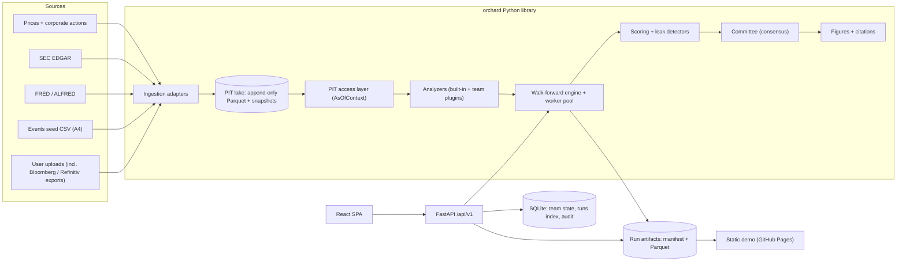

### Decision table (ADR candidates)

| ID | Decision | Recommendation | Main alternative kept on file |
|---|---|---|---|
| ARC-ADR-01 | Overall system shape | Library + CLI core → FastAPI → React SPA; plus static snapshot build | Streamlit-only UI (emergency fallback) |
| ARC-ADR-02 | Front-end framework | Vite 8 + React 19 + TypeScript + TanStack Router/Query + Tailwind 4 + shadcn/ui | Next.js 16 |
| ARC-ADR-03 | Charting | TradingView Lightweight Charts 5 (price/events) + Apache ECharts 6 (statistical charts) in the UI; **matplotlib server-side** for report-grade exports | Plotly (one spec for Python and JS) |
| ARC-ADR-04 | Back-end framework | FastAPI 0.163 (native SSE) + Pydantic 2 | Litestar 2 |
| ARC-ADR-05 | Python version & compute | Python **3.14**; NumPy hot loop, pandas 3 at the analyzer boundary, DuckDB for set operations; statsmodels / SciPy / arch / scikit-learn / scoringrules | Polars-first |
| ARC-ADR-06 | Storage / PIT store | Parquet PIT lake + DuckDB 1.5 (query engine) + SQLite (state) | DuckDB-only |
| ARC-ADR-07 | Long jobs & progress | In-process process pool + SQLite job table; progress via **polling first, SSE as an enhancement** | arq / RQ + Redis (R2 hosted) |
| ARC-ADR-08 | Plugin system | Folder discovery + `@analyzer` decorator registry + Pydantic params; version = semver + AST code hash; entry points in R2 | Entry points only |
| ARC-ADR-09 | Run configuration | YAML + Pydantic `ExperimentConfig` → JSON Schema → auto-generated UI forms (RJSF shadcn theme) and Monaco YAML editor | TOML |
| ARC-ADR-10 | Team use & identity (R1) | **One shared instance**, browser-only for teammates; team passphrase + name picker; edge auth via Cloudflare protected quick tunnel (UCL e-mail one-time PIN) **or** a small always-on VM | Everyone runs locally |
| ARC-ADR-11 | Deployment | Local `uv` + `pnpm`; one Docker image; R1 host = product owner's Mac + tunnel (default) or Azure-for-Students VM; static snapshot on GitHub Pages | Free PaaS (rejected: too small / ephemeral) |
| ARC-ADR-12 | API & TS client | REST + OpenAPI 3.1 (FastAPI) → **Orval** → typed TanStack Query hooks + MSW mocks; contract-first so UI and backend tracks run in parallel | openapi-typescript + openapi-fetch |
| ARC-ADR-13 | R2 LLM idea→analyzer | an LLM API with structured output → **Docker sandbox** (no network, read-only) → automated validation gate (lint, contract, PIT suite, baselines) → human approval | E2B hosted sandbox |
| ARC-ADR-14 | Licence & docs | Code **MIT**; docs/KB and curated event data **CC BY 4.0**; R1 no docs site, R2 Zensical (fallback: pinned Material for MkDocs 9.x) | Apache-2.0; Docusaurus |
| ARC-ADR-15 | Idea-card intake | In-app form that writes a YAML file to `ideas/` (git-tracked, readable by the coding agent) | GitHub Issue Forms (R2, public contributors) |

### What the product owner gets on day 8 (R1 architecture slice)

1. `orchard ingest all` builds the PIT lake from free sources; `orchard snapshot create` freezes it with a content hash.
2. Any analyzer (built-in or team plugin) runs walk-forward over any window with **monthly origins × 5 horizons** in seconds, scored against baselines, and is **refused a "validated" badge unless it passes the leak-detection suite**.
3. A committee of validated analyzers produces the **12-month consensus predictive distribution** that the report's prediction is based on, with PIT weights and attribution.
4. Every report figure is regenerated by one command from run IDs, with caption, source line and Harvard citations.
5. Teammates use it in a browser (no install); the professor can open a static demo link.

### Top risks the architecture is designed around

Timeline (17 days to deadline, ~8 to R1) → contract-first parallel tracks and explicit cut lines (section 12). Look-ahead bugs → defence in depth (section 4). Licensed data leaking into a public repo → three independent guards (section 10). Teammates on Windows without Python → browser-only access (ARC-ADR-10).

---

## 1. Context & quality attributes

### 1.1 Scope recap (traceability)

| Need | Source | Architectural consequence |
|---|---|---|
| Backtest any idea over any window with zero look-ahead | V-01, V-02, constraint 6 | PIT access layer is the *only* data path for analyzers (section 4) |
| Ideas as indicators, fundamentals, events, user data, natural language | V-03, V-08, V-11 | Generic bitemporal `observations` table + typed accessors; user upload validator; R2 LLM generator |
| Probabilistic forecasts, combined into one decision | V-06, V-09 | Fixed forecast contract (quantile grid per horizon) so any two analyzers are combinable; committee implements the analyzer interface |
| Team workflow | V-10 | Shared instance, authors on every artifact, idea cards in git |
| Pro UI / demo / GitHub | V-12, V-14, V-15 | Real SPA, static demo build, recruiter-grade repo hygiene |
| Report grading: data analysis 20%, figures 15%, citations 15% | coursework brief | Report-grade figure renderer, provenance → citations pipeline |
| R1 in ~7 working days; no in-app LLM in R1 | constraints 1, 3 | Library-first, boring tech, explicit cut lines; LLM path designed but deferred |
| Licensed data cannot be redistributed | constraint 5 | Licence flag on every dataset; gitignore + CI guard + export guard |

### 1.2 Assumptions

| ID | Assumption | Impact if wrong |
|---|---|---|
| ARC-A-01 | **[A]** The product owner (PO) has ~8–10 focused hours/day from 18 to 25 Nov and can run 2 coding-agent sessions in parallel (two git worktrees: backend, frontend). | Cut lines in section 12 trigger earlier. |
| ARC-A-02 | **[A]** At least 3 of 5 teammates are non-coders, some on Windows; none should need to install Python/Node. | If all are technical, local installs (uv + pnpm) become viable and hosting matters less. |
| ARC-A-03 | **[A]** Data volume is small: one stock, ~11.5k daily bars since Dec 1980, a few hundred macro/fundamental series, a few hundred events. Everything fits in memory (< 200 MB). | None realistic for R1–R2. |
| ARC-A-04 | **[A]** Concurrency is tiny (≤ 5 simultaneous users, ≤ 10 queued backtests). | A queue/broker becomes necessary only for a public R2 instance. |
| ARC-A-05 | **[A]** The repository stays **private until the coursework is submitted**, then becomes public for R2 (see ARC-Q-02). | If public from day 1, the licensed-data guards must be in place before the first push. |
| ARC-A-06 | **[A]** A2 owns the forecast semantics (horizons, quantile grid, scoring defaults); this document proposes technical defaults compatible with A2's brief: horizons 5/21/63/126/252 trading days, predictive distribution of forward log-return. | Schema constants change; the design does not. |

### 1.3 Local environment (checked 2026-11-17)

**[F]** macOS 27.2.1 on arm64; system Python **3.9.0**; Node **26.13.0** (Node 26 is the current LTS line, "Lithium", since 26.13.0 [S-34]); Docker **29.9.2**; git 2.56.0. **`uv` and `pnpm` are not installed.** Node ≥ 25 no longer bundles Corepack [S-34], so pnpm must be installed explicitly (`npm install -g corepack && corepack enable`, or `npm i -g pnpm@12`). **[R]** Never use the system Python 3.9; `uv` installs and pins Python 3.14 per project.

### 1.4 Architectural drivers, ranked

Each driver is written as a testable quality-attribute scenario.

| Rank | ID | Driver | Scenario (stimulus → response → measure) |
|---|---|---|---|
| 1 | ARC-QA-01 | **PIT integrity** | An analyzer is run at origin *t* on a store where every value with `available_at > t` has been scrambled → its forecast is bit-identical to the run on the clean store → 100% of registered analyzers pass in CI; a deliberately leaky canary analyzer fails. |
| 2 | ARC-QA-02 | **Time-to-R1** | PO + the coding agent build the R1 slice → usable by teammates on 25–26 Nov → critical path ≤ ~55 agent-assisted hours (≈ 6 working days), all other work in parallel tracks (section 12); nothing on the critical path depends on an unfamiliar technology. |
| 3 | ARC-QA-03 | **Extensibility** | A teammate's idea card arrives → the coding agent implements it as a plugin → available in the UI after a reload, with tests and PIT badge → ≤ 60 min for a typical idea, ≤ 40 lines of analyzer code for a simple one. |
| 4 | ARC-QA-04 | **Reproducibility & audit** | Any run ID → `orchard runs verify <id>` → identical forecasts (bitwise on same lockfile and machine class; rtol ≤ 1e-9 otherwise); every number in the report traces to a run manifest and data snapshot hash. |
| 5 | ARC-QA-05 | **Demo-ability without a server** | Professor/recruiter opens a link → explores consensus forecast, runs, figures, events → static site, no backend, loads < 3 s. |
| 6 | ARC-QA-06 | **UX performance** | User pans a 46-year daily chart / changes horizon → response < 100 ms; INP ≤ 200 ms ("good" per web.dev [S-26]). |
| 7 | ARC-QA-07 | **Portability / one-command setup** | Recruiter clones repo → `docker compose up` (or `uv run orchard demo`) → working app with demo data in < 5 min. |
| 8 | ARC-QA-08 | **Licence safety** | A licensed export is uploaded → it is usable in-app, never committed, never exported into the static demo → CI and export guard block it. |

Explicitly **not** drivers for R1: horizontal scalability, multi-tenancy, high availability, real-time data.

### 1.5 Architecture principles

| ID | Principle | What it means in code |
|---|---|---|
| ARC-P-01 | **Truncate, don't mask** | Analyzers receive data *physically cut* at the decision time. A future row cannot leak because it is not in memory that the analyzer can reach. |
| ARC-P-02 | **One door in, one door out** | Analyzers read only via `ctx.data` (PIT) and return only a `Forecast`. Realised outcomes come from a separate `OutcomeOracle` that analyzers cannot import. |
| ARC-P-03 | **Everything is a run** | Backtests, committee evaluations, the "live" 12-month forecast and figure renders are all runs with manifests. Nothing in the report comes from an unlogged computation. |
| ARC-P-04 | **The committee is just another analyzer** | The consensus implements the analyzer contract, so it is backtested, scored and leak-tested with the same machinery. |
| ARC-P-05 | **As-of is a request parameter** | Every read endpoint accepts `asof`; the UI's time-machine control just sets it. |
| ARC-P-06 | **Library first, server second, UI third** | All logic is callable from Python/CLI. The API adds no business logic beyond orchestration and auth. |
| ARC-P-07 | **Immutable artifacts, mutable catalogue** | Run folders and lake files are write-once; SQLite holds only collaborative state and an index that can be rebuilt from artifacts (`orchard reindex`). |
| ARC-P-08 | **Provenance is data** | Each series carries source, licence, PIT-quality grade and citation key; figures and tables inherit them automatically. |

---

## 2. Option analyses (ADR candidates)

Scoring: 1 (poor) – 5 (excellent). Weights reflect the driver ranking above. Scores are the architect's judgement, not measurements.

### ARC-ADR-01 — Overall system shape

**Context.** We need a credible PIT engine, a pro UI, collaboration for 5 people and a server-less demo, in ~7 days.

| Option | PIT by construction (×3) | Time-to-R1 (×3) | Pro UX (×2) | Server-less demo (×1) | Portfolio signal (×1) | Weighted |
|---|---|---|---|---|---|---|
| **A. Python library + CLI → FastAPI → React SPA (+ static snapshot mode)** | 5 | 3 | 5 | 4 | 5 | **41** |
| B. Python-only UI (Streamlit / Dash / Panel) over the library | 5 | 5 | 2 | 1 | 2 | 37 |
| C. Static-only: precomputed JSON + Pyodide / DuckDB-WASM in the browser | 3 | 2 | 4 | 5 | 4 | 31 |
| D. Next.js full-stack, Python as a sidecar service | 4 | 2 | 5 | 3 | 4 | 33 |

**Decision [R].** Option A. Borrow C's idea only for the read-only demo: the SPA gets a `SnapshotClient` adapter that reads exported JSON (section 3.4).

**Consequences.** Two languages and two toolchains. Mitigated by OpenAPI-generated types (ARC-ADR-12) and by keeping the API thin. **Fallback:** because the core is a library, a 1-file Streamlit "lab" page could be stood up in ~2 hours if the React UI were badly late (ARC-RSK-01). Revisit if: R1 front-end is < 50% done by end of day 5.

### ARC-ADR-02 — Front-end framework

| Option | Version (npm, 2026-11-17) | For | Against |
|---|---|---|---|
| **Vite + React SPA** | vite 8.3.8, react 19.3.1, @tanstack/react-router 1.170.46, @tanstack/react-query 5.108.0, tailwindcss 4.3.5, shadcn CLI 4.23.0 — all MIT | Pure client bundle → trivially static-hostable (GitHub Pages) and servable by FastAPI from one process; huge component ecosystem (shadcn/Radix, TanStack Table, cmdk); the coding agent is highly fluent; Vite 8 uses the Rust bundler Rolldown by default (stable since 12 Mar 2026) [S-32]; TanStack Router gives **type-safe URL search params**, ideal for shareable `?asof=2019-01-02&h=252` states | No SSR (irrelevant: no SEO need, data comes from Python) |
| Next.js | next 16.4.6 (MIT) | Polished framework, image/font optimisation | Server components / route handlers duplicate what FastAPI does; static export has constraints; two servers in dev; more concepts for the agent to get wrong |
| SvelteKit | @sveltejs/kit 3.3.0 (MIT) | Small bundles, elegant | Smaller finance-chart and component ecosystem; less agent fluency; shadcn-svelte lags |
| Streamlit / Dash / Panel | streamlit 1.67.0 (Apache-2.0), dash 4.5.0 (MIT), panel 1.10.0 (BSD) | Fastest to first screen; Python only | Script-rerun model is awkward for long jobs and linked charts; looks like "a Streamlit app", not a product (fails V-12/V-15); no static demo |

**Decision [R].** Vite + React 19 + TypeScript, TanStack Router (hash-history build for GitHub Pages) + TanStack Query, Tailwind CSS 4 + shadcn/ui (Radix primitives, MIT; officially updated for Tailwind v4 and React 19 [S-35]), TanStack Table 9 + TanStack Virtual for grids, cmdk for ⌘K, Zustand for UI-only state. A6 owns the visual design system; this ADR only fixes the technical stack. **TypeScript 7.0.x** (the Go-native compiler, stable since mid-2026 [S-33]) for type-checking; if a tool needs the TS programmatic API (expected in 7.1 [S-33]), pin that tool to TS 6 in isolation.

### ARC-ADR-03 — Charting (interactive) and report figures (static)

Charts needed: price/volume with event markers and macro overlays (~11.5k daily points); fan charts; calibration/reliability diagrams; PIT histograms; metric heatmaps; committee weights over time; leaderboards with sparklines.

| Option | Licence / version | Strength | Weakness |
|---|---|---|---|
| **TradingView Lightweight Charts** | Apache-2.0, 5.3.0 | Canvas, built for long financial series; buttery pan/zoom; markers API for events | Financial-only; licence requires the NOTICE attribution plus a visible link to tradingview.com — the `attributionLogo` option satisfies the link part, the notice must still be shown (e.g. in About) [S-27] |
| **Apache ECharts** | Apache-2.0, 6.1.0 | Everything statistical (custom series for fan bands, heatmaps, dataZoom, LTTB sampling); v6 adds a new default theme and runtime dark-mode switching [S-28]; SVG renderer for vector export | Option-object API is verbose (mitigation: pure "option builder" functions, unit-tested) |
| Plotly (plotly.js 4.3.0 / plotly.py 7.1.0, MIT) | MIT | Same figure JSON in Python and JS; static export | Heavy bundle; generic look; static export needs a headless browser (Kaleido) |
| Vega-Lite / Altair 6.3.0 + vl-convert 1.9 | BSD-3 | One declarative spec on both sides; no browser needed for static export | Interactive finance UX (crosshair, linked cursors) weaker; perf on dense series |
| Observable Plot 0.6.19 (ISC) / visx 4.0.0 (MIT) | permissive | Beautiful static / fully custom | Plot is not built for rich interaction; visx = build every chart by hand |
| Recharts 3.11.0 (MIT) | MIT | Default in shadcn "charts" | SVG; slow at 10k+ points |
| uPlot 1.6.32 (MIT) | MIT | Fastest time-series | Minimal features; last release Mar 2025 |

**Report figures.** The report needs ~8–12 publication-quality figures with captions, figure numbers and source lines. Two ways: (a) export from the browser (ECharts SVG + composed caption), or (b) render server-side with matplotlib 3.11 from run artifacts.

**Decision [R].** UI: **Lightweight Charts** for the price/explorer view, **ECharts** for all statistical charts. Report: **server-side matplotlib** is the canonical path — deterministic, vector PDF/SVG, unit-testable with image comparison (pytest-mpl 0.19), and gives the strongest reproducibility claim: *"every figure in our report is regenerated by `orchard figures render report.yaml`"*. Client-side PNG export is a convenience only (cut line). **Consequence:** ~6 chart kinds exist twice (TS option builder + Python renderer). Accepted: each is ~40–80 lines and both read the same artifact schema.

### ARC-ADR-04 — Back-end framework

| Option | Version / licence | For | Against |
|---|---|---|---|
| **FastAPI** | 0.163.2 (MIT), Python ≥ 3.11 | Pydantic-native; OpenAPI 3.1 for free; **native Server-Sent Events** (`fastapi.sse.EventSourceResponse`, since 0.135.0 [S-09]); largest community; the coding agent very fluent | Pre-1.0 versioning (pin exact minor) |
| Litestar | 2.25.0 (MIT) | Faster, more batteries (DTOs, channels) | Smaller community; less agent fluency |
| Django 6.1 (+ Ninja) | BSD-3 | Admin UI, auth, ORM | Heavy for a stateless compute API; two model systems (ORM + Pydantic) |
| No backend (precomputed JSON + Pyodide / DuckDB-WASM) | — | Zero ops | Cannot run teammates' backtests or hold shared state (fails V-10) |

**Decision [R].** FastAPI + Pydantic 2.14 + uvicorn 0.54, single process (`--workers 1`; compute happens in the worker pool, ARC-ADR-07). The API also serves the built SPA as static files, so production is **one process, one port**.

### ARC-ADR-05 — Python version and compute stack

**Python version.** **[F]** Python 3.15.0 was released 9 Oct 2026 [S-08]; 3.14 is a year old. Wheels checked on PyPI (2026-11-17): numpy 2.5.5, scipy 1.18.1, pandas 3.1.1, statsmodels 0.15.0, arch 9.0.0, scikit-learn 1.9.1, pyarrow 26.0.1 and matplotlib 3.11.2 ship cp314 **and** cp315 wheels for macOS arm64 and Windows; **duckdb 1.5.6 ships up to cp314 only** (2.0.0 ships abi3 wheels). numpy ≥ 2.5 and scipy ≥ 1.18 require Python ≥ 3.12. **[R] Python 3.14**, pinned in `.python-version`, installed by `uv`. Revisit 3.15 in R2.

**Data-frame engine.**

| Option | For | Against |
|---|---|---|
| **NumPy hot loop + pandas 3 at the analyzer boundary + DuckDB for set operations** | pandas 3.0 (21 Jan 2026) made Copy-on-Write the only mode — slices behave as copies, which is exactly what read-only PIT frames want — and added a dedicated `str` dtype [S-07]; statsmodels/arch/scikit-learn all speak pandas/NumPy; teammates' and the coding agent's idioms are pandas | pandas is slower than Polars (irrelevant at 11.5k rows) |
| Polars-first (polars 2.1.0, MIT) | Fast, strict, lazy | Conversions at every statsmodels/arch call; two idioms in one codebase |
| Pure NumPy | Fastest | Poor ergonomics for analyzer authors |

**Modelling libraries [R]:** statsmodels 0.15 (OLS/HAC, logistic, quantile regression), SciPy 1.18 (distributions, optimisation), **arch 9.0** (GARCH/GJR, bootstrap; NCSA licence, permissive), scikit-learn 1.9 (isotonic/logistic calibration, CV), LightGBM 4.7 (R2 ML analyzer), **scoringrules 0.12.0** (Apache-2.0, released 2026-11-08; CRPS, log score, energy score, interval score) as the reference implementation for proper scoring rules — Orchard's own vectorised quantile-based CRPS/pinball are cross-checked against it in tests. `properscoring` (last release 2015) is **not** recommended.

### ARC-ADR-06 — Storage for a bitemporal PIT store

Requirements: append-only history with vintages; fast as-of slices; content-hashable snapshots for reproducibility; exportable to static demo; licensed data separable; zero-ops for teammates and recruiters.

| Option | For | Against |
|---|---|---|
| **B. Parquet PIT lake + DuckDB engine + SQLite for team state** | Parquet files are immutable, hashable (snapshot = Merkle root of file hashes), portable (pandas, DuckDB, DuckDB-WASM), easy to partition by licence; DuckDB gives SQL over Parquet incl. native `ASOF JOIN` [S-06]; SQLite is the most battle-tested embedded OLTP store (idea cards, committees, job status updates from a web server) and DuckDB can `ATTACH` it for analytical joins | Two embedded engines to understand |
| A. DuckDB file for everything | One engine | **One read-write process per database file** (other processes can only open read-only, and not while a writer holds it) [S-05] — awkward with a worker pool; ORM/migration story weaker than SQLite's |
| C. Postgres (+TimescaleDB) | Real concurrency, mature | A server to run on every laptop and for every recruiter; no benefit at < 200 MB; Docker becomes mandatory |
| D. SQLite only | One file | Weak analytics; no content-addressed snapshots |
| E. DuckLake (lakehouse format with catalog, snapshots/time travel) | Built-in snapshots | Newer; more moving parts — `UNVERIFIED` maturity; revisit R3 |

**Versions [F]:** DuckDB 2.0.0 LTS shipped 21 Oct 2026, supported until at least Oct 2027; DuckDB 1.5 support was extended to Mar 2027; 2.0 reads 1.x files but older versions cannot read 2.0 files; the DuckDB team suggests waiting for the first patch release (planned for November) for critical workloads [S-04]. **[R]** Pin **`duckdb==1.5.*`** (1.5.6, cp314 wheels) for R1 — mature and what the coding agent knows best; upgrade to 2.0.x in R2 after 2.0.1 (one-way file upgrade is fine because the lake is Parquet and the DuckDB database is only views). SQLite via SQLModel 0.0.50 (on SQLAlchemy 2.x; latest 2.1.9) + **Alembic 1.20 from day 1** (team state must survive schema changes mid-week).

**Decision [R].** Option B. Process rule: the API process owns `state.sqlite` (WAL mode); worker processes **never** open it — they read the snapshot's Parquet files into memory and write results into their own run folder.

### ARC-ADR-07 — Execution of long backtests and progress streaming

| Option | For | Against |
|---|---|---|
| **In-process `ProcessPoolExecutor` (spawn) managed by a small JobManager; jobs table in SQLite; progress via a multiprocessing queue → in-memory pub/sub** | No Redis/broker; true parallelism for CPU-bound fits; cancellation via shared flag; crash isolation from the API | Jobs die with the API process (acceptable: mark as `interrupted`, re-run is cheap and deterministic) |
| Threads (asyncio + thread pool) | Simplest | GIL-bound for Python-heavy analyzers (free-threaded builds not yet a safe default for the scientific stack) |
| arq 0.28 / RQ 3.0 + Redis | Durable, multi-host | Redis on every machine; extra container |
| Celery 5.7 | Industry standard | Heavy configuration for 5 users |
| Huey 3.5 (SQLite backend) / Dramatiq 2.2 / Procrastinate 3.11 (Postgres) | Lighter queues | Still a separate worker process to supervise; little gain over a pool |

**Progress transport.** **[F]** FastAPI supports SSE natively [S-09]; **Cloudflare Quick Tunnels do not support SSE and cap at 200 in-flight requests** [S-16]. **[R]** Polling `GET /api/v1/jobs/{id}` (TanStack Query `refetchInterval: 1000`) is the baseline; SSE (`GET /api/v1/jobs/{id}/events`) is used automatically when the connection supports it. WebSockets are unnecessary (one-way updates).

**Granularity.** One job = one run; a run's origins are split into chunks (e.g. 8 chunks) executed in parallel — legal because analyzers are stateless across origins (enforced by leak test T3, section 4.6). Worker env sets `OMP_NUM_THREADS=OPENBLAS_NUM_THREADS=MKL_NUM_THREADS=VECLIB_MAXIMUM_THREADS=1` (no oversubscription; deterministic BLAS reductions). Pool size = `min(cpu_count − 2, 6)`.

**Decision [R].** In-process process pool for R0–R2 local/single-host; swap the `JobRunner` interface to arq/RQ only if a public multi-instance deployment ever exists (R3).

### ARC-ADR-08 — Analyzer plugin system

| Option | For | Against |
|---|---|---|
| **Folder discovery + `@analyzer` decorator registry (+ entry points for external packs in R2)** | Drop a folder, reload, done; no reinstall; metadata next to code; works with hot reload | Need our own discovery code (~80 lines) |
| Python entry points only (`[project.entry-points."orchard.analyzers"]`) | Standard, supports pip-installed packs | Every new plugin needs a `pyproject` edit + reinstall; friction for the idea-card loop |
| pluggy 1.7 hooks | Mature (pytest uses it) | Designed for hook chains, not a typed registry of classes with metadata |
| Declarative-only (A5's DSL in YAML) | No code | Cannot express every idea; still needs a code path — **complementary**: DSL specs compile into an analyzer at load time |

**Design [R].**
- Plugin roots: `packages/orchard-analyzers/src/orchard_analyzers/builtin/**` and `.../team/**` (and `ORCHARD_PLUGIN_PATHS` for local experiments). Discovery walks packages with `pkgutil.walk_packages`, imports modules, and the decorator registers classes into a `Registry`.
- **Manifest = decorator arguments** validated by a Pydantic `AnalyzerSpec`: `id` (`category.slug`), `name`, `version` (semver), `category` (A5 taxonomy), `authors` (handles), `idea_card` (e.g. `IC-007`), `hypothesis`, `data` (declared series patterns — used to preload data, compute provenance/citations, and fail fast if data is missing), `horizons`, `min_history_days`, `refit` (`never|monthly|quarterly|yearly`), `concepts` (course concepts, A5), `references`, `status` (`draft|validated|retired`).
- **Params** = nested Pydantic model → JSON Schema → UI form.
- **Version identity:** `analyzer_version_id = sha256(id, semver, code_hash, params_schema_hash, sdk_major)[:16]`. `code_hash` hashes the **AST** (docstrings stripped) of the plugin module plus in-repo modules it imports, so formatting-only edits don't create new versions but logic changes always do — even if the author forgets to bump semver (a CI warning nags them).
- **Lifecycle gate:** only `validated` versions (passed PIT suite + own tests + ran vs baselines) can join a committee; enforced in the API and in CI.
- **Scaffolding:** `orchard plugin new --idea IC-007` creates `team/ic007_<slug>/{analyzer.py, test_analyzer.py, README.md}` from a template (the template is also the coding agent's recipe).
- **Dependency boundary:** analyzers may import only `orchard.sdk` (+ numpy/pandas/scipy/statsmodels/arch/sklearn). Enforced statically (section 4.5).

### ARC-ADR-09 — Run configuration format

| Option | For | Against |
|---|---|---|
| **YAML + Pydantic `ExperimentConfig` + exported JSON Schema** | Human-friendly, comments allowed; Pydantic validates and fills defaults; JSON Schema drives (1) form generation, (2) Monaco YAML autocompletion (monaco-yaml 5.5.1), (3) VS Code validation via `# yaml-language-server: $schema=` | YAML gotchas (Norway problem) → mitigated by schema validation and quoting dates |
| TOML | Simple, typed | Awkward for lists of nested objects (committee members, grids) |
| JSON | Universal | No comments, unfriendly by hand |
| Python config files | Unlimited power | Not hashable as data; arbitrary code; unsafe for R2 |
| Hydra / OmegaConf | Composition, sweeps | Heavy, its own mental model |

**Decision [R].** YAML on disk and in the editor; JSON on the wire; canonical JSON (RFC 8785 JCS) for hashing **after** default-resolution (so omitting a default and stating it explicitly give the same `config_hash`) and after resolving `data_snapshot: latest` to a concrete ID. Forms: **@rjsf/core 6.11 with the @rjsf/shadcn theme** (6.11.1, MIT) plus 4 custom widgets (series picker, date with trading-calendar, horizon multi-select, analyzer picker). Full example in section 3.3(b).

### ARC-ADR-10 — Multi-user model and how teammates actually use it (R1)

The honest constraints: 5 people, some non-technical and on Windows, ~1 week of use, the PO implements idea cards with the coding agent on his Mac, licensed data must stay private.

| Option | Setup for teammates | Shared state | Cost | Uptime | Licensed data | Verdict |
|---|---|---|---|---|---|---|
| A. Everyone runs locally (uv + pnpm, or Docker Desktop) | High (install Python/Node or Docker+WSL2 on Windows) | None — each has their own DB; consensus needs manual merging | Free | Each laptop | Copies on 5 machines | **Reject for non-coders**; fine for technical teammates who write plugins |
| **B. PO-hosted instance on the Mac + Cloudflare *protected* Quick Tunnel** | Zero: open a link, enter a one-time PIN sent to their UCL e-mail | Single source of truth | Free | Only while the Mac is awake and online | Stays on the PO's machine | **Recommended default** |
| C. Small always-on VM (Azure for Students: $100 credit for 12 months, no credit card [S-19]) running the same Docker image + named tunnel or Caddy | Zero | Single | Free (credit) | Always on | On a private VM | **Recommended upgrade** if B's uptime is a problem |
| D. Free PaaS (Render free: spins down after 15 min, ~512 MB, ephemeral disk [S-11]; Koyeb: one 512 MB / 0.1 vCPU instance, scale-to-zero after 1 h [S-14]; Fly.io: no free tier for new accounts, trial only (`UNVERIFIED` primary) [S-12]; Railway: $5 trial then $1/month credit [S-13]; Hugging Face: **Docker Spaces now require a paid plan to create** [S-10]) | Zero | Lost on restart without external storage | Free | Sleeps | On a third-party PaaS | **Reject**: too little RAM/CPU for model fitting, ephemeral disks lose team state |
| E. GitHub Codespaces per teammate (Free plan: 120 core-hours + 15 GB-month per month [S-15]) | Browser, but a VS Code UI | Per-teammate (no sharing) | Free within quota | On demand | In each codespace | **Offer to technical teammates** who want to write plugins themselves |
| F. Static snapshot (GitHub Pages) | Zero | Read-only | Free | Always | Excluded by export guard | **Always on in parallel** for viewing results; the professor's link |

**Why B by default.** It matches the R1 workflow: idea cards are written to `ideas/` on the PO's disk, the coding agent implements the plugin in the same checkout, the API hot-reloads the registry, and teammates see the new analyzer minutes later — no deploy pipeline on the critical path. **[F]** Since 2 Oct 2026, Quick Tunnels can be restricted with `--allowed-mail` to specific addresses or a whole e-mail domain, with a one-time PIN; visitors don't need a Cloudflare account [S-17]. **Caveats [F]:** Quick Tunnels carry no SLA, don't support SSE and cap in-flight requests at 200 [S-16] (hence polling-first, ARC-ADR-07); the URL changes when `cloudflared` restarts. Tailscale Funnel is an alternative (available on all plans, beta, ports 443/8443/10000, non-configurable bandwidth limits; on macOS it requires the open-source Tailscale variant) [S-18].

**Identity in-app [R].** No passwords. A **team passphrase** (env var, constant-time compare) unlocks a signed session cookie; the user then picks their name from `configs/authors.yaml` (handles only, no e-mails). Every mutating request records `author_id` in the audit log. This is honest about what it is: attribution, not security; the security boundary is the tunnel/VM.

**R2.** Public showcase = static site (F) + an optional read-only live instance; any write or LLM action requires GitHub OAuth.

### ARC-ADR-11 — Deployment topology

| Target | How | Release |
|---|---|---|
| Developer (PO) | `uv sync && pnpm -C web install && just dev` → uvicorn `--reload` on :8000 + Vite dev server on :5173 with `/api` proxy | R0 |
| Team instance | `just serve` (builds SPA into `orchard/server/static`, runs one uvicorn process) + `cloudflared tunnel --url http://localhost:8000 --allowed-mail <ucl domain>` + `caffeinate -i` | R1 |
| Team instance (fallback) | Same Docker image on an Azure-for-Students VM (B-series), `docker compose up -d`, data volume, nightly `orchard snapshot create` | R1 fallback |
| Recruiter / any machine | `docker run -p 8000:8000 ghcr.io/<owner>/orchard:demo` (image contains only redistributable demo data) — or `git clone … && docker compose up` | R2 |
| Static demo | `orchard export static --profile demo` → `web` build with `VITE_DATA_MODE=snapshot` → GitHub Pages via Actions (site ≤ 1 GB, soft 100 GB/month bandwidth [S-20]) | R1 (cut line) / R2 |
| Hosted live (optional) | Same image on any container host; Vercel Hobby is non-commercial only [S-21]; Cloud Run has an always-free monthly allowance (billing account `UNVERIFIED`) [S-22] | R3 |

**Docker image [R]:** multi-stage — `node:26-slim` builds the SPA (pnpm via `npm i -g corepack && corepack enable`), `python:3.14-slim` + `uv sync --frozen --no-dev` runs it, non-root user, `HEALTHCHECK` on `/api/v1/health`, volumes for `data/` and `artifacts/`. One image for every target.

### ARC-ADR-12 — API style and TypeScript client generation

| Option | Version / licence | For | Against |
|---|---|---|---|
| **REST + OpenAPI 3.1 → Orval** | orval 8.48.0 (MIT), msw 3.0.6 (MIT) | Generates typed **TanStack Query hooks**, zod validators and **MSW mock handlers** from one spec → the UI track can start against mocks on day 1 | Generator config to maintain |
| openapi-typescript + openapi-fetch | 7.13.0 / 0.17.0 (MIT) | Type-only, tiny runtime | No hooks/mocks; last release Feb 2026 |
| @hey-api/openapi-ts | 0.99.0 (MIT) | Hooks plugin | Pre-1.0 churn |
| GraphQL / tRPC / gRPC | — | Flexible queries / end-to-end types | Over-engineered here; tRPC needs a TS server |

**Decision [R].** FastAPI is the source of truth; `orchard api export-openapi > web/openapi.json` is committed; `pnpm gen:api` runs Orval; CI fails if regeneration produces a diff. Conventions in section 6.

### ARC-ADR-13 — R2: natural-language idea → analyzer code (an LLM API) and sandboxing

**Pipeline [R]** (R2; nothing of this ships in R1):

1. **Intake:** structured idea card (A5 template) — never free-form chat. Idea text is treated as *data*, never as instructions for tools.
2. **Generation:** the LLM provider's Python SDK with a frontier LLM.format` with a JSON schema: `{analyzer_py, test_py, spec, data_requirements, rationale}`). Context = SDK docs, 3 exemplar analyzers, series *metadata* (never licensed values). Model ID and effort are configuration, not code.
3. **Sandboxed validation** (below), with up to 3 automated repair rounds feeding failures back.
4. **Human approval gate:** reviewer sees code diff, validation report, baseline comparison, PIT badge; approval creates an `analyzer_version` with `origin=llm`, `approved_by`, prompt hash and model ID recorded.

**Validation gate (all automatic, ordered cheapest-first):** (a) AST allow-list (imports, no `open`/`eval`/`exec`/dunder access), ruff + pyright; (b) contract: imports, registers, params schema valid, returns a valid `Forecast` on 3 fixture origins; (c) generated unit tests + framework tests; (d) **PIT suite T1–T5** (section 4.6); (e) determinism (two runs, same seed); (f) empirical: backtest vs baselines on the training window only, "too-good-to-be-true" check; (g) cost/time limits.

**Sandbox options.**

| Option | Isolation | Scientific stack | Cost | Verdict |
|---|---|---|---|---|
| Subprocess + `resource` rlimits + audit hooks + import allow-list | **Not a security boundary** — PEP 578: audit hooks are "not sandboxing" [S-25] | Full | Free | Use *inside* a real sandbox as a leak detector, never alone |
| **Docker container per validation job** (`--network none --read-only --cap-drop ALL --pids-limit 256 --memory 2g --cpus 2 --user 65534`, tmpfs work dir, fixture data mounted read-only) | Good for this threat model | Full (same image) | Free, local; Docker already installed | **Recommended** |
| gVisor (`runsc`) runtime for the same container | Stronger | Full | Free; Linux hosts only | R3 hardening for a public host |
| Pyodide / WASM worker | Strong | Partial (Pyodide 314.0.8 exists; whether arch/LightGBM are available is `UNVERIFIED`) | Free | Not for validation; maybe in-browser "what-if" toys (R3) |
| E2B (Firecracker microVMs; Hobby: free with one-time $100 usage credit, 1 h sessions — secondary sources [S-23]) | Strong | Full (custom template) | Credit then usage-based | **Hosted fallback** if a public instance ever allows generation |
| Modal Sandboxes (Starter: $30/month credit [S-24]) | Strong | Full | Credit | Alternative hosted option |
| Provider-hosted code execution / Managed Agents | Strong, provider-run | Preinstalled libs; our data must be uploaded | API usage | Only with redistributable fixture data; ties validation to one vendor — not recommended as the gate |

**Policies [R].** Generated code never runs in the API process; the sandbox gets only redistributable fixture data and the public snapshot (never `data/licensed/`); per-author daily token budget; anonymous public visitors cannot trigger generation; every prompt/response stored for audit. An agent-SDK loop (a coding agent as a library) inside the sandbox is an alternative generator that mirrors the R1 human workflow; prefer the deterministic Messages-API pipeline above for the gate itself.

### ARC-ADR-14 — Licence and documentation site

**Licence.**

| Option | For | Against |
|---|---|---|
| **MIT (code) + CC BY 4.0 (docs, KB, curated event descriptions)** | Ecosystem norm (FastAPI, DuckDB, Polars, React are MIT); shortest, recruiter-familiar; CC BY suits prose and curated data | No explicit patent grant (irrelevant here) |
| Apache-2.0 (code) | Patent grant, NOTICE mechanism | Longer; NOTICE upkeep |
| AGPL / non-commercial | Protects against SaaS reuse | Hurts portfolio adoption; unusual |

**[R]** MIT + CC BY 4.0, plus `CITATION.cff` so the professor can cite the tool. Third-party data is **not** licensed by us and is never committed (section 10). All dependencies above are permissive (MIT/BSD/Apache/ISC/NCSA/PSF-style); Hypothesis (MPL-2.0) and orjson (MPL-2.0 / Apache / MIT) are fine as unmodified dependencies; Lightweight Charts requires the attribution notice and link (ARC-ADR-03).

**Docs site.** **[F]** Material for MkDocs entered maintenance mode in Nov 2025 (critical fixes only) and its team now builds **Zensical**, which reads `mkdocs.yml` [S-29]; MkDocs 2.0 is incompatible with Material and its plugin ecosystem [S-29]. On PyPI, zensical is 0.1.2 (2026-11-17) and mkdocs-material 9.8.1. **[R]** R1: no docs site — README + `docs/` rendered by GitHub (Mermaid renders natively). R2: Zensical after a 1-hour spike on the KB; fallback: pinned `mkdocs<2` + Material 9.x; alternative: Docusaurus 3.10 / Starlight 0.43 if the team prefers JS tooling.

### ARC-ADR-15 — Idea-card intake channel (R1)

| Option | For | Against |
|---|---|---|
| **In-app form → YAML file `ideas/IC-###-slug.yaml` (+ DB index row)** | Teammates stay in one tool; file is in the PO's checkout so the coding agent reads it directly; git history = audit trail; status updated by the PO (`submitted → accepted → implementing → validated → rejected`) | Need a small form (RJSF from the IdeaCard schema — almost free) |
| GitHub Issue Forms (`.github/ISSUE_TEMPLATE/idea-card.yml`) | Free form UI, comments, links to PRs; great public story | Teammates need GitHub accounts and repo access; context switch |
| Shared doc / chat | Zero setup | Unstructured — exactly what the professor criticises |

**[R]** In-app for R1; in R2 add the Issue Form for public contributors, with a GitHub Action that converts issues into `ideas/*.yaml`. Teammates can start **today** with the A5 template as a YAML/Markdown file — no platform needed to begin thinking.


---

## 3. Recommended architecture

### 3.1 Component diagram

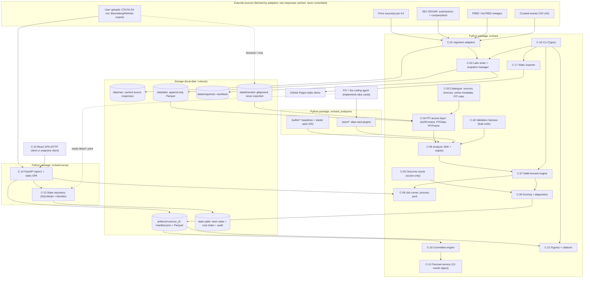

### 3.2 Component responsibilities

| ID | Component | Responsibility | Key interfaces | Must never |
|---|---|---|---|---|
| ARC-C-01 | Ingestion adapters | One adapter per source: fetch (rate-limited, cached in `data/raw/`), parse, assign `available_at` via PIT rules, emit normalised rows | `Adapter.fetch() -> RawBatch`, `Adapter.normalise(RawBatch) -> LakeBatch` | Overwrite existing lake files; guess `available_at` silently (must record the rule used) |
| ARC-C-02 | Lake writer + snapshot manager | Append batches as new Parquet files; validate schemas and keys; create content-hashed snapshots; garbage-collect unreferenced files | `write_batch()`, `create_snapshot() -> SnapshotId`, `load_snapshot(id)` | Mutate a file once written |
| ARC-C-03 | Catalogue | `configs/sources.yaml` (source → licence, redistributable flag, citation template, rate limits), `configs/pit_rules.yaml` (default lags), series metadata | `Catalogue.series(id)`, `Catalogue.citation(source_id)` | Contain secrets |
| ARC-C-04 | PIT access layer | Build `AsOfContext` for an origin; serve truncated, read-only frames; adjusted prices as-of; fundamentals TTM as-of; events without hindsight fields | `PITData.*` (section 4.4) | Return any row with `available_at > ctx.asof` |
| ARC-C-05 | Outcome oracle | Compute realised forward returns for scoring | `OutcomeOracle.forward_log_return(origin, h)` | Be importable from `orchard_analyzers` |
| ARC-C-06 | SDK + registry | Analyzer base class, decorator, Forecast type, calibration helpers (A5 recipes), discovery, code hashing | `@analyzer`, `Analyzer.fit/predict`, `Registry` | Expose storage internals |
| ARC-C-07 | Walk-forward engine | Origin schedule, warm-up, refit schedule, chunking, forecast validation, artifact writing, manifest | `run(config) -> RunResult` | Skip forecast validation |
| ARC-C-08 | Job runner | Process pool, job lifecycle, progress, cancellation, interruption recovery | `submit()`, `cancel()`, `progress()` | Touch `state.sqlite` from workers |
| ARC-C-09 | Scoring | Pinball, quantile-CRPS, log score, Brier + decomposition, coverage, PIT values, hit rate, DM/HAC tests, block-bootstrap CIs, skill vs baselines (A2 formulas) | `score(forecasts, outcomes) -> ScoreTable` | Score holdout origins without an unlock record |
| ARC-C-10 | Committee | Member selection, PIT weights, combination (quantile averaging / linear pool per A2), attribution | Implements `Analyzer` | Use member scores realised after *t* |
| ARC-C-11 | Forecast service | Live as-of-today forecasts; the **final 12-month forecast object** (price quantiles, P(up), P(return > x), scenarios) | `final_forecast(committee_id, asof)` | Run without a frozen config |
| ARC-C-12 | Figures + citations | `FigureSpec` → matplotlib SVG/PNG/PDF with caption, number, source line; Harvard references from provenance | `render(spec) -> FigureArtifact` | Render data whose licence forbids the target (e.g. public export) |
| ARC-C-13 | State repository | Authors, idea cards, analyzers index, experiments, runs index, committees, figures, audit log, jobs | SQLModel repos | Hold anything not rebuildable or not collaborative |
| ARC-C-14 | API | Thin orchestration, auth-lite, validation, OpenAPI, SSE/polling, static file serving | `/api/v1/*` | Contain business logic beyond orchestration |
| ARC-C-15 | Web SPA | All screens (A6) | Orval hooks or `SnapshotClient` | Compute anything statistically meaningful (display only) |
| ARC-C-16 | CLI | Everything the API can do, scriptable | `orchard …` (Typer 0.29) | — |
| ARC-C-17 | Static exporter | Export selected runs/committees/figures/events to JSON for the snapshot build; enforce licence guard | `orchard export static --profile demo` | Export `redistributable=false` data |
| ARC-C-18 | Validation harness | Leak suite T1–T8, determinism, contract checks; writes `validation_results` | `orchard validate <analyzer>` | Be skipped for committee members |
| ARC-C-19 | (R2) Generator | Idea card → code via an LLM API → sandbox → gate → approval | — | Run generated code outside the sandbox |

### 3.3 Data flows

#### (a) Ingestion

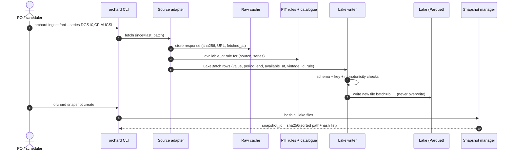

Notes. Vintaged sources (ALFRED realtime periods; EDGAR filings with acceptance timestamps) produce one row per vintage. Sources without vintages (most price feeds) produce one row per value; a later batch that changes a historical value is stored as a **correction** (`revision_kind='correction'`) and flagged in the data-quality report, because silent backfills are a classic PIT hazard. A3 defines the per-source rules; the writer only enforces that every row has a rule.

#### (b) A backtest run

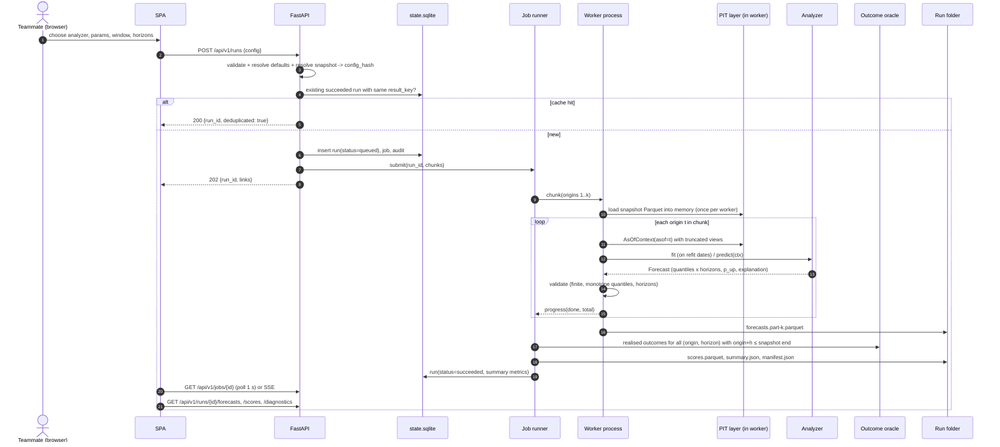

**Example experiment config (YAML)** — what the form produces and what technical teammates can write by hand:

```yaml
# yaml-language-server: $schema=../../schemas/experiment.schema.json
schema_version: 1
name: "TS momentum 12-1, default"
research_question: RQ-momentum          # groups trials for multiple-testing accounting (A2)
analyzer:
  id: tech.tsmom
  version: "1.0.0"                       # or "latest-validated"
  params: {lookback_months: 12, skip_months: 1, n_buckets: 5}
data_snapshot: latest                    # resolved to a concrete sha at submit time
window: {start: "1995-01-01", end: "2021-12-31"}
origins: {frequency: monthly, anchor: last_session, decision_time: close}
horizons: [5, 21, 63, 126, 252]          # trading days (A2)
holdout: {policy: locked, from: "2022-01-01"}   # scoring refused after this date unless unlocked
baselines: [base.rw_drift, base.bootstrap_iid, base.bootstrap_block]
scoring: {primary: crps, also: [pinball, log_score, brier_up, coverage_80, coverage_95]}
seed: 20261117
compute: {chunks: auto}
```

#### (c) Committee / consensus computation

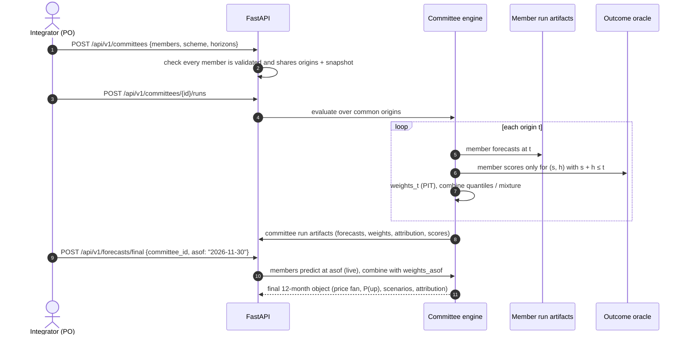

The committee is itself registered as an analyzer (`committee.<id>`), so its backtest scores, calibration plots and leak tests come for free (ARC-P-04). Weight schemes are A2's call; the engine supports at least: equal, inverse-loss over a trailing window, and shrinkage-to-equal.

#### (d) Figure export

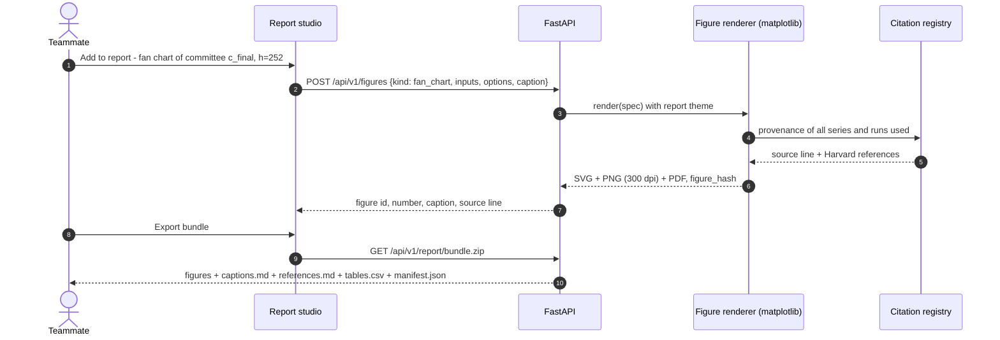

`configs/report.yaml` lists figure specs by stable key (`fig_consensus_fan`, `fig_calibration_top5`, …); `orchard figures render configs/report.yaml` regenerates the whole set deterministically. Source line format: *"Source: Orchard run c_final@3f9a1c (snapshot 8e21…, 2026-11-30); price data: <source>; macro: FRED/ALFRED; fundamentals: SEC EDGAR. Authors' calculations."*

#### (e) R1 idea-card → plugin loop (human + the coding agent)

```mermaid
flowchart LR
  T["Teammate fills idea card form"] --> Y["ideas/IC-012-*.yaml written + status=submitted"]
  Y --> PO["PO triages: accepted / needs-info / rejected"]
  PO --> CC["the coding agent: orchard plugin new --idea IC-012, implements analyzer + tests"]
  CC --> V["orchard validate team.ic012 (leak suite, contract, determinism, baselines)"]
  V -->|pass| R["Registry hot-reload; status=validated; teammate notified in UI"]
  V -->|fail| CC
  R --> RUN["Teammate runs backtests, iterates params via forms"]
  RUN --> COMM["Integrator adds to committee"]
```

### 3.4 Deployment views

**R1 team topology (default).**

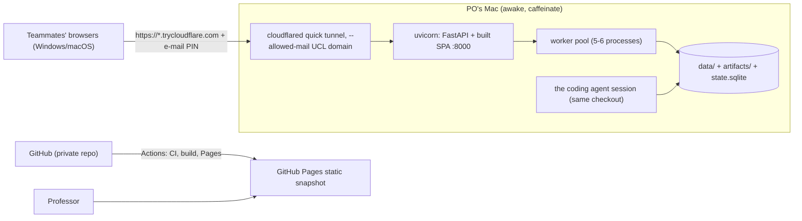

**Static snapshot mode.** `orchard export static --profile demo` writes `web/public/snapshot/` (`meta.json`, `analyzers.json`, `runs/<id>/{summary,forecasts,scores,diagnostics}.json`, `committees/<id>.json`, `events.json`, `series/<id>.json` for redistributable series only, `figures/*.svg`). The SPA's data layer is an interface with two implementations: `HttpClient` (Orval hooks) and `SnapshotClient` (fetches the JSON files); mutation UI is hidden and replaced by "Clone the repo to run your own backtests". Routing uses hash history so deep links work on GitHub Pages.

### 3.5 Process and file layout at runtime

- **API process:** FastAPI app, `JobManager` (asyncio), in-memory pub/sub for progress, sole writer of `state.sqlite` (WAL), registry (re-discovered on plugin change via `watchfiles` 1.3 in dev).
- **Worker processes (spawn):** each loads the run's snapshot into an in-memory `PITStore` once (target ≤ 1.5 s, ≤ 500 MB), imports the analyzer module, processes origin chunks, writes `forecasts.part-<k>.parquet` into the run folder, streams progress over a `multiprocessing` queue. Workers are recycled after N tasks to avoid memory creep.
- **Run folder** `artifacts/runs/run_<ULID>/`: `manifest.json`, `config.yaml` (resolved), `forecasts.parquet`, `scores.parquet`, `summary.json`, `diagnostics.json`, `validation.json` (if any), `logs.jsonl`. Written to a temp folder and atomically renamed on success.

---

## 4. Point-in-time enforcement design

This is the scientific core. Methodological rules (lags, timing conventions, purging) are A2/A3's; this section makes them **mechanically enforceable**.

### 4.1 Time model

| Concept | Definition | Storage |
|---|---|---|
| `period_start`, `period_end` | The reference period a value describes ("valid time"), e.g. fiscal quarter ending 2026-06-27, or the trading session 2026-11-16 | `DATE` |
| `available_at` | Earliest instant the public could know the value ("knowledge time"): EDGAR acceptance timestamp, ALFRED `realtime_start` + release-time rule, session close + delay for prices, user-declared for uploads | `TIMESTAMP WITH TIME ZONE`, stored UTC |
| `ingested_at` | When Orchard learned it ("system/transaction time") — audit and snapshotting only, never used by analyzers | UTC |
| `asof` / decision time | The instant a forecast is made. Default: origin session close (16:00 America/New_York) — information with `available_at ≤ asof` is usable; an earnings release at 16:30 is usable from the next origin | UTC; sessions from `exchange-calendars` 4.13 (XNYS) |

Rules: all timestamps stored UTC; all calendar logic in `America/New_York`; dates-only sources get an explicit time from `configs/pit_rules.yaml` (never midnight by accident). **[R]** Conservative defaults when a source has no timestamp (e.g. "filed date only" → next session 09:30 ET). A2 may also define `decision_time: next_open` for strategy translation; the engine supports `close | close_plus(minutes) | next_open`.

### 4.2 Bitemporal storage schema (PIT lake, Parquet)

`observations` — the generic table for every scalar time series (macro, fundamentals, user data, derived indicators):

```sql
-- data/lake/observations/dataset=<dataset_id>/batch=<ingest_batch_id>.parquet
series_id          VARCHAR    -- 'FRED:DGS10', 'EDGAR:AAPL:us-gaap/Revenues:Q', 'USER:au_03:app_rank'
entity             VARCHAR    -- 'AAPL', 'US', 'CN' …
field              VARCHAR    -- 'Revenues', 'DGS10' …
period_start       DATE
period_end         DATE       -- valid time
value              DOUBLE
unit               VARCHAR
available_at       TIMESTAMPTZ  -- knowledge time (UTC)
available_at_rule  VARCHAR    -- 'edgar:acceptance', 'alfred:realtime_start+release_time', 'lag:+1BD@09:30ET', 'user'
vintage_id         VARCHAR    -- ALFRED realtime_start, EDGAR accession no., or 'b:'||ingest_batch_id
revision_seq       SMALLINT   -- 0 = first release, then 1, 2 …
revision_kind      VARCHAR    -- 'release' | 'revision' | 'restatement' | 'correction'
source_id          VARCHAR    -- FK catalogue
source_ref         VARCHAR    -- URL / accession for citation
pit_quality        VARCHAR    -- 'A' exact timestamp | 'B' rule-based | 'C' assumed (A3 grading)
ingest_batch_id    VARCHAR
ingested_at        TIMESTAMPTZ
-- logical key: (series_id, period_end, vintage_id)
```

`bars` — prices are wide and dense, so they get their own table (stored **unadjusted**):

```sql
symbol, session_date DATE, open, high, low, close, volume DOUBLE,
available_at TIMESTAMPTZ,          -- session close + rule (e.g. 16:00 ET + 15 min)
source_id, vintage_id, pit_quality, ingest_batch_id, ingested_at
```

`corporate_actions` — splits and dividends with their own knowledge time:

```sql
symbol, action VARCHAR,            -- 'split' | 'cash_dividend'
ex_date DATE, ratio DOUBLE NULL, amount DOUBLE NULL,
declared_at TIMESTAMPTZ NULL,      -- announcement (knowledge) time if known
available_at TIMESTAMPTZ,          -- = declared_at, else conservative rule
source_id, source_ref, ingest_batch_id, ingested_at
```

`events` — curated and sourced events (A4 CSV) plus R2 news:

```sql
event_id, event_time TIMESTAMPTZ NULL, event_date DATE, available_at TIMESTAMPTZ,
event_type, subtype, title, description, source_url, source_name,
verification_status, tags VARCHAR[],
importance SMALLINT,               -- HINDSIGHT LABEL: never exposed to analyzers (4.5 L6)
ingest_batch_id, ingested_at
```

Plus `ingest_batches` (id, source, started/finished, row counts, raw file hashes, adapter version) and `snapshots` (section 7). User uploads land in `observations` (or `events`) with `source_id = 'user:<upload_id>'`; licensed ones go under `data/licensed/lake/…` with the same schema.

### 4.3 As-of query semantics

"Value of each reference period, as known at *t*" (latest vintage per period):

```sql
SELECT period_end, value, available_at, vintage_id
FROM observations
WHERE series_id = $sid AND available_at <= $t
QUALIFY row_number() OVER (PARTITION BY period_end
                           ORDER BY available_at DESC, revision_seq DESC) = 1
ORDER BY period_end;
```

"Latest *period* known at each of many origins" (for vectorised panels): precompute a **knowledge timeline** per series — walk rows ordered by `available_at`, keep a running map `period → value`, emit `(available_at, latest_period_known, its_value)` — then:

```sql
SELECT o.origin_ts, k.latest_period, k.value
FROM origins o
ASOF LEFT JOIN knowledge_timeline k
  ON o.series_id = k.series_id AND o.origin_ts >= k.available_at;
```

DuckDB's `ASOF JOIN` matches each left row to the nearest preceding right row on the inequality column; `ASOF LEFT JOIN` keeps origins with no match as NULL [S-06]. In workers the same logic runs in NumPy: per series, arrays sorted by `available_at`, `np.searchsorted(available_at, t, side="right")` gives the visible prefix in O(log n), and a per-series revision index resolves "latest vintage per period" for that prefix (cached per `(series_id, t)`).

**Prices as of *t*.** Bars with `available_at ≤ t`. Adjustment is computed **relative to *t*** using only corporate actions with `available_at ≤ t` and `ex_date ≤ t`: `adj_close_s(t) = raw_close_s / Π{ratio_k : s < ex_date_k ≤ t}` (split basis of *t*); total-return index adds dividends at ex-date. Using today's back-adjusted series inside a 2013 origin would leak the 2014 7:1 and 2020 4:1 splits into price *levels* (returns are unaffected, levels are not) — the accessor makes that impossible. AAPL split ex-dates for tests (1987-06-16, 2000-06-21, 2005-02-28, 2014-06-09, 2020-08-31) to be confirmed by A4.

**Fundamentals as of *t*.** Quarter values from filings with `available_at ≤ t`; TTM = sum of the last four *known* quarters; Q4 derived as FY − (Q1+Q2+Q3) when only the 10-K reports it (EDGAR quirk, A3); restated values replace originals only from their own `available_at`.

### 4.4 Analyzer-facing API (sketch)

```python
# orchard/sdk/context.py  (the ONLY module analyzers may import from orchard)
class AsOfContext(Generic[P]):
    asof: pd.Timestamp                 # decision time, UTC
    origin: pd.Timestamp               # session date of the origin
    horizons: tuple[int, ...]          # trading days, e.g. (5, 21, 63, 126, 252)
    params: P                          # validated Pydantic params
    rng: np.random.Generator           # seeded from (run seed, analyzer id, origin)
    data: PITData
    log: AnalyzerLogger                # structured explanation payload

class PITData:
    def prices(self, symbol="AAPL", *, adjust: Literal["split", "total", "none"] = "split",
               lookback_days: int | None = None) -> PITFrame: ...       # OHLCV ending at asof
    def returns(self, symbol="AAPL", *, kind: Literal["log", "simple"] = "log",
                lookback_days: int | None = None) -> PITSeries: ...
    def series(self, series_id: str, *, vintage: Literal["asof", "first_release"] = "asof",
               lookback_days: int | None = None) -> PITSeries: ...      # e.g. "FRED:DGS10"
    def fundamentals(self, ticker: str, concept: str, *,
                     period: Literal["Q", "FY", "TTM"] = "Q") -> PITSeries: ...
    def events(self, *, types: Sequence[str] | None = None,
               lookback_days: int | None = None) -> EventsFrame: ...    # no 'importance' column
    def past_outcomes(self, symbol="AAPL", *, horizons: Sequence[int]) -> PITFrame: ...
        # (s, h, realised log-return) only where session s+h close <= asof: labels for
        # calibration/training, purged by construction
    def calendar(self) -> TradingCalendar: ...  # past sessions + exchange schedule (holidays are public in advance)
```

`PITFrame` / `PITSeries` are thin wrappers over pandas objects: the underlying NumPy buffers are set `writeable=False`, the index ends at or before `asof`, `.asof` and `.provenance` (source IDs, PIT grade) are attached, and an `.as_pandas()` copy is available for library calls. Example analyzer:

```python
from orchard.sdk import Analyzer, AsOfContext, Forecast, analyzer, recipes
from pydantic import BaseModel, Field

class Params(BaseModel):
    lookback_months: int = Field(12, ge=3, le=24)
    skip_months: int = Field(1, ge=0, le=3)
    n_buckets: int = Field(5, ge=2, le=10)

@analyzer(id="tech.tsmom", name="Time-series momentum (12-1)", version="1.0.0",
          category="technical", data=["prices:AAPL"], horizons=(21, 63, 126, 252),
          min_history_days=756, concepts=["weak-form EMH", "momentum"],
          references=["Moskowitz, Ooi and Pedersen (2012)"], idea_card="IC-003")
class TSMomentum(Analyzer[Params]):
    def predict(self, ctx: AsOfContext[Params]) -> Forecast:
        r = ctx.data.returns("AAPL")
        signal = recipes.momentum(r, ctx.params.lookback_months, ctx.params.skip_months)
        history = ctx.data.past_outcomes("AAPL", horizons=ctx.horizons)
        return recipes.conditional_empirical(signal, history, n_buckets=ctx.params.n_buckets)
```

Analyzers with expensive models implement `fit(ctx) -> State` (called by the engine on refit dates *r*) and `predict(ctx, state)`; the engine guarantees the state used at origin *t* was fit at the latest refit date *r ≤ t* and passes it explicitly — analyzers hold no hidden state between origins.

**Forecast contract (technical, A2 owns semantics).** Per horizon: quantiles of the forward **log-return** on a canonical 23-level grid {0.01, 0.025, 0.05, 0.10, 0.15, …, 0.90, 0.95, 0.975, 0.99}; optional `p_up`, `mean`, `sd`, `signal ∈ [-1, 1]`; `status ∈ {ok, abstain}` (abstentions are counted, not hidden); `explanation` (feature values, short template text, provenance IDs). Validation: finite, non-decreasing quantiles (non-crossing), horizons ⊆ requested, `0 ≤ p_up ≤ 1`.

### 4.5 Isolation: defence in depth

| Layer | ID | Mechanism | Catches |
|---|---|---|---|
| L1 | ARC-PIT-01 | **Physical truncation**: frames contain only rows with `available_at ≤ asof` | Any direct look-ahead through the API |
| L2 | ARC-PIT-02 | **No handles**: analyzers receive no paths, DB connections or store objects; the store lives in a private module | Bypassing the API by reading the lake |
| L3 | ARC-PIT-03 | **Static lint** for `orchard_analyzers`: a nested `ruff.toml` with `flake8-tidy-imports` banned APIs (`os`, `pathlib`, `io`, `shutil`, `socket`, `subprocess`, `requests`, `httpx`, `urllib`, `duckdb`, `pyarrow.parquet`, `pandas.read_*`, `yfinance`, `orchard.pit.store`, `orchard.scoring.oracle`); **import-linter 2.16** contracts (analyzers → only `orchard.sdk`); a 40-line AST check for `open`, `eval`, `exec`, `__import__`, `importlib`, `globals()`, `getattr` on dunders (whether ruff's banned-API rule also catches bare built-ins is to be checked in the spike) | Accidental or lazy shortcuts |
| L4 | ARC-PIT-04 | **Runtime audit hook** (PEP 578, `sys.addaudithook`): while a `predict`/`fit` is executing (context variable), raise `PITViolation` on `open` of any path outside the Python install / site-packages, and on `socket.connect`, `subprocess.Popen`, `os.system`. PEP 578 is explicit that this is "not sandboxing" [S-25] — it is a tripwire for honest code, not a defence against malicious code (that is ARC-ADR-13's sandbox) | Runtime file/network access that static lint missed |
| L5 | ARC-PIT-05 | **Separate outcome oracle** used only by the scorer and committee weights | Labels leaking into features |
| L6 | ARC-PIT-06 | **Hindsight fields stripped**: `events.importance`, curated "regime" labels and any column tagged `hindsight=true` in the catalogue never reach `PITData` | Hindsight bias from curation (A4 warning) |
| L7 | ARC-PIT-07 | **Forecast validation + statelessness**: engine re-instantiates analyzers per chunk and passes state explicitly | Cross-origin state carrying future information |
| L8 | ARC-PIT-08 | **Holdout lock**: scorer refuses origins ≥ `holdout.from` unless the run is `final` and an unlock record (author, time, reason, config hash) exists; every unlock is shown in the UI | Tuning on the test period |

### 4.6 Automated leak detectors (run in CI for every registered analyzer, and on every new plugin)

| ID | Test | Procedure | Pass criterion |
|---|---|---|---|
| ARC-PIT-T1 | **Future poisoning** | For 12 sampled origins *t* (seeded), rebuild the in-memory store with every row having `available_at > t` replaced (modes: NaN, ×10⁶, sign-flip, shuffled, extra future rows appended); run `predict` at *t* | Forecast bit-identical to clean run |
| ARC-PIT-T2 | **Truncation equivalence** | Physically drop all rows with `available_at > t` (a different code path from T1) | Bit-identical |
| ARC-PIT-T3 | **Order independence** | Run the 12 origins chronologically, reversed, shuffled, and in parallel chunks | Bit-identical per origin |
| ARC-PIT-T4 | **Determinism** | Same config twice in fresh processes | Bit-identical (same platform) |
| ARC-PIT-T5 | **Canary series (framework self-test)** | Inject `CANARY:fwd21`: the value for period *p* is the realised 21-session forward log-return from *p*'s close, with `available_at` = close of session *p*+21 (correctly lagged). At every origin *t*, the latest visible canary value must equal the trailing 21-session log-return computed from prices at *t*. Any off-by-one, or use of `period_end` instead of `available_at`, turns it into a *future* return and breaks the equality | Exact equality at every origin |
| ARC-PIT-T6 | **Too-good-to-be-true monitor** | Flags (not fails) runs with e.g. 21-day hit rate > 65% or CRPS skill > 15% over ≥ 100 origins | Human review recorded |
| ARC-PIT-T7 | **Hindsight access** | Attempt to read `importance` via the public API | Raises |
| ARC-PIT-T8 | **Runtime tripwire** | A deliberately leaky fixture analyzer (reads the lake file) | `PITViolation` raised; the suite itself fails if it doesn't |

```python
@pytest.mark.parametrize("spec", registry.all_specs(), ids=lambda s: s.id)
def test_future_poisoning(spec, fixture_store):
    for t in sample_origins(fixture_store, n=12, seed=7):
        clean = run_single(spec, fixture_store, t)
        for mode in POISON_MODES:
            poisoned = run_single(spec, fixture_store.poison_after(t, mode=mode), t)
            assert_forecasts_identical(clean, poisoned)
```

CI runs T1–T5, T7, T8 on a deterministic **synthetic fixture store** (AAPL-like GBM with regime switches, five splits, quarterly dividends, revised macro vintages, late-filed fundamentals) so tests are fast (< 60 s for 25 analyzers) and redistributable; a nightly job repeats T1–T4 on the real snapshot with fewer origins. Results are stored per `analyzer_version_id` and drive the **"PIT-verified" badge** in the UI and README.

### 4.7 What the architecture cannot guarantee (state it in the report)

1. **Selection hindsight** — the team knows how 2008, 2020 and 2022 played out; choosing ideas *because* they would have worked is not detectable by code. Mitigations: locked holdout (L8), trials counter (section 7.6), pre-registration via idea cards with timestamps.
2. **Source backfills** — a vendor silently revising history before our first fetch is invisible; we can only detect changes *after* first ingest (`revision_kind='correction'`).
3. **Pre-XBRL fundamentals** (before ~2009) depend on manual/commercial data whose availability dates are approximate → `pit_quality='C'` and visible in UI.
4. **Curated events** are a hindsight-selected sample even if each `available_at` is correct (A4) — event studies on them must say so.

### 4.8 User-supplied data path

Upload (CSV/XLSX ≤ 20 MB) → schema mapping UI → **mandatory `available_at`** column, or an explicit conservative lag rule chosen by the uploader (then `pit_quality='C'`) → validation report (types, duplicates, `available_at ≥ period_end` unless declared as forecasts/estimates, outliers, gaps) → preview chart → commit as a new batch with licence flag (`licensed` default **true** for anything that looks like a Bloomberg/Refinitiv export) → series usable by analyzers via `ctx.data.series("USER:<upload>:<field>")`. Formula-like cells (`= + - @`) are neutralised on any later CSV export (CSV-injection guard).

---

## 5. Data model

### 5.1 Entity-relationship overview

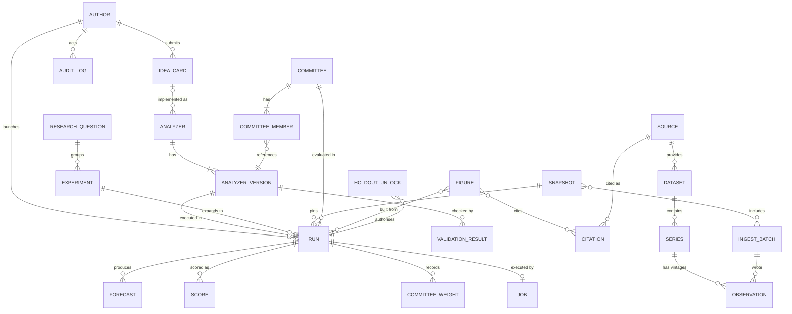

### 5.2 Where each entity lives

| Entity | Store | Mutability | Notes |
|---|---|---|---|
| sources, datasets, series (metadata) | `configs/*.yaml` → loaded into `state.sqlite` | Versioned in git | Licence + citation template per source |
| observations, bars, corporate_actions, events, ingest_batches | Parquet lake | Append-only | Section 4.2 |
| snapshots | `data/snapshots/<id>.json` + SQLite index | Immutable | Section 7.2 |
| authors, idea_cards, research_questions, experiments, committees, committee_members, figures, citations, holdout_unlocks, audit_log, jobs | SQLite | Mutable (audited) | Idea cards also mirrored to `ideas/*.yaml` |
| analyzers, analyzer_versions, validation_results | SQLite (rebuildable from registry + artifacts) | Append-only versions | |
| runs | SQLite index + `artifacts/runs/<id>/manifest.json` (canonical) | Immutable once finished | `orchard reindex` rebuilds the index |
| forecasts, scores, committee_weights, diagnostics | Parquet/JSON in run folder | Immutable | Queried via DuckDB views (`read_parquet('artifacts/runs/*/forecasts.parquet')`) |

### 5.3 Schema sketches (SQLite state, simplified DDL)

```sql
CREATE TABLE author (
  id TEXT PRIMARY KEY,               -- 'au_01'
  handle TEXT UNIQUE NOT NULL,       -- display handle, no e-mail
  role TEXT NOT NULL DEFAULT 'member', -- member | integrator | guest
  colour_token TEXT                  -- consistent series colour per author (A6)
);

CREATE TABLE idea_card (
  id TEXT PRIMARY KEY,               -- 'IC-012'
  author_id TEXT REFERENCES author(id),
  title TEXT NOT NULL,
  status TEXT NOT NULL,              -- submitted|accepted|needs_info|implementing|validated|rejected
  body_yaml TEXT NOT NULL,           -- full A5 template, also written to ideas/IC-012-*.yaml
  submitted_at TEXT NOT NULL,        -- pre-registration timestamp (UTC ISO)
  analyzer_id TEXT NULL
);

CREATE TABLE analyzer (
  id TEXT PRIMARY KEY,               -- 'tech.tsmom'
  name TEXT, category TEXT, idea_card_id TEXT NULL, origin TEXT -- builtin|team|llm
);

CREATE TABLE analyzer_version (
  id TEXT PRIMARY KEY,               -- analyzer_version_id (16 hex)
  analyzer_id TEXT REFERENCES analyzer(id),
  semver TEXT, code_hash TEXT, params_schema_hash TEXT, sdk_major INTEGER,
  spec_json TEXT,                    -- decorator manifest
  status TEXT,                       -- draft|validated|retired
  created_at TEXT, approved_by TEXT NULL, llm_meta_json TEXT NULL
);

CREATE TABLE validation_result (
  analyzer_version_id TEXT, test_id TEXT,  -- 'ARC-PIT-T1' …
  passed INTEGER, details_json TEXT, snapshot_id TEXT, git_commit TEXT, ran_at TEXT,
  PRIMARY KEY (analyzer_version_id, test_id, snapshot_id)
);

CREATE TABLE research_question (id TEXT PRIMARY KEY, title TEXT, created_by TEXT, created_at TEXT);

CREATE TABLE experiment (
  id TEXT PRIMARY KEY, research_question_id TEXT, name TEXT,
  config_yaml TEXT, grid_size INTEGER, created_by TEXT, created_at TEXT
);

CREATE TABLE run (
  id TEXT PRIMARY KEY,               -- 'run_01JD…' (ULID)
  kind TEXT,                         -- backtest|committee|live_forecast|final_forecast
  experiment_id TEXT NULL, analyzer_version_id TEXT NULL, committee_id TEXT NULL,
  config_hash TEXT, snapshot_id TEXT, env_hash TEXT, result_key TEXT,  -- dedup/cache key
  status TEXT,                       -- queued|running|succeeded|failed|cancelled|interrupted
  is_final INTEGER DEFAULT 0, author_id TEXT,
  created_at TEXT, started_at TEXT, finished_at TEXT,
  summary_json TEXT,                 -- headline metrics for lists/leaderboards
  artifact_path TEXT, parent_run_id TEXT NULL, verified_at TEXT NULL
);
CREATE INDEX run_result_key ON run(result_key);

CREATE TABLE committee (
  id TEXT PRIMARY KEY, name TEXT, scheme_json TEXT,  -- weighting + combination per A2
  frozen_at TEXT NULL, created_by TEXT
);
CREATE TABLE committee_member (
  committee_id TEXT, analyzer_version_id TEXT, params_hash TEXT, member_run_id TEXT,
  prior_weight REAL NULL,            -- judgemental tilt, documented
  PRIMARY KEY (committee_id, analyzer_version_id, params_hash)
);

CREATE TABLE figure (
  id TEXT PRIMARY KEY, key TEXT, number INTEGER, kind TEXT, spec_json TEXT,
  caption TEXT, source_line TEXT, figure_hash TEXT, run_ids_json TEXT, created_by TEXT, created_at TEXT
);
CREATE TABLE citation (
  key TEXT PRIMARY KEY, source_id TEXT, harvard TEXT, bibtex TEXT, url TEXT, accessed_on TEXT
);
CREATE TABLE holdout_unlock (
  run_id TEXT PRIMARY KEY, author_id TEXT, reason TEXT, config_hash TEXT, unlocked_at TEXT
);
CREATE TABLE job (
  id TEXT PRIMARY KEY, run_id TEXT, state TEXT, done INTEGER, total INTEGER,
  message TEXT, heartbeat_at TEXT
);
CREATE TABLE audit_log (
  id INTEGER PRIMARY KEY AUTOINCREMENT, at TEXT, author_id TEXT,
  action TEXT,                       -- 'run.create', 'committee.freeze', 'holdout.unlock', 'upload.commit' …
  entity TEXT, entity_id TEXT, payload_json TEXT
);
```

### 5.4 Run-artifact schemas (Parquet)

`forecasts.parquet` — one row per (origin, horizon); wide quantile columns because the grid is fixed:

```text
run_id, origin_date DATE, asof TIMESTAMPTZ, horizon_d SMALLINT, status VARCHAR,
q01, q025, q05, q10, q15, q20, q25, q30, q35, q40, q45, q50, q55, q60, q65, q70,
q75, q80, q85, q90, q95, q975, q99  DOUBLE,           -- forward log-return quantiles
p_up DOUBLE, mean DOUBLE, sd DOUBLE, signal DOUBLE,
explanation JSON, price_at_origin DOUBLE               -- for price-space fan charts
```

`scores.parquet` — one row per (origin, horizon): `realised_log_return, available_at_outcome, crps, pinball_mean, log_score (if density), brier_up, hit, pit_value, in_80, in_95`, plus the same metrics for each baseline (for skill and Diebold–Mariano tests).

`committee_weights.parquet` — `origin_date, horizon_d, member_key, weight, trailing_score, n_scored`.

**Sizing [A].** Monthly origins 1990–2026 ≈ 443 × 5 horizons ≈ 2,200 rows per run (≈ 100 KB Parquet). Daily origins ≈ 9,300 × 5 ≈ 46k rows (≈ 2 MB). 500 runs during the coursework ≈ < 1 GB in total.

### 5.5 Identifier conventions

| Kind | Format | Example |
|---|---|---|
| Surrogate IDs | prefix + ULID (time-sortable) | `run_01JD7Y8Q…`, `ib_01JD…` |
| Content hashes | SHA-256 hex, shown truncated to 12 | `snapshot 8e21a0c4f3b2` |
| Human IDs | prefix + counter | `IC-012`, `RQ-momentum`, figure keys `fig_consensus_fan` |
| Series IDs | `SOURCE:path` | `FRED:DGS10`, `EDGAR:AAPL:us-gaap/Revenues:Q`, `PX:AAPL`, `USER:up_7:app_rank` |

---

## 6. API design

### 6.1 Conventions

- Base path `/api/v1`; JSON; OpenAPI 3.1 generated by FastAPI and committed as `web/openapi.json`.
- **`asof` query parameter** (ISO 8601) on every data-read endpoint (ARC-P-05); default = now.
- Time series returned **columnar**: `{"t": [...], "v": [...], "available_at": [...]}` (≈ 200 KB for 11.5k points; gzip on).
- Runs, snapshots and figures are immutable → `ETag` = content hash, `Cache-Control: public, max-age=31536000, immutable` for their artifact endpoints.
- Errors: RFC 9457 `application/problem+json` with stable `type` URIs (relative, e.g. `/errors/pit-violation`).
- Long work returns **202 + `links.progress`**; progress by polling `GET /jobs/{id}` (baseline) or SSE `GET /jobs/{id}/events`.
- Cursor pagination (`?cursor=…&limit=50`) on lists.
- Mutations require the session cookie; every mutation writes `audit_log`.
- `POST /runs` is idempotent by `result_key` (dedup).

### 6.2 Endpoint catalogue

| ID | Method & path | Purpose | Rel. |
|---|---|---|---|
| ARC-API-01 | `GET /health` | Liveness + versions + snapshot id | R0 |
| ARC-API-02 | `GET /meta` | App version, disclaimer text, horizons, quantile grid, current snapshot, data freshness per source | R1 |
| ARC-API-03 | `POST /session` · `DELETE /session` | Passphrase + author pick → signed cookie | R1 |
| ARC-API-04 | `GET /authors` | Handles and colour tokens | R1 |
| ARC-API-05 | `GET /sources` · `GET /datasets` · `GET /series?q=&dataset=` | Catalogue browse/search (licence, PIT grade, citation key) | R1 |
| ARC-API-06 | `GET /series/{series_id}?asof=&start=&end=&vintage=asof\|first_release` | As-of series values | R1 |
| ARC-API-07 | `GET /series/{series_id}/vintages?period_end=` | Revision history of one period (time-machine detail) | R1 |
| ARC-API-08 | `GET /prices/{symbol}?asof=&adjust=split\|total\|none&start=&end=&max_points=` | OHLCV as of a date; optional LTTB down-sampling | R1 |
| ARC-API-09 | `GET /events?asof=&types=&start=&end=` · `GET /events/{id}` | Events known at `asof` (importance only shown in UI, flagged "hindsight label") | R1 |
| ARC-API-10 | `POST /uploads` (multipart) → `GET /uploads/{id}/report` → `POST /uploads/{id}/commit` | User data with PIT validation | R1 |
| ARC-API-11 | `GET /analyzers` · `GET /analyzers/{id}` · `GET /analyzers/{id}/versions` | Registry with PIT badge, author, idea card | R1 |
| ARC-API-12 | `GET /analyzers/{id}/params-schema` | JSON Schema for the form | R1 |
| ARC-API-13 | `POST /analyzers/{version_id}/validate` | Run leak suite + contract (job) | R1 |
| ARC-API-14 | `GET/POST /idea-cards` · `GET/PATCH /idea-cards/{id}` | Intake + status | R1 |
| ARC-API-15 | `GET /schemas/{name}` | `experiment`, `committee`, `idea-card`, `figure` JSON Schemas | R1 |
| ARC-API-16 | `POST /experiments/validate` | Dry-run validation, resolved config, grid size, trial count | R1 |
| ARC-API-17 | `POST /runs` | Create backtest run(s) (grid expands to many) | R1 |
| ARC-API-18 | `GET /runs?analyzer=&author=&status=&rq=` · `GET /runs/{id}` | List + manifest + summary | R1 |
| ARC-API-19 | `GET /runs/{id}/forecasts?horizon=&format=json\|parquet` | Forecast table | R1 |
| ARC-API-20 | `GET /runs/{id}/scores` · `GET /runs/{id}/diagnostics` | Metrics with CIs vs baselines; calibration bins, PIT histogram, coverage, by-period/regime breakdown | R1 |
| ARC-API-21 | `POST /runs/{id}/cancel` · `POST /runs/{id}/verify` | Cancel; re-execute and compare (reproducibility) | R1 |
| ARC-API-22 | `GET /runs/compare?ids=a,b` | Manifest diff + metric deltas + DM test | R1 |
| ARC-API-23 | `GET /jobs/{id}` · `GET /jobs/{id}/events` (SSE) | Progress | R1 |
| ARC-API-24 | `GET /leaderboard?horizon=252&metric=crps_skill&rq=` | Ranked validated analyzers, with trials count | R1 |
| ARC-API-25 | `GET/POST /committees` · `GET/PATCH /committees/{id}` · `POST /committees/{id}/freeze` | Committee definition and freezing | R1 |
| ARC-API-26 | `POST /committees/{id}/runs` | Evaluate committee historically | R1 |
| ARC-API-27 | `GET /committees/{id}/weights?horizon=` | Weights over time + attribution | R1 |
| ARC-API-28 | `POST /forecasts/live` · `POST /forecasts/final` | As-of-now forecast for an analyzer/committee; the frozen 12-month object | R1 |
| ARC-API-29 | `GET/POST /figures` · `GET /figures/{id}.{svg\|png\|pdf}` | Report figures | R1 |
| ARC-API-30 | `GET /citations?run_id=&figure_id=&format=harvard\|bibtex` | References | R1 |
| ARC-API-31 | `GET /report/bundle.zip` | Figures + captions + references + tables + manifest | R1 |
| ARC-API-32 | `GET /audit?entity=&entity_id=` | Audit trail | R1 |
| ARC-API-33 | `POST /holdout/unlock` | Authorise holdout scoring for a final run | R1 |
| ARC-API-34 | `POST /admin/snapshots` · `POST /admin/export-static` · `POST /admin/reload-registry` | Integrator-only operations | R1 |
| ARC-API-35 | `POST /generator/jobs` · `GET /generator/jobs/{id}` · `POST /generator/jobs/{id}/approve` | LLM idea → analyzer (R2) | R2 |

### 6.3 Request/response sketches

`POST /api/v1/runs`

```json
{
  "config": { "schema_version": 1, "name": "TS momentum 12-1", "analyzer": {"id": "tech.tsmom", "version": "1.0.0", "params": {"lookback_months": 12}}, "data_snapshot": "latest", "window": {"start": "1995-01-01", "end": "2021-12-31"}, "origins": {"frequency": "monthly"}, "horizons": [21, 63, 252], "seed": 42 },
  "grid": null,
  "dry_run": false
}
```

`202 Accepted`

```json
{
  "run_ids": ["run_01JD7Y8QK3V2"],
  "deduplicated": [false],
  "config_hash": "c9f1e0a77b41",
  "snapshot_id": "8e21a0c4f3b2",
  "trials_in_research_question": 7,
  "links": {"run": "/api/v1/runs/run_01JD7Y8QK3V2", "progress": "/api/v1/jobs/job_01JD7Y8R00A1"}
}
```

`GET /api/v1/jobs/job_01JD7Y8R00A1` → `{"state": "running", "done": 180, "total": 443, "phase": "forecasting", "eta_s": 3.1}`; the SSE variant emits `event: progress` with the same payload and `event: done` with the run summary.

`GET /api/v1/series/FRED:DGS10?asof=2008-09-15T20:00:00Z&start=2007-01-01`

```json
{
  "series_id": "FRED:DGS10", "asof": "2008-09-15T20:00:00Z", "vintage_mode": "asof",
  "unit": "percent", "frequency": "D", "pit_quality": "A",
  "source": {"id": "fred", "citation_key": "FRED_DGS10"},
  "t": ["2007-01-02", "…", "2008-09-11"], "v": [4.68, "…", 3.72],
  "available_at": ["2007-01-03T21:00:00Z", "…", "2008-09-12T21:00:00Z"]
}
```

(Values and the next-day publication rule are illustrative; A3 sets the real rule.) The last visible observation is for 11 Sep: under a "published next business day, 17:00 ET" rule the 12 Sep value only appears on the evening of 15 Sep, after the 16:00 ET decision time. This is exactly the kind of detail the time-machine view surfaces.

`POST /api/v1/forecasts/final` → the object the report's prediction cites:

```json
{
  "committee_id": "c_final", "committee_frozen_at": "2026-11-28T18:00:00Z",
  "asof": "2026-11-30T21:00:00Z", "snapshot_id": "…", "run_id": "run_…",
  "price_at_origin": 0.0,
  "horizon_d": 252,
  "log_return_quantiles": {"q05": 0.0, "q50": 0.0, "q95": 0.0},
  "price_quantiles": {"q05": 0.0, "q50": 0.0, "q95": 0.0},
  "p_up": 0.0, "p_return_gt": {"0.10": 0.0, "-0.20": 0.0},
  "scenarios": [{"name": "bear", "range": ["q05", "q25"], "probability": 0.2}],
  "attribution": [{"member": "tech.tsmom@1.0.0", "weight": 0.0, "contribution_to_median": 0.0}],
  "evidence": [{"member": "tech.tsmom@1.0.0", "crps_skill_252": 0.0, "coverage_80": 0.0, "n_origins": 0}],
  "disclaimer": "Educational research output. Not investment advice."
}
```

(Zeros are placeholders.)

Error example:

```json
{"type": "/errors/pit-violation", "title": "Look-ahead detected", "status": 422,
 "detail": "Analyzer team.ic012 opened data/lake/... during predict() at origin 2014-05-30",
 "analyzer_version_id": "4b1c…", "test_id": "ARC-PIT-T8"}
```

### 6.4 TypeScript client pipeline

`orchard api export-openapi` → `web/openapi.json` (committed) → `pnpm gen:api` (Orval 8.48: `react-query` client, zod schemas, MSW handlers with faker data) → `web/src/api/gen/`. CI job `contract` regenerates and fails on diff; Schemathesis 4.33 fuzzes the running API against the same spec. During days 1–3 the SPA runs fully on MSW mocks, so the frontend track never waits for the backend (critical-path decoupling, section 12).


---

## 7. Reproducibility & audit

### 7.1 Run manifest (canonical record of a run)

```json
{
  "run_id": "run_01JD7Y8QK3V2",
  "kind": "backtest",
  "created_at": "2026-11-21T14:03:11Z",
  "author_id": "au_03",
  "config": { "...": "fully resolved ExperimentConfig (defaults filled, snapshot resolved)" },
  "config_hash": "sha256:c9f1e0a77b41…",
  "analyzer": {
    "id": "tech.tsmom", "semver": "1.0.0",
    "version_id": "4b1c9e…", "code_hash": "sha256:77de…", "params_schema_hash": "sha256:1a0b…",
    "validation": {"ARC-PIT-T1": "pass", "ARC-PIT-T2": "pass", "ARC-PIT-T3": "pass", "ARC-PIT-T4": "pass"}
  },
  "data_snapshot": {"id": "sha256:8e21a0c4f3b2…", "created_at": "2026-11-20T23:10:00Z",
                    "datasets": ["px_aapl", "fred_core", "edgar_aapl", "events_seed"], "licensed_inputs": false},
  "environment": {
    "orchard_version": "0.1.0", "git_commit": "a1b2c3d", "git_dirty": false,
    "python": "3.14.x", "platform": "macOS-27.2-arm64",
    "lockfile_hash": "sha256:…(uv.lock)", "key_packages": {"numpy": "2.5.5", "pandas": "3.1.1", "scipy": "1.18.1", "statsmodels": "0.15.0", "arch": "9.0.0", "duckdb": "1.5.6"},
    "blas_threads": 1, "env_hash": "sha256:…"
  },
  "seed": {"run_seed": 42, "derivation": "SeedSequence([run_seed, fnv64(analyzer_id), origin_ordinal])"},
  "origins": {"count": 324, "first": "1995-01-31", "last": "2021-12-31"},
  "holdout": {"from": "2022-01-01", "scored": false},
  "outputs": {"forecasts.parquet": "sha256:…", "scores.parquet": "sha256:…", "summary.json": "sha256:…"},
  "timings_s": {"load": 0.9, "forecast": 1.4, "score": 0.3},
  "result_key": "sha256:…(config_hash, version_id, snapshot_id, env_major)"
}
```

### 7.2 Hash and ID definitions

| ID | Item | Definition |
|---|---|---|
| ARC-REP-01 | `config_hash` | SHA-256 of RFC 8785 canonical JSON of the **resolved** config (defaults filled; `latest` resolved; YAML comments and key order irrelevant) |
| ARC-REP-02 | `code_hash` | SHA-256 over sorted `(module path, sha256(ast.dump(parse(source)) with docstrings removed))` for the plugin module and every in-repo module it imports transitively, plus `orchard.sdk` major version |
| ARC-REP-03 | `analyzer_version_id` | SHA-256(id, semver, code_hash, params_schema_hash, sdk_major)[:16] |
| ARC-REP-04 | `snapshot_id` | SHA-256 over sorted `(relative path, file sha256)` of every lake file included (a Merkle-style root); manifest lists files, row counts, licence flags, max `ingested_at` |
| ARC-REP-05 | `env_hash` | SHA-256(uv.lock, Python version, platform tag, BLAS vendor) |
| ARC-REP-06 | `result_key` | SHA-256(config_hash, analyzer_version_id, snapshot_id, env-major) → dedup + cache |
| ARC-REP-07 | Seeds | `np.random.default_rng(SeedSequence([run_seed, fnv64(analyzer_id), origin_ordinal]))` → independent of execution order and chunking |
| ARC-REP-08 | `figure_hash` | SHA-256(FigureSpec canonical JSON, input run IDs, renderer version, style version) |

### 7.3 Immutability and lifecycle

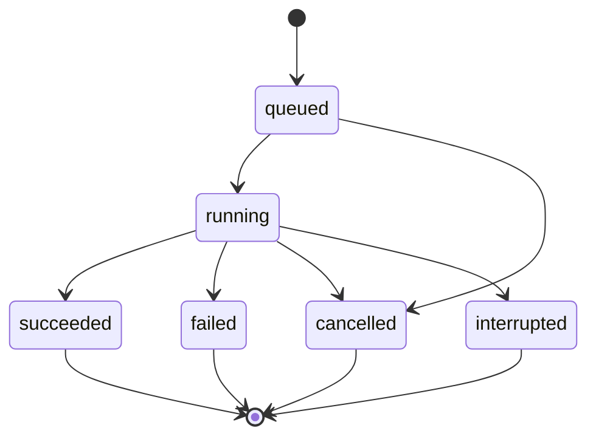

Finished runs are never edited. "Re-running" creates a new run with `parent_run_id`. Committees become immutable when **frozen** (`frozen_at`); the final forecast may only reference a frozen committee. Lake files are never rewritten; `orchard lake gc` only deletes files no snapshot references.

### 7.4 Caching

- **Run-level:** identical `result_key` → return the existing run (UI shows "re-used result from 21 Nov").
- **Forecast-level (R2):** because the lake is append-only, a forecast at origin *t* depends only on rows with `available_at ≤ t`. A new snapshot that only *appends* newer data cannot change it. Store per-dataset **history epochs** (incremented only when a batch contains rows with `available_at` earlier than the previous max, i.e. corrections/backfills) and cache forecasts by `(analyzer_version_id, params_hash, origin, epochs of declared datasets)`. Daily data refreshes then re-compute only the newest origins.
- **Worker-level:** each worker loads a snapshot once and keeps it for its lifetime (LRU of 2 snapshots).

### 7.5 "Re-run produces identical numbers"

`orchard runs verify <run_id>` (and `POST /runs/{id}/verify`) re-executes the manifest in fresh processes and compares outputs: **bitwise** if `env_hash` matches; `rtol ≤ 1e-9, atol ≤ 1e-12` otherwise, with a list of differing cells. Preconditions enforced by the engine: single-threaded BLAS in workers, seeded RNG per origin (ARC-REP-07), stable sort orders, no wall-clock reads inside analyzers (lint), float64 throughout. The "Reproduced" badge and timestamp appear on the run page. Cross-OS bitwise equality is **not** promised (different BLAS/libm builds) — this is stated honestly in the docs.

### 7.6 Audit trail, trials counter, holdout

- `audit_log` records every mutation with author and payload (runs, uploads, committee edits, freezes, holdout unlocks, plugin validations).
- **Trials counter:** every run belongs to a `research_question`; the count of distinct configurations tried per question is shown next to every metric and passed to A2's multiple-testing corrections (e.g. deflated Sharpe ratio). This makes p-hacking visible rather than hidden.
- **Holdout:** scoring of origins ≥ `holdout.from` requires an explicit, audited unlock tied to a frozen config (L8). Recommended policy (A2 to confirm): unlock once, for the final committee only.

### 7.7 Provenance → citations

Each source in `configs/sources.yaml` carries a Harvard template, e.g. `Federal Reserve Bank of St. Louis ({year}) {title} [{series_id}]. FRED. Available at: {url} (Accessed: {accessed_on}).` Series inherit their source; runs aggregate the sources of their declared `data`; figures aggregate their runs. `GET /citations?figure_id=` returns the deduplicated reference list in Harvard and BibTeX. This is how "every number has a source" (coursework: citations 15%) is enforced mechanically rather than by discipline.

---

## 8. Repository structure & engineering standards

### 8.1 Monorepo layout

```text
orchard/
├── README.md  LICENSE  LICENSE-docs  CITATION.cff  SECURITY.md  CONTRIBUTING.md  CHANGELOG.md
├── AGENTS.md                      # agent guardrails: architecture map, PIT rules, commands (8.5)
├── justfile                       # dev | serve | test | lint | gen | ingest | snapshot | export | release
├── pyproject.toml  uv.lock  .python-version     # uv workspace root (3.14); ruff/pyright/pytest config
├── packages/
│   ├── orchard/                   # import name: orchard  (distribution name: orchard-pit, see ARC-Q-09)
│   │   └── src/orchard/
│   │       ├── sdk/               # PUBLIC analyzer API: Analyzer, AsOfContext, Forecast, recipes, decorator
│   │       ├── pit/               # store (private), accessors, calendar, adjustments, rules
│   │       ├── ingest/            # adapters: prices, edgar, fred_alfred, events, uploads
│   │       ├── lake/              # writer, schemas, snapshots, gc
│   │       ├── engine/            # schedule, walk-forward, chunking, validation, artifacts
│   │       ├── jobs/              # job manager, worker pool, progress
│   │       ├── scoring/           # proper scores, tests (DM/HAC), bootstrap, oracle.py (private)
│   │       ├── committee/         # weights, combination, final forecast object
│   │       ├── figures/           # matplotlib renderers, report theme, citations
│   │       ├── export/            # static snapshot exporter (+ licence guard)
│   │       ├── validation/        # leak suite T1–T8, contract checks
│   │       ├── server/            # FastAPI app, routers, state (SQLModel), alembic/, static/
│   │       └── cli.py             # Typer entry point: `orchard …`
│   └── orchard-analyzers/         # import name: orchard_analyzers (stricter lint: ruff.toml with banned APIs)
│       └── src/orchard_analyzers/
│           ├── builtin/{baselines,technical,fundamental,macro,event,stat}/
│           └── team/ic012_<slug>/{analyzer.py,test_analyzer.py,README.md}
├── web/                           # Vite + React + TS (pnpm); src/{api/gen,app,routes,components,charts,lib}
├── configs/                       # sources.yaml, pit_rules.yaml, authors.yaml, report.yaml,
│   ├── experiments/  committees/  # shared YAML configs (reviewed like code)
├── schemas/                       # exported JSON Schemas (experiment, committee, idea-card, figure)
├── ideas/                         # IC-###-slug.yaml idea cards (pre-registration record)
├── data/                          # .gitignored except README.md and fixtures/
│   ├── raw/  lake/  snapshots/  uploads/  licensed/
│   └── fixtures/                  # synthetic, redistributable test store (generated, small)
├── artifacts/                     # .gitignored: runs/, figures/, exports/
├── tests/                         # cross-package: e2e API, golden, perf; unit tests live next to packages
├── docs/                          # kb/ (this knowledge base), site/ (R2 docs site)
├── docker/                        # Dockerfile, compose.yaml
└── .github/                       # workflows/, ISSUE_TEMPLATE/idea-card.yml (R2), PULL_REQUEST_TEMPLATE.md, dependabot.yml
```

### 8.2 Tooling (versions verified on PyPI/npm/GitHub, 2026-11-17)

| Area | Tool | Version | Licence | Note |
|---|---|---|---|---|
| Python env & packaging | **uv** | 0.13.9 | MIT/Apache | Installs Python 3.14; workspace; lockfile. Astral is being acquired by OpenAI (announced 19 Mar 2026); tools remain permissively licensed [S-30] — low risk |
| Lint + format (Py) | **ruff** | 0.17.5 | MIT | Rules: E, F, W, I, B, UP, SIM, RUF, N, PT, NPY, DTZ, TID, PL (subset), D (sdk only) |
| Type check (Py) | **pyright** | 1.1.414 | MIT | `strict` for `sdk`, `pit`, `scoring`, `committee`; `standard` elsewhere. Alternatives: mypy 2.4.1, pyrefly 1.4.1, ty 0.0.105 (beta [S-31]) — evaluate ty in R2 |
| Import boundaries | **import-linter** | 2.16 | BSD-2 | Layer + forbidden contracts (analyzers → sdk only) |
| Tests (Py) | **pytest** 9.2.0, **hypothesis** 6.170.15, pytest-xdist 3.8.0, syrupy 7.0.2, pytest-benchmark 5.3.1, pytest-mpl 0.19.0 | — | MIT / MPL-2.0 / … | |
| API contract | **schemathesis** | 4.33.4 | MIT | Property-based API fuzzing from OpenAPI |
| Hooks | **pre-commit** 4.7.0 (run via **prek** 0.5.11 optionally) | — | MIT | ruff, biome, gitleaks, data-guard, end-of-file, large-file check |
| Task runner | **just** (`uv tool install rust-just`, 1.59.0) | — | CC0 (`UNVERIFIED`) | Cross-platform; Windows-friendly |
| JS package manager | **pnpm** | 12.21.0 | MIT | `packageManager` field; Corepack installed explicitly on Node ≥ 25 [S-34] |
| Lint + format (TS) | **Biome** | 2.6.8 | MIT/Apache | One tool, fast; replaces ESLint 10 + Prettier |
| Type check (TS) | **TypeScript** | 7.0.2 | Apache-2.0 | Go-native compiler [S-33] |
| Unit tests (TS) | **Vitest** | 5.1.0 | MIT | + Testing Library |
| E2E | **Playwright** | 1.65.1 | Apache-2.0 | Chromium + WebKit; screenshot assertions for visual regression (R2) |
| API mocks | **MSW** | 3.0.6 | MIT | Generated by Orval |
| CI/CD | GitHub Actions + release-please 17.11 + Dependabot | — | — | Actions pinned by commit SHA |
| Security | gitleaks, pip-audit 2.10.1, `pnpm audit`, CodeQL (public repo), cyclonedx-bom 8.0.1 | — | — | |
| Logging | structlog 26.1.0 | — | MIT/Apache | JSON logs with `run_id`, `job_id` |
| Docs (R2) | Zensical 0.1.2 (fallback mkdocs-material 9.8.1) | — | MIT | [S-29] |

### 8.3 Coding standards (summary)

**Python.** Pydantic models at every boundary; timezone-aware datetimes only (ruff `DTZ`); units in names (`horizon_d`, `lookback_days`, `_bps`); `np.random.default_rng` only (`NPY002`); no global mutable state; pure functions for all statistics with docstrings giving the formula and the reference (author, year); pandas 3 Copy-on-Write idioms; no bare `except`; errors as typed exceptions (`PITViolation`, `DataUnavailable`, `ConfigError`) mapped to RFC 9457 in the API; structured logging only.
**TypeScript.** `strict` + `noUncheckedIndexedAccess`; server state only via generated hooks; UI state in Zustand / URL search params; chart *option builders* are pure functions of API data (unit-tested, no DOM); no financial math in the client beyond formatting and unit conversion; one `format.ts` for numbers, percentages, dates (always showing the as-of date).
**Repo.** Trunk-based, short-lived branches, squash merges; **Conventional Commits** (`feat(engine): …`, `fix(pit): …`); release-please generates CHANGELOG and tags — `0.x` during coursework, **`1.0.0` at the R2 showcase**; PR template checklist: tests, PIT suite green, docs/AGENTS.md updated, screenshots for UI changes.

### 8.4 CI pipeline

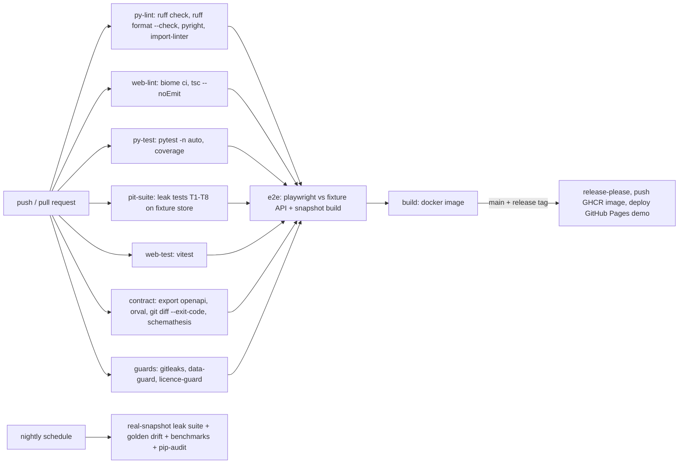

Budget: PR pipeline ≤ 10 minutes (ARC-PERF-12). The **data-guard** job fails if any tracked file matches `data/**` (except `data/fixtures/**` and READMEs), `*.parquet` outside fixtures, `*.xlsx`, `*.duckdb`, `*.sqlite`. The **licence-guard** job runs the static exporter in check mode and fails if any series with `redistributable: false` would be exported.

### 8.5 `AGENTS.md` (agent guardrails) — outline

Because the coding agent writes most of the code, the repository should carry its own instructions:

1. Architecture map (this document, condensed to one page) and where things live.
2. **PIT rules** (non-negotiable): analyzers import only `orchard.sdk`; never read files, network or clocks in analyzers; outcomes only via the oracle; never use `importance`.
3. "Definition of done" for a plugin: scaffold via `orchard plugin new --idea IC-###`, tests, `orchard validate`, README with hypothesis and references, idea-card status updated.
4. Commands: `just dev`, `just test`, `just lint`, `just gen`, `orchard validate`, `orchard runs verify`.
5. Style rules from 8.3; Conventional Commits; never commit `data/` or secrets.
6. When unsure about methodology → consult `docs/kb/02-ideation/A2-quant-methodology.md`; never invent data sources (A3 catalogue).

### 8.6 README blueprint (recruiter and professor view)

1. Name, one-line pitch ("A point-in-time backtesting and probabilistic-forecasting lab — any idea, no look-ahead, honest probabilities"), and badges: CI, coverage, Python 3.14, licence, ruff, **"PIT-verified analyzers: N/N"** (generated by CI).
2. 20-second GIF: time machine → run → calibration → committee fan chart.
3. **Live demo** link (GitHub Pages snapshot) and "Run it yourself in 2 commands" (`docker run …` / `git clone && docker compose up`).
4. "Why point-in-time matters" — a 6-line example of a leaky backtest vs Orchard's result, with the split-adjustment trap.
5. Architecture diagram (Mermaid from section 0) + link to this document.
6. "Write an analyzer in 25 lines" (the TS-momentum snippet) + how the leak suite tests it.
7. Methodology summary (proper scoring rules, committee, holdout, trials counter) with literature links (A2).
8. Results gallery (consensus fan chart, calibration plot) with the educational disclaimer.
9. Data sources and licences table (what is fetched, what is never redistributed).
10. Roadmap (R2/R3), contributing, citation (`CITATION.cff`), licence, acknowledgements.

---

## 9. Performance budget

### 9.1 Workload sizing [A]

AAPL daily bars Dec 1980 → Nov 2026 ≈ 11.5k; monthly origins 1990 → 2026 ≈ 443; weekly ≈ 1,920; daily ≈ 9,300; horizons 5; quantile grid 23; macro series ≤ 50 (with vintages ≤ 500k rows); fundamentals ≤ 100 concepts × ~70 quarters × vintages; events ≈ 300–500.

### 9.2 Budgets (measured on the PO's Apple-Silicon Mac unless noted)

| ID | Scenario | Budget | How achieved / measured |
|---|---|---|---|
| ARC-PERF-01 | Simple analyzer (baselines, momentum, conditional-empirical), monthly origins 1990–2026 × 5 horizons, incl. scoring | **≤ 2 s** end-to-end; ≤ 0.5 s if snapshot already loaded | Snapshot in RAM; `searchsorted` slicing; vectorised recipes; pytest-benchmark |
| ARC-PERF-02 | Same, **daily** origins (~9.3k) | ≤ 15 s with 6 workers | Chunked origins across the pool |
| ARC-PERF-03 | Heavy analyzer (GARCH refit monthly; ML refit quarterly), monthly origins | ≤ 60 s; progress update ≥ 1/s | Refit schedules; pool; arch with warm starts. **[A]** ~20–100 ms per GARCH fit on ~2.5k returns → 443 fits ≈ 10–45 s single-core before parallelism — to be benchmarked in WP-06 |
| ARC-PERF-04 | Committee evaluation (20 members, PIT weights, 5 horizons, ~440 origins) | ≤ 1 s | Members' forecasts already on disk; NumPy over aligned arrays |
| ARC-PERF-05 | Worker cold start (load snapshot) | ≤ 1.5 s, ≤ 500 MB RSS | Column-pruned Parquet reads; float64 NumPy arrays |
| ARC-PERF-06 | API reads (cached/immutable) | p95 ≤ 100 ms local | ETag + immutable caching; DuckDB views over run Parquet; gzip |
| ARC-PERF-07 | UI interaction latency | INP ≤ 200 ms ("good" [S-26]); target < 100 ms for hover/zoom; 60 fps pan on 11.5k daily candles | Lightweight Charts canvas; ECharts `sampling: 'lttb'` and `large` mode; memoised option builders; TanStack Virtual for tables |
| ARC-PERF-08 | Initial load | JS shell ≤ 300 KB gzip; LCP ≤ 1.5 s local, ≤ 2.5 s on GitHub Pages | Route-level code splitting; ECharts and Monaco lazy-loaded; fonts subset |
| ARC-PERF-09 | Full ingest from scratch | ≤ 5 min (network-bound) | Parallel adapters within each source's rate limit (A3; SEC fair-access limits) |
| ARC-PERF-10 | Static demo bundle | ≤ 25 MB total; any single JSON ≤ 2 MB | Down-sampled long series for overview, full data for zoom windows; Parquet → JSON only for exported runs |
| ARC-PERF-11 | Report figure render | ≤ 2 s per figure; full set ≤ 30 s | matplotlib Agg/SVG backends; no browser |
| ARC-PERF-12 | CI pull-request pipeline | ≤ 10 min | Fixture store; pytest-xdist; cached uv/pnpm stores |

Budgets are tracked by `tests/perf/` (pytest-benchmark) in the nightly job; a regression > 30% fails the nightly run.

---

## 10. Security & privacy

| ID | Asset / threat | Controls |
|---|---|---|
| ARC-SEC-01 | **Secrets** (team passphrase, FRED key if used, R2 LLM API key) committed or leaked | `.env` + pydantic-settings; `.env.example` with placeholders; gitleaks in pre-commit and CI; GitHub secret scanning / push protection; no secrets in `VITE_*` variables (they are public in the bundle) |
| ARC-SEC-02 | **Licensed data** (Bloomberg/Refinitiv exports) entering git or the public demo | `data/` gitignored; CI data-guard (8.4); per-dataset `licensed`/`redistributable` flags (default **licensed** for uploads); static-export and figure "public profile" guards refuse licensed inputs; UI badge "licensed — internal use only" on such series and on figures derived from them |
| ARC-SEC-03 | Third-party terms of free sources (e.g. unofficial price APIs) | Raw responses cached locally only; public demo uses only sources A3 marks redistributable, otherwise derived results only (ARC-Q-05) |
| ARC-SEC-04 | **Plugin code** (R1, human-reviewed) | Trusted-team model: plugins merged via PR review; runtime tripwire (L4) catches file/network access; workers run as the same user (acceptable for R1, stated in SECURITY.md) |
| ARC-SEC-05 | **LLM-generated code** (R2) | Only in the Docker sandbox (ARC-ADR-13); no network; read-only fixture data; human approval; all prompts/outputs audited |
| ARC-SEC-06 | Exposed team instance | Edge auth (Cloudflare e-mail one-time PIN or VM firewall) + passphrase session; `SameSite=Strict`, `HttpOnly`, `Secure` cookies; CSRF token on mutations; same-origin CORS; security headers (CSP without `unsafe-eval` except the lazy Monaco route, `frame-ancestors 'none'`); request size limits; simple per-session rate limit on `POST /runs` and uploads |
| ARC-SEC-07 | Malicious/broken uploads | Size/row limits; no macro formats (`.xlsm` rejected); parsing in a worker with timeouts; CSV-injection neutralisation on export |
| ARC-SEC-08 | Supply chain | Lockfiles committed; Dependabot weekly; pip-audit + pnpm audit in CI; CodeQL once public; SBOM (CycloneDX) attached to releases; Actions pinned by SHA |
| ARC-SEC-09 | **Privacy** | No personal data in any external request. SEC EDGAR requires a declared User-Agent: configured via `ORCHARD_SEC_USER_AGENT`, shipped with a generic placeholder (e.g. `Orchard research tool admin@example.invalid`) and documented as an operator configuration item. Authors are handles only; no e-mails stored (the tunnel's allow-list lives in the operator's command line, not in the repo); logs exclude IPs in the public build |
| ARC-SEC-10 | Academic integrity | The platform produces data, statistics, figures and citations — **never report prose**. No "write my section" feature in any release |
| ARC-SEC-11 | Investment-advice framing | Disclaimer in API `/meta`, UI footer, figure captions on export, README; vocabulary is "forecast distribution", never "buy/sell" (V-16) |

---

## 11. Testing strategy

| Layer | ID | What | Tools | When | Target |
|---|---|---|---|---|---|
| Unit (Py) | ARC-TST-01 | Scoring rules vs closed forms and vs scoringrules; calendar; adjustments (AAPL split dates); hashing/canonicalisation; config resolution | pytest | pre-commit (fast subset) + CI | ≥ 90% line coverage for `sdk`, `pit`, `scoring`, `committee` |
| Property-based | ARC-TST-02 | (i) no returned row has `available_at > t`; (ii) monotonicity: rows visible at t₁ remain visible at t₂ > t₁ unless superseded by a later vintage; (iii) quantiles non-decreasing after validation/repair; (iv) CRPS ≥ 0 and = 0 only for a point mass at the outcome; pinball loss minimised at the true quantile; (v) committee weights ≥ 0 and sum to 1; (vi) `config_hash` invariant to key order/comments/explicit defaults | Hypothesis | CI | — |
| **PIT leak suite** | ARC-TST-03 | T1–T8 (section 4.6) parametrised over **every** registered analyzer, plus the committee | pytest | CI (fixture) + nightly (real) | 100% pass is a merge gate |
| Golden-file regression | ARC-TST-04 | Each built-in analyzer + committee on the fixture store with pinned configs → `tests/golden/*.parquet`; compared at rtol 1e-9; intentional changes via `--update-golden` with reviewed diff | pytest + syrupy (JSON manifests) | CI | No unexplained drift |
| Data quality | ARC-TST-05 | Ingest checks: schema, key uniqueness, monotone dates, `available_at ≥ period_end` (with declared exceptions), split continuity (no artificial jumps in split-adjusted series), FRED vintage ordering, EDGAR duplicate facts | pytest on new batches | Every ingest + nightly | Batch rejected on failure |
| API contract | ARC-TST-06 | Generated client in sync; Schemathesis property-based fuzzing (no 500s, responses match schema) | Orval, Schemathesis | CI | Zero schema violations |
| API integration | ARC-TST-07 | Create run → poll → fetch artifacts; dedup; holdout lock; auth on mutations | pytest + httpx `ASGITransport` | CI | — |
| Front-end unit | ARC-TST-08 | Formatters; **chart option builders** (snapshot of option objects); snapshot-client adapter | Vitest | CI | — |
| E2E | ARC-TST-09 | 5 journeys: (1) explore price + events at an as-of date; (2) configure and run a backtest, see calibration; (3) submit idea card; (4) build committee → final forecast; (5) export report bundle. Run against fixture API and against the static snapshot build | Playwright | CI | All green |
| Visual regression | ARC-TST-10 | Report figures (pytest-mpl image comparison); 3–4 key screens (Playwright screenshots) | pytest-mpl, Playwright | R1 figures; R2 screens | Tolerance-based |
| Performance | ARC-TST-11 | ARC-PERF-01/04/05 | pytest-benchmark | Nightly | No > 30% regression |
| Reproducibility | ARC-TST-12 | `runs verify` on 3 golden runs in fresh processes | CLI in CI | Nightly | Bitwise on CI runner |

**Fixture store.** A generator (`orchard fixtures build --seed 7`) creates a synthetic "AAPL-like" world: GBM with two volatility regimes, the five historical split ex-dates, quarterly dividends from 2012, macro series with revised vintages, fundamentals filed 30–45 days after quarter end with one restatement, ~50 events. Being synthetic, it is committable and makes leak tests fast and deterministic.

---

## 12. Build plan input (R0 + R1)

Estimates are **agent-assisted build hours** (PO directing the coding agent, including review), ±40%. Tracks: **BE** (engine/API), **DATA** (adapters), **FE** (web). With two or three parallel coding-agent sessions (separate git worktrees), the calendar time is governed by the critical path, not the sum.

### 12.1 Work packages

| ID | Work package | Deliverable | Depends on | Hours | R1 priority | Track | Critical path |
|---|---|---|---|---|---|---|---|
| ARC-WP-00 | Toolchain & scaffold | uv + Python 3.14, pnpm, workspace, ruff/pyright/biome, pre-commit, CI skeleton, justfile, **AGENTS.md** | — | 3 | Must | BE | **Yes** |
| ARC-WP-01 | Core contracts | Pydantic: Forecast, AnalyzerSpec, ExperimentConfig, RunManifest, IdeaCard; JSON Schema export; hashing utils; IDs | 00 | 4 | Must | BE | **Yes** |
| ARC-WP-02 | PIT lake | Parquet schemas, batch writer, checks, snapshots, DuckDB views | 01 | 4 | Must | BE | **Yes** |
| ARC-WP-03a | Prices + corporate actions adapter | Source per A3; unadjusted bars + actions with `available_at` | 02 | 3 | Must | DATA | **Yes** |
| ARC-WP-03b | FRED/ALFRED adapter | ≤ 15 core series with vintages | 02 | 3 | Must | DATA | |
| ARC-WP-03c | EDGAR adapter | companyfacts (≤ 20 concepts) + acceptance timestamps; TTM/Q4 logic | 02 | 4 | Should | DATA | |
| ARC-WP-03d | Events loader | A4 seed CSV → `events` (hindsight fields tagged) | 02 | 1 | Must | DATA | |
| ARC-WP-03e | User uploads | Upload → mapping → validation report → commit; licence flag | 02, 12 | 3 | Should | DATA | |
| ARC-WP-04 | PIT access layer | `AsOfContext`, `PITData`, `PITFrame`, adjustments as-of, fundamentals as-of, calendar, oracle | 02, 03a | 6 | Must | BE | **Yes** |
| ARC-WP-05 | Leak suite + fixture store | T1–T8, fixture generator, CI job | 04, 08 | 4 | Must | BE | |
| ARC-WP-06 | Engine + job runner | Schedules, chunked pool, cancellation, progress, artifacts, manifest, verify | 04, 08 | 6 | Must | BE | **Yes** |
| ARC-WP-07 | Scoring & diagnostics | Proper scores, coverage, PIT hist, reliability, DM/HAC, bootstrap CIs, skill vs baselines | 06 | 5 | Must | BE | **Yes** |
| ARC-WP-08 | SDK + registry | Decorator, discovery, code hash, params schema, scaffold CLI, hot reload | 01 | 4 | Must | BE | (parallel to 02–04) |
| ARC-WP-09a | Baselines | RW, RW+drift, iid bootstrap, block bootstrap, GBM | 08 | 2 | Must | BE | |
| ARC-WP-09b | Starter analyzers, batch 1 | ~8 from A5's R1 pack (≥ 2 per report section) | 09a, 05 | 6 | Must | BE (parallel subagents) | |
| ARC-WP-09c | Starter analyzers batch 2 + idea-card plugins | Remaining A5 pack + teammates' ideas | 09b | 6+ | Should (continues to 1 Dec) | BE | |
| ARC-WP-10 | Committee + final forecast | Schemes per A2, attribution, freeze, final 12-month object | 07 | 5 | Must | BE | **Yes** |
| ARC-WP-11 | State DB | SQLModel + Alembic; authors, idea cards (+ YAML mirror), runs index, audit, jobs | 01 | 4 | Must | BE | |
| ARC-WP-12 | API | Routers (6.2), auth-lite, polling + SSE, static SPA serving, OpenAPI export; **stubs on day 1** | 06, 11 | 5 | Must | BE | **Yes** |
| ARC-WP-13 | Web shell | Vite/React/TS, router, layout, theme tokens (A6), ⌘K, as-of control, Orval + MSW | 00, API stub | 5 | Must | FE | |
| ARC-WP-14a | Explorer + events screens | Price chart with markers, overlays, provenance panel | 13 | 4 | Must | FE | |
| ARC-WP-14b | Run builder + run detail | RJSF forms + YAML editor; fan chart, calibration, PIT histogram, metric table vs baselines | 13 | 7 | Must | FE | |
| ARC-WP-14c | Leaderboard/compare + committee + final forecast | Skill table with trials count; weights over time; 12-month fan + scenarios | 14b, 10 | 5 | Must | FE | **Yes** |
| ARC-WP-14d | Idea cards, uploads, report studio, settings | Forms + lists | 13 | 4 | Should | FE | |
| ARC-WP-15 | Figures + citations | matplotlib report theme, ~6 figure kinds, captions, Harvard refs, bundle | 07, 10 | 5 | Must (by 1 Dec) | BE | |
| ARC-WP-16 | Static snapshot | Exporter + licence guard + snapshot client + Pages workflow | 12, 14c | 4 | Could (R1) | FE/BE | |
| ARC-WP-17 | Team deployment | Docker image, `just serve`, tunnel runbook (or Azure VM), backups | 12, 14c | 3 | Must | BE | **Yes** |
| ARC-WP-18 | Docs | README v1, CONTRIBUTING (plugin guide), SECURITY.md | any | 2 | Must | — | |
| ARC-WP-19 | Hardening | E2E journeys, bug bash with 2 teammates, perf check, onboarding guide | 17 | 5 | Must | all | **Yes** |

Totals: ≈ 122 h overall; ≈ 101 h Must. **Critical path** (WP-00 → 01 → 02 → 03a → 04 → 06 → 07 → 10 → 12 → 14c → 17 → 19) ≈ **54 h ≈ 6 working days** at ~9 h/day, leaving ~2 days of slack in the 18–25 Nov window — but only if the FE and DATA tracks really run in parallel.

### 12.2 Dependency graph

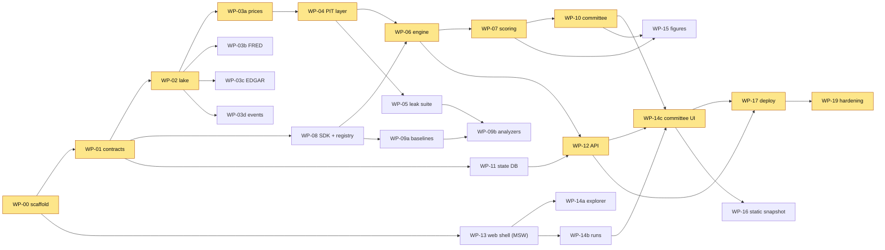

### 12.3 Suggested calendar

| Day | Date | BE track | DATA track | FE track | Team |
|---|---|---|---|---|---|
| D1 | Wed 18 Nov | WP-00, WP-01, AGENTS.md, API stubs + OpenAPI | — | WP-13 on MSW | Teammates start idea cards (A5 template, as files) |
| D2 | Thu 19 Nov | WP-02, WP-08, WP-11 | WP-03a, WP-03d | WP-13, WP-14a | PO triages first idea cards |
| D3 | Fri 20 Nov | WP-04, WP-09a | WP-03b, WP-03c | WP-14b | — |
| D4 | Sat 21 Nov | WP-06, WP-05 | (buffer) | WP-14b | — |
| D5 | Sun 22 Nov | WP-07, WP-12 real wiring, WP-09b (subagents) | WP-03e | WP-14c (mocks) | — |
| D6 | Mon 23 Nov | WP-10, WP-15 | — | WP-14c live, WP-14d | — |
| D7 | Tue 24 Nov | WP-17 deploy; alpha with 2 teammates | — | Fixes | Alpha feedback |
| D8 | Wed 25 Nov | WP-19; tag **v0.1.0 (R1)**; 30-min onboarding | — | WP-19 | **R1 in teammates' hands** |
| — | Thu 26 – Sun 29 Nov | Idea-card plugins (WP-09c); WP-16 if time | — | — | Teammates backtest and iterate |
| — | Mon 30 Nov | Final as-of date candidate (close); avoid Fri 27 Nov, which is the post-Thanksgiving half-day session (early close per the usual NYSE schedule; `UNVERIFIED` for 2026 — `exchange-calendars` will confirm) | | | Committee membership agreed |
| — | Tue 1 Dec | Freeze committee → `final_forecast` → render report figures | | | Report writing |
| — | Thu 3 Dec | Submission target (see ARC-Q-01 on the deadline weekday) | | | |

### 12.4 Cut lines (drop in this order if behind)

1. WP-16 static snapshot → R2 (live demo via tunnel instead).
2. YAML editor in the UI (forms only; YAML stays in `configs/` for the PO).
3. Report studio UI (keep `orchard figures render` CLI — the report still gets every figure).
4. EDGAR breadth (keep ≤ 8 concepts: revenue, net income, EPS, shares, cash, debt, OCF, capex).
5. SSE (polling only).
6. Uploads UI (PO ingests teammates' files via CLI).
7. Daily origins (monthly only).

**Never cut:** leak suite (it *is* the scientific claim), committee + final forecast object (it *is* the report's prediction), run manifests (reproducibility), figure rendering with sources (15% + 15% of the grade).

### 12.5 R1 architectural definition of done

- [ ] `docker compose up` or `just serve` starts the full app from a clean clone (with fixture data).
- [ ] `orchard ingest all && orchard snapshot create` succeeds against free sources; data-quality report clean.
- [ ] ≥ 12 analyzers (incl. 5 baselines) registered, all **PIT-verified**; leak suite gate active in CI.
- [ ] A run of any built-in analyzer (monthly, 1990–2021, 5 horizons) completes within ARC-PERF-01/03.
- [ ] Committee frozen and `final_forecast` produced for the chosen as-of date; `runs verify` reproduces it.
- [ ] `orchard figures render configs/report.yaml` produces all report figures with captions, source lines and references.
- [ ] Teammates can log in via browser, run backtests, submit idea cards; every action audited.
- [ ] No file under `data/` (except fixtures) tracked; licence guard green.

---

## 13. Risks

| ID | Risk | Likelihood / impact | Mitigation |
|---|---|---|---|
| ARC-RSK-01 | Timeline overrun (most likely failure mode) | High / High | Contract-first parallel tracks (MSW mocks), cut lines (12.4), library-first so CLI covers the report even if UI lags; Streamlit emergency page (~2 h) as last resort |
| ARC-RSK-02 | Free data source breaks or rate-limits mid-week | Medium / High | Raw-response cache; snapshot pins; second price-source adapter per A3; ingest is not on the daily critical path once a snapshot exists |
| ARC-RSK-03 | Undetected look-ahead bug in the PIT layer itself | Medium / Very high (credibility) | Two independent code paths (T1 vs T2), canary self-test T5, property tests, split-adjustment unit tests; a reviewer agent audits `pit/` before R1 |
| ARC-RSK-04 | Host Mac asleep/offline when teammates work | Medium / Medium | `caffeinate`, announced "office hours"; fallback Azure VM using the same image (~3 h); static snapshot for read-only viewing |
| ARC-RSK-05 | Licensed data pushed to a public repo | Low / Very high | Three guards (gitignore, CI data-guard, export guard); repo private until after submission (ARC-Q-02) |
| ARC-RSK-06 | Scope creep toward the portfolio vision | High / Medium | R1 scope frozen at end of D1; R2 backlog file; this document's cut lines |
| ARC-RSK-07 | New-major churn (DuckDB 2.0, TypeScript 7, Vite 8, pandas 3) | Low / Medium | Pin DuckDB 1.5.x; lockfiles; the coding agent told the exact versions in AGENTS.md |
| ARC-RSK-08 | Teammates don't adopt the tool | Medium / High | Browser-only access, guided first run, idea cards accepted from day 1, PO implements ideas quickly (target ≤ 24 h turnaround) |
| ARC-RSK-09 | Statistical over-claiming from 45 years of one stock | Medium / High | A2's honest statistics surfaced in UI (CIs, trials counter, effective sample size); holdout lock |
| ARC-RSK-10 | Inconsistent code from many agent sessions | Medium / Medium | AGENTS.md, import-linter, strict lint/type gates, golden tests, small PRs, one reviewer pass per day |
| ARC-RSK-11 | Windows teammates who *do* want to code hit setup issues | Medium / Low | Codespaces devcontainer (`.devcontainer/` with uv + pnpm preinstalled) |
| ARC-RSK-12 | Name collision: `orchard` is taken on PyPI by a client for an Apple-Silicon compute platform [S-41] | Certain / Low (R1), Medium (R2 branding) | Import name stays internal; distribution name `orchard-pit`; A1 naming decision before R2 |

---

## 14. Open questions for the product owner

| ID | Question | Recommendation | Needed by |
|---|---|---|---|
| ARC-Q-01 | The coursework brief says **"Thursday 4 December 2026"**, but 4 Dec 2026 is a **Friday** (checked with `cal`). Which is right — Thu 3 Dec or Fri 4 Dec? | Plan for Thu 3 Dec 16:00 until confirmed | ASAP |
| ARC-Q-02 | Repo visibility during the coursework? | Private until submission (and marking question settled), public for R2 | 18 Nov |
| ARC-Q-03 | Team access: Mac + protected tunnel (free, needs Mac awake) or Azure-for-Students VM (always on, ~3 h setup, student verification)? | Start with the Mac + tunnel; prepare the VM only if uptime hurts | 19 Nov |
| ARC-Q-04 | Which teammates will write Python themselves (→ Codespaces/local) vs idea cards only? | Ask in the team chat today | 18 Nov |
| ARC-Q-05 | A3 reports that **no free price source permits redistribution** (A3 finding, `02-ideation/A3-data-sources.md`). Accept that the public static demo excludes raw price series and shows derived, return-space results only (forecast quantiles, scores, normalised charts)? | Yes — set the `demo` export profile to exclude all `PX:*` series; live instance shows prices to the team | Before WP-16 |
| ARC-Q-06 | Holdout policy (A2): lock from 2022-01-01? Who may unlock, when? | Lock last ~5 years; one audited unlock for the final committee | 20 Nov |
| ARC-Q-07 | Final forecast as-of date (Mon 30 Nov close?) and committee freeze date | 30 Nov close; freeze 1 Dec | 26 Nov |
| ARC-Q-08 | Will Bloomberg/Refinitiv data feed committee members? (Then those members can't appear in the public demo) | Allowed, flagged as licensed | 23 Nov |
| ARC-Q-09 | Product name / package name (A1)? `orchard` is taken on PyPI | Keep `orchard` internally; decide public name before R2 | R2 |
| ARC-Q-10 | Is passphrase + name picker (attribution, not security) acceptable for R1? | Yes, with edge auth at the tunnel | 19 Nov |
| ARC-Q-11 | Licence MIT (+ CC BY 4.0 docs) vs Apache-2.0? | MIT + CC BY 4.0 | Before going public |
| ARC-Q-12 | R2 LLM budget (LLM API spend cap) and whether public visitors may trigger generation | Small monthly cap; no anonymous generation | R2 |
| ARC-Q-13 | Can you run 2–3 parallel coding-agent sessions (worktrees) during 18–25 Nov? The schedule assumes yes | Yes: BE, FE, DATA | 18 Nov |

---

## 15. Interfaces with the other planning agents

| Agent | What A7 needs from it | What A7 provides to it |
|---|---|---|
| A1 (product) | Final R1 feature list and name | Feasibility constraints, cut lines, static-demo capability |
| A2 (quant) | Horizons, quantile grid, decision-time convention, purging rule, holdout policy, committee schemes, metric formulas | Forecast contract, engine guarantees (statelessness, PIT weights), trials counter, holdout lock mechanism |
| A3 (data) | Per-source `available_at` rules, licences/redistributability, rate limits, R1 data stack | Lake schema, adapter interface, PIT-quality grade field, upload schema |
| A4 (events) | Seed CSV columns (`available_at`, hindsight `importance`) and split dates | `events` schema; hindsight stripping (L6) |
| A5 (analyzers) | R1 starter pack, recipes (signal → distribution), DSL, idea-card template | SDK API (4.4), plugin scaffold, validation gate, `concepts` metadata field |
| A6 (UX) | Screens, design tokens, chart specs | Stack (ARC-ADR-02/03), API endpoints with `asof`, snapshot mode, performance budgets |

Conflicts to watch: if A6 proposes Recharts (shadcn default charts) for dense series, prefer ECharts/Lightweight Charts per ARC-ADR-03; if A2 prefers parametric densities over quantiles, the contract keeps quantiles as the common currency and stores parametric parameters in `explanation`.

---

## 16. Sources (accessed 2026-11-17 unless stated)

| ID | Source |
|---|---|
| S-01 | PyPI JSON API (`https://pypi.org/pypi/<package>/json`) — version, upload date, licence and wheel tags for every Python package named in this document |
| S-02 | npm registry (`https://registry.npmjs.org/<package>`) — version, date and licence for every JS package named |
| S-03 | GitHub releases API — uv 0.13.9, ruff 0.17.5, ty 0.0.105, pnpm 12.21.0, DuckDB v2.0.0, Lightweight Charts v5.3.0, Pyodide 314.0.8, FastAPI 0.163.2, prek 0.5.11, zensical 0.1.2 |
| S-04 | DuckDB team, "Announcing DuckDB 2.0.0 LTS", 21 Oct 2026 — https://duckdb.org/2026/10/21/announcing-duckdb-200 |
| S-05 | DuckDB docs, Concurrency — https://duckdb.org/docs/current/connect/concurrency.html |
| S-06 | DuckDB docs, AsOf join guide — https://duckdb.org/docs/2.0/guides/sql_features/asof_join |
| S-07 | pandas, "pandas 3.0 released" — https://pandas.pydata.org/community/blog/pandas-3.0.html ; What's new 3.0.0 (21 Jan 2026) — https://pandas.pydata.org/docs/whatsnew/v3.0.0.html |
| S-08 | Python docs, What's new in Python 3.15 (release date 9 Oct 2026) — https://docs.python.org/3.15/whatsnew/3.15.html |
| S-09 | FastAPI docs, Server-Sent Events — https://fastapi.tiangolo.com/tutorial/server-sent-events/ and https://fastapi.tiangolo.com/reference/sse/ |
| S-10 | Hugging Face Hub docs, Spaces overview (compute Spaces require a paid plan; CPU Basic 2 vCPU/16 GB, non-persistent disk) — https://huggingface.co/docs/hub/en/spaces-overview |
| S-11 | Render, "Platforms with a real free tier for developers in 2026" — https://render.com/articles/platforms-with-a-real-free-tier-for-developers-in-2026 ; secondary: https://livemy.app/blog/render-pricing (RAM/CPU figures `UNVERIFIED` on primary) |
| S-12 | Fly.io pricing (secondary; primary not checked, `UNVERIFIED`) — https://temps.sh/blog/fly-io-pricing-2026 |
| S-13 | Railway pricing (secondary) — https://www.activepieces.com/blog/railway-pricing-2026-plans-usage-rates-and-costs |
| S-14 | Koyeb docs, Scale to zero — https://www.koyeb.com/docs/run-and-scale/scale-to-zero ; Pricing FAQ — https://www.koyeb.com/docs/faqs/pricing |
| S-15 | GitHub docs, Codespaces billing — https://docs.github.com/en/billing/concepts/product-billing/github-codespaces |
| S-16 | Cloudflare docs, Quick Tunnels (no SSE; 200 in-flight requests; no SLA) — https://developers.cloudflare.com/cloudflare-one/networks/connectors/cloudflare-tunnel/do-more-with-tunnels/trycloudflare/ |
| S-17 | Cloudflare changelog, "Protected Quick Tunnels", 2 Oct 2026 — https://developers.cloudflare.com/changelog/post/2026-10-02-protected-quick-tunnels/ |
| S-18 | Tailscale docs, Funnel — https://tailscale.com/kb/1223/funnel |
| S-19 | Microsoft Learn, Azure for Students FAQ — https://learn.microsoft.com/en-us/azure/education-hub/faq |
| S-20 | GitHub docs, GitHub Pages limits — https://docs.github.com/en/pages/getting-started-with-github-pages/github-pages-limits |
| S-21 | Vercel docs, Hobby plan — https://vercel.com/docs/plans/hobby |
| S-22 | Google Cloud, Cloud Run pricing — https://cloud.google.com/run/pricing |
| S-23 | E2B pricing — https://e2b.dev/pricing (figures via secondary summaries, e.g. https://www.morphllm.com/e2b-pricing ; `UNVERIFIED` on primary) |
| S-24 | Modal pricing — https://modal.com/pricing |
| S-25 | PEP 578, Python Runtime Audit Hooks — https://peps.python.org/pep-0578/ |
| S-26 | web.dev, Interaction to Next Paint — https://web.dev/articles/inp |
| S-27 | TradingView Lightweight Charts README (licence and attribution) — https://github.com/tradingview/lightweight-charts |
| S-28 | Apache ECharts 6 features — https://echarts.apache.org/handbook/en/basics/release-note/v6-feature |
| S-29 | Material for MkDocs maintenance mode issue — https://github.com/squidfunk/mkdocs-material/issues/8523 ; "MkDocs 2.0" post, 18 Feb 2026 — https://squidfunk.github.io/mkdocs-material/blog/2026/02/18/mkdocs-2.0 |
| S-30 | OpenAI, "OpenAI to acquire Astral" (19 Mar 2026) — https://openai.com/index/openai-to-acquire-astral |
| S-31 | pydevtools handbook, ty — https://pydevtools.com/handbook/topics/ty/ |
| S-32 | Vite blog, "Announcing Vite 8" — https://vite.dev/blog/announcing-vite8 |
| S-33 | Microsoft TypeScript blog, "Announcing TypeScript 7.0 RC" — https://devblogs.microsoft.com/typescript/announcing-typescript-7-0-rc/ ; InfoWorld, "Go-based TypeScript 7.0 arrives" — https://www.infoworld.com/article/4196378/go-based-typescript-7-0-arrives.html |
| S-34 | Socket, "Node.js TSC votes to stop distributing Corepack" — https://socket.dev/blog/node-js-tsc-votes-to-stop-distributing-corepack ; Node.js release index (26.13.x LTS "Lithium") — https://nodejs.org/dist/index.json |
| S-35 | shadcn/ui docs, Tailwind v4 — https://ui.shadcn.com/docs/tailwind-v4 |
| S-36 | LLM provider model table (cached 2026-11-03) |
| S-37 | GitHub Education, Student Developer Pack — https://education.github.com/pack (partner offers change often; DigitalOcean's offer reportedly ended Jul 2026 — `UNVERIFIED`) |
| S-38 | Pyodide, packages built in Pyodide — https://pyodide.org/en/stable/usage/packages-in-pyodide.html (314.x package list not verified) |
| S-39 | npm, @rjsf/shadcn — https://www.npmjs.com/package/@rjsf/shadcn |
| S-40 | PyPI, exchange-calendars — https://pypi.org/project/exchange-calendars/ |
| S-41 | PyPI, `orchard` (taken: "Python client for Orchard, a compute platform for Apple Silicon") — https://pypi.org/project/orchard/ |
| S-42 | RFC 8785, JSON Canonicalization Scheme — https://www.rfc-editor.org/rfc/rfc8785 |
| S-43 | RFC 9457, Problem Details for HTTP APIs — https://www.rfc-editor.org/rfc/rfc9457 |

*End of A7.*
