# ProbCast — System architecture (final plan, v1.0)

> **Status:** v1.1, approved for R0/R1 build, 17 Nov 2026. Lead-authored. v1.1 applies the R3 red-team fixes (RT-06/09/22/23/26/28/34/36).
> **Based on:** A7 (`02-ideation/A7-architecture.md`), adjusted for R1a, R1b, R2 and the product owner's answers D-010…D-013.
> **Read with:** `analyzer-contract.md` (binding interface), `04-decisions/adr/ADR-*.md`, `05-requirements/srs-functional.md`, `05-requirements/srs-nonfunctional.md`.
> A7 holds the long-form option analyses. This document records **what we are building**.

## 1. Architectural drivers (ranked)

1. **PIT integrity by construction.** No code path lets an analyzer see data with `available_at > asof`.
2. **Report safety.** Every number and figure the report needs is produced by the **Python library + CLI**. The UI never blocks the report (Plan B).
3. **Time to R1.** Wed 25 Nov 2026. The build is one lead coding-agent session plus parallel subagents (D-012).
4. **Pro UX on one laptop.** R1 runs locally on the product owner's machine and teammates use it in person (D-011). There is no auth, hosting or multi-tenant work.
5. **Reproducibility.** Every run is immutable, has a manifest and can be re-verified with identical numbers.
6. **Extensibility.** Any idea becomes a plugin through one contract and one scaffold command.
7. **Portfolio quality.** Clean monorepo, typed code, CI, tests, docs and a static public demo (R2).

## 2. Shape

```mermaid
flowchart LR
  subgraph SRC["Free sources (fetched at install; never committed)"]
    S1["Prices + splits/dividends (yfinance → rebuilt raw)"]
    S2["SEC EDGAR (submissions + companyfacts)"]
    S3["FRED / ALFRED"]
    S4["Events seed CSV v1.1 (committed, CC BY)"]
    S5["PO imports: Bloomberg/Refinitiv CSV (local, licensed)"]
  end
  subgraph LIB["probcast — Python library + CLI (the spine)"]
    ING["ingest/ adapters"] --> LAKE[("PIT lake<br/>append-only Parquet<br/>+ named snapshots")]
    LAKE --> PIT["pit/ AsOfContext<br/>(physical truncation)"]
    PIT --> AN["analyzers<br/>(built-in + team plugins)"]
    AN --> ENG["engine/ walk-forward<br/>monthly origins × 5 horizons"]
    ENG --> SCO["scoring/ proper scores,<br/>tests, grades, trials"]
    SCO --> COM["committee/ EW-per-family<br/>Vincentized + CAPM anchor"]
    COM --> FIN["final 12-month<br/>forecast object"]
    SCO & FIN & LAKE --> REP["report/ evidence pack<br/>figures · tables · refs · ledger"]
    VAL["validation/ leak suite T1–T7"] -.gates.-> AN
  end
  RUNS[("artifacts/runs/&lt;run_id&gt;/<br/>manifest + Parquet")]
  FILES[("ideas/*.yaml · committees/*.yaml<br/>trials.jsonl · audit.jsonl")]
  ENG --> RUNS
  API["server/ FastAPI (localhost)"] --> LIB
  API --> RUNS & FILES
  WEB["web/ React SPA (pro UI)"] --> API
  CLI["probcast CLI"] --> LIB
  RUNS -. R2 .-> SNAP["Static demo snapshot<br/>(GitHub Pages)"]
```

**Layers:** the library (all science) ← the CLI (the PO's and the coding agent's interface) ← the FastAPI service (a thin read/write adapter on localhost) ← the SPA (presentation only, with no financial maths beyond formatting).

## 3. Runtime and deployment

| Release | Deployment | Notes |
|---|---|---|
| **R1** | `just serve` on the PO's laptop → FastAPI on `127.0.0.1:8000` serving the built SPA. Teammates use the laptop in class (D-011) | No auth. An **"acting as" author selector** stamps attribution on idea cards, notes and trials. From Wed 25 the active snapshot is pinned to `r1-dev` until `final` (`dev-*` snapshots are build-only). The evening before class, `just demo-check` runs smoke E2E |
| R1 fallback | `probcast report build` → PNG/SVG/CSV/BibTeX in `artifacts/report/` → shared to the team folder | Plan B: the report never depends on the UI |
| **R2** | Static snapshot build of the SPA (reads exported JSON) → GitHub Pages public demo. Optional hosted instance (Docker) with auth | Licence guard: no raw price series in public exports (ADR-011) |

## 4. Components

| Module | Responsibility | Key rules |
|---|---|---|
| `ingest/` | Source adapters: `prices` (yfinance, with raw rebuilt from the split ledger), `edgar` (submissions + companyfacts, as-first-reported), `fred` (FRED + ALFRED vintages), `events` (seed CSV v1.1), `imports` (user/licensed CSV with the PIT schema) | Raw responses cached under `data/raw/` with a content hash. No re-ingest on the critical path; daily snapshots |
| `lake/` | Append-only Parquet tables (`observations`, `fundamentals`, `prices`, `corporate_actions`, `events`, `series_catalog`) partitioned by source; named snapshots (`r1-dev`, `final`) with content hashes; DuckDB views | Writes are append-only. A correction is a new row with `revision_kind` |
| `pit/` | `AsOfContext`, market calendar (`exchange_calendars`), per-series availability rules, forward base-share adjustment, TRI builder, fundamentals as-of (Q4 = FY − 9M, TTM), purged labels, **outcome oracle (private)** | The only data path to analyzers. Physical truncation (copies) |
| `sdk/` | Public analyzer API: `@analyzer` decorator, `AsOfContext` protocol, `ForecastBundle`, calibrators C1/C3/C5/CJ, `vol.ewma_blend`, anchor | Analyzers import **only** `probcast.sdk` (import-linter) |
| `analyzers` package | Built-in baselines + starter pack + `team/ic###_slug/` plugins | Stricter lint (banned APIs: `os`, `pathlib`, `open`, `requests`, `duckdb`, `pandas.read_*`, `yfinance`, …) |
| `engine/` | Schedules (month-end origins), walk-forward, chunked process pool, validation, run folder + manifest, cache | Stateless analyzers, re-instantiated per chunk (L7) |
| `scoring/` | CRPS/pinball/WIS, coverage, PIT histograms, Brier + binned reliability, CRPSS vs anchor & yardstick with stationary-bootstrap CIs, HLN-DM with HAC lag in **origin units**, n_eff, BH-FDR, evidence grade A–D, verdict template, trials registry, **holdout lock** | Holdout ≥ 2021-01-01 is refused without an unlock record (L8) |
| `committee/` | Gate, EW-per-family Vincentization, fixed 25% CAPM anchor, spread recalibration, composition-at-origin log, median waterfall, leave-one-family-out ΔP(up), freeze + hash, judgemental overlay (separate) | The committee is itself scored like an analyzer |
| `report/` | matplotlib report theme (159 mm, 300 dpi, PNG + SVG), figure registry `configs/report.yaml`, captions, source lines, context stamps, Harvard references (BibTeX + text), **numbers ledger** (`numbers.csv`), descriptive pack (ratios, peers, FX/rates betas, segment mix, reverse DCF) | Reference export is blocked unless the reference is `human_opened` (ADR-012) |
| `validation/` | Leak suite T1, T2, T3, T5, T7 + **T-DN drift neutrality** + T6-lite warning (R1.0); T4 determinism in CI (R1.2); T8 tripwire (R2); contract validator; synthetic fixture store | CI gate. A failing analyzer can't join the committee |
| `server/` | FastAPI app: read endpoints over the lake, runs and report; write endpoints for idea cards, run launch, committee proposals and notes; serves the SPA | Localhost only in R1; OpenAPI → TS types |
| `web/` | React SPA: the pro UI (see `ux-spec.md`) | No business maths; every number shows provenance |

## 5. State model (R1: files under one canonical state root; ADR-008)

R1 runs on one machine, but the build uses parallel git worktrees (D-012). So **all mutable state lives under one canonical root, `PROBCAST_HOME`** (default `<main checkout>/state/`, git-ignored), shared by every worktree and subagent. The engine refuses to append trials anywhere else (RT-06).

| State | Location | Format | Written by |
|---|---|---|---|
| Data (raw cache, lake, snapshots, local licensed data) | `$PROBCAST_HOME/data/` | Parquet + raw JSON/CSV | Ingest (lead or data lane) |
| Runs, figures, report packs | `$PROBCAST_HOME/artifacts/` | `runs/<run_id>/{manifest.json, forecasts.parquet, scores.parquet, tearsheet.png}` (immutable) | Engine, report builder |
| Trials registry | `$PROBCAST_HOME/registry/trials.jsonl` | Append-only, hash-chained, file-locked; deletion forbidden | Engine (any lane) |
| Idea registrations | `$PROBCAST_HOME/registry/ideas.jsonl` | Card content hash + timestamp (the pre-registration record) | Lead / UI form |
| Holdout unlocks | `$PROBCAST_HOME/registry/unlocks.jsonl` | Author, time, reason, config hash, witnesses (PO + ≥ 2 teammates) | PO via CLI only, once |
| Committee freezes | `$PROBCAST_HOME/registry/freezes.jsonl` | Committee config hash, member versions, snapshot hash, forecast SHA-256 | PO via CLI only (`probcast committee freeze`) |
| Audit log | `$PROBCAST_HOME/registry/audit.jsonl` | Actor handle, action, target, time | Server, CLI |
| Idea cards (content) | `ideas/IC-###-slug.yaml` (git) | YAML (schema `schemas/idea-card.json`) | Lead on `main` only |
| Judgemental views | `views/VW-###.yaml` (git) | Dated view (elicited q10/q50/q90, rationale, references); immutable after registration | Lead on `main` only |
| Committees, experiments, report figure list | `configs/` (git) | YAML | Lead on `main` only |
| Authors (handles) | `configs/authors.yaml` (git) | Handles only; real names never committed | PO |

**Committing state:** `just state-commit` runs from `main` at each 12:00/20:00 batch. It copies the registry JSONL files into the tracked `registry/` folder, commits them, and **pushes to the private remote**. Remote push events are the third-party timestamps for pre-registration (RT-33). SQLite and Alembic come in R2 with a hosted instance.

## 6. Point-in-time enforcement (defence in depth)

| Layer | Mechanism | R1? |
|---|---|---|
| L1 | Physical truncation: `ctx` returns copies with only rows `available_at ≤ asof` | ✅ |
| L2 | No handles: analyzers receive no paths, connections or store objects | ✅ |
| L3 | Static lint + import-linter: analyzers → `probcast.sdk` only; banned APIs list; AST check for `open`/`eval`/`exec`/`__import__` | ✅ |
| L4 | Runtime audit-hook tripwire (PEP 578) during `forecast` | R2 |
| L5 | Separate outcome oracle for the scorer only | ✅ |
| L6 | Hindsight fields (`importance`, `selection_method`, curated labels) stripped from `ctx` | ✅ |
| L7 | Stateless analyzers re-instantiated per chunk; state passed explicitly | ✅ |
| L8 | Holdout lock in the scorer + audited single unlock | ✅ |

**Leak suite** (run in CI on a deterministic synthetic fixture store with five splits, dividends, revised vintages and late filings): **T1** future-poisoning (5 poison modes × 20 origins) · **T2** truncation equivalence (separate code path) · **T3** order independence · **T5** canary series self-test of the as-of logic · **T7** hindsight access raises. **T-DN** drift neutrality (contract §11.2b) and a **T6-lite** too-good-to-be-true warning ship in R1.0. T4 determinism moves to CI in R1.2, and the T8 runtime tripwire comes in R2. The UI badge reads **"Leak-tested"**, not "PIT-verified" (CRT-B), because tests cannot rule out selection hindsight. `methodology.md` states this limitation.

**What code cannot guarantee** (stated in the UI and the report): selection hindsight in which ideas the team chose, source backfills before first fetch, approximate pre-XBRL availability, and the curated nature of the events list. The mitigations are pre-registration, the trials registry, the sealed holdout and the published forecast hash.

## 7. Data flows

1. **Ingest:** `probcast ingest all` → adapters → raw cache → validated rows with `available_at` → lake → `probcast snapshot create --name r1-dev` (content hash).
2. **Backtest run:** `ExperimentConfig` → engine builds month-end origins over the window → for each origin, `AsOfContext(snapshot, t)` → `analyzer.forecast` → validate → `forecasts.parquet` → oracle joins realised outcomes (s + h ≤ evaluation time; holdout-locked) → scores + CIs + grade + verdict → run folder + manifest + trials entry + tear sheet.
3. **Committee:** committee YAML → gate check per member → EW-per-family Vincentization at every origin (composition logged) → spread recalibration → committee scores at 21/63 sessions, calibration at 252 → at the final as-of: the **final forecast object** (fan, P(up) with base rate, P(return > x), economic-threshold scenarios, anchor-sensitivity table, attribution) → freeze → SHA-256 hash.
4. **Report:** `probcast report build configs/report.yaml` → figures + tables + references + `numbers.csv` ledger → `artifacts/report/<snapshot>/`. The UI's report studio shows the same files.

## 8. API (R1, localhost)

All endpoints accept `asof` where meaningful, and every response carries a `provenance` block (source, snapshot, `available_at`, rule, licence).

| Area | Endpoints |
|---|---|
| Data | `GET /api/v1/series` · `GET /api/v1/series/{id}?asof=&from=&to=` · `GET /api/v1/prices/{ticker}?asof=&basis=raw|base_share|display_adjusted|tri` (UI and F1 default to `display_adjusted`: labelled, display-only, never reachable through `ctx`; RT-23) · `GET /api/v1/fundamentals/{ticker}?asof=&concepts=` · `GET /api/v1/events?asof=&types=` · `GET /api/v1/peers?asof=` · `GET /api/v1/snapshots` |
| Descriptive | `GET /api/v1/descriptive/ratios?asof=` · `/peers-table` · `/segments` · `/betas` · `/reverse-dcf` |
| Analyzers | `GET /api/v1/analyzers` · `GET /api/v1/analyzers/{id}` (manifest, versions, leak-test status, latest scores) |
| Runs | `POST /api/v1/runs` (ExperimentConfig) · `GET /api/v1/runs` · `GET /api/v1/runs/{id}` · `GET /api/v1/runs/{id}/forecasts` · `/scores` · `/tearsheet.png` · `GET /api/v1/jobs/{id}` (poll) |
| Leaderboard | `GET /api/v1/leaderboard?horizon=` |
| Committee | `GET /api/v1/committees` · `GET /api/v1/committees/{id}` · `POST /api/v1/committees/{id}/evaluate` · `GET /api/v1/forecast/final` |
| Ideas | `GET/POST /api/v1/ideas` · `PATCH /api/v1/ideas/{id}` (status, notes; content is immutable after registration; amendments create new versions) |
| Report | `GET /api/v1/report/figures` · `GET /api/v1/report/figures/{id}.{png,svg}` · `GET /api/v1/report/references` · `GET /api/v1/report/ledger` |
| Meta | `GET /api/v1/trials?family=&author=` · `GET /api/v1/audit?actor=&action=&target=&since=` · `GET /api/v1/health` · `GET /api/v1/authors` |
| Status (UXR1-10) | `GET /api/v1/status`: active snapshot (id, hash, as-of close), holdout state (`sealed`/`revealed`, reveal time, witnesses), leak-tested count / registered count, freeze state, data freshness per source |
| Exceedance (UXR1-12) | `GET /api/v1/forecast/final/exceedance?price=` and `GET /api/v1/committees/{id}/exceedance?asof=&h=&x=` → P(price > x) and P(return > x) derived from the 23-quantile CDF |
| Report tables & packs (UXR1-13) | `GET /api/v1/report/tables` · `GET /api/v1/report/tables/{id}.{csv,md,html}` · `GET /api/v1/report/pack.zip` · `GET /api/v1/report/status` (build state, snapshot, stale figures). This is canonical; UX §11.1 points here |
| Moments (UXR1-14, R1.2) | `GET /api/v1/moments` · `GET /api/v1/moments/{id}?revealed=` (pre-computed ≤ 2020 time-machine origins; nothing after the as-of date is named or counted before reveal) |
| Event reactions (UXR1-15) | `GET /api/v1/events/{id}` includes `reaction`: day-0 session, abnormal return vs the **S&P 500** market model over [0,+1] and [0,+5] (QQQ is avoided because AAPL is a large Nasdaq-100 weight; self-inclusion caveat stated; RT-36), with the market-model window stated (R1.2 for the full study) |
| Runs list filters (UXR1-17) | `GET /api/v1/runs?analyzer=&author=&family=&status=&horizon=` |

**Payload requirements (UXR1-16, required for R1.0).**
- Every metric object carries `sample: dev|val|holdout` and is omitted (not zeroed) when `holdout` is sealed.
- Every skill value carries `ci`, `n_eff`, `grade`, `trials` and `mde`.
- Every P(up) carries `base_rate_aapl` and `base_rate_spx`.
- Final and committee forecasts include `fan_monthly`: 23 quantiles at each month-end to the horizon, via the contract's interpolation.
- Attribution payloads include ordered `steps` (anchor → each family → spread recalibration → final median) that sum exactly.

**Deliberately not in the API:** committee freeze and holdout reveal are **CLI-only** actions (witnessed, deliberate friction; D-047). The UI shows their state read-only.

Errors use RFC 9457 problem details with typed errors (`PITViolation`, `DataUnavailable`, `HoldoutLocked`, `ContractError`).

## 9. Reproducibility

`manifest.json` per run: run_id (ULID), config hash, analyzer version (semver + code hash), params hash, snapshot id + content hash, platform version + git SHA, `uv.lock` hash, Python/OS, seed, start/end time, author handle. `probcast runs verify <run_id>` re-executes and asserts bit-identical forecasts. The final forecast cites its committee freeze hash. The report's methods footnote names snapshot `final` and the hash.

## 10. Technology stack (R1)

| Area | Choice | Notes |
|---|---|---|
| Python | **3.14 via uv** (fallback 3.13 if any wheel is missing; checked in the D1 spike) | System Python 3.9 is untouched |
| Compute | NumPy, pandas 3, SciPy, statsmodels, arch, scoringrules, exchange_calendars, scikit-learn (R1.2) | |
| Storage | Parquet (pyarrow) + **DuckDB 1.5.x (pinned)** | DuckDB 2.0 is too new (shipped 21 Oct 2026) |
| API | FastAPI + Pydantic 2 + Uvicorn | OpenAPI 3.1 export |
| CLI | Typer | `probcast …` |
| Figures (report) | matplotlib (report theme) | Same PNG/SVG shown in the UI |
| Front-end | Vite + React 19 + TypeScript (stable line, not 7.x) + TanStack Router/Query/Table + Tailwind 4 + shadcn/ui (Radix) + cmdk | |
| Charts (UI) | **Apache ECharts 6** for all interactive charts in R1 | Lightweight Charts (TradingView attribution required) is R2-optional (ADR-010) |
| TS client | `openapi-typescript` types + thin fetch wrapper + TanStack Query hooks | Orval/MSW are R2 |
| Quality | ruff, pyright (strict on sdk/pit/scoring/committee), import-linter, pytest + hypothesis, Biome, Vitest, Playwright (smoke E2E), pre-commit (ruff, biome, gitleaks, data-guard) | |
| Tasks | `just` | `just dev`, `just serve`, `just test`, `just ingest`, `just report` |
| CI | GitHub Actions (private repo in R1): lint, types, unit, leak suite on fixtures, contract tests, build web | Public CI badges in R2 |

## 11. Repository layout

A7 §8.1 is adopted, with these R1 adjustments: no `docker/` (R2); `registry/` added for the append-only JSONL files; `server/` has no `alembic/` (R2); `.github/ISSUE_TEMPLATE/idea-card.yml` is R2. Distribution name `probcast` (ADR-014); import name `probcast`.

## 12. Performance budget

| ID | Budget | How |
|---|---|---|
| PERF-01 | One analyzer walk-forward, 1990–2026, month-end origins × 5 horizons, < 10 s on the laptop | NumPy hot loops; origin-chunked process pool; forecast cache |
| PERF-02 | Committee evaluation (≤ 12 members) < 20 s | Reuses cached member forecasts |
| PERF-03 | UI interaction < 100 ms; first meaningful paint < 1.5 s (local) | Pre-aggregated endpoints; ECharts `large` mode + LTTB sampling for 11k+ points |
| PERF-04 | `probcast report build` (all figures) < 60 s | Cached runs |
| PERF-05 | Leak suite on fixtures < 90 s in CI | Synthetic store; 20 origins |

## 13. Security, privacy and licensing

- **Secrets:** `.env` (git-ignored) for the FRED API key and the SEC User-Agent contact (a project mailbox the PO controls, never a personal address in code); gitleaks pre-commit.
- **Licensed data:** `state/` and `data/` are git-ignored except `data/fixtures/` and the allow-listed `data/seed/`. A data-guard pre-commit blocks Parquet/CSV elsewhere (and is tested both ways; RT-22). A licence class on every series drives the R2 export guard.
- **Localhost hardening (RT-34):** `TrustedHostMiddleware` (127.0.0.1, localhost), writes rejected when `Origin` is foreign, JSON content-type only on write endpoints. This blocks DNS-rebinding and cross-site writes into the integrity registries.
- **Plugin code:** written only by the coding agent under PO review in R1. Idea-card text is treated as **data, not instructions**, when given to an agent.
- **Privacy:** handles only in the repo and artefacts. Teammates' names appear only in the report. The repo stays private until marks are returned (ADR-014).
- **Disclaimer:** "Educational research tool. Not investment advice." appears on every page and every exported figure, and is checked by an advice-word lint on UI strings and captions.

## 14. Evolution to R2

Static snapshot demo (GitHub Pages) · in-app NL → analyzer via an LLM API with a Docker sandbox (no network, read-only), validation gate (contract → leak suite → baselines) and human approval (A7 ARC-ADR-13) · SQLite + Alembic + auth for a hosted instance · Lightweight Charts price pane · full global as-of mode · docs site · release automation, SBOM and CodeQL.
