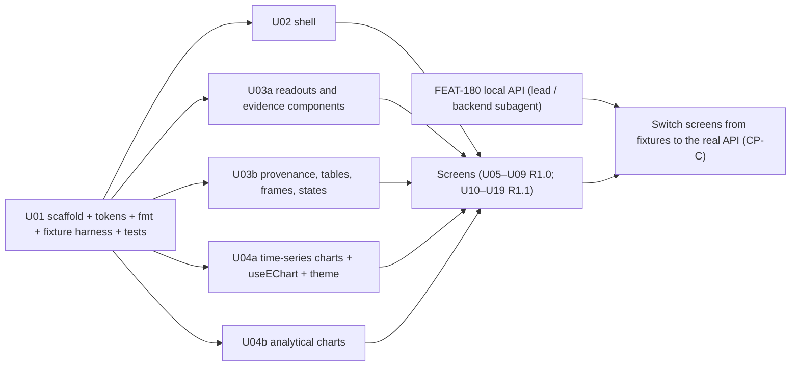

# ProbCast — R1 UX specification

| Field | Value |
|---|---|
| Author | W2, principal product designer (R1 UX specification) |
| Date | Tue 17 Nov 2026 |
| Status | **v1.1 for the R1 UI build** (re-baselined after the R3 red team by W3, D-068; every change is listed in `03-reviews/W3-rebaseline-changelog.md`). `architecture.md` §4 points `web/` here. UI subagents build against this document and the fixture contract in §9.2 |
| Brief | an internal brief (not published) |
| Design source | `02-ideation/A6-ux-ui.md` (A6). This spec replaces A6 for R1 wherever they differ (§0.1 lists every change) |
| Binding inputs | Decision log D-001…D-068; ADR-002, -005, -006, -008, -009, -010, -012, -013, -015, -016 (v1.1 revisions included); `analyzer-contract.md` v1.1; `architecture.md` v1.1 §8 (API, canonical); `05-requirements/srs-functional.md` v1.1 (FR-UI, FR-SCR, Gate column); `srs-nonfunctional.md` v1.1 §6–§7; `08-roadmap/roadmap.md` v1.1 (drops, cut order). Reviews used as inputs, ranked below this spec: R2 §7.2 (16 surfaces, polish, drops), §1.11–§1.14 (UI, SCR, TM, DEMO); R1b §6 ("Wow vs substance"); R3 (`03-reviews/R3-plan-review.md`) |
| IDs | A6 IDs are kept where they exist (`UX-P`, `UX-IA`, `UX-S`, `UX-C`, `UX-CH`, `UX-M`, `UX-T`, `UX-DEMO`). New items use `UXR1-nn`. Appendix A indexes every `UXR1` ID |

**Precedence when documents disagree** (as in `docs/kb/README.md`): the coursework brief → the decision log and ADRs → the analyzer contract and `architecture.md` → the SRS (functional and non-functional), this spec (binding for `web/`), the data plan and the roadmap → reviews (R1a, R1b, R2, R3) → ideation (A6).

**How to read this document**

- **Wireframes.** Content-area wireframes assume a 1440 × 900 viewport with the rail expanded, so the content area is 1220 px wide, drawn as 120 characters (≈ 10 px per character). The shell wireframe (§4.1) shows the full 1440 px as 156 characters. Box-drawing shows layout and order, not exact proportions.
- **Numbers in wireframes are placeholders.** Prices and probabilities are written `$xxx`, `xx%` or `+x.x%` so that no mock number can leak into a README or a teammate's draft (CRT-B-24). Grades at 12 months are shown as C or D, which is what A2 QNT-120/175 expects. `n_eff` values follow A2's orders of magnitude (≈ 33 at 252 sessions for price-only analyzers). Fixture data uses the ticker `DEMO` and an `ILLUSTRATIVE` watermark (DEC-Q-19).
- **Labels.** Statements taken from a binding document cite it. **[REC]** marks my design call. **[ASK]** marks something the lead or the PO must confirm (all collected in §11).
- **Drops.** R1.0 = Wed 25 Nov 12:00 UK · R1.1 = Sat 28 Nov 18:00 UK · R1.2 = stretch, Sun 29–Mon 30 Nov, only with spare capacity and first in the cut order (roadmap §5). The R1.0 UI is a **target** whose requirements are gated at R1.1 (SRS Gate column; D-031, D-068): if CP-C is missed, R1.0 ships as PB-1 and these screens land in R1.1.
- **Time zones.** Market data times are shown in **ET** with a UK tooltip. Team-process times (card registration, committee freeze, holdout reveal) are shown in **UK time** with an ET tooltip.

---

## 0. Summary

1. **Sixteen surfaces in three drops** (R2 §7.2). Polished: shell, Home, Run view, Committee, Price & events, Report studio. Standard (stock shadcn with correct tokens and states): Leaderboard, About, Data tabs, Analyzer library, Idea lab, Run launcher, Events, Settings. Stretch (R1.2): time machine lite, ⌘K and the runs index.
2. **Honesty is enforced by component contracts, not by good intentions.** `ForecastReadout` cannot render without an interval (UXR1-03). Every skill value is rendered through `EvidenceStrip`, which requires grade, `n_eff`, trials and MDE (UXR1-04). Every number carries `data-provenance`, and a Playwright scan fails on any that does not (UX-P01). `hist_drift` can only be labelled through `YardstickLabel`, which always says "survivor-biased" (UXR1-05).
3. **The CAPM anchor is the headline reference** for skill, for the leaderboard sort and for the committee waterfall. `hist_drift` appears beside it as a survivor-biased yardstick. The **anchor-sensitivity table** sits on Home and on the Committee Forecast tab from R1.0 (ADR-006, NFR-SCI-10).
4. **Committee attribution is the median waterfall plus leave-one-family-out ΔP(up)** (ADR-009). There is no P(up) waterfall, no method selector, no weights-over-time chart and no judgemental-view form anywhere in R1.
5. **The holdout is a state machine with a sealed default** (UXR1-02). Until the single witnessed reveal on Tue 1 Dec 2026 at 12:00 UK, no screen renders any score for an (origin, horizon) pair whose outcome date falls on or after 2021-01-01 (outcome-date segments; a 12-month forecast made at the 30 June 2020 close is sealed). Sealed regions are hatched and labelled. There is no freeze or reveal control in the UI: the PO runs both from the CLI (D-047), the reveal in front of witnesses. The final forecast is computed and hashed at the Mon 30 Nov freeze; the reveal unseals scores only.
6. **ECharts for every interactive chart; the report figures are the server's matplotlib files**, previewed byte-for-byte in the Report studio. The SPA never renders or exports a report figure itself (ADR-010).
7. **Final tokens** (§2) were re-checked by script for WCAG contrast and colour-vision-deficiency separation. Four values moved slightly from A6 to meet NFR-UX-05's ΔE ≥ 18 and AA contrast. Dark app, light exports, blue/orange with ▲▼, Inter and JetBrains Mono, British English. §2.8 is paste-ready Tailwind 4 CSS, including the mapping onto shadcn's variable names.
8. **The shell states context and integrity on every page:** ticker, horizon, as-of/snapshot pill, "acting as" picker (⌘K in R1.2) in the top bar; snapshot, "Leak-tested n/N", "Holdout ≥ 2021 sealed until 1 Dec 12:00 UK" and the disclaimer **"Educational research tool. Not investment advice."** in the status bar, never truncated.
9. **The five-minute professor demo uses R1.0/R1.1 screens only.** Its centrepiece is "Why is the median +x%?" (median waterfall), not "Why 61%?". The time-machine beat is optional (R1.2). The LinkedIn storyboard is R2.
10. **Build order: tokens → shell → components → chart kit → screens.** After the scaffold, component lanes and then screen lanes run in parallel against typed fixture JSON: at most three lanes until CP-A (UI lanes U01–U03 only), then at most four, because the PO's review is the constraint (§9; roadmap §2, D-062). The UI needs eight small API additions or clarifications (UXR1-10…17), listed in §11.

### 0.1 Changes from A6

| # | A6 said | R1 does | Why (binding source) |
|---|---|---|---|
| 1 | Committee method selector (Equal / Inverse-CRPS / Stacking / Hedge), inverse-CRPS weights, linear pool | Static method line: "Equal weight per family, quantile averaging, CAPM anchor fixed at 25%". No selector | ADR-009, D-022 |
| 2 | "Why is P(up) 61%?" P(up) waterfall (UX-CH13), demo scene 6, LinkedIn shot 7 | **Median waterfall** from the CAPM-anchor median to the committee median, plus **LOFO ΔP(up)** bars. Demo asks "Why is the median +x%?" | ADR-009, C-03, CRT-B-05 |
| 3 | Baseline "RW+drift" ghost; skill vs RW+drift | **CAPM anchor** is the headline reference; `hist_drift` is a labelled **survivor-biased yardstick** shown alongside | ADR-006, ADR-013, D-019 |
| 4 | Quantile-defined scenarios (20/60/20) with an optional threshold mode | **Economic thresholds only:** R < −15%, −15% … +15%, R > +15% | QNT-245, C-32 |
| 5 | "PIT-verified" badge, "PIT guard on" | **"Leak-tested (future-poisoning)"** with a popover listing what it does not cover | C-38, CRT-B-18 |
| 6 | Holdout "locked · reveals 0/2" per family; "Final evaluation" button | Sealed until **one witnessed reveal, Tue 1 Dec 12:00 UK**; no reveal button in the UI; post-reveal numbers shown as a separate segment | ADR-005, D-018 |
| 7 | Lightweight Charts for the price chart, ECharts for the rest | **ECharts only** | ADR-010, D-023 |
| 8 | Browser-side ECharts SVG print export, print-theme controls, PDF | **Server-rendered matplotlib PNG/SVG**, previewed as the same file; no client export of report figures | ADR-010, C-18 |
| 9 | Global as-of / time machine on every screen, "never cut" | **Time machine lite** on data screens and moments only, R1.2 stretch, first in the cut order; R1.0/R1.1 show "Latest" | C-15, R2 §7.5 #1 |
| 10 | Presentation mode "lite" in R1 | **R2.** R1 demo = script on the normal UI + recorded MP4 | C-39, DEC-Q-21 |
| 11 | Job tray, live running state, SSE progress, cancel | **Removed.** Runs are synchronous (≤ 2 s simple, ≤ 60 s GARCH) | D-011, CRT-B-14 |
| 12 | Identity modal with names, colours and "Add member" | **"Acting as" handle picker** from `configs/authors.yaml`; handles only; attribution, not security | ADR-002, NFR-ACA-07 |
| 13 | Four density modes, presentation scale | **One density.** Projector legibility comes from a 125% browser-zoom check (UXR1-01) | R2 §7.2 #1 |
| 14 | Green/red "traditional" opt-in | **Blue/orange only** in R1 (always with ▲▼ and sign) | Brief constraint; NFR-UX-05 |
| 15 | Disclaimer "— not investment advice", quiet; not on report figures | Exact text **"Educational research tool. Not investment advice."**, always visible in the status bar; also on every exported figure (by the renderer) | D-006, NFR-ACA-05 |
| 16 | Caption builder with a required "Your interpretation" slot; lint flags it | **Factual template captions** (≈ 40 words). The interpretation is optional, written in Word by the team, never stored or generated by ProbCast | ADR-012, C-37, CRT-B-16 |
| 17 | CORP reliability diagram by default | **Binned** reliability diagram with bin counts in R1; CORP only if R1.2 has spare time, otherwise R2 | FEAT-072 |
| 18 | Leaderboard with bootstrap rank intervals and trial-deflated skill | **No rank numbers.** Sorted by CRPSS vs CAPM with CI, grade, n_eff, trials and MDE; rank intervals and DSR are R2 | R2 §7.2 #5, ADR-013 |
| 19 | Run launcher with Form/YAML modes and parameter grids (RJSF) | **Declared presets only**, with a trial-count preview | DEC-Q-10, FEAT-210 |
| 20 | Idea lab kanban board, no-code builder, YAML config editor, "Copy brief" | **Status list + card form** writing `ideas/IC-###.yaml`. The coding agent reads the YAML directly, so "Copy brief" is dropped | D-013, FEAT-209 |
| 21 | Weights-over-time chart (UX-CH12) | **Removed:** it carries no information under equal weights | FEAT-110, R1b §6 |
| 22 | "Add judgemental view…" inside committee members | **Overlay only, no UI in R1** (YAML + report table) | ADR-009, FEAT-107 |
| 23 | "Freeze snapshot for report" (named) | **"Committee forecast vN" freeze with SHA-256 hash** of the final forecast, made from the CLI only (`probcast committee freeze`); final freeze Mon 30 Nov 23:59 UK; the UI shows the freeze history read-only | FEAT-105, FEAT-106, D-047, D-058 |
| 24 | Grade words Strong/Moderate/Weak/Insufficient/Negative | A–D letters + Harvey ball + "… evidence" (e.g. `◔ C · Weak evidence`) + ⊘ flag. The literature prior uses a different component ("Prior: strong") so the two scales cannot be confused | FEAT-044, FEAT-074 |
| 25 | Realistic wireframe numbers (61%, $246, "Moderate" at 12M) | Placeholders; 12M grades C/D; fixtures use `DEMO` and an `ILLUSTRATIVE` watermark | CRT-B-24, DEC-Q-19 |
| 26 | "Add to report (R)" on every chart, report figures pinned from the UI | Report figures come from `configs/report.yaml` (PO-owned). Charts that match a registered figure show "Open report figure" | ADR-010, FEAT-141 |
| 27 | Home "Since your last visit" and "Idea pipeline" | Removed from R1.0 (pipeline counts may return with the Idea lab in R1.1) | R2 §7.2 #2 |
| 28 | Run view tabs Forecasts, Breakdown (regimes), strategy view, sensitivity heatmap, PBO/DSR | **Overview, Calibration, Scores, Robustness, Manifest.** Robustness = trials, decade sub-periods, leak tests | R2 §7.2 #3, FEAT-059 |
| 29 | Fundamentals "As first reported / Latest restated / Diff" | **As first reported only**; the restated diff is R2 | R2 §7.2 #9 |
| 30 | Command palette in R1 | **R1.2 stretch** (navigate and open objects only) | R2 §7.2 #16 |
| 31 | Four palette slots and two text tokens as in A6 §6 | Dark Jade `#3FA585 → #3C9E7F`, dark Rose `#EE66B8 → #EF6BBA`, light down `#B4500C → #B04E0B`, dark input border `#606B7A → #677284` | NFR-UX-05 (ΔE ≥ 18), WCAG 1.4.3/1.4.11 (§2) |

### 0.2 Binding constraints and where this spec enforces them

| Constraint (brief) | Enforced by | Test |
|---|---|---|
| Local laptop app, no login, "acting as" picker | Shell top bar (§3.4), `ActingAsPicker` (§5) | E2E: writes carry `author`; write buttons disabled without a handle |
| 1280–1920 px and projector | Breakpoints §2.6, UXR1-01 | Visual check at 1280, 1440, 1920 and 1920 @ 125% zoom |
| ECharts for all interactive charts; report figures are server PNG/SVG previewed as-is | §6, Report studio §4.8 | Bundle has no other chart library; studio `` hash = server hash |
| Median waterfall + LOFO ΔP(up); no "Why is P(up) X%?" | `MedianWaterfall`, `LofoBars`, §4.4 | String scan: no "Why is P(up)" anywhere in `web/` |
| Economic-threshold scenarios | `ScenarioBar`, `ScenarioTable` | Fixture test: labels "< −15%", "−15% to +15%", "> +15%" |
| "Leak-tested", not "PIT-verified" | `LeakTestedBadge`, §7.6 | String scan: no "PIT-verified" / "PIT guard" in `web/` |
| CAPM headline; hist_drift "survivor-biased"; anchor-sensitivity table on final forecast | `AnchorSensitivityTable`, `YardstickLabel`, Home and Committee | Component test: hist_drift row always contains "survivor-biased" |
| Holdout scores hidden until 1 Dec 12:00 UK; sealed states | UXR1-02, `HoldoutChip` | E2E on the sealed fixture: no `[data-segment="holdout"]` value in the DOM |
| Committee freeze and holdout reveal are CLI-only (D-047) | §4.4 Freeze tab (read-only history + copyable command), UXR1-43 | E2E on every route: no button, link or menu item that freezes or reveals, and no request outside the FR-UI-29 write set |
| 23-quantile fans with 50/80/95% bands; every forecast shows its interval | `FanChart`, `ForecastReadout` (UXR1-03) | Type test: `interval80` and `interval95` required |
| Evidence grade, n_eff, trials and MDE wherever skill is shown | `EvidenceStrip` (UXR1-04) | E2E: every `[data-kind="skill"]` has a sibling `EvidenceStrip` |
| Every number has provenance | `ProvenanceChip`, `data-provenance` | Playwright scan of all routes |
| Blue/orange + ▲▼; dark app, light exports; British English; Inter | §2 tokens, §7.1 voice | Token test (contrast, ΔE), copy review |
| Disclaimer always visible | `DisclaimerBar` in the status bar | E2E: visible and untruncated on every route at 1280 and 1920 |
| Platform never writes prose; factual caption templates | §7.3, §7.14; `CaptionBuilder` has no free-text generation | Advice-word lint; caption snapshot tests |

---

## 1. Design principles

A6's eight principles are condensed to eight R1 rules. Each keeps its A6 ID and ends with how we check it.

### UX-P01 — Every number has a source

Every rendered metric is a provenance target: hover shows a one-line popover (source + as-of), and click or `I` opens the provenance drawer (dataset → series → observation, or run / committee freeze → manifest). Every chart has a source line. Derived numbers link to the run or committee freeze that produced them.
**How we check it:** every numeric element carries `data-metric` and a non-empty `data-provenance`; a Playwright scan over every route (fixtures and real API) fails on any metric without one. Development builds draw a dashed "unsourced" underline under offenders.

### UX-P02 — Uncertainty travels with every estimate

A forecast is never shown without its 80% and 95% range. A skill number is never shown without its 90% CI, `n_eff`, evidence grade, trial count and the minimum detectable effect (MDE). Probabilities are whole percentages and P(price higher) always shows its base rate.
**How we check it:** `ForecastReadout` and `EvidenceStrip` make those props required in TypeScript (`@ts-expect-error` tests prove that omitting them fails to compile). An E2E check asserts that each `[data-kind="skill"]` element has an `EvidenceStrip` sibling.

### UX-P03 — Compared to the CAPM anchor

Every score is relative to a named reference. The headline reference is the **CAPM anchor**; `hist_drift` appears next to it as a **survivor-biased yardstick**. The leaderboard sorts by CRPSS vs CAPM, never by backtest return. Hit rates show the base rate.
**How we check it:** leaderboard default sort is asserted in E2E. `hist_drift` can only be rendered through `YardstickLabel` (lint rule: the raw string `hist_drift` may not appear in JSX outside that component).

### UX-P04 — Honest by default

Every run opens on a fixed-template verdict with grade, CI, `n_eff`, trials, the pre-registered criterion (met / not met / not evaluable) and the holdout state. Negative and insufficient results are normal, neutral states, never alarming. Holdout scores are sealed until the witnessed reveal.
**How we check it:** verdict snapshot tests over six fixture cases (§7.3). The sealed-holdout E2E check finds no holdout-segment value in the DOM while `holdout.state = "sealed"`.

### UX-P05 — Time is explicit

Every page header states its as-of time and snapshot ID. Runs show their evaluation windows by outcome date (dev ≤ 2015, validation 2016–2020, holdout ≥ 2021; origins from 1990). Horizons are shown as chips (`12M · 252 sessions`). In R1.2 past-mode is amber and impossible to miss.
**How we check it:** E2E asserts that every route renders a page subtitle containing the as-of time and snapshot ID.

### UX-P06 — Report-ready means the same file

The Report studio previews the exact PNG/SVG the server renders for the report, with its factual caption, source line and context stamp. ProbCast states what is plotted; the team writes what it means. The UI never draws its own version of a report figure.
**How we check it:** the studio's `` is the server URL and the displayed SHA-256 matches the figure metadata; caption snapshot tests; no text-generation code path exists.

### UX-P07 — Dense, calm, keyboard-reachable, projector-legible

One accent colour; colour is reserved for data. Tabular numerals wherever numbers align. Blue/orange with ▲▼ for direction. Visible focus everywhere. Designed for 1280–1920 px and legible on a projector at 125% zoom.
**How we check it:** token tests (contrast ≥ 4.5:1 text, ≥ 3:1 UI; CVD ΔE ≥ 18); axe (no serious or critical issues) on the five polished routes; a keyboard-only E2E path Leaderboard → Run view → Committee; manual check at 1280, 1440, 1920 and 1920 @ 125%.

### UX-P08 — Credit people; state probabilities, not advice

Every authored object shows its author handle. There is no "AI says" framing and no in-app LLM. Advice words are banned. The disclaimer is always visible.
**How we check it:** the advice-word lint (NFR-ACA-04) runs in CI over UI strings, Markdown and fixtures; E2E checks the disclaimer on every route; authored objects render `AuthorChip`.

---

## 2. Design tokens (final values)

All colour values were checked by script on 17 Nov 2026: WCAG 2.x relative-luminance contrast, and colour-vision-deficiency (CVD) separation using the Machado, Oliveira and Fernandes (2009) full-severity matrices with CIE76 ΔE in CIELAB (the same method as A6 §6, re-run independently). The script reproduces A6's published figures to within ±0.3 ΔE. Four values moved slightly to meet NFR-UX-05 (ΔE ≥ 18 under all three CVD types) and AA contrast; they are marked **changed**.

### 2.1 Surfaces, text, borders and accent (UX-T01)

| Token | Dark (app default) | Light (exports, optional app theme) | Use | Contrast (computed) |
|---|---|---|---|---|
| `canvas` | `#0B0D10` | `#F6F7F9` | App background, status bar | — |
| `surface` | `#111418` | `#FFFFFF` | Panels, top bar, tables | — |
| `raised` | `#171B21` | `#FFFFFF` + e2 shadow | Cards, popovers | — |
| `overlay` | `#1D222A` | `#FFFFFF` + e3 shadow | Dialogs, drawers, ⌘K | — |
| `sunken` | `#08090B` | `#EEF0F3` | Inputs, code, manifests | — |
| `hover` | `#1C2129` | `#F0F2F5` | Row and item hover | — |
| `selected` | `#232845` | `#E8E9FB` | Selected row, active nav item | On `selected`, tertiary text switches to `text-2` (4.2:1 otherwise) |
| `text` | `#E8EBF0` | `#0F1419` | Body, numbers, realised path ("ink") | 15.5:1 / 18.5:1 on surface |
| `text-2` | `#A9B1BD` | `#46505D` | Labels, secondary values | 8.5:1 / 8.2:1 |
| `text-3` | `#828C9B` | `#626B79` | Captions, source lines, axis ticks | 5.4:1 / 5.4:1 (≥ 4.7:1 on every layer) |
| `text-disabled` | `#5A6370` | `#9AA2AE` | Disabled controls only (exempt) | — |
| `border-subtle` | `#232931` | `#E9ECF0` | Panel separators (decorative) | — |
| `border` | `#2E3540` | `#D9DDE3` | Cards, table rules (decorative) | — |
| `border-input` | `#677284` **changed** | `#7E8794` | Input, checkbox and toggle boundaries (WCAG 1.4.11) | 3.8:1 / 3.6:1 on surface; ≥ 3.2:1 on overlay |
| `accent` (iris) | `#8B93FF` | `#4A50D9` | Links, focus ring, primary buttons, **consensus median** | 6.8:1 / 6.1:1 |
| `accent-hover` | `#A3A9FF` | `#3B41C4` | Hover and pressed | — |
| `on-accent` | `#0B0D10` | `#FFFFFF` | Text on accent fills | 7.1:1 / 6.1:1 |
| `accent-subtle` | `#1F2340` | `#ECEDFC` | Accent backgrounds (chips, "working forecast" tag) | — |
| `focus-ring` | `accent`, 2 px + 2 px offset | same | Every focusable element | 7.2:1 / 5.7:1 vs canvas |

### 2.2 Direction, status and time (UX-T02)

| Token | Dark | Light | Use and rule | Check |
|---|---|---|---|---|
| `up` | `#5AA9F0` | `#1764C0` | Positive change. Always with **+** sign and **▲** | 7.4:1 / 5.8:1 |
| `down` | `#F28C3A` | `#B04E0B` **changed** | Negative change. Always with **−** (U+2212) and **▼** | 7.6:1 / 5.3:1 (≥ 4.6:1 on sunken) |
| `flat` | = `text-3` | = `text-3` | No change. Always with **▬** | — |
| `on-up`, `on-down` | `#0B0D10` | `#FFFFFF` | Labels inside up/down fills | ≥ 5.3:1 |
| up vs down separation | | | ΔE76 normal / deuteranopia / protanopia / tritanopia | dark 107 / 106 / 95 / 96 · light 109 / 112 / 99 / 89 |
| `success` | `#4CC38A` | `#16784F` | Checks passed (with ✓). **Never** "good forecast" | 8.3:1 / 5.5:1 |
| `warning` | `#F2B84B` | `#8F5B00` | Stale data, acknowledgeable warnings (with ⚠) | 10.3:1 / 5.7:1 |
| `danger` | `#F26464` | `#C42B2B` | Errors, blocked actions (with ✕). **Never** price down | 6.0:1 / 5.6:1 |
| `info` | = `accent` | = `accent` | Informational notes (with ⓘ) | — |
| `tm` (as-of / past mode) | `#E8B04A` | `#8A5A00` | As-of pill, 2 px frame, banner edge, as-of line on charts (R1.2) | 9.5:1 / 5.9:1 |
| `tm-bg` | `rgb(232 176 74 / 0.08)` | `rgb(138 90 0 / 0.06)` | Past-mode banner and top-bar tint | — |

**Collision rules [REC].** `warning` and `tm` share a hue (ΔE ≈ 4), so they never appear in the same component: `tm` always comes with the clock icon, a frame or a dashed line; `warning` always with ⚠. `tm` and `down` are close under deuteranopia (ΔE ≈ 6), so the amber as-of line only appears on time charts whose series do not use `down`. `accent` and `up` are close under deuteranopia (ΔE ≈ 11), so the waterfall's start and end bars are neutral, not accent.

### 2.3 Data colours

**Series-6 (analyzers; at most six coloured series per chart).** Stable per analyzer: slot = registry order. Authors are identified by handle text, never by series colour.

| Slot | Name | Dark | Light | Contrast dark / light |
|---|---|---|---|---|
| 1 | Sky | `#66C6F5` | `#1097BF` | 9.6:1 / 3.4:1 |
| 2 | Copper | `#DF971D` | `#8A4208` | 7.5:1 / 7.3:1 |
| 3 | Jade | `#3C9E7F` **changed** | `#17604A` | 5.6:1 / 7.5:1 |
| 4 | Rose | `#EF6BBA` **changed** | `#BA1481` | 6.5:1 / 6.0:1 |
| 5 | Sand | `#F2CF86` | `#A07C00` | 12.4:1 / 3.9:1 |
| 6 | Olive | `#A2A05A` | `#6E8F5E` | 6.8:1 / 3.6:1 |

Minimum pairwise ΔE76 including the two reserved colours (accent, ink), normal / deut / prot / trit: **dark 23.9 / 18.9 / 18.8 / 19.9**; **light 26.4 / 18.1 / 24.5 / 22.1**. Further series render in `text-3` and highlight on hover; the legend says "+n more (grey)". Grayscale print redundancy: dash patterns solid · 6-3 · 2-2 · 6-2-2-2 for slots 1–4.

**Reserved data encodings**

| Role | Dark | Light | Encoding |
|---|---|---|---|
| Realised / history ("ink") | `#E8EBF0` | `#0F1419` | Solid 1.5 px, always topmost |
| Consensus median | `accent` | `accent` | Solid 2 px |
| Committee fan 50 / 80 / 95% | `#3F4470` / `#2E324F` / `#222638` | `#BEC0F1` / `#D7D8F7` / `#E9EAFA` | Nested filled bands (q0.25–q0.75 · q0.10–q0.90 · q0.025–q0.975) |
| Analyzer fan (run view) | `color-mix(in oklch, var(--o-sN) 38% / 24% / 14%, var(--o-surface))` | same formula | Same nesting, analyzer's slot colour |
| CAPM anchor reference | `#8B95A5` dashed 4-3 | `#7A8494` dashed 4-3 | Label "CAPM anchor" (6.1:1 / 3.8:1) |
| `hist_drift` yardstick | same grey, **dotted 1-3** | same | Label via `YardstickLabel`: "hist_drift · survivor-biased" |
| Neutral fill (scenario "base", waterfall start/end) | `#4A5260` | `#C9CED6` | Text label inside (6.6:1 / 11.7:1); 1 px `border-input` outline around the bar |
| Holdout region | 45° hatch, 1 px `#46505E` every 6 px | hatch `#C4CAD3` | Always with text label "Holdout ≥ 2021 · sealed" (label in `text-2`) |
| Insufficient-data region | 135° hatch in `text-disabled` | same | Label "insufficient evidence" |
| Chart grid | `#1A1F26` | `#EEF0F3` | Horizontal only |
| Chart axis line | `#2E3540` | `#C4CAD3` | x-axis only |

**Evidence grades (UX-C11 → `GradeBadge`).** Monochrome glyphs in `text-2`, never green or red, so evidence cannot be read as "stock up / stock down".

| Grade (A2 QNT-175) | Glyph | Label | Summary rule |
|---|---|---|---|
| A | ● | A · Strong evidence | n_eff ≥ 100; CRPSS 90% CI excludes 0; HLN-DM p < 0.05; BH q < 0.10; holdout CRPSS > 0 if revealed; 80% coverage within ±10 pp |
| B | ◐ | B · Moderate evidence | n_eff ≥ 40; HLN-DM p < 0.10; holdout not significantly negative; coverage within ±10 pp |
| C | ◔ | C · Weak evidence | n_eff ≥ 20; CRPSS point estimate > 0; coverage within ±15 pp |
| D | ○ | D · Insufficient evidence | Anything else |
| flag | ⊘ | Worse than the CAPM anchor | Shown with D when the CRPSS 90% CI lies wholly below 0 |

The **literature prior** (FEAT-044: strong / moderate / weak / folklore) uses `LiteraturePriorTag` (book icon, outlined chip, text "Prior: moderate"). It never uses letters or Harvey balls.

### 2.4 Typography (UX-T03)

| Role | Family | Notes |
|---|---|---|
| UI and data | **Inter Variable** (`@fontsource-variable/inter`, OFL-1.1), self-hosted | `tabular-nums` and `slashed-zero` on every number that aligns: tables, KPI tiles, readouts, axis labels |
| Codes, IDs, hashes, commands, manifests | **JetBrains Mono Variable** (`@fontsource-variable/jetbrains-mono`, OFL-1.1) | 12–13 px; ligatures off |
| Report figures | Set by the matplotlib renderer (`probcast.mplstyle` from the same tokens): Inter, falling back to Arial | Not controlled from the UI |

No Google Fonts requests (offline demo, NFR-REL-01).

| Token | Size / line height (px) | Weight | Use |
|---|---|---|---|
| `text-2xs` | 11 / 14 | 400–500 | Source lines and status-bar secondary items only (UXR1-01: never data values) |
| `text-xs` | 12 / 16 | 400 | Axis ticks, captions, tooltips, compact table cells, disclaimer |
| `text-sm` | 13 / 20 | 400 | **Default UI body** and table cells |
| `text-base` | 14 / 22 | 400 | Forms, prose in panels, About pages (16/26 inside the 720 px reading column) |
| `text-md` | 16 / 24 | 600 | Panel titles |
| `text-lg` | 20 / 28 | 600 | Page titles (letter-spacing −0.01em) |
| `text-xl` | 24 / 32 | 600 | KPI values |
| `text-2xl` | 32 / 40 | 600 | Readout numbers (median price, P(price higher)) |
| `text-3xl` | 48 / 52 | 600 | Home hero median only |

Overline labels (panel kickers, KPI titles): `text-2xs`, 500, uppercase, +0.04em, `text-3`.

### 2.5 Number and date formats (UX-T04, unchanged except where noted)

| Kind | Rule | Example |
|---|---|---|
| Price | 2 dp, `$`, thousands separators | `$1,234.50` |
| Large money | 1 dp + `bn` / `tn` | `$394.3bn` |
| Returns and changes | 1 dp, explicit sign, U+2212 minus, glyph | `▲ +7.9%`, `▼ −13.0%` |
| Probabilities | Integer %, `<1%` / `>99%` at the extremes. Readouts and tables exact; prose-like captions round to 5 pp (QNT-244) | `xx%` |
| Percentage-point changes | `pp`, signed | `+3 pp` |
| Skill (CRPSS) | 1 dp %, CI in brackets, level stated once per view | `+4.1% [−0.6, +8.8] 90% CI` |
| p-values | 2 significant figures, floor `< 0.001` | `p = 0.041` |
| Counts | `n` and `n_eff` labelled, `≈` for n_eff | `n = 396 · n_eff ≈ 33` |
| Dates (UI) | `D Mon YYYY` | `2 Jan 2019` |
| Dates (IDs, URLs, CSV) | ISO 8601 | `2019-01-02` |
| Times | 24-hour + zone, always | `16:30 ET` (tooltip `21:30 UK`) |
| Horizons | Label + sessions | `12M · 252 sessions` |
| Hashes | First 6 characters in mono; full on hover and copy | `a1b2c3` |
| Apple fiscal periods | Fiscal label + calendar tooltip | `Q1 FY19` (Oct–Dec 2018) |

### 2.6 Spacing, grid, layout and breakpoints (UX-T05)

- **Spacing:** 4 px base (Tailwind 4 default `--spacing: 0.25rem`); use steps 0, 2, 4, 6, 8, 12, 16, 20, 24, 32, 40, 48, 64.
- **Grid:** 12 columns, 24 px gutters, 24 px page padding. Splits 8+4, 6+6, 4+4+4. Panels are cards with 16 px gaps (A6 "default" density; the tiled compact mode is R2).
- **Fixed sizes:** top bar 48 px · rail 220 px expanded / 56 px collapsed · status bar 32 px (A6 had 28 px; raised for the projector) · page header 56 px (title + subtitle) · panel header 40 px · panel padding 16 px · table row 32 px · control height 32 px · right drawer 440 px · reading column 720 px.
- **Breakpoints [REC]:**

| Width | Behaviour |
|---|---|
| ≥ 1920 (`3xl`) | Rail expanded; extra width goes to chart panels; tables cap at 1600 px and centre |
| 1440–1919 (`2xl`, reference) | Rail expanded; layouts as wireframed |
| 1280–1439 (`xl`) | Rail collapsed to icons with tooltips; right drawers overlay content; 8+4 splits stay |
| 1024–1279 | Degraded: 8+4 splits stack; notice "ProbCast is designed for screens 1280 px and wider" |
| < 1024 | Not supported in R1 (same notice) |

- **UXR1-01 Projector rule.** Every polished screen must stay usable at **1920 × 1080 with 125% browser zoom** (1536 × 864 CSS px, i.e. the `2xl` layout). No data value below 12 px; 11 px only for source lines and secondary status items; chart ticks 12 px; line widths ≥ 1.5 px for data series. The demo runs at this zoom (§8).

### 2.7 Radii, elevation, motion and layers (UX-T07, UX-T09)

| Token | Value | Use |
|---|---|---|
| `radius-xs` | 3 px | Badges, chips, `kbd` |
| `radius-sm` | 4 px | Checkboxes |
| `radius-md` | 5 px | Buttons, inputs, selects, popovers, menus, tooltips (shadcn's `rounded-md`) |
| `radius-lg` | 8 px | Cards, panels, drawers |
| `radius-xl` | 12 px | Dialogs, ⌘K |
| `radius-full` | 9999 px | Pills (as-of, acting-as), avatars |
| charts | 0 | Plot areas are square |

| Elevation | Dark | Light |
|---|---|---|
| e1 surface | `surface` + 1 px `border-subtle`, no shadow | `#FFF` + 1 px `border` |
| e2 raised | `raised` + `border` + `0 1px 2px rgb(0 0 0 / .4)` | `0 1px 2px rgb(16 24 40 / .06), 0 1px 3px rgb(16 24 40 / .10)` |
| e3 popover/drawer | `overlay` + `0 8px 24px rgb(0 0 0 / .5)` | `0 8px 24px rgb(16 24 40 / .12)` |
| e4 modal | `overlay` + `0 16px 48px rgb(0 0 0 / .6)`; scrim `rgb(0 0 0 / .6)` | `0 16px 48px rgb(16 24 40 / .16)`; scrim `rgb(15 20 25 / .4)` |

| Motion token | Duration | Easing | Use |
|---|---|---|---|
| `motion-fast` | 120 ms | `cubic-bezier(0.2, 0, 0, 1)` | Hover, press, toggles |
| `motion-base` | 180 ms | same | Popovers, tooltips, tab fade |
| `motion-slow` | 240 ms | enter same; exit `cubic-bezier(0.4, 0, 1, 1)` | Drawers, dialogs; R1.2 curtain |
| `motion-deliberate` | 900 ms | `cubic-bezier(0.3, 0, 0, 1)` | **Only** the R1.2 realised-path reveal |

Rules: never animate data values (no count-ups); charts fade in once (150 ms) and never "grow"; animate `opacity` and `transform` only; with `prefers-reduced-motion: reduce` every duration is 0 except fades ≤ 120 ms, and skeleton shimmer is static.

| Layer (`z`) | 0 base · 10 sticky table headers · 20 rail · 30 top bar and status bar · 40 drawers · 50 popovers and menus · 60 dialogs · 70 toasts · 80 tooltips |
|---|---|

### 2.8 Paste-ready CSS (Tailwind 4 `@theme` + shadcn mapping)

`web/src/styles/tokens.css` is **generated** from `web/src/styles/tokens.json` (UXR1-08, §2.9); edit the JSON, not the CSS. Rules: components use only these tokens (no raw hex, no `dark:` variants); the theme switches by toggling `.dark` on `<html>` before first paint; a subtree with class `light` (the Report studio preview) renders with light tokens inside the dark app.

**UXR1-09 — shadcn naming collision.** In shadcn, `primary` is the brand colour and **`accent` means the hover surface**. ProbCast's iris accent therefore maps to shadcn `primary`, and shadcn `accent` maps to ProbCast `hover`. ProbCast-specific utilities use the `o-` prefix (`bg-o-surface`, `text-o-up`) so the two vocabularies never mix.

```css
@import "tailwindcss";
@custom-variant dark (&:where(.dark, .dark *));

/* LIGHT: also used by the .light preview subtree (Report studio) */
:root, .light {
  --o-canvas:#F6F7F9; --o-surface:#FFFFFF; --o-raised:#FFFFFF; --o-overlay:#FFFFFF; --o-sunken:#EEF0F3;
  --o-hover:#F0F2F5; --o-selected:#E8E9FB;
  --o-text:#0F1419; --o-text-2:#46505D; --o-text-3:#626B79; --o-text-disabled:#9AA2AE;
  --o-border-subtle:#E9ECF0; --o-border:#D9DDE3; --o-border-input:#7E8794;
  --o-accent:#4A50D9; --o-accent-hover:#3B41C4; --o-on-accent:#FFFFFF; --o-accent-subtle:#ECEDFC;
  --o-up:#1764C0; --o-down:#B04E0B; --o-on-up:#FFFFFF; --o-on-down:#FFFFFF;
  --o-success:#16784F; --o-warning:#8F5B00; --o-danger:#C42B2B;
  --o-tm:#8A5A00; --o-tm-bg:rgb(138 90 0 / .06);
  --o-s1:#1097BF; --o-s2:#8A4208; --o-s3:#17604A; --o-s4:#BA1481; --o-s5:#A07C00; --o-s6:#6E8F5E;
  --o-ink:#0F1419; --o-fan-50:#BEC0F1; --o-fan-80:#D7D8F7; --o-fan-95:#E9EAFA;
  --o-ref:#7A8494; --o-neutral-fill:#C9CED6; --o-hatch:#C4CAD3; --o-grid:#EEF0F3; --o-axis:#C4CAD3;
  --o-shadow-2:0 1px 2px rgb(16 24 40/.06),0 1px 3px rgb(16 24 40/.10);
  --o-shadow-3:0 8px 24px rgb(16 24 40/.12); --o-shadow-4:0 16px 48px rgb(16 24 40/.16);
  --o-scrim:rgb(15 20 25/.4);
}
.dark {
  --o-canvas:#0B0D10; --o-surface:#111418; --o-raised:#171B21; --o-overlay:#1D222A; --o-sunken:#08090B;
  --o-hover:#1C2129; --o-selected:#232845;
  --o-text:#E8EBF0; --o-text-2:#A9B1BD; --o-text-3:#828C9B; --o-text-disabled:#5A6370;
  --o-border-subtle:#232931; --o-border:#2E3540; --o-border-input:#677284;
  --o-accent:#8B93FF; --o-accent-hover:#A3A9FF; --o-on-accent:#0B0D10; --o-accent-subtle:#1F2340;
  --o-up:#5AA9F0; --o-down:#F28C3A; --o-on-up:#0B0D10; --o-on-down:#0B0D10;
  --o-success:#4CC38A; --o-warning:#F2B84B; --o-danger:#F26464;
  --o-tm:#E8B04A; --o-tm-bg:rgb(232 176 74 / .08);
  --o-s1:#66C6F5; --o-s2:#DF971D; --o-s3:#3C9E7F; --o-s4:#EF6BBA; --o-s5:#F2CF86; --o-s6:#A2A05A;
  --o-ink:#E8EBF0; --o-fan-50:#3F4470; --o-fan-80:#2E324F; --o-fan-95:#222638;
  --o-ref:#8B95A5; --o-neutral-fill:#4A5260; --o-hatch:#46505E; --o-grid:#1A1F26; --o-axis:#2E3540;
  --o-shadow-2:0 1px 2px rgb(0 0 0/.4); --o-shadow-3:0 8px 24px rgb(0 0 0/.5);
  --o-shadow-4:0 16px 48px rgb(0 0 0/.6); --o-scrim:rgb(0 0 0/.6);
}
:root {
  --o-motion-fast:120ms; --o-motion-base:180ms; --o-motion-slow:240ms; --o-motion-deliberate:900ms;
  --o-z-sticky:10; --o-z-rail:20; --o-z-bars:30; --o-z-drawer:40; --o-z-popover:50;
  --o-z-dialog:60; --o-z-toast:70; --o-z-tooltip:80;
}
@media (prefers-reduced-motion: reduce) {
  :root { --o-motion-fast:0ms; --o-motion-base:0ms; --o-motion-slow:0ms; --o-motion-deliberate:0ms; }
}

@theme inline {
  --font-sans:"Inter Variable", Inter, ui-sans-serif, system-ui, sans-serif;
  --font-mono:"JetBrains Mono Variable", ui-monospace, SFMono-Regular, Menlo, monospace;
  --text-2xs:0.6875rem; --text-2xs--line-height:0.875rem;
  --text-xs:0.75rem;    --text-xs--line-height:1rem;
  --text-sm:0.8125rem;  --text-sm--line-height:1.25rem;
  --text-base:0.875rem; --text-base--line-height:1.375rem;
  --text-md:1rem;       --text-md--line-height:1.5rem;
  --text-lg:1.25rem;    --text-lg--line-height:1.75rem;
  --text-xl:1.5rem;     --text-xl--line-height:2rem;
  --text-2xl:2rem;      --text-2xl--line-height:2.5rem;
  --text-3xl:3rem;      --text-3xl--line-height:3.25rem;
  --radius-xs:3px; --radius-sm:4px; --radius-md:5px; --radius-lg:8px; --radius-xl:12px;
  --shadow-e2:var(--o-shadow-2); --shadow-e3:var(--o-shadow-3); --shadow-e4:var(--o-shadow-4);
  --ease-standard:cubic-bezier(0.2,0,0,1); --ease-exit:cubic-bezier(0.4,0,1,1);
  --breakpoint-xl:80rem; --breakpoint-2xl:90rem; --breakpoint-3xl:120rem;

  /* ProbCast utilities: bg-o-surface, text-o-up, border-o-border … */
  --color-o-canvas:var(--o-canvas); --color-o-surface:var(--o-surface); --color-o-raised:var(--o-raised);
  --color-o-overlay:var(--o-overlay); --color-o-sunken:var(--o-sunken); --color-o-hover:var(--o-hover);
  --color-o-selected:var(--o-selected); --color-o-text:var(--o-text); --color-o-text-2:var(--o-text-2);
  --color-o-text-3:var(--o-text-3); --color-o-text-disabled:var(--o-text-disabled);
  --color-o-border-subtle:var(--o-border-subtle); --color-o-border:var(--o-border);
  --color-o-accent:var(--o-accent); --color-o-accent-subtle:var(--o-accent-subtle);
  --color-o-up:var(--o-up); --color-o-down:var(--o-down); --color-o-success:var(--o-success);
  --color-o-warning:var(--o-warning); --color-o-danger:var(--o-danger);
  --color-o-tm:var(--o-tm); --color-o-tm-bg:var(--o-tm-bg);
  --color-o-s1:var(--o-s1); --color-o-s2:var(--o-s2); --color-o-s3:var(--o-s3);
  --color-o-s4:var(--o-s4); --color-o-s5:var(--o-s5); --color-o-s6:var(--o-s6);

  /* shadcn semantic names (UXR1-09) */
  --color-background:var(--o-canvas);  --color-foreground:var(--o-text);
  --color-card:var(--o-surface);       --color-card-foreground:var(--o-text);
  --color-popover:var(--o-raised);     --color-popover-foreground:var(--o-text);
  --color-primary:var(--o-accent);     --color-primary-foreground:var(--o-on-accent);
  --color-secondary:var(--o-hover);    --color-secondary-foreground:var(--o-text);
  --color-muted:var(--o-sunken);       --color-muted-foreground:var(--o-text-3);
  --color-accent:var(--o-hover);       --color-accent-foreground:var(--o-text);
  --color-destructive:var(--o-danger);
  --color-border:var(--o-border);      --color-input:var(--o-border-input); --color-ring:var(--o-accent);
  --color-sidebar:var(--o-surface);    --color-sidebar-foreground:var(--o-text-2);
  --color-sidebar-primary:var(--o-accent); --color-sidebar-primary-foreground:var(--o-on-accent);
  --color-sidebar-accent:var(--o-selected); --color-sidebar-accent-foreground:var(--o-text);
  --color-sidebar-border:var(--o-border-subtle); --color-sidebar-ring:var(--o-accent);
}

@layer base {
  html { font-family:var(--font-sans); background:var(--o-canvas); color:var(--o-text); font-size:16px; }
  body { font-size:var(--text-sm); line-height:var(--text-sm--line-height); }
  [data-metric], table, .num, .font-mono { font-variant-numeric:tabular-nums slashed-zero; }
  :focus-visible { outline:2px solid var(--o-accent); outline-offset:2px; }
}
```

After `npx shadcn add <component>` [REC]: replace `rounded-xl` on `Card` with `rounded-lg`, keep every other class, and never add `dark:` variants.

### 2.9 Token pipeline and tests (UXR1-08)

| Output | Generated from `tokens.json` | Consumer |
|---|---|---|
| `tokens.css` (§2.8) | All colour, type, radius, motion and layer tokens | SPA |
| `echarts-theme.ts` | Two registered themes (`probcast-dark`, `probcast-light`): background transparent, text `text-2`, axis/grid/tick colours, Series-6 as `color`, Inter, 12 px ticks | Chart kit (§6) |
| `probcast.mplstyle` | **Light** values only, print sizes (ticks 7.5–8 pt, labels 8.5–9 pt, source line 7 pt), Series-6 light, fan print tints `#B3B6EF / #D0D2F5 / #E6E6FA` | Report renderer (FEAT-140) |

**Token tests (Vitest, CI):** (1) every text token ≥ 4.5:1 on `surface`, `raised` and `canvas` in both themes, and `text-3` ≥ 4.5:1 on every layer except `selected`; (2) `border-input`, `ref` and Series-6 ≥ 3:1 on `surface`; (3) up vs down ΔE76 ≥ 18 under deut/prot/trit (NFR-UX-05); (4) Series-6 + accent + ink pairwise ΔE76 ≥ 18 under all three; (5) `tokens.css` is byte-identical to a fresh generation. The contrast and Machado-matrix code is about 60 lines; it ships as `web/scripts/check-tokens.ts`.

---

## 3. Information architecture for R1

### 3.1 Object model (R1 subset of UX-IA-01)

| Object | Display ID | Home in the UI | Source of truth |
|---|---|---|---|
| Snapshot | `r1-dev` · `a1b2c3` | Status bar → snapshot drawer | `GET /api/v1/snapshots` |
| Series / observation | `FRED:DGS10`, `PX:AAPL:close` | Provenance drawer; Data › Catalog | `GET /api/v1/series/{id}` |
| Event | `AAPL-EV-20190102-01` | Event drawer (Price & events, Events) | `GET /api/v1/events` |
| Idea card | `IC-007` (`IC-007.v2` after an amendment) | `/lab/:icId` | `ideas/IC-###.yaml` via `/api/v1/ideas` |
| Analyzer (+ version) | `macro.usd_sensitivity` · `1.0.0+3f9c2a` | `/analyzers/:id` | `/api/v1/analyzers/{id}` |
| Family | `macro.fx` (one of 8) | Chips; Committee › Members | Contract §7 |
| Run | ULID, shown as `run 01JD…7F3A` | `/runs/:runId/:tab` | `/api/v1/runs/{id}` |
| Trial | Count, never an object page | `TrialsCounter` | `/api/v1/trials` |
| Committee (+ freeze) | `main` · "Committee forecast v2" · hash | `/committee/:tab` | `/api/v1/committees/{id}` |
| Final forecast | "Working forecast" / "Committee forecast vN" | Home, Committee | `/api/v1/forecast/final` |
| Report figure / table | `F9`, `T4` (from `configs/report.yaml`) | `/report/figures` | `/api/v1/report/figures` |
| Reference | Harvard entry + verification state | `/report/references` | `/api/v1/report/references` |
| Ledger key | `cm.v1.p_up_252d` | `/report/ledger` | `/api/v1/report/ledger` |
| Author | Handle (`maya`), role `integrator` or `member` | `AuthorChip`, acting-as | `/api/v1/authors` |

### 3.2 Route map with drop and polish

| # | Route | Screen (§4) | Drop | Polish | Cut-order position (R2 §7.5) |
|---|---|---|---|---|---|
| 1 | shell (all routes) | Shell | R1.0 | Polished | Plan B (#15) only |
| 2 | `/` | Home | R1.0 | **Polished** | #15 |
| 3 | `/runs/:runId/:tab` (`overview` · `calibration` · `scores` · `robustness` · `manifest`) | Run view | R1.0 | **Polished** | #15 |
| 4 | `/committee/:tab` (`forecast` · `attribution` in R1.0; `scenarios` · `members` · `anchor` · `freeze` in R1.1) | Committee | R1.0 → R1.1 | **Polished** | #13 (polish), #15 |
| 5 | `/leaderboard` | Leaderboard | R1.0 | Standard | #15 |
| 6 | `/about/:page` (`look-ahead` · `scoring` · `committee` · `glossary` · `data` · `disclaimer`) | About | R1.0 | Standard | #15 |
| 7 | `/data/price` | Price & events | R1.1 | **Polished** | #15 |
| 8 | `/report/:tab` (`figures` · `tables` · `references` · `ledger` · `pack`) | Report studio | R1.1 | **Polished** | #14 (static gallery) |
| 9 | `/data/fundamentals` · `/data/macro` · `/data/peers` · `/data/catalog` | Data tabs | R1.1 | Standard | #9 |
| 10 | `/analyzers` · `/analyzers/:id` | Analyzer library | R1.1 | Standard | #7 |
| 11 | `/lab` · `/lab/new` · `/lab/:icId` | Idea lab | R1.1 | Standard | #6 |
| 12 | dialog; deep link `/runs/new?analyzer=` | Run launcher | R1.1 | Standard | #5 |
| 13 | `/events` (`?sel=` opens the drawer) | Events | R1.1 | Standard | #8 |
| 14 | `/settings` | Settings | R1.1 | Standard | #15 |
| 15 | `?asof=` on `/data/*` and `/events`; `/replay/:momentId` | Time machine lite | R1.2 | Polished if built | **#1** |
| 16 | ⌘K overlay; `/runs` | Command palette, runs index | R1.2 | Standard | **#2** |

**UXR1-07 Feature flags per drop.** `web/src/features.ts` maps each route to its drop. The rail and ⌘K show only enabled routes. A link to a disabled route renders as plain text with the tooltip "Arrives in the R1.1 update (Sat 28 Nov)". There is no "coming soon" page.

### 3.3 URL state (UX-IA-03, R1 subset)

| Param | Scope | Values | Default | Notes |
|---|---|---|---|---|
| `h` | Global | `5` · `21` · `63` · `126` · `252` (sessions) | `252` | Labels 1W · 1M · 3M · 6M · 12M |
| `asof` | Data screens, Events (R1.2) | ISO datetime with offset | absent = latest | Removed when navigating to a route that is not time-aware, with a toast (§4.15) |
| `from`, `to` | Time charts | ISO dates (view window) | page default | Never changes the as-of |
| `scale` | Price chart | `log` · `lin` | `log` if window > 10 y | |
| `basis` | Price chart | `display_adjusted` · `tri` (the API also offers `raw` and `base_share`) | `display_adjusted` | `display_adjusted` = split-adjusted to today's share count, labelled "display-adjusted", display-only and never reachable through `ctx`; `tri` = total return (architecture §8, RT-23) |
| `types` | Price & events, Events | csv of event types | all | |
| `verified` | Price & events, Events | `1` (hide unverified) · `0` | `1` | |
| `sel` | Any | Selected object ID | — | Opens the event or provenance drawer |
| `fx` | Dev builds only | Fixture state (`sealed`, `revealed`, `working`, `frozen`, `baseline_only`, `insufficient`, `stale`, `empty`, `error`) | — | Stripped from production builds (§9.2) |

Router: TanStack Router with `validateSearch` (zod) on every route; invalid params fall back to defaults with a console warning, never an error page.

### 3.4 App shell anatomy (UX-IA-04, revised)

| Region | Spec |
|---|---|
| Top bar (48 px, `surface`, bottom `border-subtle`) | Left → right: wordmark "ProbCast" (links to `/`) · `TickerContext` · `AsOfPill` · `HorizonSelector` · (R1.2) ⌘K trigger 260 px · help `?` · `ActingAsPicker` |
| Rail (220 / 56 px, shadcn `Sidebar`, `collapsible="icon"`) | Items 36 px tall, 16 px Lucide icons, 13 px labels; active item has a 2 px accent bar and `selected` background. `[` toggles. Auto-collapsed at < 1440 px |
| Page header (56 px) | Title (`text-lg`) + subtitle (`text-xs`, `text-3`): "As of {as-of label} · snapshot {id} ({hash})" + page-specific chips; actions right-aligned |
| Content | 12-column grid; reading pages 720 px |
| Status bar (32 px, `canvas`, top `border-subtle`) | Left: `SnapshotChip` · `LeakTestedBadge` (count) · `HoldoutChip` · version. Right: `DisclaimerBar` |
| Right drawer (440 px, shadcn `Sheet`, e3) | Provenance, event detail, grade explanation. `Esc` closes; focus is trapped and returned |
| Toasts (sonner, bottom-right above the status bar) | Neutral tone (§7.12); polite live region |

**Rail order (R1)** follows the workflow look → think → test → combine → write: **Home · Data · Events · Idea lab · Analyzers · Runs (R1.2) · Leaderboard · Committee · Report**, then pinned at the bottom **Settings · About**. In R1.0 only Home, Leaderboard, Committee and About are present (UXR1-07); the Run view is reached from Home and the Leaderboard.

### 3.5 Top bar controls

| Control | ID | R1 behaviour |
|---|---|---|
| `TickerContext` | UX-C01 | Fixed to **AAPL** (dropdown rendered disabled, tooltip "Other tickers arrive in R2"). Shows the last close **of the active snapshot**, never "live": `AAPL · Apple Inc. · Close 24 Nov $xxx.xx ▲ +x.x%`. Click opens a popover with the company card (exchange, fiscal year end, split history with dates), each value with provenance |
| `AsOfPill` | UX-C02 (reduced) | R1.0/R1.1: read-only pill `◷ Latest · r1-dev (24 Nov 2026 close)`; tooltip lists dataset freshness. R1.2: interactive on time-aware routes (§4.15) |
| `HorizonSelector` | UX-C03 | shadcn `ToggleGroup`, `1W 1M 3M 6M 12M`, `role="radiogroup"`, keys `1`–`5`. Writes `?h=`. On pages where a value is horizon-fixed (the 12-month final forecast) the selector stays enabled for the skill panels, and the fixed panels carry a `12M · fixed` chip |
| ⌘K trigger | UX-C04 | R1.2 only (§4.16) |
| Help `?` | UX-A11Y-10 | Opens a popover: shortcuts, link to About › Glossary, link to the team guide |
| `ActingAsPicker` | UX-C06 (revised) | Pill `ⓐ Acting as: maya ▾`. Popover lists handles from `/api/v1/authors` with role tags; selection stored in `localStorage` (`probcast.actingAs`). With no handle chosen the pill reads "Choose who you are acting as" in a `warning` outline and every write action is disabled with the tooltip "Choose who you are acting as (top right) first". Attribution only, not security (ADR-002) |

### 3.6 Status bar (UX-C08, revised)

```
● snap r1-dev a1b2c3 · ⛨ Leak-tested 9/9 + committee · [lock] Holdout ≥ 2021 sealed until 1 Dec 12:00 UK · v0.1.0 (5e1f0a)   │ Educational research tool. Not investment advice.
```

| Item | Content | Click |
|---|---|---|
| `SnapshotChip` | Snapshot ID, 6-char hash; ⚠ `warning` if the newest price observation is older than 1 trading day before today | Snapshot drawer: datasets, `ingested_at`, content hash, rule count |
| `LeakTestedBadge` (count) | "Leak-tested n/N" over registered analyzers, plus "+ committee" when the committee passes; `danger` ✕ if any registered analyzer fails | Popover: list of failing analyzers (if any) and §7.6 text |
| `HoldoutChip` | Per UXR1-02 state (outcome-date boundary) | Popover with §7.5 text, which explains that a 2020 origin at 12 months is sealed |
| Version | Package version + git SHA | Copies both |
| `DisclaimerBar` | Exact text **"Educational research tool. Not investment advice."**, `text-xs`, `text-2` | About › Disclaimer |

At 1280 px the left items shorten (`r1-dev`, `9/9`, `Sealed ≥ 2021`), never the disclaimer.

### 3.7 UXR1-02 — Holdout state machine and the sealed rendering rule

| State | When | `status.holdout` | UI |
|---|---|---|---|
| `sealed` | Now → reveal | `{state:"sealed", boundary:"2021-01-01", basis:"outcome_date", freeze_at:"2026-11-30T23:59:00Z", reveal_at:"2026-12-01T12:00:00Z"}` | Chip "Holdout ≥ 2021 sealed until 1 Dec 12:00 UK" (tooltip: outcome dates; §7.5) |
| `sealed` + frozen | Mon 30 Nov 23:59 → Tue 1 Dec 12:00 UK | `+ frozen:true, forecast_hash` | Chip adds "· methods frozen"; popover: "Final forecast computed and hashed at the freeze ({hash})" |
| `revealed` | After the unlock record exists | `{state:"revealed", unlock:{at, witnesses:n, witness_mode, record_hash}, forecast_hash}` | Chip "Holdout ≥ 2021 revealed 1 Dec (witnessed)"; popover: "The reveal unsealed scores only. The forecast hash is unchanged: {hash}" |

**Rules.**
1. While `sealed`, no element may render a score, metric, verdict, rank, PIT value or forecast-vs-realised mark for an (origin, horizon) pair whose **outcome date** t + h falls on or after 2021-01-01 (ADR-005 v1.1; e.g. origin 2020-06-30 at 12 months). Charts by origin draw the holdout span as a hatched region labelled "Holdout ≥ 2021 · sealed", starting h sessions before 2021-01-01 for the displayed horizon (late 2020 at 3M, early 2020 at 12M); tables show a `Sealed` cell with the chip's tooltip.
2. Prices, events, fundamentals and macro data from 2021 onward stay visible: the holdout seals **scores**, not data (CRT-B-04). The tooltip says so.
3. Defence in depth: the API should never send holdout metrics while sealed (the scorer refuses, L8). If a payload nevertheless contains any metric tagged `sample: "holdout"` (architecture §8 payload tag; rendered as `data-segment`) while sealed, the component shows the error state "Integrity check: holdout scores received while sealed. Not displayed." and logs to the console. It never renders the value.
4. After the reveal, holdout metrics appear as a **separate** column or row labelled "Holdout 2021–2026 (revealed 1 Dec, witnessed)". They are never merged into development/validation numbers; the grade shown stays `grade_prereveal` (frozen at the reveal), `holdout_result` is shown separately, and any post-reveal grade is labelled "post-reveal" (ADR-005, RT-30). At 126 and 252 sessions the holdout line reads "insufficient evidence" (pre-registered readout at 21 and 63 sessions only).
5. No UI control can freeze the committee or reveal the holdout, and the API has no path for either (D-047, architecture §8). The PO runs `probcast committee freeze` and `probcast holdout reveal` from the CLI, the reveal in front of witnesses (FEAT-053).
7. The reveal unseals scores only. The final forecast and its SHA-256 are computed at the Mon 30 Nov freeze; after the reveal every forecast view shows the same frozen hash (ADR-015, D-058).
6. The time machine (R1.2) never shows a committee scorecard or realised-vs-fan mark for a pair whose outcome falls on or after 2021-01-01 while sealed.

### 3.8 Kinds of time (UX-IA-06, R1)

| Concept | Question | Where shown | Visual |
|---|---|---|---|
| Snapshot | Which data version? | Status bar, page subtitle, figure stamps | Mono ID + hash |
| As-of | What did the world know? | Top-bar pill; R1.2 amber mode | Clock icon; amber only in past mode |
| Evaluation windows | Which period scored this run? | Run header chip `By outcome: Dev ≤ 2015 · Val 2016–20 · Holdout ≥ 2021 sealed ⓘ` (tooltip: "Segments use the date the outcome is known. A 12-month forecast made at the 30 June 2020 close ends in 2021, so it is sealed.") | Bracket chip; hatched holdout on charts |
| Horizon | How far ahead? | Top-bar selector; `12M` chips on panels | Chip |
| Forecast origin | When was this forecast made? | Tooltips ("origin 30 Nov 2026 close") | Ink dot on fans |
| Target date | When is the forecast about? | Readouts ("≈ 1 Dec 2027; 252 sessions") | Text |
| View window | Which dates are on the x-axis? | Range presets, slider | Grey brush |

Rules: zooming never changes the as-of; runs ignore the as-of ("Runs are historical artefacts; the time machine does not change them"); the final forecast's origin and target are always spelled out.

### 3.9 Keyboard map (UX-IA-07, R1 subset)

Single-key shortcuts work only when focus is not in a text field (WCAG 2.1.4). The remappable keymap is R2.

| Keys | Action | Keys | Action |
|---|---|---|---|
| `G H` | Home | `1`–`5` | Horizon 1W … 12M |
| `G L` | Leaderboard | `[` | Toggle rail |
| `G M` | Committee | `I` | Provenance of the focused value |
| `G D` | Data (R1.1) | `V` | Toggle "view as table" on the focused chart |
| `G E` | Events (R1.1) | `J` / `K` | Next / previous row |
| `G R` | Report studio (R1.1) | `Esc` | Close drawer / dialog |
| `G I` | Idea lab (R1.1) | `?` | Shortcut sheet |
| `⌘K` / `Ctrl K` | Command palette (R1.2) | `⌘↵` | Confirm the run launcher |

---

## 4. Screen specifications

### 4.0 Common template and shared states

Every screen section uses the same headings: **Purpose · Questions it answers · Wireframe · Components · Data · States · Provenance · Interactions · Acceptance · Polish, drop and cut · Deferred to R2.**

**Shared state matrix (UX-M01, revised).** Screens only list deviations from this table.

| State | Trigger | Treatment |
|---|---|---|
| Loading < 300 ms | Any fetch | Render nothing new (no flash) |
| Loading ≥ 300 ms | Any fetch | `Skeleton` matching the layout; charts show the axis frame and a band skeleton; numbers show a width-stable `—`; container `aria-busy="true"` |
| Empty | Endpoint returns no items | `EmptyState` (glyph, title, one or two sentences, one action or CLI hint) from §7.10 |
| Error (recoverable) | RFC 9457 problem or network error on one panel | Inline `StateNotice` in that panel: what happened → what to do; collapsible details in mono with a copy button; the rest of the page keeps working |
| Engine offline | `/api/v1/health` fails | Global banner + status bar item in `danger` (§7.11); TanStack Query serves cached data, labelled "cached {time}" |
| Blocked (integrity) | `PITViolation`, failed gate, holdout data while sealed | ⊘ glyph, `danger` border, the reason and the fix path |
| Insufficient evidence | `n_eff < 20` (greyed, no tests) or `< 10` (value hidden) | Value in `text-3` or `—`, 135° hatch on chart regions, ⓘ explanation (§7.4), grade ○ D |
| Sealed | `status.holdout.state = "sealed"` | UXR1-02: hatch + chip + "Sealed" cells; no holdout values |
| Stale | Newest observation older than its expected lag, or a run/figure built on an older snapshot | `warning` ⚠ item and a page `StateNotice` once per session (§7.12) |
| Working vs frozen | Committee forecast not yet frozen / frozen | `accent-subtle` chip "Working forecast" vs neutral chip "Committee forecast vN · hash" |

All write actions (register card, launch run) require an acting-as handle (§3.5) and send `author` in the request body. Committee freeze and holdout reveal are not UI actions: they are CLI-only (D-047).

---

### 4.1 Shell — top bar, rail, status bar (UX-IA-04 · FEAT-183, -166) · R1.0 · Polished

**Purpose.** A frame that states, on every page, which stock, horizon, data version and author context the user is in, and whether the results on screen are leak-tested and holdout-safe.

**Questions it answers.** Which data am I looking at (snapshot, as-of)? Which horizon? Who am I acting as? Are these methods leak-tested? Is the holdout still sealed? Is this advice? (No, and it says so.)

**Wireframe (full 1440 px).**

```
┌──────────────────────────────────────────────────────────────────────────────────────────────────────────────────────────────────────────────────────────┐
│ ProbCast │ AAPL ▾ Apple Inc. · Close 24 Nov $xxx.xx ▲ +x.x% │ ◷ Latest · r1-dev (24 Nov close) │ 1W 1M 3M 6M [12M] │ ? │ ⓐ Acting as: maya ▾              │
├──────────────────┬───────────────────────────────────────────────────────────────────────────────────────────────────────────────────────────────────────┤
│ ◆ Home           │ Page title                                                                                                           [page actions]   │
│ ▤ Data           │ As of Latest · snapshot r1-dev (a1b2c3) · page chips                                                                                  │
│ ⚑ Events         │ ───────────────────────────────────────────────────────────────────────────────────────────────────────────────────────────────────── │
│ ✎ Idea lab       │                                                                                                                                       │
│ ƒ Analyzers      │                              content: 12 columns · 24 px gutters · 24 px padding                                                      │
│ ≡ Leaderboard    │                                                                                                                                       │
│ ⚖ Committee      │                                                                                              ┌─ Right drawer 440 px (Sheet) ──────┐   │
│ ❐ Report         │                                                                                              │ Provenance · Event · Grade         │   │
│                  │                                                                                              │ Esc closes; focus is trapped       │   │
│                  │                                                                                              └────────────────────────────────────┘   │
│ ⚙ Settings       │                                                                                                                                       │
│ ⓘ About          │                                                                                                                                       │
├──────────────────┴───────────────────────────────────────────────────────────────────────────────────────────────────────────────────────────────────────┤
│ ● r1-dev a1b2c3 · ⛨ Leak-tested 9/9 + committee · [lock] Holdout ≥ 2021 sealed until 1 Dec 12:00 UK │ Educational research tool. Not investment advice.  │
└──────────────────────────────────────────────────────────────────────────────────────────────────────────────────────────────────────────────────────────┘
```

**Components.** shadcn: `Sidebar`, `ToggleGroup`, `Popover`, `Tooltip`, `Sheet`, `Sonner`, `Button`, `Separator`. Custom: `TopBar`, `TickerContext`, `AsOfPill`, `HorizonSelector`, `ActingAsPicker`, `StatusBar`, `SnapshotChip`, `LeakTestedBadge`, `HoldoutChip`, `DisclaimerBar`, `ProvenanceDrawer` host, `ShortcutSheet`, `SkipLink`.

**Data.** `GET /api/v1/health` (+ the status fields in UXR1-10), `GET /api/v1/snapshots`, `GET /api/v1/authors`, `GET /api/v1/prices/AAPL?from={-10 sessions}` (last two closes), `GET /api/v1/analyzers` (leak-test count until UXR1-10 exists).

**States.** Loading: chips render as width-stable skeletons, the disclaimer renders immediately (static text). Engine offline: status bar left becomes `✕ Engine offline · cached {time}` in `danger`, plus the global banner. Stale snapshot: `SnapshotChip` shows ⚠. No acting-as: picker in `warning` outline, write buttons disabled. Sealed / revealed: per UXR1-02. A leak-test failure: badge `✕ Leak-tested 8/9` in `danger`.

**Provenance.** The ticker close and change carry provenance (price series, snapshot). The snapshot chip opens the snapshot drawer. Badges open explanatory popovers.

**Interactions.** `[` toggles the rail; `1`–`5` set the horizon; `?` opens the shortcut sheet; `G`-chords navigate; skip link "Skip to content" is the first tab stop; the drawer returns focus to its trigger.

**Acceptance.**
1. On every route at 1280, 1440 and 1920 px the top bar, rail and status bar render without horizontal scroll; at < 1440 px the rail is collapsed to 56 px with tooltips.
2. The status bar shows exactly "Educational research tool. Not investment advice.", fully visible (not clipped or ellipsised) on every route at 1280 px and at 1920 px @ 125% zoom.
3. The snapshot chip shows the ID and a 6-character hash from the API; the holdout chip text matches §7.5 for the `sealed`, `sealed+frozen` and `revealed` fixtures.
4. `LeakTestedBadge` shows `passed/total` from the API and turns `danger` when any analyzer fails.
5. Horizon changes update `?h=`, persist across navigation and respond to `1`–`5` when focus is not in an input.
6. The acting-as choice persists across reloads; with none chosen, every write button is disabled with the §3.5 tooltip.
7. With the engine stopped, the offline banner appears within 3 s and no route renders blank.
8. Landmarks `header`, `nav`, `main`, `contentinfo` exist; axe reports no serious or critical issues on the shell.
9. Ticker change renders sign, ▲/▼ and colour together.

**Polish, drop and cut.** Polished · R1.0 · cut only under Plan B (#15).

**Deferred to R2.** Density modes, remappable keymap, multi-ticker, job tray, hosted-instance auth, presentation chrome.

---

### 4.2 Home / Mission control (UX-S01 · FEAT-200) · R1.0 · Polished

**Purpose.** A ten-second answer for the professor and teammates: what the committee forecasts for AAPL's price about 12 months out, how strong the evidence is, how much the answer depends on the anchor, and whether the data is fresh.

**Questions it answers.** What is the median price ≈ 1 Dec 2027 and its 80% and 95% range? What is P(price higher) against its base rate? What are bear/base/bull probabilities? How does the forecast move under other anchors? Which ideas were scored recently and how did they grade? Is the forecast frozen and registered?

**Wireframe (content area).**

```
Home                                                        As of Latest · snapshot r1-dev (a1b2c3) · [Working forecast]
┌─ Committee forecast · AAPL price ≈ 1 Dec 2027 (252 sessions) ──────── 12M · fixed ─┐┌─ Readout ──────────────────────┐
│ $ (log)                                                   95% ░░░░                 ││ MEDIAN PRICE ≈ 1 DEC 2027      │
│                                              80% ▒▒▒▒▒▒▒▒▒▒░░░░                    ││ $xxx               ▲ +x.x%     │
│                                  50% ▓▓▓▓▓▓▓▓▓▓▒▒▒▒░░░                             ││ 80% range   $xxx – $xxx        │
│ ink history ────────────────●━━━━━━━━━━━━━━━━━━━ median (iris)                     ││ 95% range   $xxx – $xxx        │
│                               ▓▓▓▓▓▓▓▓▓▓▒▒▒▒░░░    ┄┄ CAPM anchor median           ││ 31 Dec 2027 $xxx (80% $x–$x)   │
│                                    ▒▒▒▒▒▒▒▒░░░░    ·· hist_drift · survivor-biased ││ ────────────────────────────── │
│                                            ░░░░                                    ││ P(PRICE HIGHER)  xx%           │
│ └ 2024 ────── 2025 ────── 2026 ┊ Mar 2027 ─── Jun ─── Sep ─── Dec 2027             ││ ▕███████████▏░░░░░░▏ 50% ┆     │
│ Bands: central 50 / 80 / 95% predictive intervals. Price derived from the          ││ Base rate: AAPL rose in xx% of │
│ total-return forecast (expected dividend yield ≈ x.x%). Source: ProbCast committee  ││ 12M windows since 1981;        │
│ (working, r1-dev); prices: Yahoo Finance via yfinance, rebuilt. Data as of         ││ S&P 500 xx%                    │
│ 24 Nov 2026 16:00 ET.                                                              ││ ────────────────────────────── │
└────────────────────────────────────────────────────────────────────────────────────┘│ EVIDENCE (COMMITTEE)           │
┌─ Scenarios · 12-month total return ────────────────────────────────────────────────┐│ 63 sessions: CRPSS vs CAPM     │
│ ▼ Bear  R < −15%    │ ▬ Base  −15% to +15%                   │ ▲ Bull  R > +15%    ││ +x.x% [−x.x, +x.x] 90% CI      │
│ ███████ xx% ████████│█████████████████ xx% ██████████████████│███████ xx% ████████ ││ ◔ C · n_eff ≈ 180 · trials 41  │
└────────────────────────────────────────────────────────────────────────────────────┘│ MDE ±x.x%                      │
                                                                                      │ Mean tilt vs CAPM +x.x pp/yr ⓘ │
                                                                                      │ 12M: calibration only ⓘ        │
                                                                                      │ [Open committee →]             │
                                                                                      └────────────────────────────────┘
┌─ Anchor sensitivity · median ≈ 1 Dec 2027 ─────────────┐┌─ Latest verdicts ────────────┐┌─ Data freshness ───────────┐
│ Location anchor              Median 80% range  P(up)   ││ ◔ C USD sensitivity maya  3M ││ ● Prices  24 Nov 16:00 ET  │
│ CAPM, ERP 4%                 $xxx   $xxx–$xxx  xx%     ││ ○ D Momentum 12-1  theo 12M  ││ ● SEC EDGAR 10-K 31 Oct    │
│ CAPM, ERP 5% · headline ●    $xxx   $xxx–$xxx  xx%     ││ ⊘ D RSI reversal   ines  1M  ││ ◐ FRED  CPI Oct · lag      │
│ CAPM, ERP 6%                 $xxx   $xxx–$xxx  xx%     ││ ◔ C Earnings drift raj    3M ││ ● Events  261 · 88 earn.   │
│ 50% shrink to hist_drift     $xxx   $xxx–$xxx  xx%     ││ ○ D Fed-model gap  maya 12M  │└────────────────────────────┘
│ hist_drift · survivor-biased $xxx   $xxx–$xxx  xx%     ││ [Leaderboard →]              │┌─ Registered forecast ──────┐
│ The anchor is a modelling assumption. ⓘ                │└──────────────────────────────┘│ Not frozen yet. Final      │
└────────────────────────────────────────────────────────┘                                │ freeze Mon 30 Nov 23:59 UK │
                                                                                          └────────────────────────────┘
```

**Components.** shadcn: `Card`, `Table`, `Tooltip`, `Badge`, `Button`. Custom: `ChartFrame` + `FanChart` (UX-CH02, hero variant), `ForecastReadout` (UXR1-20), `ProbabilityReadout` (UX-C10), `ScenarioBar` (UX-CH14), `EvidenceStrip` (UXR1-22), `AnchorSensitivityTable` (UXR1-26, compact), `VerdictList` (compact `DataTable` with `GradeBadge` and `AnalyzerChip`), `FreshnessList` (UX-C17), `RegisteredForecastCard` (UXR1-33), `ProvenanceChip`, `StateNotice`.

**Data.** `GET /api/v1/forecast/final` (fan, summary, scenarios, anchor sensitivity, evidence, base rate, status, freeze, prospective registration, caveats, provenance; fields in UXR1-16) · `GET /api/v1/committees/{id}` (family and member counts) · `GET /api/v1/runs?status=completed` (latest verdicts: the five newest, sorted client-side; filters in UXR1-17) · `GET /api/v1/prices/AAPL?basis=display_adjusted` (history line, last 3 years shown) · status/freshness (UXR1-10).

**States (deviations).**
- *Empty:* no final forecast object yet (before CP-B) → `EmptyState` "No committee forecast yet" (§7.10) in the hero; other panels still render.
- *Baseline-only:* no family is active (fewer than 1 active family; SRS FR-CMT-05, FR-CMT-21) → chip "Baseline committee (forecast floor)"; evidence panel says "Built from the CAPM anchor, bootstrap and volatility baselines only".
- *Working vs frozen:* chip in the page subtitle; `RegisteredForecastCard` shows "Not frozen yet…", then "Committee forecast v2 · frozen 30 Nov 23:59 UK · forecast hash 3f9c…a21 · to be scored ≈ 1 Dec 2027" (the forecast is computed and hashed at the freeze; the reveal does not change it).
- *Insufficient:* committee evidence at 63 sessions below n_eff 20 → greyed with §7.4 copy; the forecast itself still shows (a forecast is not a skill claim).
- *Stale:* stale freshness rows show ⚠ and the page `StateNotice`.
- *Sealed / revealed:* evidence panel adds "Evaluated on outcomes 1990–2020 · holdout sealed until 1 Dec 12:00 UK"; after the reveal it adds a separate "Holdout 2021–2026 (revealed)" line, and the forecast and its hash stay unchanged.

**Provenance.** Each readout value, each scenario probability, each anchor row and each freshness row has a `ProvenanceChip` (final forecast object → committee version/freeze hash → snapshot; freshness → dataset). The fan has a source line.

**Interactions.** Hover the fan → readout bar (month, median, 50/80/95% bounds in price and return). `Price | Return` and `Log | Lin` toggles in the frame toolbar. `V` shows the monthly quantile table. Click fan → `/committee/forecast`. Click a scenario segment → `/committee/scenarios` (R1.1; before then a tooltip with the definition). Verdict row → its run. Freshness row → provenance drawer (R1.1: Data › Catalog).

**Acceptance.**
1. The readout shows median, 80% range and 95% range; the component does not compile without both intervals (UXR1-03).
2. P(price higher) shows the base rate for AAPL and the S&P 500 with the period, and the event definition in its tooltip (§7.8).
3. The scenario bar has exactly three segments labelled "R < −15%", "−15% to +15%", "R > +15%", each with ▼/▬/▲, and the probabilities sum to 100% ± 1 pp.
4. The anchor-sensitivity table has five rows in the fixed order; the headline row is marked; the `hist_drift` row reads "hist_drift · survivor-biased".
5. The fan shows exactly three nested bands (50/80/95) built from the 23-quantile grid (q0.25–q0.75, q0.10–q0.90, q0.025–q0.975), plus the CAPM-anchor and hist_drift median reference lines with labels.
6. Committee skill is shown only with `EvidenceStrip` (grade, n_eff, trials, MDE); 12M shows "calibration only"; the panel shows the committee's mean location tilt vs CAPM in pp/yr (contract §8.1).
7. Fixtures `working`, `frozen`, `baseline_only` and `empty` each render the specified chip or empty state.
8. On the `sealed` fixture no holdout value is in the DOM; on `revealed` the separate holdout line appears.
9. Every numeric element has `data-provenance`.
10. Largest contentful paint ≤ 1.5 s on the PO's laptop with the real API (NFR-PERF-04).

**Polish, drop and cut.** Polished · R1.0 · Plan B only (#15).

**Deferred to R2.** "Since your last visit" diff, idea-pipeline panel, presentation hero, quantile dotplot (FEAT-191).

---

### 4.3 Run view (UX-S08 · FEAT-202) · R1.0 · Polished

**Purpose.** Answer three questions about one backtest — did the idea work against the CAPM anchor, how sure are we, could it be overfit — and show what is needed to reproduce it.

**Questions it answers.** What is the verdict at this horizon? Is the skill distinguishable from zero given n_eff and the MDE? Was the pre-registered criterion met? Are the forecasts calibrated? How many variants were tried? Does it hold across decades? Which data, code and seed produced it?

**Wireframe (Overview tab).**

```
Runs ▸ run 01JD…7F3A   ■ USD sensitivity · 1.0.0+3f9c2a · maya · macro.fx · ⛨ Leak-tested · Completed 21 Nov 14:02
[By outcome: Dev ≤ 2015 · Val 2016–20 · Holdout ≥ 2021 sealed ⓘ] [Monthly from 1990 · n = 312] [3M · 63 s] [Ref: CAPM]
[Yardstick: hist_drift · survivor-biased] [snap r1-dev a1b2c3] [Trials 3 · family 7 · team 41]   [Tear sheet ↗] [⋯]
Overview | Calibration | Scores | Robustness | Manifest
┌─ Verdict ────────────────────────────────────────────────────────────────────────────────────────────────────────────┐
│ ◔ C · Weak evidence. At 3M (63 sessions), CRPS skill against the CAPM anchor is +x.x% [−x.x, +x.x] (90% CI,          │
│ n_eff ≈ 104). This is not distinguishable from the CAPM anchor. Against the hist_drift yardstick (survivor-biased)   │
│ it is +x.x% [−x.x, +x.x]. 80% intervals contained the outcome in xx% of cases (target 80%). Pre-registered           │
│ criterion (IC-007): not met. Trials: 3 for this analyzer, 7 in family macro.fx, 41 team-wide. Minimum detectable     │
│ skill at this sample size: ±x.x%. Holdout (outcomes ≥ 2021): sealed until 1 Dec 12:00 UK.                            │
└──────────────────────────────────────────────────────────────────────────────────────────────────────────────────────┘
┌─ CRPSS vs CAPM ────┐┌─ vs hist_drift ─────┐┌─ 80% coverage ──────┐┌─ Hit rate (P > 50%) ─┐┌─ Sample ─────────────────┐
│ +x.x%              ││ +x.x%               ││ xx%  target 80%     ││ xx%  base rate xx%   ││ n = 312 origins          │
│ ├──●───┤ [−x, +x]  ││ yardstick ·         ││ [xx, xx] binomial   ││ [xx, xx] binomial    ││ n_eff ≈ 104 (overlap 3)  │
│ ◔ C · n_eff 104    ││ survivor-biased     ││ 90% CI              │└──────────────────────┘│ MDE ±x.x% · trials 3     │
│ trials 3 · MDE ±x  ││ ├─●──┤ [−x, +x]     │└─────────────────────┘                        └──────────────────────────┘
└────────────────────┘└─────────────────────┘                                                                           
┌─ Pre-registered criterion · IC-007 · registered 21 Nov 2026 14:02 UK · hash a9e1c0 ──────────────────────── NOT MET ─┐
│ "Beats the CAPM anchor on CRPS at 63 days with grade ≥ B and 80% intervals covering 70–90%."                         │
└──────────────────────────────────────────────────────────────────────────────────────────────────────────────────────┘
┌─ Location tilt vs CAPM · drift-neutral calibration (contract §8.1) ──────────────────────────────────────────────────┐
│ Mean over origins of (median − CAPM median): +x.x pp/yr at 3M · T-DN drift-neutrality test ✓                         │
└──────────────────────────────────────────────────────────────────────────────────────────────────────────────────────┘
┌─ Forecast vs realised · 3M · by origin (UX-CH04) ────────────────────────────────────────────────────────────────────┐
│ bars = 10–90% per origin · inner 25–75% · tick = median · ● realised inside 80% · ○ outside · ┄ CAPM 10–90%          │
│ 1990 ───────────────────────────────────────────────────────────── 2020 ┊▨▨▨▨▨ Holdout ≥ 2021 · sealed ▨▨▨▨▨┊        │
└──────────────────────────────────────────────────────────────────────────────────────────────────────────────────────┘
┌─ Reliability · P(up) · 10 bins ──────┐┌─ PIT histogram · 10 bins ────────────┐┌─ Skill by horizon vs CAPM ───────────┐
│ points + 90% whiskers · diagonal     ││ uniform line · 95% band · counts     ││ 1W 1M 3M 6M 12M · 90% CI · 0 · ┄ MDE │
│ bin counts under the x-axis          │└──────────────────────────────────────┘└──────────────────────────────────────┘
└──────────────────────────────────────┘                                                                                
```

**Other tabs.**

| Tab | Content | Notes |
|---|---|---|
| Calibration | UX-CH05 binned reliability (10 bins, counts, 90% whiskers); UX-CH06 PIT histogram (10 bins; at 252 sessions computed on non-overlapping sub-series, labelled); UX-CH07 coverage at 50/80/95% with binomial CIs; sharpness table (mean 80% width vs CAPM anchor) | Each chart has a three-line "How to read" popover (U-shaped PIT = overconfident, hump = underconfident, slope = bias) |
| Scores | Horizon table: rows = CRPS, CRPSS vs CAPM, CRPSS vs hist_drift (yardstick), pinball (mean over quantiles), Brier on P(up), hit rate vs base rate, 80% coverage; columns = this run · CAPM anchor · hist_drift · Δ vs CAPM [90% CI] · HLN-DM p · n_eff. UX-CH08 skill by horizon (with MDE band) and UX-CH09 forest (vs CAPM and vs hist_drift at each horizon) | p-values only when n_eff ≥ 20 |
| Robustness | `TrialsCounter` (analyzer / family / team, soft budget 20 per idea, grid cap 30 per family); decade table by outcome date 1990–2000, 2001–2010, 2011–2020 (CRPSS vs CAPM with CI and n_eff per decade) plus a "2021– · Sealed" row; leak-test results T1, T2, T3, T5, T7 and T-DN with dates; strict-mode result (true publication lags, contract §6) if the payload has one; the T6-lite too-good warning and its review record if raised (R1.0, contract §11.2c) | Decade boundaries are neutral (QNT-121) |
| Manifest | Key–value grid: run ID, config hash, analyzer version + code hash, params hash, snapshot ID + content hash, platform version + git SHA, `uv.lock` hash, Python/OS, seed, start/end time, author; "Copy reproduce command" (`probcast runs verify <run_id>`); download `manifest.json`; open tear sheet PNG | Mono font for hashes |

**Components.** shadcn: `Tabs`, `Card`, `Table`, `Badge`, `Tooltip`, `Popover`, `Button`, `DropdownMenu`. Custom: `RunHeader`, `WindowChips`, `AnalyzerChip`, `LeakTestedBadge`, `HoldoutChip`, `TrialsCounter` (UXR1-23), `VerdictCard` (UXR1-21), `KpiTile` (UX-C13), `MetricCI` (UX-C12), `EvidenceStrip`, `YardstickLabel` (UXR1-30), `CriterionCard`, `ChartFrame` with UX-CH04/05/06/07/08/09, `DataTable`, `CopyButton`, `ProvenanceChip`.

**Data.** `GET /api/v1/runs/{id}` (manifest, header, status) · `GET /api/v1/runs/{id}/scores` (per horizon and reference: CRPS, CRPSS with CI, HLN-DM, coverage, hit rate + base rate, n, n_eff, grade + inputs, MDE, criterion status, verdict fields, calibration bins, PIT bins, coverage points, decade table, segment tag per metric; UXR1-16) · `GET /api/v1/runs/{id}/forecasts?horizon=` (per origin: q0.10, q0.25, q0.50, q0.75, q0.90, realised, inside80; CAPM q0.10/q0.90) · `GET /api/v1/runs/{id}/tearsheet.png` · `GET /api/v1/analyzers/{id}` (family, leak tests, idea card) · `GET /api/v1/trials?analyzer={id}`.

**States (deviations).** *Not found:* 404 page "Run not found" with a link to the Leaderboard. *Failed run:* header `✕ Failed at {stage}`, the problem detail, no metrics (partial folders are excluded, NFR-REL-02). *Insufficient:* per QNT-122 — `n_eff < 10` hides the value (`—`), 10–19 greys it and drops p-values. *Abstentions:* if the analyzer abstained at > 20% of origins, a notice "Abstained at x of y origins; scores use the remaining origins". *Stale:* run built on an older snapshot → info `StateNotice` "This run used snapshot r1-dev; the current snapshot is final" (not an error). *Sealed / revealed:* UXR1-02; after the reveal a "Holdout 2021–2026 (revealed)" column appears in Scores and a separate line in the verdict; the grade shown stays `grade_prereveal`.

**Provenance.** Every KPI, table cell and verdict number links to the run (run ID, manifest hash, snapshot) and the specific metric key. The tear sheet link carries the run ID.

**Interactions.** Tab and horizon in the URL. Hover ribbon → origin values in the readout bar. Click a horizon on UX-CH08 → sets `?h=`. `V` on any chart → table. Copy buttons announce "Copied" in the live region. Keyboard-only path: Leaderboard row → Enter → Run view → `Tab` through tabs.

**Acceptance.**
1. The verdict text equals the §7.3 template output for six fixtures (grades A–D, ⊘ flag, n_eff < 10) — snapshot tests.
2. Every skill value on every tab has an adjacent `EvidenceStrip` (grade, n_eff, trials, MDE).
3. CRPSS vs CAPM appears before CRPSS vs hist_drift everywhere, and hist_drift is always labelled through `YardstickLabel`.
4. The ribbon and every table show no holdout value on the `sealed` fixture; the hatched region carries its label.
5. Each chart has a working "view as table" that includes the bin counts or point values.
6. Metrics with n_eff < 10 render `—` with the §7.4 text; with 10 ≤ n_eff < 20 they render greyed with no p-value.
7. The criterion card shows the registered text verbatim, the registration time and hash, and one of MET / NOT MET / NOT EVALUABLE / NOT REGISTERED.
8. "Copy reproduce command" copies `probcast runs verify <run_id>`.
9. Tab switch < 300 ms with cached data; axe clean on all five tabs.
10. The Overview shows the mean location tilt vs CAPM (pp/yr) and the T-DN status; `EvidenceStrip` carries the `tilt` field where the payload supplies it.

**Polish, drop and cut.** Polished · R1.0 · Plan B only (#15). If the UI slips, the tear sheet PNG (FEAT-081) carries the same content.

**Deferred to R2.** Live running state, Forecasts tab with an origin picker and per-origin distribution, regime breakdown, rolling skill (UX-CH10), PBO/DSR, sensitivity heatmap, strategy view, Compare, "Reproduced ✓" button.

---

### 4.4 Committee (UX-S10 · FEAT-201) · R1.0 → R1.1 · Polished

**Purpose.** Show the team's combined 12-month forecast, explain exactly where its median comes from, show how each family moves P(price higher), and show its freeze record read-only (the freeze itself is a witnessed CLI action, D-047).

**Questions it answers.** What is the predictive distribution for ≈ 1 Dec 2027? What are P(R > x), VaR and ES? Why is the median where it is (relative to the CAPM anchor)? Which families raise or lower P(price higher)? How sensitive is it to the anchor? Who is in the committee and why? Is it frozen, and with which hash?

**Header (all tabs).**

```
Committee ▸ main      [Working forecast · r1-dev]   7 of 8 families · 11 members · CAPM anchor 25% (fixed; effective location weight xx% ⓘ)
Equal weight per family, quantile averaging (Vincentized), spread recalibrated · Final freeze Mon 30 Nov 23:59 UK (CLI only)
Forecast | Attribution | Scenarios (R1.1) | Members & gate log (R1.1) | Anchor sensitivity (R1.1) | Freeze history (R1.1, read-only)
```

**Wireframe — Forecast tab (R1.0).**

```
┌─ AAPL predictive distribution · monthly fan to ≈ 1 Dec 2027 (UX-CH02) ───────────────┐┌─ Readout ────────────────────┐
│ $ (log)                                                      family medians at 12M ┆ ││ MEDIAN ≈ 1 DEC 2027          │
│                                       95% ░░░░░░░░░░░░░░░░░░░           valuation ─┤ ││ $xxx             ▲ +x.x%     │
│                           80% ▒▒▒▒▒▒▒▒▒▒▒▒▒▒▒▒▒▒▒▒▒░░░░░                 macro.fx ─┤ ││ 80%  $xxx – $xxx             │
│              50% ▓▓▓▓▓▓▓▓▓▓▓▓▓▓▓▓▓▓▓▓▓▓▓▓▓▒▒▒░░░                  technical.trend ─┤ ││ 95%  $xxx – $xxx             │
│ ink history ─────●━━━━━━━━━━━━━━━━━━━━━━━━━━━━━ median                 volatility ─┤ ││ Mean $xxx (Jensen gap ⓘ)     │
│                    ┄┄┄┄┄┄┄┄┄┄┄┄┄┄┄┄┄┄┄┄┄┄┄┄┄┄┄┄ CAPM anchor median                   ││ P(price higher)  xx%         │
│                    ···························· hist_drift · survivor-biased         ││ base rate AAPL xx% · S&P xx% │
│ └ 2025 ──── 2026 ┊ Jan 2027 ──── Apr ──── Jul ──── Oct ──── Dec 2027                 ││ VaR 5% −xx% · ES 5% −xx%     │
│ Source: ProbCast committee main (working, r1-dev; 11 analyzers in 7 families + CAPM). ││ 31 Dec 2027: $xxx (80% …)    │
└──────────────────────────────────────────────────────────────────────────────────────┘└──────────────────────────────┘
┌─ Distribution at ≈ 1 Dec 2027 (UX-CH03) · PDF | CDF ───────────┐┌─ P(12-month return > x) ───────────────────────────┐
│ density, scenario shading ▼ < −15% │ ▬ −15% to +15% │ ▲ > +15% ││ x     −30%  −20%  −10%   0%  +10%  +20%  +30%      │
│ line at today's close · Ask (R1.1): P(price > $[_____]) = xx%  ││ P      xx%   xx%   xx%  xx%   xx%   xx%   xx%      │
└────────────────────────────────────────────────────────────────┘└────────────────────────────────────────────────────┘
┌─ Anchor sensitivity (compact, UXR1-26) ──────────┐┌─ Evidence (committee) ───────────────────────────────────────────┐
│ Five rows as on Home; headline row marked.       ││ 1M (21 s): CRPSS vs CAPM +x.x% [..] · ◔ C · n_eff · trials · MDE │
└──────────────────────────────────────────────────┘│ 3M (63 s): …                                                     │
                                                    │ 12M (252 s): calibration only · 80% coverage xx% (n_eff ≈ 33)    │
                                                    │ Mean location tilt vs CAPM: +x.x pp/yr (backtest) · T-DN ✓       │
                                                    │ Weights are equal by design: one vote per family.                │
                                                    └──────────────────────────────────────────────────────────────────┘
┌─ Caveats ────────────────────────────────────────────────────────────────────────────────────────────────────────────┐
│ Selection bias: Apple was chosen with knowledge of its past success; its historical average return overstates a      │
│ forward-looking expected return. The anchor is a modelling assumption.                                               │
│ Educational research tool. Not investment advice.                                                                    │
└──────────────────────────────────────────────────────────────────────────────────────────────────────────────────────┘
```

**Wireframe — Attribution tab (R1.0).**

```
┌─ Why is the median +x.x%? · 12-month median log total return, decomposed exactly (UX-CH13) ──────────────────────────┐
│ CAPM anchor median          +x.x%    ▇▇▇▇▇▇▇▇▇▇▇▇▇▇▇ (neutral)                                                       │
│ ▲ valuation (2 members)     +x.x pp                 ▇▇▇▇                                                             │
│ ▲ technical.trend (3)       +x.x pp                     ▇▇                                                           │
│ ▼ macro.fx (1)              −x.x pp                    ▇                                                             │
│ ▼ technical.reversion (1)   −x.x pp                   ▇                                                              │
│ ▬ volatility (2)            +0.0 pp                   │                                                              │
│ = Committee median          +x.x%    ▇▇▇▇▇▇▇▇▇▇▇▇▇▇▇▇▇ (neutral, outlined)                                           │
│ Each bar = family weight × (family median − CAPM median). The CAPM anchor (25%) contributes 0 by construction.       │
│ Bars add exactly in log space. Price labels (hover, Price toggle) are converted (P₀·exp), not additive.              │
└──────────────────────────────────────────────────────────────────────────────────────────────────────────────────────┘
┌─ Effect of each family on P(price higher) · leave-one-family-out ──┐┌─ Family detail ────────────────────────────────┐
│ ▲ valuation             +x pp  ▇▇▇▇                                ││ Family · members · median · contribution ·     │
│ ▲ technical.trend       +x pp  ▇▇                                  ││ ΔP(higher) · ΔCRPS if removed (63 s) ·         │
│ ▼ macro.fx              −x pp  ▇                                   ││ grade at 63 s                                  │
│ P(up) is not additive across families, so each bar is the change   ││ (row click → Members tab, R1.1)                │
│ when that family is left out, not a share of a total.              │└────────────────────────────────────────────────┘
└────────────────────────────────────────────────────────────────────┘                                                  
```

**R1.1 tabs.**

| Tab | Content |
|---|---|
| Scenarios | `ScenarioBar` + `ScenarioTable` (UXR1-36): scenario · definition · probability · conditional median price · families whose median lies in it (with grades). "Copy as table" (Word HTML, TSV, Markdown). Note: "Narratives are written by the team; ProbCast supplies the numbers." |
| Members & gate log | Table grouped by family: member `AnalyzerChip`, author, family weight (= 75% ÷ number of families, shown), within-family share, the anchor row "CAPM anchor 25% (effective location weight x%)" with the note "scale-only families such as `volatility` leave the median at the anchor", gate checks (schema ✓ · leak-tested ✓ · T-DN drift neutrality ✓ · T6-lite review (if warned) ✓ · pre-holdout walk-forward complete (outcomes ≤ 2020) ✓ · not significantly worse than CAPM on the val segment, HLN-DM one-sided 10% ✓ · tear sheet ✓; contract §11), decision (`committee` / `descriptive_only` / `rejected`) with the integrator's reason, grade at 21/63/252. Gate log below (date, actor handle, action, reason) from the committee YAML and the audit log. Footnote: "The gate has low power at 252 sessions." |
| Anchor sensitivity | `AnchorSensitivityTable` (full): variant · median · 80% range · 95% range · P(price higher) · Δ median vs headline; §7.8 note and caption; small multiple of the five medians on one axis |
| Freeze | **Read-only history** (D-047): version, frozen at, by, `final` snapshot hash, config hash, forecast SHA-256, pushed to the private remote / published (yes/no), and the holdout state (sealed → revealed) with the line "The reveal unseals scores only; the forecast hash is unchanged." Below it, a copyable CLI block: `probcast committee freeze configs/committees/main.yaml --as <handle>` with a `CopyButton` and the note "Freezing is a witnessed CLI action run by the PO; there is no freeze or reveal control in the app." |
| Ask (on Forecast) | Input "P(price > $ ____ on ≈ 1 Dec 2027)" → engine value (UXR1-12) with the event definition. Typed input only; no drag handle needed |

**Components.** shadcn: `Tabs`, `Card`, `Table`, `Input` (Ask), `Badge`, `Tooltip`. Custom: `CommitteeHeader`, `FanChart` (full, with family rug), `DistributionChart` (UX-CH03), `ForecastReadout`, `ProbabilityReadout`, `ExceedanceTable`, `AnchorSensitivityTable`, `EvidenceStrip`, `CaveatsBlock`, `MedianWaterfall` (UX-CH13), `LofoBars` (UXR1-27), `ScenarioBar`, `ScenarioTable`, `GateChecklist` (UX-C20, read-only), `FreezeHistory` (read-only table + CLI block), `CopyButton`, `RegisteredForecastCard`.

**Data.** `GET /api/v1/committees` · `GET /api/v1/committees/{id}` (members, families, weights, gate checks, decisions, gate log, attribution steps, LOFO, ΔCRPS, evidence per horizon) · `GET /api/v1/forecast/final` · `POST /api/v1/committees/{id}/evaluate` (not exposed in the UI in R1; CLI) · freeze record and holdout state: read-only, from the committee payload and `GET /api/v1/status` (no write path, D-047) · Ask: `GET /api/v1/forecast/final/exceedance?price=` (UXR1-12) · `GET /api/v1/audit?target=committee:{id}`.

**States (deviations).** *Baseline-only (forecast floor):* "Baseline committee: no family is active yet, so the forecast uses the CAPM anchor with bootstrap and volatility baselines." (fewer than 1 active family; SRS FR-CMT-05, FR-CMT-21) Attribution tab shows "No family contributions yet". *Live differs from frozen:* `StateNotice` "The live committee differs from Committee forecast v2 (median $xxx vs $xxx). Report figures use v2." *Final freeze recorded:* the Freeze tab and the header show "Final freeze recorded Mon 30 Nov {time} UK · forecast hash {hash}"; there is no button. *Insufficient:* 252-session skill is never shown; "calibration only" line explains why (ADR-009). *Error in attribution:* if the steps do not sum to the committee median within 0.1 pp, the waterfall shows the blocked state "Attribution does not reconcile; not displayed" (defence against a payload bug).

**Provenance.** Every readout value, exceedance cell, waterfall bar, LOFO bar, anchor row and member weight links to the committee version (or freeze hash) and snapshot; member rows link to their runs.

**Interactions.** Hover a rug tick → highlights the family in the readout and (R1.1) its row in the Members table. Click a waterfall bar → family detail row. PDF / CDF toggle on UX-CH03. Ask input validates numbers > 0, debounced 300 ms. The Freeze tab's CLI command is copy-only.

**Acceptance.**
1. No method selector, weights-over-time chart, P(up) waterfall or judgemental-view form exists (string scan for "Why is P(up)", "Inverse-CRPS", "weights over time" in `web/` returns nothing).
2. The waterfall starts at the CAPM-anchor median, ends at the committee median and the bars reconcile within 0.1 pp on fixtures; start/end bars are neutral, contributions use up/down + ▲▼ + signed labels.
3. LOFO bars are titled "leave-one-family-out" and carry the non-additivity note.
4. The compact anchor-sensitivity table is on the Forecast tab in R1.0.
5. The family rug has ≤ 8 neutral, labelled ticks (no series colours).
6. Committee skill is shown only at 21 and 63 sessions; the 252 row says "calibration only".
7. No freeze or reveal control exists on any tab (E2E: no button, link or menu item that freezes or reveals; UXR1-43). The Freeze tab is read-only history plus a copyable `probcast committee freeze …` command.
8. Fixtures `baseline_only`, `working`, `frozen` and `revealed` render the specified states.
9. Scenario thresholds and probabilities match the payload exactly.
10. The header and the Members tab show "CAPM anchor 25% (effective location weight x%)" from the payload; the evidence panel shows the mean location tilt vs CAPM; waterfall price labels are marked as converted from log space.

**Polish, drop and cut.** Polished. R1.0: Forecast (readout, fan, distribution, exceedance table, compact anchor table, evidence, caveats) and Attribution. R1.1: Scenarios, Members & gate log, Anchor sensitivity, Freeze history (read-only), Ask. Cut #13 replaces the polished tabs with the server-rendered fan, waterfall and scenario images plus the readout.

**Deferred to R2.** Method selector and expert schemes (FEAT-111), judgemental-view UI (FEAT-107 is YAML + report table only), disagreement strip (FEAT-108) and error-correlation matrix (FEAT-113) as UI, critical-examination panel (FEAT-109), weights over time (no information under equal weights).

---

### 4.5 Leaderboard (UX-S09 leaderboard · FEAT-206) · R1.0 · Standard

**Purpose.** Compare all scored analyzers fairly at one horizon, against the CAPM anchor, with their uncertainty and the effort spent on them.

**Questions it answers.** Which ideas beat the CAPM anchor at this horizon, by how much, and with what confidence? How many independent observations and trials sit behind each? Which are in the committee?

**Wireframe.**

```
Leaderboard     Horizon: 3M (top bar)   Family [All ▾]  Section [All ▾]  Author [All ▾]  Grade [Any ▾]        [Copy TSV]
Sorted by CRPS skill against the CAPM anchor, never by backtest return. Holdout ≥ 2021 sealed until 1 Dec 12:00 UK.
┌──────────────────────────────────────────────────────────────────────────────────────────────────────────────────────┐
│ Analyzer           Family              Author CRPSS vs CAPM [90% CI]        Grade n_eff Trials MDE   vs hist_drift*  │
│ ■ USD sensitivity  macro.fx            maya   +x.x%  ├──●───┤ [−x.x, +x.x]  ◔ C   104   3      ±x.x  +x.x% [..]      │
│ ■ Earnings drift   events              raj    +x.x%   ├─●──┤  [−x.x, +x.x]  ◔ C   88    2      ±x.x  …               │
│ ┄ CAPM anchor      reference           —       0.0%      ┊                 —     —     —      —     …                │
│ ■ Momentum 12-1    technical.trend     theo   −x.x%    ├──●──┤ [−x.x, +x.x] ○ D   104   4      ±x.x  …               │
│ ■ RSI reversal     technical.reversion ines   −x.x% ├●┤      [−x.x, −x.x]  ⊘ D   104   6      ±x.x  …                │
│ ·· hist_drift · survivor-biased yardstick      −x.x%                                                                 │
└──────────────────────────────────────────────────────────────────────────────────────────────────────────────────────┘
* CRPSS against the hist_drift yardstick, which is survivor-biased. No rank numbers: with n_eff ≈ 100 most gaps
  are not significant.
```

**Components.** shadcn: `Table`, `Select`, `Badge`, `Tooltip`, `Button`. Custom: `DataTable` (UX-C14, sortable, sticky header), `AnalyzerChip`, `AuthorChip`, `MetricCI`, `GradeBadge`, `TrialsCounter` (compact), `YardstickLabel`, `CopyButton`.

**Data.** `GET /api/v1/leaderboard?horizon={h}` → rows (analyzer, version, family, section, author, CRPSS vs CAPM + CI, grade + flag, n_eff, trials, MDE, CRPSS vs hist_drift + CI, 80% coverage, leak-tested, in-committee, best run ID).

**States (deviations).** *Empty:* "No scored analyzers yet" (§7.10). *Insufficient:* rows with n_eff < 10 show `—` in the skill cell and sort to the bottom; 10–19 greyed. *Sealed:* footnote and chip; after the reveal an optional "Holdout CRPSS" column (separate, never merged); grades stay `grade_prereveal`.

**Provenance.** Each skill cell links to the run and metric key.

**Interactions.** Sort by any numeric column (▲▼ + `aria-sort`); filters in the URL; row Enter/click → Run view at the same horizon; `J`/`K` row navigation; "Copy TSV" copies the visible table with a header line stating horizon, reference and snapshot.

**Acceptance.**
1. Default sort is CRPSS vs CAPM descending; there is no sort by return and no rank-number column.
2. CAPM anchor (0.0%) and hist_drift rows are pinned reference rows, not ranked; hist_drift row uses `YardstickLabel`.
3. Every row shows grade, n_eff, trials and MDE beside the skill value.
4. Changing the horizon refetches and keeps filters.
5. Row activation opens the matching run view and horizon.
6. Copy TSV header includes horizon, reference and snapshot.

**Polish, drop and cut.** Standard · R1.0 · Plan B only.

**Deferred to R2.** Rank intervals, deflated skill / DSR, BH-FDR column in the table (the BH table is an R1.1 report artefact, FEAT-076), rolling-skill sparklines, Compare (FEAT-207).

---

### 4.6 About, methodology and glossary (UX-S15 · FEAT-213) · R1.0 · Standard

**Purpose.** Let the professor and teammates check how ProbCast works — and what it cannot guarantee — without leaving the app.

**Questions it answers.** How is look-ahead prevented, and what does the leak suite not cover? How are forecasts scored and graded? How does the committee combine ideas? What does each term mean? Which data and licences are used? What is the disclaimer?

**Wireframe.**

```
About ▸ How ProbCast prevents look-ahead
┌─ Pages ──────────────────┐┌─ Reading column 720 px ────────────────────────────────────┐┌─ On this page ─────────────┐
│ How ProbCast prevents     ││ How ProbCast prevents look-ahead                            ││ The as-of rule             │
│   look-ahead             ││ Every analyzer sees data only through an as-of context     ││ Availability rules         │
│ How forecasts are scored ││ that is physically truncated at the forecast date …        ││ The leak suite (T1–T7)     │
│ How the committee        ││ [Table: availability rule per data class]                  ││ What code cannot guarantee │
│   combines               ││ What code cannot guarantee                                 ││ References                 │
│ Glossary                 ││  · which ideas we chose to test (selection hindsight) …    │└────────────────────────────┘
│ Data and licences        ││ References (Harvard)                                       │                              
│ Disclaimer               │└────────────────────────────────────────────────────────────┘                              
└──────────────────────────┘                                                                                            
```

| Page | Content (source) |
|---|---|
| How ProbCast prevents look-ahead | As-of context and physical truncation; availability-rule table (contract §6); leak suite T1, T2, T3, T5, T7, the T-DN drift-neutrality test and the T6-lite warning; holdout by outcome date and the single witnessed reveal, described as **pseudo-out-of-sample** (scores sealed and methods frozen; the data and history are public knowledge) with the pre-registered readout at 21 and 63 sessions; **"What code cannot guarantee"** (architecture §6: selection hindsight, source backfills before first fetch, approximate pre-XBRL availability, curated events) and the mitigations (pre-registration, trials registry, sealed holdout, forecast hash) |
| How forecasts are scored | CRPS and CRPSS (formulas in KaTeX), CAPM anchor (expected-simple-return moment and the Jensen gap) vs hist_drift yardstick, the anchor validation (50/80/95% coverage within ±10 pp at 21/63/252 sessions plus a PIT histogram; RT-15), 90% stationary-bootstrap CI, HLN-DM, n_eff and the display rules, grades A–D, MDE, calibration (reliability, PIT, coverage), "consistent / not consistent with" language |
| How the committee combines | Families (8), equal weight per family, quantile averaging, 25% CAPM anchor and its effective location weight, drift-neutral calibration and the mean location tilt, spread recalibration, median waterfall (exact in log space; price labels converted), LOFO ΔP(up), economic-threshold scenarios, anchor-sensitivity table, the freeze (CLI; forecast hashed at the freeze) and the reveal (scores only) |
| Glossary | §7.13 entries (the same JSON powers `GlossaryTerm` tooltips) |
| Data and licences | Sources with licence classes (data-plan §4), FRED notice ("This product uses the FRED® API but is not endorsed or certified by the Federal Reserve Bank of St. Louis."), third-party notices (ECharts Apache-2.0, Inter and JetBrains Mono OFL-1.1, Lucide ISC, shadcn/Radix MIT), events corpus CC BY 4.0 |
| Disclaimer | Full text (§7.2) |

**Components.** shadcn: `ScrollArea`, `Separator`, `Table`. Custom: `ProseMarkdown` (react-markdown + remark-gfm + KaTeX), `TocNav`, `GlossaryList`, `CitationItem` (with `VerificationBadge`).

**Data.** Static Markdown and `glossary.json` bundled at build time from `web/src/content/about/` [REC: no API needed]. Availability-rule table rendered from `configs/pit_rules.yaml` exported at build time, or typed by hand if the export is late.

**States.** Static; only a missing-page 404.

**Provenance.** References at the end of each page with verification state; formulas cite their source (Gneiting and Raftery 2007; Harvey, Leybourne and Newbold 1997; Politis and Romano 1994) — the cited works must be `human_opened` before the report relies on them (ADR-012).

**Interactions.** TOC scroll-spy; deep links to headings (`/about/scoring#n-eff`); every `GlossaryTerm` in the app links to `/about/glossary#term`.

**Acceptance.**
1. All six pages render; the 720 px measure holds at 1440 and 1920.
2. "What code cannot guarantee" lists the four limits from architecture §6.
3. Every `GlossaryTerm` key used in the app exists in `glossary.json` (unit test), and the glossary contains the §7.13 entries.
4. The FRED notice and the third-party notices are present.
5. KaTeX formulas render without network access.

**Polish, drop and cut.** Standard · R1.0 · Plan B only (the same Markdown ships as `docs/methodology.md`).

**Deferred to R2.** Docs site (FEAT-237), "How to cite ProbCast", changelog page, credits page with avatars.

---

### 4.7 Data explorer › Price & events (UX-S02 price tab, UX-S04 drawer · FEAT-203) · R1.1 · Polished

**Purpose.** Show AAPL's full price history with sourced, typed events whose public timing is explicit — the backbone of the report's Introduction (F1) and the clearest demonstration that information arrives at a time, not on a date.

**Questions it answers.** How has AAPL traded over any window? What happened when, and exactly when did it become public? Is an event systematic or curated, and is its source verified? How did AAPL move against peers or a macro series over the same window?

**Wireframe.**

```
Data ▸ Price & events   [1M 6M YTD 1Y 5Y 10Y Max]  Scale [Log|Lin]  Show [Price|Total return]  [+ Peer] [+ Macro] [V]
As of Latest · snapshot r1-dev (a1b2c3) · display-adjusted basis ⓘ                    Events [●▲◆■┼★✚] [✓ verified only]
┌─ AAPL · daily close ───────────────────────────────────────────────────────────────────┐┌─ Provenance ───────────────┐
│ 2 Jan 2019 · Close $xx.xx ▼ −x.x% · Event: Letter to investors   (readout bar)         ││ Close · 2 Jan 2019         │
│ $ (log)                                                                  ╭─╮           ││ $xx.xx (split-adjusted)    │
│                                                        ╭──╮    ╭───────╯ ╰─╮           ││ Series PX:AAPL:close       │
│                                       ╭──╮     ╭──────╯  ╰───╯            ╰──          ││ Rule   same-session close  │
│                      ╭───────────────╯  ╰─────╯                                        ││ Avail. 2 Jan 2019 16:00 ET │
│ ╭───────────────────╯                                                                  ││ Snap.  r1-dev a1b2c3       │
│ ─┼──────────────────────────────────────────────────────────────── Event rail ──       ││ Licence L2 (not in git)    │
│  │ ●  ●  ▲  ●  ◆  ●  ●  ▲  ■  ●  ●  ▲  ●  ┼  ●  ●  ▲  ●  ●  ▲  ●  ●  ◆  ●  ★  ●        ││ Source Yahoo Finance via   │
│  └┬──────────┬──────────┬──────────┬──────────┬──────────┬──────────┬──────            ││        yfinance, rebuilt   │
│   2014       2016       2018       2020       2022       2024       2026               ││ [Copy Harvard citation]    │
│ ▕══════════════════════[▒▒▒▒▒▒▒▒▒▒ view window ▒▒▒▒▒▒▒▒▒▒]══════▏ 1980 → 2026          │└────────────────────────────┘
│ Source: Yahoo Finance via yfinance, raw closes rebuilt from Apple's split ledger;      │                              
│ events: ProbCast events corpus v1.1 (CC BY 4.0). Data as of 24 Nov 2026 16:00 ET.       │                              
└────────────────────────────────────────────────────────────────────────────────────────┘                              
┌─ Event drawer (440 px, opens on select) ─────────────────────────────────────────────────────────────────────────────┐
│ ● Earnings / guidance · Letter to investors revises Q1 FY19 guidance      [Curated · hindsight risk] [✓ web_checked] │
│ Content public: 2 Jan 2019 16:30 ET (21:30 UK) · precision: minute · announced: — · occurred: 2 Jan 2019             │
│ Day 0 for event studies: 3 Jan 2019 close (first close after the content became public)                              │
│ Abnormal return vs S&P 500 (market model): [0,+1] ▼ −x.x% · [0,+5] ▼ −x.x% · window ⓘ                                │
│ Source: Apple Inc. (2019) Letter from Tim Cook to Apple investors. [Copy citation — verify first]                    │
└──────────────────────────────────────────────────────────────────────────────────────────────────────────────────────┘
```

**Components.** shadcn: `ToggleGroup`, `Popover`, `Command` (peer/macro picker), `Sheet`, `Badge`, `Checkbox`, `Tooltip`, `Resizable` (provenance panel). Custom: `ChartFrame` + `PriceEventsChart` (UX-CH01 on ECharts), `ReadoutBar`, `EventMarker` (UXR1-39), `EventDrawer` (UXR1-40), `VerificationBadge` (UXR1-31), `SelectionBadge`, `ProvenancePanel` (inline variant of the drawer), `RangePresets`.

**Data.** `GET /api/v1/prices/AAPL?asof=&basis=display_adjusted` (default; `Show Price`) or `basis=tri` (`Show Total return`) (full history, ≈ 11.6k rows; the basis is labelled on the chart; `raw` and `base_share` are API values not offered in the R1 chart) · `GET /api/v1/events?asof=&types=` (v1.1 fields: `occurred_at`, `announced_at`, `content_available_at`, `time_precision`, `selection_method`, `verification`, source, plus `day0_session` and the `reaction` block: abnormal return vs the S&P 500 market model over [0,+1] and [0,+5] with its window and the self-inclusion caveat, UXR1-15) · `GET /api/v1/peers?asof=` (peer sets A, B, NVDA "hindsight peer") · `GET /api/v1/prices/{peer}?basis=tri` · `GET /api/v1/series` and `GET /api/v1/series/{id}?from=&to=` (macro overlay).

**Overlays [REC].** Peer overlay switches the y-axis to "Rebased: 100 = first session in view" (a display transform, labelled). A macro overlay opens one extra pane below the price with its own axis (never a dual axis), drawn as published (weekly H.10 series as steps). R1 allows one macro pane. No SMA/Bollinger in R1 (the SPA does no indicator maths).

**States (deviations).** *No events after filters:* inline note in the rail "No events match these filters" + Clear. *Unverified hidden:* rail footer "18 unverified events hidden · Show" (count from the payload; DEC-Q-13). *Stale:* readout shows the last close date with ⚠. *Sealed:* not applicable — prices after 2021 are visible; the ⓘ next to the title explains "The holdout seals scores, not data". *As-of (R1.2):* §4.15 curtain.

**Provenance.** The provenance panel follows the hovered or selected value (close, event timestamp, peer value, macro observation). The event drawer shows the event's own source and verification state.

**Interactions.** Wheel or pinch zooms, drag pans, the slider sets the window (`from`/`to` in the URL); presets; `Log|Lin`; hover → readout bar (no floating tooltip over the series); click a rail glyph → select + drawer; keyboard: focus the chart, `←/→` move one session, `PgUp/PgDn` one month, `Home/End`, `Tab` into the rail, `←/→` between events, `Enter` opens the drawer; `V` table view (date, close, change, events that day).

**Acceptance.**
1. The full 1980–2026 series (≥ 11,500 points) renders in < 500 ms and pans and zooms at ≥ 50 fps on the PO's laptop (NFR-PERF-03).
2. Windows longer than 10 years default to log scale with a visible `Log` chip.
3. Event glyphs are shape-distinct by type and keyboard-reachable; the drawer opens from mouse and keyboard.
4. The drawer shows `content_available_at` in ET with a UK tooltip, `time_precision`, `selection_method` and `verification` badges, day 0, and the abnormal reaction vs the S&P 500 market model with its window and the self-inclusion caveat (AAPL is part of the index).
10. The price chart labels its basis ("display-adjusted" by default: split-adjusted to today's share count, display only).
5. Unverified events are hidden by default and the hidden count is shown.
6. "Copy citation" is disabled with "Verify before citing" unless the source is `human_opened`; when enabled it copies UCL Harvard text.
7. The readout bar updates on hover and keyboard moves and never covers the series.
8. The peer overlay relabels the axis as rebased; no screen shows two y-axes on one plot.
9. Every value in the readout, panel and drawer carries provenance.

**Polish, drop and cut.** Polished · R1.1 · Plan B only (F1 exists as a report figure regardless).

**Deferred to R2.** Lightweight Charts price pane, candles and volume pane, indicator overlays, multiple macro panes, "travel to before/after" buttons (they arrive with the R1.2 time machine if built), drawing tools (never).

---

### 4.8 Report studio (UX-S11 · FEAT-204) · R1.1 · Polished

**Purpose.** Hand the report writers every figure, table, reference and ledger number exactly as the evidence pack contains them, organised by the coursework's six sections, without writing any prose.

**Questions it answers.** Which figures and tables exist for each report section, and who owns them? What is the exact file, caption, source line and context stamp? Which references may go into the bibliography (verified) and which still need opening? Which ledger value backs a number in my draft? Where is the evidence pack?

**Wireframe (Figures tab).**

```
Report studio   Figures | Tables | References | Ledger | Evidence pack Built 1 Dec 2026 12:41 UK · snapshot final 9c41e2
┌─ Outline (report.yaml) ────┐┌─ Print preview · light · true size (159 mm) ───────────┐┌─ Figure F9 ──────────────────┐
│ 1 Introduction   ~400 w.   ││ [50%] [100%] [150%]                                    ││ Owner     ines               │
│   F1 Price & events     ✓  ││ ┌────────────────────────────────────────────────┐     ││ File      fig09_fan_final    │
│   T1 Company snapshot   ✓  ││ │                                                │     ││ SHA-256   3f9c2a… ✓ matches  │
│ 2 Macroeconomic  ~400      ││ │   server-rendered PNG (matplotlib, 300 dpi),   │     ││ Snapshot  final 9c41e2       │
│   F2 Rolling β USD, 10y ✓  ││ │   shown as-is                                  │     ││ Committee v2 (frozen)        │
│ 3 Sector         ~400      ││ │                                                │     ││ Lint      ✓ 7/7 (R1.1)       │
│   F4 Indexed TR, peers  ✓  ││ │                                                │     ││ ──────────────────────────── │
│   T2 Peer multiples     ✓  ││ └────────────────────────────────────────────────┘     ││ [PNG] [SVG] downloads        │
│ 4 Fundamental    ~400      ││ Figure 9: AAPL 12-month predictive distribution from   ││ [Copy caption] [Copy source] │
│   F5 Margins, ROE       ✓  ││ the ProbCast committee, origin 30 Nov 2026 close,       ││ [Copy in-text references]    │
│   F6 Reverse DCF        ✓  ││ monthly to ≈ 1 Dec 2027. Shaded bands: central 50%,    ││ Caption slots (all factual): │
│   T3 Ratios + filings   ✓  ││ 80% and 95% predictive intervals; line: median.        ││ ☑ What is shown              │
│ 5 Future perf.   ~400      ││ Source: Authors' calculations in ProbCast (committee    ││ ☑ Uncertainty                │
│   F7 Scorecard vs CAPM  ✓  ││ v2) using Yahoo Finance (2026) and FRED (2026).        ││ ☑ Period/sample ☑ Source     │
│   F8 Median waterfall   ✓  ││ Notes: eval 1990–2020; n_eff ≈ 33 at 12M; trials 41;   ││ ☐ "[Your interpretation]"    │
│   F9 12M fan ★          ✓  ││ reference CAPM anchor; holdout revealed (witnessed).   ││   placeholder when copying   │
│   T4 Scenarios          ✓  │└────────────────────────────────────────────────────────┘│ Words: 58                    │
│ 6 Conclusion     ~200      │                                                          └──────────────────────────────┘
└────────────────────────────┘                                                                                          
```

**Other tabs.**

| Tab | Content |
|---|---|
| Tables | T1–T4 and the other copy-ready tables (ratios with filing citations, peer multiples, scenarios, event list) previewed as HTML; actions Copy for Word (rich HTML clipboard), Copy TSV, Copy Markdown, Download CSV (FEAT-147, Should). Table captions sit above tables |
| References | UCL Harvard (Cite Them Right) list, alphabetical; each with `VerificationBadge` and "used by" chips (F/T numbers). Header: "Bibliography export includes only references a teammate has opened (n of N). n_x still to verify." Buttons Copy as text, Download `.bib` — both export **only** `human_opened` items. Unverified items are listed in a separate "To verify" group with their source links |
| Ledger | Searchable `DataTable`: key (`cm.v1.p_up_252d`), value, unit, run/committee ID, snapshot, provenance; consistency-test status ("Ledger, captions, figures and frozen committee agree ✓ — checked 1 Dec 12:41 UK"), copy key |
| Evidence pack | The overall pack from `GET /api/v1/report/pack.zip` (name, size, built at, snapshot, contents list, Download) and the build state from `GET /api/v1/report/status`; per-section zips stay in the evidence-pack folder (architecture §8 has no per-section path); note "Rebuilt by the PO with `probcast report build`" |

**Caption builder rules (UX-C22, revised).** The four slots are filled by the server's caption template (FEAT-142) and can only be included or excluded. The optional "[Your interpretation]" placeholder is literal bracketed text added on copy; ProbCast never stores or writes interpretation text. Word count is shown for the copied caption (captions do not count towards the limit, but long captions read as padding; target ≈ 40 words, CRT-B-16).

**Components.** shadcn: `Tabs`, `ScrollArea`, `Table`, `Button`, `Checkbox`, `Badge`, `Tooltip`. Custom: `ReportOutline`, `FigureCard` (UXR1-28; preview variant), `CaptionBuilder`, `ContextStamp`, `LintList`, `TableCard`, `CitationItem` (UX-C23) + `VerificationBadge`, `LedgerTable`, `PackList`, `CopyButton`.

**Data.** `GET /api/v1/report/figures` (id, F number, section, owner, title, caption slots, source line, context stamp, alt text, file names, SHA-256, snapshot, committee/run IDs, built_at, lint results) · `GET /api/v1/report/figures/{id}.png` / `.svg` · `GET /api/v1/report/references` (formatted text, BibTeX key, verification, used_by) · `GET /api/v1/report/ledger` · `GET /api/v1/report/tables` and `/report/tables/{id}.{csv,md,html}` · `GET /api/v1/report/pack.zip` · `GET /api/v1/report/status` (architecture §8, canonical).

**States (deviations).** *Empty:* "No report figures yet" (§7.10) with the CLI hint. *Missing file:* `FigureCard` error state "File not found on the server: fig09_fan_final.png. Rebuild the evidence pack." *Hash mismatch:* blocked state "The file on disk does not match the recorded hash. Do not use it; rebuild." *Stale:* "Built from snapshot r1-dev; snapshot final is available" or "The live committee differs from the frozen version used here". *Sealed:* figures with backtest results carry "holdout sealed" in their context stamp; after the reveal they show "revealed (witnessed)".

**Provenance.** Each figure's metadata panel is its provenance (file hash, snapshot, committee/run IDs); each ledger row has a `ProvenanceChip`; references show verification and source URL.

**Interactions.** Outline item click selects the figure; `↑/↓` move through the outline; zoom 50/100/150% (100% = true print size using CSS `mm`); copy actions announce "Copied caption for Figure 9"; downloads use the server file names. The preview area is a `.light` subtree regardless of the app theme.

**Acceptance.**
1. The preview `` source is the server file URL; the panel shows the SHA-256 and a ✓ when it matches the metadata.
2. At 100% zoom the image is 159 mm wide on screen (CSS mm).
3. "Copy caption" copies exactly the server template text with the chosen slots (snapshot test per figure type); no other text source exists.
4. The bibliography export contains only `human_opened` references; the UI shows how many were excluded and lists them under "To verify".
5. Figures and tables are grouped by the six report sections in `report.yaml` order with their F/T numbers and owners.
6. Every figure that shows backtest results displays a context stamp (window, n, n_eff, trials, reference, holdout state).
7. The preview renders light inside the dark app.
8. Ledger search by key returns the row with value and provenance; the consistency status is visible.

**Polish, drop and cut.** Polished · R1.1 · cut #14 reduces it to a static gallery with copy-caption and copy-reference; Plan B = the evidence-pack folder.

**Deferred to R2.** PDF export, slide preset, RIS, CVD and greyscale previews, lint rules 07–08 in the UI, word-budget tracker (FEAT-150), reordering figures from the UI, in-browser figure rendering.

---

### 4.9 Data explorer › Fundamentals, Macro, Peers, Catalog (UX-S02 tabs · FEAT-205) · R1.1 · Standard

**Purpose.** Give the Macro, Sector and Fundamental report sections their descriptive evidence — ratios with filing citations, rolling betas, peer comparisons — each value traceable to its filing or series.

**Questions it answers.** What are Apple's liquidity, leverage, profitability, efficiency and payout ratios over FY2015–FY2026, as first reported, and from which filing? How does today's P/E compare with its own trailing history? How sensitive are AAPL returns to the dollar and to real yields? How does AAPL compare with its peers on a TTM basis? Which datasets exist, under which licence and availability rule?

**Wireframe (Fundamentals tab; the other tabs follow the same frame).**

```
Data ▸ Fundamentals   Statement [Income | Balance | Cash flow | Ratios]   Period [Annual | Quarterly | TTM]
As first reported · As of Latest · snapshot r1-dev (a1b2c3)
┌─ P/E (TTM, as-of trailing EPS) vs own 10-year history (UX-CH17) ───────────────────┐┌─ Where are we now? ────────────┐
│ line = P/E; band = 10th–90th percentile of trailing 10 y; ticks = 10-Q ┆ / 10-K ╎  ││ P/E TTM            xx.x×       │
│ ◆ = accounting-regime break (Q1 FY2010, Q1 FY2019)                                 ││ vs own 10 y        xxth pct    │
│ Source: SEC EDGAR companyfacts (acceptance times); prices: Yahoo Finance (2026)    ││ Normalised-EPS P/E xx.x× ⓘ     │
└────────────────────────────────────────────────────────────────────────────────────┘│ Reverse DCF: implied           │
                                                                                      │ growth x.x% → Report F6        │
                                                                                      └────────────────────────────────┘
┌─ Ratios · annual · as first reported ────────────────────────────────────────────────────────────────────────────────┐
│ Ratio                   FY2021   FY2022   FY2023   FY2024   FY2025   FY2026   Filing                                 │
│ Public from (accepted)  29 Oct   28 Oct   3 Nov    1 Nov    31 Oct   31 Oct   ← availability row                     │
│ Current ratio           x.xx     x.xx     x.xx     x.xx     x.xx     x.xx     10-K ↗ ⓘ                               │
│ Debt / equity           x.xx     …                                            10-K ↗ ⓘ                               │
│ Gross margin            xx.x%    …         (◆ regime breaks flagged in the tooltip)                                  │
│ ROE                     xx.x%    …                                                                                   │
└──────────────────────────────────────────────────────────────────────────────────────────────────────────────────────┘
```

| Tab | Content | Data |
|---|---|---|
| Fundamentals | Statement tables (annual/quarterly/TTM; Q4 derived = FY − Q1..Q3 and labelled) with a "Public from (accepted)" row; ratio table FY2015–FY2026 with accession per cell (T3); UX-CH17 P/E vs own history with the normalised-EPS variant; segment mix table (product and geography, FY2015–FY2026); reverse-DCF summary with a link to F6 | `/fundamentals/AAPL?asof=&concepts=`, `/descriptive/ratios`, `/descriptive/segments`, `/descriptive/reverse-dcf` |
| Macro | 2–4 series as small multiples on one aligned time axis with a linked cursor (UXR1-42); as-published rendering (ALFRED `realtime_start`; H.10 weekly steps with the note "Published weekly (H.10); daily values were not public on their dates"); rolling 156-week betas of AAPL to the broad dollar index and to 10-year real-yield changes with CI bands (UX-CH19, F2) | `/series`, `/series/{id}?from=&to=`, `/descriptive/betas` |
| Peers | Peer-set chips: A (MSFT, GOOGL, AMZN, META), B (DELL, HPQ, QCOM, CSCO), and **NVDA shown separately as "hindsight peer"**, never pooled; TTM peer table (multiples and margins, filing citations per cell, "TTM as of {date}", survivorship note) (T2); indexed total return vs QQQ, XLK, SPY and peers over 1Y/5Y/10Y (UXR1-41, F4) | `/peers?asof=`, `/descriptive/peers-table`, `/prices/{t}?basis=tri` |
| Catalog | Dataset table: name, source, licence class (L0–L4 badge), frequency, coverage, availability rule, last observation, rows, snapshot; FRED rows carry the FRED notice | `/series`, `/snapshots` |

**Components.** shadcn: `Tabs`, `ToggleGroup`, `Table`, `Badge`, `Tooltip`. Custom: `DataTable` (sticky first column, right-aligned tabular numbers, U+2212 negatives in `text`, never red), `FilingCell` (value + accession tooltip + provenance), `ChartFrame` + UX-CH17, UX-CH19, UXR1-41, UXR1-42, `LicenceBadge`, `RegimeBreakMarker`.

**States (deviations).** *Fewer than 10 years for a ratio band:* band omitted with "Band needs 10 years of history". *Pre-2009 fundamentals:* "Fundamentals start in 2009 (XBRL). Earlier years are not in R1" (DEC-Q-25). *Missing concept:* cell `n/a` with tooltip "Not reported in this filing". *Stale:* per series.

**Provenance.** Every table cell links to its filing (accession, acceptance time in ET) or series observation (`available_at`, vintage).

**Interactions.** Toggles in the URL; hover a cell → provenance popover; `I` opens the drawer; macro cursor linked across panes; copy table as TSV.

**Acceptance.**
1. Each fundamentals and ratio cell has a provenance link to its filing accession and acceptance time.
2. The "Public from" row is present on statement and ratio tables.
3. Weekly H.10 series render as steps with the published-weekly note.
4. NVDA is labelled "hindsight peer" and excluded from peer medians.
5. No chart uses two y-axes; betas show CI bands.
6. Catalog shows a licence badge and an availability rule for every dataset.

**Polish, drop and cut.** Standard · R1.1 · cut #9 (the same tables and figures stay in the Report studio).

**Deferred to R2.** Restated vs first-reported diff, peer valuation scatter (UX-CH18), coverage map (UX-CH20), vintage toggle UI, pre-2009 fundamentals.

---

### 4.10 Analyzer library and detail (UX-S06 · FEAT-208) · R1.1 · Standard

**Purpose.** One place to see every analyzer's hypothesis, literature prior, family, data timing, leak-test status and grades by horizon — the "nutrition label" of each idea.

**Questions it answers.** What does this analyzer claim and why? Who proposed it, from which idea card? How much independent evidence can it ever have at each horizon? Is it leak-tested? How does it grade at each horizon? What does it forecast now?

**Wireframe (detail).**

```
Analyzers ▸ USD sensitivity   1.0.0+3f9c2a · maya · IC-007 · macro.fx · macro · Report §2 · ⛨ Leak-tested · In committee
┌─ Hypothesis (from IC-007, verbatim) ───────────────────────────────┐┌─ Grades by horizon (vs CAPM) ──────────────────┐
│ When the USD index has risen over the last 13 weeks, AAPL's next-  ││ 1W    1M    3M    6M    12M                    │
│ quarter return is lower than its normal (CAPM) expectation.        ││ —     ○ D   ◔ C   ○ D   ○ D                    │
│ Mechanism: … (card text)                                           ││ CRPSS 3M +x.x% [−x.x, +x.x] · n_eff 104        │
│ [Prior: moderate] (literature) · Concepts: FX exposure · CAPM      ││ MDE ±x.x% · trials 3                           │
│ References: 2 (1 opened by a teammate ✓, 1 to verify)              │└────────────────────────────────────────────────┘
└────────────────────────────────────────────────────────────────────┘                                                  
┌─ Data and timing ──────────────────────────────────────────────────┐┌─ Nutrition label ──────────────────────────────┐
│ FRED:DTWEXBGS · weekly publication (ALFRED realtime_start) · L0    ││ Horizon       1W    1M    3M    6M    12M      │
│ PX:AAPL:close_base · same-session close · L2                       ││ n_eff (max)   540   540   180   90    45       │
│ Warm-up: 756 sessions · first scored origin 1990-01                ││ n_eff (this)  —     312   104   52    26       │
└────────────────────────────────────────────────────────────────────┘│ MDE (CRPSS)   …     …     …     …     …        │
                                                                      └────────────────────────────────────────────────┘
┌─ Latest forecast (snapshot r1-dev · 3M) ───────┐┌─ Leak tests ─────────────┐┌─ Runs ─────────────────────────────────┐
│ median ▼ −x.x% · 80% [−x.x, +x.x]              ││ T1 ✓ T2 ✓ T3 ✓ T5 ✓ T7 ✓ ││ run · preset · date · grade · author   │
│ P(up) xx% (base rate xx%)                      ││ 21 Nov 2026 13:40 UK     ││ [Run standard protocol… (R1.1)]        │
│ driver: USD 13w change +x.x%                   │└──────────────────────────┘└────────────────────────────────────────┘
│ (FRED:DTWEXBGS@2026-11-18)                     │                                                                      
└────────────────────────────────────────────────┘                                                                      
```

Library (`/analyzers`): `DataTable` with name, family, category, author, report section, horizons, a 5-cell grade row, leak-tested, status (committee / descriptive only / parked / rejected), literature prior tag. Filters: family, category, section, author, status.

**Components.** shadcn: `Table`, `Badge`, `Tooltip`, `Card`. Custom: `AnalyzerChip`, `GradeRow` (five `GradeBadge`s), `LiteraturePriorTag` (UXR1-32), `NutritionLabel` (UXR1-37), `LeakTestedBadge` (detail variant with T1–T7), `DriverList` (explanation payload rendered as data, not prose), `ForecastReadout` (compact), `VerificationBadge`.

**Data.** `GET /api/v1/analyzers` · `GET /api/v1/analyzers/{id}` (manifest, versions, card link, leak-test results, latest scores per horizon, latest forecast and drivers, n_eff and MDE per horizon) · `GET /api/v1/runs?analyzer={id}` · `GET /api/v1/trials?analyzer={id}`.

**States (deviations).** *Leak test failed:* ⊘ blocked banner "Look-ahead detected: this analyzer cannot join the committee" (§7.11). *Abstains at this horizon:* grade cell `—` with "Horizon not declared". *Descriptive-only:* chip "Descriptive only (not a committee member)".

**Provenance.** Hypothesis links to the idea card (registration hash); grades link to runs; drivers carry their series and observation date.

**Acceptance.**
1. The literature prior never uses letters or Harvey balls and always reads "Prior: …".
2. The grade row shows all five horizons, with `—` for undeclared ones.
3. The nutrition label shows max and actual n_eff per horizon and the MDE.
4. Leak-test results list T1, T2, T3, T5 and T7 with the run date.
5. The latest forecast shows its 80% interval and P(up) with its base rate.

**Polish, drop and cut.** Standard · R1.1 · cut #7 (leaderboard rows open the run view instead).

**Deferred to R2.** Version diff, code view, compare, parameter-schema forms.

---

### 4.11 Idea lab — status list and card form (UX-S05 · FEAT-209) · R1.1 · Standard

**Purpose.** Let the PO enter a teammate's idea card "acting as" its author, validate it deterministically and register it (`ideas/IC-###.yaml` plus a hash-chained `registry/ideas.jsonl` entry with its timestamp; the app makes no git commit, ADR-008) before any backtest.

**Questions it answers.** Which ideas are registered, and where is each in its lifecycle? Is this card complete and testable before it is registered? When was it registered, with which hash? Which analyzer and runs came from it?

**Wireframe (form).**

```
Idea lab ▸ New card (acting as maya)                                           [Save draft (this browser)]  [Register ▸]
┌─ Card ───────────────────────────────────────────────────────────────────┐┌─ Checks (deterministic) ─────────────────┐
│ 1 Title*            [ USD index sensitivity                      ]       ││ ✓ Hypothesis has condition, direction,   │
│ 2 Handle            maya (from acting-as)                                ││   horizon and comparison                 │
│ 3 Section*          [ Macro ▾ ]     4 Concepts* [FX exposure][CAPM]      ││ ✓ Every data item has a timing rule      │
│ 5 Hypothesis*  Condition  [ USD index up over the last 13 weeks   ]      ││ ✓ No full-sample statistics in the rule  │
│                Direction  [ lower ▾ ]   Horizon [ 3M ▾ ]                 ││ ✓ ≤ 3 alternatives per parameter → ≤ 20  │
│                Comparison [ than its CAPM expectation ▾ ]                ││   planned trials                         │
│                Preview: "When the USD index has risen over the last      ││ ⚠ Expected −2% at 3M is below the MDE    │
│                13 weeks, AAPL's 3M return is lower than its CAPM         ││   (±x.x%): likely undetectable; consider │
│                expectation."                                             ││   descriptive-only                       │
│ 6 Mechanism*        [ multiline …                                ]       ││ ✓ ≥ 1 reference                          │
│ 7 Data*   Series         When public?                    Licence         ││ ✓ Holdout confirmation ticked            │
│           FRED:DTWEXBGS  [ Published weekly (H.10) ▾ ]   L0              ││ ○ Licensed data: none                    │
│           [+ Add data]                                                   ││                                          │
│ 8 Rule*             [ …                                          ]       ││ Registration appends the card's hash and │
│ 9 Parameters        lookback_weeks  default 13  alternatives [8, 26]     ││ time to registry/ideas.jsonl. After that │
│ 10 Horizons*        [1W][1M][●3M][6M][12M]                               ││ it cannot be edited; changes create      │
│ 11 Direction, size* [ −2% over a quarter                         ]       ││ IC-007.v2 and count as a new trial.      │
│ 12 Success*         [ Beats the CAPM anchor on CRPS at 63 days … ]       │└──────────────────────────────────────────┘
│ 13 Drop criterion*  [ …  ]     14 References* [ … ] [+ Add]              │                                            
│ ☐ I designed this idea without looking at any ProbCast backtest           │                                            
│   result for 2021 onwards (the sealed holdout).*                         │                                            
└──────────────────────────────────────────────────────────────────────────┘                                            
```

List (`/lab`): `DataTable` of IC-### · title · handle · section · concept · status · registered (time + hash) · analyzer · updated. Statuses follow `idea-card.md` §2: `draft → registered → triaged → implementing → leak-tested → evaluated → committee | descriptive_only | parked | rejected`, each terminal state with a reason. Detail (`/lab/:icId`): the registered card read-only, status timeline (who, when, reason), linked analyzer and runs, amendments list, `[Amend…]` (creates v2).

**Components.** shadcn: `Form` (react-hook-form + zod), `Input`, `Textarea`, `Select`, `ToggleGroup`, `Checkbox`, `Button`, `Table`, `Badge`, `AlertDialog` (register confirm). Custom: `HypothesisBuilder` (four sub-fields + preview), `DataTimingRepeater` (rule select from `configs/pit_rules.yaml` classes + free text), `ParamRepeater` (max 3 alternatives), `CheckList` (deterministic), `StatusTimeline`, `AuthorChip`.

**Data.** `GET /api/v1/ideas` · `POST /api/v1/ideas` (body = card + `author`; appends to `registry/ideas.jsonl` and returns IC ID, registration hash, timestamp; the next `just state-commit` pushes it to the private remote) · `PATCH /api/v1/ideas/{id}` (status, notes; content immutable) · MDE per horizon from UXR1-16 · `GET /api/v1/series` (data picker).

**Checks [REC].** All deterministic: required fields present; hypothesis sub-fields all filled; each data item has a rule; keyword lint on the rule text ("whole period", "full sample", "average over all", "in hindsight"); planned trials = product of (alternatives + 1) ≤ 20; expected size vs MDE at the chosen horizon (warning only); any series with licence class L3/L4 flagged "local only".

**States (deviations).** *Draft:* kept in `localStorage` only, labelled "Draft (this browser only, not registered)". *Registration error:* problem detail shown at the top with field links (error summary, WCAG 3.3.1). *Intake closed (after Sat 28 Nov 23:59 UK):* Register disabled with "Intake closed Sat 28 Nov 23:59 UK" (DEC-Q-26). *Cap reached (2 active cards):* warning, not a block (the PO decides).

**Provenance.** Registration hash and time on every registered card; status changes show actor and time from the audit log.

**Acceptance.**
1. Register stays disabled until every required field and the holdout confirmation are complete; the error summary links to each missing field.
2. Registration returns and displays the IC ID, hash and UK timestamp; the card is then read-only.
3. Amend creates `IC-###.v2` and shows "counts as a new trial".
4. The author is the acting-as handle; handles match `^[a-z0-9-]{2,24}$` (no real names, NFR-ACA-07).
5. All checks are deterministic and listed with ✓/⚠/✕ text, not colour alone.

**Polish, drop and cut.** Standard · R1.1 · cut #6 (the PO commits the YAML template by hand).

**Deferred to R2.** Kanban board, no-code builder, YAML config editor, DOI lookup, comments, in-app LLM idea → analyzer.

---

### 4.12 Run launcher (UX-S07 · FEAT-210) · R1.1 · Standard

**Purpose.** Let a teammate at the laptop run the standard protocol for an analyzer with a declared preset, seeing the trial cost before running (DEC-Q-10).

**Questions it answers.** What exactly will run? How many trials does it add, for the analyzer, its family and the team? Has this exact configuration already been evaluated?

**Wireframe (dialog, 560 px).**

```
┌─ Run the standard protocol ────────────────────────────────────────────────────────┐
│ Analyzer   ■ USD sensitivity · 1.0.0+3f9c2a (IC-007)                               │
│ Protocol   Standard walk-forward: month-end origins from 1990; segments by         │
│            outcome date (dev ≤ 2015, val 2016–20); holdout ≥ 2021 sealed.          │
│ Preset     (●) card default · lookback_weeks 13                                    │
│            ( ) declared alternative · lookback_weeks 8                             │
│            ( ) declared alternative · lookback_weeks 26                            │
│ Horizons   1M 3M 6M 12M (declared)          Snapshot  r1-dev a1b2c3                │
│ Trials     This run adds 1 trial: analyzer 3 → 4 · family macro.fx 7 → 8 ·         │
│            team 41 → 42. Soft budget 20 per idea.                                  │
│ Acting as  maya                                                                    │
│                                                               [Cancel]   [Run  ⌘↵] │
└────────────────────────────────────────────────────────────────────────────────────┘
```

**Components.** shadcn: `Dialog`, `RadioGroup`, `Button`, `Tooltip`. Custom: `AnalyzerChip`, `TrialsCounter` (preview variant), `PresetList`.

**Data.** `GET /api/v1/analyzers/{id}` (declared presets from `param_grid_declared`, horizons) · `GET /api/v1/trials?analyzer={id}` · `POST /api/v1/runs` (ExperimentConfig + `author`) · `GET /api/v1/jobs/{id}` (poll every 1 s if the API answers asynchronously).

**States (deviations).** *Running:* button shows a spinner and "Running… usually under 10 s"; the dialog cannot be dismissed accidentally (Esc asks to confirm). *Cache hit:* "This exact configuration was already evaluated: opening the existing run. No new trial." *Over soft budget:* `warning` "Over the soft budget of 20 trials for this idea: a written justification is needed (record it on the card)". *Grid cap reached (30 per family):* Run disabled with the reason. *Errors:* `HoldoutLocked`, `ContractError`, `DataUnavailable`, `PITViolation` per §7.11.

**Acceptance.**
1. Only declared presets are selectable; there is no free parameter entry.
2. The trial preview shows analyzer, family and team counts before and after.
3. A cache hit opens the existing run and adds no trial.
4. Without an acting-as handle the Run button is disabled.
5. On success the app navigates to the new run and shows the toast "Run completed · … · {grade glyph} {grade} at {h}".
6. `⌘↵` runs; focus returns to the trigger on close.

**Polish, drop and cut.** Standard · R1.1 · cut #5 (the PO runs `probcast run` on the laptop; results still appear in the UI).

**Deferred to R2.** Parameter grids and schema forms (FEAT-171), custom protocols, background jobs with progress (FEAT-056).

---

### 4.13 Events (UX-S04 · FEAT-211) · R1.1 · Standard

**Purpose.** A filterable, sourced list of what happened to Apple and exactly when each item became public.

**Questions it answers.** Which events of a type happened in a period? Which are rule-complete (systematic) and which curated? Which sources are verified? How did the price react relative to the S&P 500 over the next session and week?

**Wireframe.**

```
Events  Type [All ▾]  Collection [Systematic | Curated | All]  Verification [Verified only ▾]  Years [2005–2026]
261 events · 88 rule-complete earnings releases · 18 unverified hidden (Show)
┌──────────────────────────────────────────────────────────────────────────────────────────────────────────────────────┐
│ Public (ET)        Type  Title                                           Collection  Verified        AR vs S&P 500   │
│ 2019-01-02 16:30   ●     Letter to investors: Q1 FY19 guidance revised   Curated     ✓ web_checked   ▼ −x.x% [0,+1]  │
│ 2018-11-01 16:30   ●     Q4 FY18 results                                 Systematic  ✓✓ human        ▼ −x.x% [0,+1]  │
│ …                                                                                                                    │
└──────────────────────────────────────────────────────────────────────────────────────────────────────────────────────┘
```

**Components.** shadcn: `Table`, `Select`, `ToggleGroup`, `Input`, `Sheet`, `Badge`. Custom: `DataTable`, `EventMarker` (glyph only), `EventDrawer` (shared with §4.7), `VerificationBadge`, `SelectionBadge`.

**Data.** `GET /api/v1/events?asof=&types=` and `GET /api/v1/events/{id}` (`reaction`: abnormal return vs the S&P 500 market model, architecture §8).

**States (deviations).** *No match:* §7.10. *Unverified shown:* rows carry ⚠ "unverified (not for citation)".

**Acceptance.**
1. Unverified rows are hidden by default and the hidden count is visible.
2. Filters live in the URL.
3. Row click or Enter opens the drawer; `J`/`K` navigate.
4. The reaction column shows the abnormal return over [0,+1] vs the S&P 500 market model (header "AR vs S&P 500"), with the estimation window and the self-inclusion caveat in its tooltip, and uses ▲▼ + sign + colour.
5. Times show ET with a UK tooltip and the time precision.

**Polish, drop and cut.** Standard · R1.1 · cut #8 (the drawer stays inside Price & events).

**Deferred to R2.** Timeline swimlanes (UX-CH16), event-study builder (FEAT-129), team-added events with four-eyes verification (FEAT-175). The earnings event-study table (FEAT-128) is an R1.2 report artefact, not a screen.

---

### 4.14 Settings (UX-S14 · FEAT-214) · R1.1 · Standard

**Purpose.** Personal display choices and a read-only view of the research policies that govern every number.

**Sections.**

| Section | Content |
|---|---|
| Appearance | Theme: Dark (default) · Light · System. Stored in `localStorage`; applied by an inline script before first paint (no flash) |
| Acting as | Default handle for this browser (same list as the top bar) |
| Research policies (read-only) | Holdout boundary 2021-01-01 by outcome date (t + h), evaluation origins from 1990-01, freeze Mon 30 Nov 23:59 UK (final forecast hashed; CLI only), reveal Tue 1 Dec 12:00 UK (CLI only; latest 20:00; unseals scores only); horizons 5/21/63/126/252; 23-quantile grid; anchor CAPM (ERP 5%, sensitivity 4%/6%), weight 25%; the 8 families; trial soft budget 20 per idea and grid cap 30 per family; snapshots `r1-dev` and `final`. Each row says where it is set ("configs/…, changed only by the PO") |
| Licences and attributions | Third-party notices and the FRED notice (same text as About) |
| Build | Version, git SHA, API URL, data mode (real / fixtures) |

**Data.** Policies from UXR1-10 (`status.policies`); `GET /api/v1/authors`.

**Acceptance.** (1) Theme persists and there is no flash of the wrong theme on reload; (2) policies are read-only, match the API and name the file that sets each one; (3) the default handle pre-selects the acting-as picker; (4) the licences section lists every third-party notice and the FRED notice; (5) the build section shows the same version and git SHA as the status bar and reads "fixtures" when `VITE_DATA=fixtures`.

**Polish, drop and cut.** Standard · R1.1 · Plan B only.

**Deferred to R2.** Team admin, data-source sync buttons, shortcut remapping, up/down scheme choice, density.

---

### 4.15 Time machine lite (UX-S03, UX-C02, UX-C24, UX-C25 · FEAT-220, -221, -222) · R1.2 stretch · Polished if built

**Purpose.** Make point-in-time discipline visible: stand at a past moment, see only what was public then, and (for precomputed moments ≤ 2020) reveal what happened against the committee's forecast at that time.

**Questions it answers.** What was knowable at 2 Jan 2019 16:00 ET? What appears at 20:00 ET the same day? What did the committee forecast at the nearest month-end origin before then, and where did reality land?

**Scope.** `?asof=` applies to `/data/*`, `/events` and `/replay/:momentId` only. Runs, the leaderboard, Home and the Committee ignore the as-of (UX-IA-06 rule 2). Navigating from a time-aware route to one that is not removes `asof` and shows the toast "Back to latest: this page is not time-aware".

**Wireframe (`/replay/2019-01-02-close`).**

```
━━━━━━━━━━━━━━━━━━━━━━━━━━━━━━━━━━━━━━━━━━━━ 2 px amber frame (tm) around the viewport ━━━━━━━━━━━━━━━━━━━━━━━━━━━━━━━━━
◷ Time machine: you are seeing only what was public by 2 Jan 2019, 16:00 ET. Later data is not loaded.  [Esc]
Moments: Lehman 15 Sep 2008 · Guidance letter 2 Jan 2019 · COVID-19 low 23 Mar 2020     Time [16:00 | 20:00 ET]
┌─ What was knowable · price to 2 Jan 2019 16:00 ET ─────────────┐┌─ Committee forecast at origin 31 Dec 2018 (12M) ───┐
│ ink price ────────────────────────╮┆▨▨▨▨▨▨▨▨▨▨▨▨▨▨▨▨▨▨▨▨▨▨▨▨▨  ││ median ▲ +x.x% · 80% [−xx%, +xx%]                  │
│                                   ╰┆▨▨▨ Future not loaded ▨▨▨▨ ││ P(price higher) xx% (base rate xx%)                │
│ amber dashed as-of line "2 Jan 2019 16:00 ET"                  ││ fan drawn from the origin into the curtain         │
└────────────────────────────────────────────────────────────────┘└────────────────────────────────────────────────────┘
┌─ Latest filing known ──────────────┐┌─ Events in the 90 days before ───────┐┌─ Macro as published by then ───────────┐
│ 10-K FY2018 · accepted 5 Nov 2018  ││ ● 1 Nov 2018 Q4 FY18 results         ││ 10-year Treasury x.xx% (31 Dec close)  │
└────────────────────────────────────┘└──────────────────────────────────────┘└────────────────────────────────────────┘
                                                                                              [ Reveal what happened ▸ ]
```

**After "Reveal".** The curtain lifts (240 ms; instant with reduced motion), the realised 12-month path draws over the old fan (900 ms), and a scorecard appears: realised return, its percentile in the forecast (PIT value), CRPS of the committee vs the CAPM anchor, and only now "What we could not have known": events after the as-of, with sources.

**Rules.** (1) Before the reveal nothing after the as-of is fetched, named, counted or hinted at — including "n events hidden". (2) Moments are precomputed JSON with origins ≤ 2020-12-31 (UXR1-14); for an as-of ≥ 2021-01-01 the forecast panel shows "Sealed: forecasts whose outcome falls in 2021 or later are part of the holdout" while sealed. While sealed, a moment's realised path and scorecard appear only for horizons whose outcome date is ≤ 2020-12-31 (the 23 Mar 2020 moment shows 1M–6M; its 12M scorecard is sealed). (3) The 16:00 → 20:00 step only appears if the event's `time_precision` is `exact` or `minute`; otherwise the step is 2 Jan → 3 Jan (UX-DEMO-03).

**Components.** Custom: `AsOfPill` (interactive), `AsOfPopover` (date input, Close 16:00 / After close 20:00 presets, moment list), `TimeMachineFrame`, `TimeMachineBanner` (UX-C24), `TimeCurtain` (UX-C25), `MomentPage`, `Scorecard`, `FanChart` (replay variant with realised path).

**Data.** Every data endpoint with `asof`; `GET /api/v1/moments`, `GET /api/v1/moments/{id}` (UXR1-14).

**Acceptance.**
1. In past mode, every request from a time-aware route includes `asof`, and no response row has `available_at` after it (network assertion in E2E).
2. Frame, banner and amber pill appear together; `Esc` from the banner returns to latest; changes are announced politely ("Time machine: as of 2 January 2019, 16:00 Eastern").
3. The curtain is labelled "Future not loaded", visually distinct from a data gap ("No data", dotted).
4. Nothing after the as-of is named or counted before the reveal.
5. No committee scorecard or realised-vs-fan mark appears for any (origin, horizon) pair whose outcome falls on or after 2021-01-01 while sealed.
6. Reduced motion makes the curtain and reveal instant.

**Polish, drop and cut.** Polished if built · R1.2 · **first in the cut order (#1)**; the demo then skips the optional beat.

**Deferred to R2.** Global as-of on every screen, blind mode, "surprise me", replay journal, human-vs-committee calibration.

---

### 4.16 Command palette and runs index (UX-C04, UX-S16 · FEAT-187, -212) · R1.2 stretch · Standard

**Purpose.** Keyboard access to every page and object, and a plain list of all runs.

**Palette.** shadcn `Command` (cmdk) dialog, 640 px, top offset 15 vh, ≤ 10 visible rows, groups: Pages · Analyzers · Runs · Events · Idea cards · Glossary. Prefixes `/` pages, `@` analyzers, `#` runs, `!` events, `?` glossary. Rows: type icon, label, secondary text (`text-3`), shortcut. Recent items first; fuzzy on name, ID and handle. Actions are R2 except "Toggle theme" and "Copy link to this view".

**Runs index (`/runs`).** `DataTable`: status, analyzer, version, author, preset, horizon grade row, trials, created; filters status, analyzer, author; sort by created; filters in the URL.

**Data.** Palette: the already-cached lists (`/analyzers`, `/runs`, `/events`, `/ideas`, `glossary.json`). Runs index: `GET /api/v1/runs` (filter and sort params in UXR1-17).

**Acceptance.** (1) `⌘K`/`Ctrl K` opens and `Esc` closes, returning focus; (2) prefixes filter groups; (3) Enter navigates; (4) recent items appear first and each row shows its type icon and ID or handle; (5) the runs index sorts and filters with URL state, and a row opens its run view.

**Polish, drop and cut.** Standard · R1.2 · cut #2.

**Deferred to R2.** Full action set ("Run analyzer…"), time actions, saved views. Freeze and reveal never become palette actions in R1 (CLI-only, D-047).

---

## 5. Component catalogue (R1)

### 5.1 shadcn/ui primitives used (Radix base, copied in and themed by §2.8)

`Button`, `Badge`, `Card`, `Tabs`, `Table`, `Dialog`, `AlertDialog`, `Sheet`, `Popover`, `HoverCard`, `Tooltip`, `DropdownMenu`, `Select`, `ToggleGroup`, `RadioGroup`, `Checkbox`, `Input`, `Textarea`, `Form` (react-hook-form + zod), `Label`, `Separator`, `ScrollArea`, `Skeleton`, `Sonner`, `Sidebar`, `Resizable`, `Alert` (base of `StateNotice`), `Command` (R1.2). Nothing else from shadcn's chart blocks (they use Recharts, which R1 does not ship).

### 5.2 Shared types (used in the prop tables)

| Type | Shape |
|---|---|
| `H` | `5 · 21 · 63 · 126 · 252` (sessions) |
| `Interval` | `{ lo, hi, level }` with `level ∈ {0.5, 0.8, 0.9, 0.95}` |
| `Prov` | `{ kind: observation · series · filing · event · run · committee · forecast · figure · ledger, id, key? }`, serialised into `data-provenance` as `kind:id#key` |
| `Grade` | `A · B · C · D`, plus `flag?: "worse_than_anchor"` |
| `HoldoutState` | `{ state: "sealed" · "revealed", boundary, basis: "outcome_date", freeze_at, reveal_at, frozen?, forecast_hash?, unlock? }` (UXR1-02) |
| `Author` | `{ handle, role: "integrator" · "member", slot: 1–6 }` |
| `Verification` | `unverified · ai_recalled · web_checked · human_opened` |
| `Trials` | `{ analyzer, family: { id, n }, team }` |

Required props are **bold**. Every component that renders a number sets `data-metric` and `data-provenance`.

### 5.3 The R1 custom components

#### `ForecastReadout` (UXR1-20) — a forecast never appears without its interval

| Prop | Type | Notes |
|---|---|---|
| **`median`** | number | In `unit` |
| **`unit`** | `price · return` | Return = simple 12M return derived by the engine |
| **`interval80`**, **`interval95`** | `Interval` | Required by type (UXR1-03). Missing at runtime → blocked state "Interval missing — not displayed" |
| **`origin`** | `{ date, price }` | Shown as "from the {date} close of ${price}" in the tooltip |
| **`target`** | `{ date, sessions }` | "≈ 1 Dec 2027 · 252 sessions" |
| `secondary` | `{ date, median, interval80 }` | The 31 Dec 2027 line (FEAT-103) |
| `mean` | `{ value }` | Shown with "Jensen gap ⓘ" (§7.9) |
| **`status`** | `working · frozen · baseline_only` | Drives the chip |
| `freeze` | `{ version, hash, frozen_at }` | With `frozen` |
| **`prov`** | `Prov` | |
| `variant` | `hero · panel · compact` | Hero uses `text-3xl` |

Rules: the change vs origin shows sign + ▲/▼ + colour; interval bounds are rounded **outward** at display precision (whole dollars for prices) [REC]. Screen-reader text: "Median price around 1 December 2027: {x} dollars, {up/down} {y} percent from the 30 November close. 80 percent range {lo} to {hi} dollars; 95 percent range …".

#### `ProbabilityReadout` (UX-C10, revised)

| Prop | Type | Notes |
|---|---|---|
| **`p`** | number 0–1 | Integer %, `<1%` / `>99%` |
| **`event`** | string | The event definition (§7.8), shown in the tooltip |
| **`baseRate`** | `{ aapl, spx?, period }` | Always shown under the number (QNT-248) |
| `ci` | `Interval` | Only if the engine supplies one (not in R1 by default) |
| **`prov`** | `Prov` | |

Includes the inline probability bar (UX-CH24): 0–100% track, 50% tick, base-rate tick (dashed), value marker.

#### `VerdictCard` (UXR1-21) — the fixed-template verdict

| Prop | Type |
|---|---|
| **`fields`** | `{ analyzer, version, h, grade, flag?, crpssCapm: { est, ci }, crpssHist: { est, ci }, cov80: { est, ci? }, n, nEff, trials: Trials, mde, criterion: { status: met · not_met · not_evaluable · not_registered, text?, icId?, registeredAt?, hash? }, holdout: HoldoutState, holdoutMetrics?, naturalHorizon? }` |
| **`prov`** | `Prov` (run) |

Renders §7.3 only; accepts no children and no free text. Snapshot-tested on six fixtures.

#### `GradeBadge` (UX-C11, revised)

| Prop | Type | Notes |
|---|---|---|
| **`grade`** | `Grade` | Glyph + letter + "… evidence" (§2.3) |
| **`h`** | `H` | Grades are per horizon |
| `inputs` | `{ nEff, crpssCi, dmP, bhQ, cov80 }` | Popover lists the rule and these inputs |
| `variant` | `full · compact · glyph` | `glyph` only inside dense rows with an `aria-label` |

Popover text ends with "Most analyzers grade C or D at 12 months on one stock; that is the honest state of the evidence." Colour is always `text-2`.

#### `EvidenceStrip` (UXR1-22) — mandatory companion of every skill value (UXR1-04)

| Prop | Type |
|---|---|
| **`grade`** | `Grade` |
| **`nEff`** | number |
| **`trials`** | number or `Trials` |
| **`mde`** | `{ value, unit }` |
| `holdout` | `HoldoutState` |
| `tilt` | `{ value, unit: "pp/yr" }` (mean location tilt vs the anchor, contract §8.1; supplied on the Run view Overview and the committee evidence panel) |
| `layout` | `inline · stacked` |

Renders "◔ C · n_eff ≈ 104 · trials 3 · MDE ±x.x%", plus "· tilt vs CAPM +x.x pp/yr" when `tilt` is supplied. A skill value element (`data-kind="skill"`) without a sibling strip fails the E2E check.

#### `TrialsCounter` (UXR1-23)

| Prop | Type | Notes |
|---|---|---|
| **`trials`** | `Trials` | "Trials 3 · family 7 · team 41" |
| `preview` | `{ delta }` | Launcher: "3 → 4 · 7 → 8 · 41 → 42" |
| `budgets` | `{ soft: 20, cap: 30 }` | From policies |

States: normal · over soft budget (⚠ `warning`, "over the soft budget of 20") · at cap (✕ `danger`, launcher disabled). Tooltip (§7.13 "trial").

#### `HoldoutChip` (UXR1-24, replaces A6's HoldoutBadge in UX-C26)

| Prop | Type |
|---|---|
| **`holdout`** | `HoldoutState` |
| `variant` | `status · chip · region · cell · column` |

Texts in §7.5. `region` draws the label for a hatched chart area; `cell` renders "Sealed".

#### `LeakTestedBadge` (UXR1-25, replaces PITBadge in UX-C26)

| Prop | Type |
|---|---|
| **`status`** | `passed · failed · not_run` |
| `tests` | `{ T1, T2, T3, T5, T7, TDN: { passed, at } }` plus `t6lite?: { warned, reviewed }` |
| `count` | `{ passed, total, committee }` |
| `variant` | `badge · count · detail` |

Shield-with-check icon (Lucide `ShieldCheck`), text always present. Popover §7.6. Failed → ⊘ `danger` "Leak test failed".

#### `YardstickLabel` (UXR1-30)

No data props; `variant: short · long`. Renders "hist_drift · survivor-biased" (short) or "hist_drift yardstick · survivor-biased" (long) with the §7.7 tooltip. The only allowed way to name `hist_drift` in the UI (lint rule).

#### `ProvenanceChip` and `ProvenanceDrawer` (UX-C05, revised)

| Prop | Type | Notes |
|---|---|---|
| **`prov`** | `Prov` | Chip shows a 16 px seal icon on hover/focus of the owning value; `I` opens the drawer |
| `licence` | `L0 … L4` | Key icon for L3/L4 |

Drawer content by kind: **observation/series** — dataset → series → observation; source, series ID, period end, `available_at` (ET + UK), availability rule, vintage, snapshot ID + hash, `ingested_at`, licence, URL. **filing** — form, accession, acceptance time (UTC → ET), concept. **event** — v1.1 timestamps, precision, selection method, verification. **run / committee / forecast** — ID, version or freeze hash, manifest hash, snapshot, metric key, link. **figure / ledger** — file hash, ledger key, run/committee. Footer: "Copy Harvard citation" (enabled only for `human_opened`, otherwise disabled with "Verify before citing"), "Used in" (figures and ledger keys).

#### `FanChart` (UX-CH02)

| Prop | Type | Notes |
|---|---|---|
| **`history`** | `[{ t, price }]` | Ink line |
| **`fan`** | `[{ month 1–12, date, q: { 0.025, 0.10, 0.25, 0.5, 0.75, 0.90, 0.975 } }]` | Engine-supplied, from the 23-quantile grid; month 0 = origin |
| **`origin`** | `{ date, price }` | Ink dot |
| `refs` | `{ capm?, histDrift? }` median paths | Dashed / dotted grey, labelled |
| `rug` | `[{ family, median }]` | ≤ 8 neutral labelled ticks at the 12M edge |
| `realised` | `[{ t, price }]` | R1.2 replay only |
| **`unit`**, **`scale`** | `price · return`, `log · lin` | |
| `colorSlot` | 1–6 | Analyzer fans; default = consensus accent |
| `variant` | `hero · full · mini` | Hero 360 px tall; full 420 px; mini 140 px |
| **`sourceLine`**, **`prov`** | string, `Prov` | |

States: loading (axis frame + band skeleton) · empty · error · baseline-only (chip in the subtitle).

#### `ReliabilityDiagram` (UX-CH05, binned) and `PITHistogram` (UX-CH06)

| Component | Required props |
|---|---|
| `ReliabilityDiagram` | **`bins`** `[{ pMean, freq, n, ci }]` (10), **`event`**, **`h`**, **`nEff`**, `brier`, **`prov`** |
| `PITHistogram` | **`bins`** `[{ lo, hi, count, expected }]` (10), **`band`** `{ lo, hi }` (95% under uniformity), **`nonOverlapping`** boolean, **`h`**, **`nEff`**, **`prov`** |

Both: insufficient state below n_eff 20 (hatched, §7.4); "How to read" popover; table view with counts.

#### `MedianWaterfall` (UX-CH13, revised) and `LofoBars` (UXR1-27)

| Component | Required props | Rule |
|---|---|---|
| `MedianWaterfall` | **`start`** `{ label: "CAPM anchor median", value }`, **`steps`** `[{ family, members, weight, contribution }]` (the payload's ordered `steps`: anchor → each family → spread recalibration → final median), **`end`** `{ label: "Committee median", value }`, **`unit`** `pp` of log return, **`prov`** | Reconciliation check abs(start + Σ steps − end) ≤ 0.001 (0.1 pp) in log space; otherwise blocked state. Price labels are converted from the log-space values (P₀·exp) and marked "converted"; they are never drawn as additive bars. Start/end neutral fill; steps up/down + ▲▼ + signed labels; sorted by absolute contribution |
| `LofoBars` | **`items`** `[{ family, deltaP }]`, **`pUp`**, **`prov`** | Title and note fixed (§7.8); sorted by absolute delta; zero line |

#### `ScenarioBar` (UX-CH14) and `ScenarioTable` (UXR1-36)

| Component | Required props |
|---|---|
| `ScenarioBar` | **`scenarios`** `[{ id: bear · base · bull, def, p }] × 3`, **`thresholds`** `{ lo: −0.15, hi: +0.15 }`, **`prov`** |
| `ScenarioTable` | the same plus `condMedianPrice`, `families [{ family, grade }]` per scenario |

Segments: bear = `down` fill + ▼, base = neutral fill + ▬, bull = `up` fill + ▲; labels "R < −15%", "−15% to +15%", "R > +15%" with probabilities. The thresholds are read from the payload, never hard-coded, but labels always state them.

#### `AnchorSensitivityTable` (UXR1-26)

| Prop | Type |
|---|---|
| **`rows`** | 5 × `{ variant: capm_erp4 · capm_erp5 · capm_erp6 · shrink50 · hist_drift, median, interval80, interval95?, pUp, isHeadline }` |
| **`target`** | date |
| `variant` | `compact` (median, 80%, P(higher)) · `full` (+ 95%, Δ median vs headline) |
| **`prov`** | `Prov` |

Fixed row order and labels: "CAPM, ERP 4%", "CAPM, ERP 5% · headline", "CAPM, ERP 6%", "50% shrink to hist_drift", `YardstickLabel`. Footer: §7.8 note.

#### `EventMarker` (UXR1-39) and `EventDrawer` (UXR1-40)

| Component | Required props | Notes |
|---|---|---|
| `EventMarker` | **`type`** (`earnings ●`, `product ▲`, `macro ◆`, `legal ■`, `capital ┼`, `leadership ★`, `supply_chain ✚`), **`selection`** (`rule_complete · curated`), **`verification`**, **`date`** | Shape-only glyph, 10 px, `text-2`; selected = accent ring. `aria-label`: "Earnings event, 2 January 2019, curated, web-checked" |
| `EventDrawer` | **`event`** (schema v1.1 fields), `reaction` `{ day0, ar1, ar5, model: "S&P 500 market model", window }`, `onTravel` (R1.2) | Sections: title + type; timestamps (`content_available_at` first, ET + UK, precision); day 0; reaction (abnormal return vs the S&P 500 over [0,+1] and [0,+5], estimation window, self-inclusion caveat); description; source with `VerificationBadge` and copy-citation rule; selection badge ("Systematic" or "Curated · hindsight risk") |

#### `FigureCard` (UXR1-28)

| Prop | Type |
|---|---|
| **`figure`** | `{ id, number, section, title, owner, files: { png, svg }, sha256, snapshot, committee?, runIds?, captionSlots: { what, uncertainty, period, source }, contextStamp?, altText, lint: [{ rule, ok }], builtAt }` |
| `variant` | `thumb · preview` |

Actions: Download PNG, Download SVG, Copy caption, Copy source line, Copy in-text references. Hash check: the client computes SHA-256 of the fetched file (`crypto.subtle.digest`) and compares it with `sha256`; mismatch → blocked state. `ILLUSTRATIVE` watermark in fixture mode.

#### `DisclaimerBar` (UXR1-29)

`variant: statusbar · block · inline`. **No text prop**: the string is a constant ("Educational research tool. Not investment advice."), so no page can alter it. `statusbar` is pinned right, `white-space: nowrap`, never truncated (left items shrink first). `block` adds the full text (§7.2) for About and empty forecast states.

#### `ActingAsPicker` (UX-C06, revised)

| Prop | Type | Notes |
|---|---|---|
| **`authors`** | `Author[]` | From `/api/v1/authors` |
| **`value`**, **`onChange`** | handle | Persisted in `localStorage` (`probcast.actingAs`) |

Pill with a 2 px ring in the author's slot colour plus the handle text (colour never alone). Popover: listbox of handles with role tags ("integrator"). Empty state: `warning` outline + "Choose who you are acting as". Exposes `useActingAs()` for write actions, which return a disabled reason when empty.

### 5.4 Supporting components (compact)

| Component | ID | Key props | States / rules |
|---|---|---|---|
| `TickerContext` | UX-C01 | **`ticker`**, **`lastClose`** `{ date, price, change }`, **`prov`** | Disabled dropdown; popover company card |
| `AsOfPill` | UX-C02 | **`asof`** (null = latest), **`snapshot`** | Latest (neutral) / historical (amber, R1.2) / loading |
| `HorizonSelector` | UX-C03 | **`value`** `H`, **`onChange`** | `radiogroup`; keys 1–5 |
| `SnapshotChip` | UXR1-35 | **`snapshot`** `{ id, hash, created_at }`, `stale` | Opens snapshot drawer |
| `StatusBar` | UX-C08 | — (reads status query) | Offline variant |
| `MetricCI` | UX-C12 | **`est`**, **`ci`**, `ref = 0` | 120 × 16 px SVG; filled point if CI excludes 0, hollow otherwise; text equivalent visible |
| `KpiTile` | UX-C13 | **`title`**, **`value`**, **`sub`** (CI or base rate), **`prov`**, `evidence` | Insufficient (hatch), sealed (cell variant) |
| `DataTable` | UX-C14 | **`columns`**, **`rows`**, `sort`, `filters`, `onRowActivate` | TanStack Table; sticky header; tabular numbers; `aria-sort`; `J/K`; virtualised > 200 rows; Copy TSV |
| `ChartFrame` | UX-C15 | **`title`**, **`subtitle`** (measure · unit · horizon chip · as-of), **`sourceLine`**, `figureId`, `table` (rows for "view as table") | Toolbar: View as table (`V`), Copy data (TSV), Open report figure F# (if mapped), Reset zoom. `role="figure"`, `aria-describedby` = summary |
| `StateNotice` | UXR1-34 | **`kind`** `info · stale · sealed · error · blocked · offline`, **`title`**, `body`, `actions`, `details` | Built on shadcn `Alert`; glyph + text, never colour alone |
| `EmptyState` | UX-C28 | **`title`**, **`body`**, `action` or `cliHint` | Copy from §7.10 |
| `Skeleton` | UX-C29 | shape | Static under reduced motion |
| `GlossaryTerm` | UX-C21 | **`term`** key | Dotted underline; popover on hover and focus; `Esc` dismisses; "Read more" → `/about/glossary#term` |
| `CaptionBuilder` | UX-C22 | **`slots`**, `includeInterpretationPlaceholder` | Include/exclude only; no free text |
| `CitationItem` | UX-C23 | **`ref`** `{ text, inText, bibKey, verification, url, usedBy }` | Copy buttons labelled by reference |
| `VerificationBadge` | UXR1-31 | **`verification`** | `human_opened` "✓✓ Opened by a teammate" · `web_checked` "✓ Web-checked" · `ai_recalled` "~ AI-recalled (verify)" · `unverified` "⚠ Unverified" |
| `LiteraturePriorTag` | UXR1-32 | **`prior`** `strong · moderate · weak · folklore` | Book icon, outlined, "Prior: …" |
| `RegisteredForecastCard` | UXR1-33 | **`status`**, `freeze` (incl. forecast SHA-256), `prospective` `{ registered, hash, scoreOn }` | Not frozen / frozen / registered; display only (no freeze action) |
| `NutritionLabel` | UXR1-37 | **`rows`** per horizon `{ nEffMax, nEff, mde, warmupStart }` | Table |
| `CopyButton` | UXR1-38 | **`value`**, **`label`** | Polite announcement "Copied {label}" |
| `AnalyzerChip` | UX-C09 | **`id`**, **`name`**, **`slot`**, `version` | 8 px colour square (`aria-hidden`) + name |
| `AuthorChip` | UX-C06 | **`handle`**, `slot` | Ring colour + handle; never a real name |
| `FreshnessList` | UX-C17 | **`items`** `[{ dataset, last, expectedLag, state }]` | ● fresh · ◐ expected lag · ⚠ stale |
| `GateChecklist` | UX-C20 | **`checks`** `[{ id, ok, reason }]` | Read-only in R1 |
| `TimeMachineBanner`, `TimeCurtain` | UX-C24, UX-C25 | **`asof`** | R1.2 only |

---

## 6. Chart specifications (R1)

### 6.1 Shared chart grammar (UX-CH00, revised)

- **Library.** Apache ECharts 6 for every interactive chart (ADR-010), imported modularly: `echarts/core` with `LineChart`, `BarChart`, `ScatterChart`, `CustomChart`; components `GridComponent`, `TooltipComponent`, `AxisPointerComponent`, `DataZoomComponent`, `MarkLineComponent`, `MarkAreaComponent`, `DatasetComponent`, `AriaComponent`; `CanvasRenderer`. Lazy-loaded per route. Static micro-graphics (`MetricCI`, the probability bar UX-CH24, sparkline UX-CH22) are small hand-written SVG components, not a second chart library.
- **Wrapper.** One `useEChart(option, { onEvents })` hook: `init` with the registered theme, `ResizeObserver` → `resize()`, `dispose()` on unmount, `setOption(option, { notMerge: true })` on data change. Theme switching uses ECharts 6's dynamic theme switching; if the pinned version lacks it, dispose and re-initialise.
- **Theme.** `probcast-dark` / `probcast-light` from `echarts-theme.ts` (UXR1-08): transparent background, Inter 12 px ticks, axis labels `text-3`, axis line `axis`, split lines `grid` (horizontal only), Series-6 as the default `color` list.
- **Formatting.** All labels, ticks and readouts use the shared `fmt` module (§2.5); ECharts default formatters are never used. Dates in `D Mon YYYY`, times with zone.
- **Axes.** Price y-axis on the **right**; analytical y-axes on the left; 4–6 ticks; units in the axis name or subtitle; long time axes show year labels only.
- **Readout bar vs tooltip.** Time-series charts show values in a `ReadoutBar` above the plot (never over the data) driven by the chart's `updateAxisPointer` event; ECharts tooltips are hidden there. Analytical charts use a floating tooltip styled as `overlay` + e3, 12 px, tabular numbers.
- **Linked cursor.** Charts sharing a time axis on one page join an `echarts.connect(groupId)` group; panes inside one instance link with `axisPointer.link: [{ xAxisIndex: "all" }]`.
- **Zoom.** `dataZoom` `inside` (wheel/drag) + `slider`; double-click resets; the window syncs to `from`/`to` in the URL. Every zoom has a non-drag alternative: range presets and keyboard (WCAG 2.5.7).
- **Hatching.** Holdout (45°) and insufficient (135°) regions use a pattern fill (`{ image: <6 × 6 canvas tile>, repeat: "repeat" }`) on a `markArea` or a custom-series rectangle, always with a text label.
- **Animation.** One 150 ms fade on first render (`animationDuration: 150`); `animation: false` for any series over 2,000 points; no bar growth; reduced motion → 0.
- **Accessibility.** Each chart is wrapped by `ChartFrame` (`role="figure"`, title, auto-summary in `aria-describedby`); `aria: { enabled: true, label: { description: summary } }` uses ProbCast's summary, not ECharts' generic text. Keyboard model: `Tab` focuses the chart (`tabindex=0`, `aria-roledescription="interactive chart"`), `←/→` move a React-held cursor index (dispatched to the chart via `showTip` / axis-pointer actions), `Home/End`, `PgUp/PgDn`; the current point is announced in a polite live region at most every 250 ms. **"View as table" (`V`) renders the exact arrays plotted.**
- **Summary template.** "{Chart} of {measure} for {subject}, {start} to {end}. {Key values}. {Uncertainty statement}. Source: {short source}."
- **No report export from the browser.** If a chart corresponds to a registered report figure, the toolbar offers "Open report figure F{n}" (Report studio). "Copy data (TSV)" is the only data export.
- **Fixture mode.** `ChartFrame` overlays a diagonal `ILLUSTRATIVE` watermark (`text-3`, 8% opacity).

### 6.2 Chart catalogue (R1)

| Chart (ID · where) | Encoding, axes and formats | Interactions | Table view | ECharts implementation notes |
|---|---|---|---|---|
| **Price & events** (UX-CH01 · §4.7) | Grid 1: close (ink 1.5 px; or TRI) on a time x-axis, y right, log by default > 10 y ("$" ticks, 2 dp below $10, 0 dp above $100). Grid 2 (36 px): event rail, one row, shape glyphs by type. Optional grid 3: one macro pane (step line) or peers rebased (Series-6, direct labels at line ends) | Readout bar; wheel/drag zoom; slider; presets; click/Enter glyph → drawer; `←/→` cursor | Date, close, change, events | ≈ 11.6k points: `line` with `sampling: "lttb"`, `showSymbol: false`, `animation: false`; events as a `scatter` on grid 2 with custom `symbol: "path://…"` per type (≈ 261 points); `axisPointer.link` across grids; `dataZoom.filterMode: "filter"`; `yAxis.type: "log"` |
| **Fan** (UX-CH02 · Home, Committee, Analyzer) | History (ink) + nested bands 95/80/50 (fan tokens) + median (accent 2 px) + origin dot; reference medians: CAPM dashed, hist_drift dotted (labelled at right); family rug (Committee). y right, price ($, log default) or return (%) | Readout bar: month, median, all six band bounds in price and return; Price / Return and Log / Lin toggles | Month, date, q0.025 … q0.975 | Stacked areas break on a log axis, so bands are **one `custom` series per band** whose `renderItem` draws a polygon through `api.coord` for upper then reversed lower points (single data item, arrays in closure). Median and refs are `line` series. Rug = `markLine` segments with labels |
| **Distribution at horizon** (UX-CH03 · Committee) | Engine-supplied PDF or CDF grid (UXR1-16) on price x-axis; scenario shading (down / neutral / up fills at 30% with ▼▬▲ labels); vertical ink line at today's close | PDF / CDF toggle; Ask input (R1.1) draws a vertical marker | Grid points | `line` with `areaStyle`; scenario regions via `markArea` |
| **Forecast vs realised ribbon** (UX-CH04 · Run view) | Per origin: 10–90% bar (analyzer colour 24%), 25–75% inner (38%), median tick; realised dot ● inside 80% / ○ outside (ink); CAPM 10–90% as a dashed outline; holdout span hatched and labelled, starting at the first origin whose outcome (t + h) falls in 2021 | Hover origin → readout; zoom | Origin, q10, q25, q50, q75, q90, realised, inside80 | `custom` series drawing rects with `api.coord`/`api.size`; realised as `scatter` (`large: true` above 2,000 points, e.g. daily calibration pairs) |
| **Reliability (binned)** (UX-CH05 · Run view) | 10 bins: x = mean forecast P, y = observed frequency (0–1, both as %); points with 90% CI whiskers; diagonal reference; bin counts as a small bar strip under the x-axis; Brier in the corner | Tooltip: bin range, n, mean P, frequency, CI | Bin, n, mean P, freq, CI | `scatter` + `custom` whiskers; diagonal `markLine`; second grid for counts |
| **PIT histogram** (UX-CH06 · Run view) | 10 bins of PIT values; uniform reference line at 1.0 (density) or n/10 (count); 95% band under uniformity; note "non-overlapping sub-series" at 252 | Tooltip: bin, count, expected | Bin, count, expected, band | `bar` + `markLine` + `markArea` (band) |
| **Coverage** (UX-CH07 · Run view) | Nominal 50/80/95% (x) vs empirical (y) with binomial 90% CI whiskers; diagonal | Tooltip | Nominal, empirical, CI, n | `scatter` + `custom` whiskers |
| **Skill by horizon** (UX-CH08 · Run view, Analyzer) | Categorical x 1W…12M; CRPSS vs CAPM point + 90% CI; zero line; **MDE band** ±MDE (dotted lines, label "MDE"); n_eff under each tick; grade glyph above each point | Click horizon → `?h=` | Horizon, est, CI, n_eff, MDE, grade | `scatter` + `custom` whiskers + `markLine` |
| **Forest** (UX-CH09 · Run view Scores) | Rows = (reference × horizon); point + CI; zero line; filled point = CI excludes 0, hollow otherwise; hist_drift rows labelled via the yardstick text | Tooltip | Row, est, CI | Categorical y-axis; `scatter` + `custom` |
| **Median waterfall** (UX-CH13 · Committee) | Bars in pp of 12M median log total return (exact in log space; price values only as converted labels): start (neutral, labelled "CAPM anchor median"), family steps (up/down + ▲▼ + signed labels), end (neutral, outlined, "Committee median"); horizontal layout, families sorted by \|contribution\| | Tooltip: weight × (family median − CAPM median) = contribution, members; click → family row | Family, weight, family median, contribution | `bar` with a transparent stacked base series (classic ECharts waterfall); start/end in a separate series |
| **LOFO ΔP(up)** (UXR1-27 · Committee) | Horizontal bars, pp change in P(price higher) when each family is removed, signed, ▲▼, zero line | Tooltip: P with and without the family | Family, P(up), P without, Δ | `bar` on a category y-axis |
| **Scenario bar** (UX-CH14 · Home, Committee) | One 100% horizontal stacked bar, three segments, inside labels ("▼ Bear R < −15% xx%") using `on-down`/`text`/`on-up`; 1 px outline | Hover → definition; click → Scenarios tab | Scenario, definition, P | `bar` with `stack`; 40 px tall; no axes |
| **Ratio vs own history** (UX-CH17 · Fundamentals) | Ratio line (ink); 10–90th percentile band of the trailing 10 y (fan-80 fill); filing-date ticks; ◆ regime-break markers | Readout bar; zoom | Date, ratio, band, filing | `line` + `custom` band (or stacked area on a linear axis); `markPoint` for ◆ |
| **Rolling beta** (UX-CH19 · Macro) | 156-week beta line + 90% CI band; reference lines at 0 and 1 | Linked cursor with the macro panes | Date, beta, CI | `line` + band (linear axis: stacked-area band allowed) |
| **Indexed total return** (UXR1-41 · Peers) | AAPL (accent) vs QQQ, XLK, SPY (neutral greys with dash patterns) and peers (Series-6, ≤ 6, others grey); 100 = start; direct labels at line ends; NVDA only when toggled and labelled "hindsight peer" | Range 1Y/5Y/10Y; legend toggle; readout bar | Date, index per ticker | `line` series; end labels via `endLabel` |
| **Macro small multiples** (UXR1-42 · Macro) | 2–4 panes on one time axis; each its own y-axis and unit; as-published step lines (`step: "end"`) for weekly/monthly vintages | Linked cursor; shared zoom | Date, value per series, vintage | One instance with multiple grids and `axisPointer.link`, or `echarts.connect` across instances |
| **Sparkline** (UX-CH22) and **probability bar** (UX-CH24) | 80 × 20 line; 0–100% track with 50% and base-rate ticks | None (static) | Value in text | Plain SVG components |

### 6.3 Performance budgets for charts

| Budget | Target | How |
|---|---|---|
| Price chart first render, 11.6k points | < 500 ms | LTTB, no symbols, no animation |
| Pan/zoom | ≥ 50 fps (NFR-PERF-03) | Canvas renderer; `filterMode: "filter"` |
| Any interaction (hover, toggle, tab) | p95 < 100 ms | Data pre-shaped by the API; no client re-aggregation |
| Chart JS chunk | Loaded per route, not in the shell bundle | Modular imports; route-level lazy loading |

---

## 7. Microcopy deck (UX-M02, revised)

### 7.1 Voice (UX-M03)

- **Precise:** numbers with units, interval levels and sample sizes. "+4.1% [−0.6, +8.8] 90% CI", never "pretty good".
- **Sober:** no exclamation marks, no emoji, no hype ("powerful", "AI-powered", "magic"). Completion is "Run completed", never "Success!".
- **Plain:** short sentences, active voice; the technical term sits in a `GlossaryTerm`.
- **British English** in UI copy ("analyse", "colour", "modelling"); code identifiers stay as they are (`analyzer`, `hist_drift`).
- **Probabilities, not advice.** ✓ "The committee gives a xx% probability that AAPL's price on ≈ 1 Dec 2027 is above the 30 Nov 2026 close." ✓ "Median $xxx; 80% range $xxx–$xxx." ✕ "AAPL will rise." ✕ "Target price". ✕ "Buy".
- **Claims follow the grade (ADR-013).** "Consistent with skill" only at grade ≥ B; otherwise "not distinguishable from the CAPM anchor".
- **Banned in UI strings, Markdown and fixtures (CI lint, NFR-ACA-04):** buy, sell, hold (as advice), target price, price target, recommend, should invest, guaranteed, risk-free, will rise, will fall, beat the market, outperform (as a claim), AI predicts, Success!, PIT-verified, PIT guard.

### 7.2 Disclaimer (UX-M04, revised)

| Form | Exact text | Where |
|---|---|---|
| Short | **Educational research tool. Not investment advice.** | Status bar on every screen (always visible); Home and Committee caveats; every exported figure (by the renderer) |
| Full | ProbCast is an educational research tool built for a university coursework project. It presents data and probabilistic forecasts. It does not provide investment advice or recommendations to buy or sell any security. Forecasts are uncertain, and a method's past performance does not guarantee its future results. Data may be delayed, revised or incomplete; check the sources before relying on any figure. | About › Disclaimer; first visit note under the acting-as picker; evidence-pack README; repository README |

### 7.3 Verdict template (fixed; generated from fields only)

Sentences in order; `{}` are fields from the scores payload. Each sentence appears only when its condition holds.

| # | Condition | Text |
|---|---|---|
| 1 | always | Grade headline: `● A · Strong evidence.` / `◐ B · Moderate evidence.` / `◔ C · Weak evidence.` / `○ D · Insufficient evidence.` / with the flag: `○ D · ⊘ Worse than the CAPM anchor.` |
| 2a | n_eff ≥ 10 | At {hLabel} ({h} sessions), CRPS skill against the CAPM anchor is {crpss} [{lo}, {hi}] (90% CI, n_eff ≈ {nEff}). |
| 2b | n_eff < 10 | At {hLabel} ({h} sessions) there are too few independent outcomes to estimate skill (n_eff ≈ {nEff}; the minimum is 10). |
| 3a | CI excludes 0 (above) and grade ≥ B | This is consistent with real skill against the anchor at this horizon. |
| 3b | CI excludes 0 (above) and grade C | The 90% CI excludes zero, but grade B also needs n_eff ≥ 40 and an HLN-DM p-value below 0.10. |
| 3c | CI includes 0 | This is not distinguishable from the CAPM anchor. |
| 3d | CI wholly below 0 | Forecasts were worse than the CAPM anchor at this horizon. |
| 3e | 10 ≤ n_eff < 20 | Fewer than 20 independent outcomes, so no test is reported. |
| 4 | n_eff ≥ 10 | Against the hist_drift yardstick (survivor-biased) it is {crpssHist} [{lo}, {hi}]. |
| 5 | n_eff ≥ 10 | 80% intervals contained the outcome in {cov80} of cases (target 80%). |
| 6 | always | Pre-registered criterion ({icId}): met. / not met. / not evaluable (needs n_eff ≥ 20). — or, for built-ins: Built-in analyzer: no pre-registered criterion. |
| 7 | always | Trials: {a} for this analyzer, {f} in family {family}, {t} team-wide. |
| 8 | n_eff ≥ 10 | Minimum detectable skill at this sample size: ±{mde}. |
| 9 | h ∈ {21, 63} and the analyzer's natural horizon is 252 | Short-horizon tests do not validate 12-month claims. |
| 10 | sealed | Holdout (outcomes ≥ 2021): sealed until 1 Dec 12:00 UK. |
| 10 | revealed, h ∈ {21, 63} | Holdout 2021–2026 (revealed 1 Dec, witnessed): CRPSS {x} [{lo}, {hi}], n_eff ≈ {n}. |
| 10 | revealed, h ∈ {126, 252} | Holdout 2021–2026 (revealed 1 Dec, witnessed): insufficient evidence at this horizon (pre-registered readout: 21 and 63 sessions only). |

Fixture cases for snapshot tests: (1) A at 21 sessions; (2) B at 63; (3) C with CI including 0 at 63; (4) D with n_eff 15 at 252; (5) D + ⊘ at 21; (6) XBRL-era analyzer at 252 with n_eff ≈ 6.

### 7.4 Insufficient evidence

| Context | Text |
|---|---|
| Value hidden (n_eff < 10), tooltip on `—` | Not enough independent observations to show this number (n_eff ≈ {n}; the minimum is 10). |
| Greyed value (10 ≤ n_eff < 20), tag + tooltip | insufficient evidence · Only {n} independent observations. The number is shown for transparency; no test is reported below 20. |
| Grade D popover | Insufficient evidence to assess this method at this horizon. |
| Committee at 12 months | At 12 months ProbCast reports calibration only. With about {n} independent 12-month outcomes, differences in skill cannot be detected reliably. |
| XBRL-era analyzer | Fundamentals start in 2009, so at 12 months this analyzer has about {n} independent outcomes. Its 12-month grade is capped at C. |
| Chart region label | insufficient evidence |
| Idea card MDE warning | Expected size {x} at {hLabel} is below the minimum detectable effect (±{mde}). It is likely undetectable on AAPL alone; consider descriptive-only. |

### 7.5 Sealed holdout

| Context | Text |
|---|---|
| Status bar (sealed) | Holdout ≥ 2021 sealed until 1 Dec 12:00 UK |
| Status bar (after freeze) | Holdout ≥ 2021 sealed until 1 Dec 12:00 UK · methods frozen |
| Status bar (revealed) | Holdout ≥ 2021 revealed 1 Dec (witnessed) |
| Chip | Holdout ≥ 2021 · sealed |
| Tooltip / popover | Forecasts whose outcome date falls on or after 1 Jan 2021 are scored only once, at a witnessed reveal on Tue 1 Dec 2026 at 12:00 UK. This includes forecasts made in 2020 whose horizon ends in 2021: a 12-month forecast made at the 30 June 2020 close is sealed. Every analyzer and the committee are frozen first (Mon 30 Nov 23:59 UK), and the final forecast is computed and hashed at that freeze; the reveal unseals scores only and never changes the forecast. Until then these scores are hidden everywhere, so nobody can tune an idea to them. Prices and other data after 2021 stay visible: the holdout seals scores, not data. This makes it **pseudo-out-of-sample**: scores sealed and methods frozen; the data and history are public knowledge. |
| Chart region | Holdout ≥ 2021 · sealed |
| Table cell | Sealed |
| After the reveal (column header) | Holdout 2021–2026 (revealed 1 Dec, witnessed) |
| After the reveal (note) | Revealed once on Tue 1 Dec 2026 at {time} UK in front of {n} witnesses. These numbers were not used to choose or tune any method. The forecast was hashed at the Mon 30 Nov freeze and is unchanged. Only the 21- and 63-session results are reported; at 126 and 252 sessions the holdout is insufficient evidence. |
| Integrity block | Integrity check: holdout scores received while sealed. Not displayed. |
| Time machine (R1.2) | Sealed: forecasts whose outcome falls in 2021 or later are part of the holdout. |

### 7.6 Leak-tested

| Context | Text |
|---|---|
| Badge | Leak-tested |
| Badge (count) | Leak-tested {n}/{N} (+ committee) |
| Popover | **Leak-tested (future-poisoning).** On {date} this analyzer passed ProbCast's leak suite: when data after each of 20 forecast dates was scrambled, its forecasts did not change (T1); truncated and full data gave identical forecasts (T2); the order of inputs did not matter (T3); a canary series confirmed the as-of rule (T5); hindsight-only fields could not be read (T7); and, on a synthetic market with a built-in excess return, its median stayed at the CAPM anchor unless its signal said otherwise (T-DN, drift neutrality). **What it does not cover:** which ideas the team chose to test (selection hindsight), revisions made by a source before we first downloaded it, approximate availability times before 2009, and how the events list was curated. |
| Failed | Leak test failed: {test} on {date}. This analyzer cannot join the committee until it passes. |

### 7.7 Survivor-biased yardstick

| Context | Text |
|---|---|
| Label (short) | hist_drift · survivor-biased |
| Label (long) | hist_drift yardstick · survivor-biased |
| Tooltip | Historical-drift yardstick: AAPL's average daily log total return from its 1980 listing up to each forecast date, scaled to the horizon. It is shown for comparison only. It is survivor-biased: we study Apple because it became one of the world's most valuable companies, so its own past average overstates what an investor could have expected in advance. Headline skill is measured against the CAPM anchor instead. |

### 7.8 Anchor, attribution, scenarios and probability notes

| Context | Text |
|---|---|
| Anchor note | Anchor: CAPM. The committee's location is anchored on the CAPM expected return: the 1-year Treasury yield plus β × a 5% equity risk premium, with β estimated at each date from 5 years of monthly returns against the S&P 500 total return (Blume-adjusted). The anchor fixes the expected simple return, so the median log return sits slightly below it (the Jensen gap). The anchor has a fixed 25% weight; its effective location weight is {x}% because scale-only families such as volatility leave the median at the anchor. It is a modelling assumption; the table shows how the forecast changes under other choices. |
| Anchor-sensitivity caption | Median and 80% range of the AAPL price on ≈ {target} under five location anchors. The headline uses CAPM with a 5% equity risk premium. hist_drift is survivor-biased and shown as a yardstick only. |
| P(price higher) event definition | Probability that AAPL's share price on ≈ {target} ({sessions} sessions after the {origin} close) is above that close of ${P0}. |
| Base rate | Base rate: AAPL's price rose over {x}% of past 12-month windows ({period}); the S&P 500 rose over {y}%. |
| Waterfall title | Why is the median {m}? |
| Waterfall note | Each bar is the family's weight × (family median − CAPM median), in percentage points of 12-month log total return. In log terms the bars add up exactly to the committee median. Price values are converted from these log steps for reading and do not add up. The CAPM anchor (25%) contributes 0 by construction. |
| LOFO title | Effect of each family on P(price higher) · leave-one-family-out |
| LOFO note | P(up) is not additive across families, so each bar is the change when that family is left out, not a share of a total. |
| Weights | Weights are equal by design: one vote per family, plus the CAPM anchor at 25%. |
| Scenario labels | ▼ Bear · R < −15% · ▬ Base · −15% to +15% · ▲ Bull · R > +15% (R = 12-month total return) |
| Scenario note | Thresholds are fixed economic levels, so the probabilities are findings, not assumptions. Narratives are written by the team; ProbCast supplies the numbers. |
| Baseline-only committee | Baseline committee: no family is active yet, so the forecast uses the CAPM anchor with bootstrap and volatility baselines only. |

### 7.9 Final-forecast caveats

| Context | Text |
|---|---|
| Selection bias (always on the final forecast) | Selection bias: Apple was chosen with knowledge of its past success; its historical average return overstates a forward-looking expected return. |
| Jensen gap (ⓘ on the mean) | The mean price is above the median because returns compound: with a 12-month volatility of about {vol}, the gap is about {gap}. The median is the central forecast. |
| Price from total return | The fan is drawn in price for readability. ProbCast forecasts total return (dividends reinvested) and converts it to price using an expected dividend yield of {dy}. |
| Working forecast chip | Working forecast · not frozen |
| Frozen chip | Committee forecast v{n} · frozen {date} {time} UK · forecast hash {hash} |
| Registered card | Registered as the prospective forecast on {date} {time} UK · hash {hash} · to be scored ≈ {scoreOn}. |
| Not yet frozen card | Not frozen yet. Final freeze Mon 30 Nov 23:59 UK: the final forecast is computed and hashed then, before the reveal. |

### 7.10 Empty states (UX-C28)

| Context | Title | Body | Action |
|---|---|---|---|
| Home / Committee: no forecast | No committee forecast yet | The forecast appears once baselines have run on the current snapshot. The PO creates it with `probcast committee evaluate`. | How the committee combines → |
| Leaderboard | No scored analyzers yet | Analyzers appear here after a standard run on the current snapshot. | About scoring → |
| Run view: run not found | Run not found | This run ID does not exist on this laptop. It may come from another snapshot or a deleted branch. | Open the leaderboard |
| Committee attribution, baseline only | No family contributions yet | Contributions appear when at least one family passes the committee gate. | — |
| Report studio | No report figures yet | Figures, tables and references appear after the PO runs `probcast report build`. | — |
| References "to verify" empty | Every reference has been opened by a teammate | All references are included in the bibliography export. | — |
| Idea lab | Every analyzer starts as an idea card | Describe the idea, the data it needs and when that data became public. Set the success test before anything is run. | New idea card |
| Events (filtered) | No events match these filters | Try a wider date range or fewer types. | Clear filters |
| Analyzer runs | No runs yet | Run the standard protocol to score this analyzer. | Run standard protocol… |
| ⌘K search (R1.2) | Nothing matches "{q}" | Try an analyzer name, a run ID, an event or a glossary term. | — |

### 7.11 Errors and blocks

| Context (typed error) | Text | Actions |
|---|---|---|
| Engine offline | **Can't reach the ProbCast engine at 127.0.0.1:8000.** Start it with `just serve`. Showing cached data from {time}. | Retry |
| `PITViolation` | **Look-ahead detected: this analyzer is blocked.** Its forecast for {origin} changed when data after that date was scrambled, so it is reading information that was not yet public. It cannot join the committee until fixed. | See failing test · Copy details |
| `HoldoutLocked` | **Sealed.** Scores for forecasts whose outcome falls on or after 1 Jan 2021 stay hidden until the witnessed reveal on Tue 1 Dec 2026 at 12:00 UK. | — |
| `DataUnavailable` | **No data was public before {date} for {series}.** The first usable origin is {first}. | View in catalog |
| `ContractError` | **This analyzer's output did not match the forecast contract.** {detail} The run was not saved. | Copy details |
| Failed run | **Run failed at {stage}.** {detail} Nothing from this run is used anywhere. | Copy details |
| Waterfall does not reconcile | **Attribution does not reconcile; not displayed.** The family contributions do not add up to the committee median. | Copy details |
| Figure hash mismatch | **This file does not match its recorded hash.** Do not use it; the PO should rebuild the evidence pack. | — |
| Figure file missing | **File not found on the server: {file}.** Rebuild the evidence pack. | — |
| Interval missing | **Interval missing — not displayed.** A forecast is never shown without its range. | Copy details |
| Write without acting-as | Choose who you are acting as (top right) first. | — |
| Generic | **Something went wrong loading {thing}.** {problem.title} · Error ID {id}. | Retry · Copy details |

### 7.12 Notices, stale data and toasts

| Context | Text |
|---|---|
| Stale prices | Prices were last updated {n} trading days ago ({date}). Numbers on this page use data to {date}. The PO refreshes data with `probcast ingest all` and a new snapshot. |
| Run on an older snapshot | This run used snapshot {old}; the current snapshot is {new}. |
| Figure on an older snapshot | Built from snapshot {old}; snapshot {new} is available. |
| Live differs from frozen | The live committee differs from Committee forecast v{n} (median ${a} vs ${b}). Report figures use v{n}. |
| Unverified events hidden | {n} unverified events hidden · Show |
| Intake closed | Intake closed Sat 28 Nov 23:59 UK. |
| Not time-aware (R1.2) | Back to latest: this page is not time-aware. |
| Toast: run | Run completed · {analyzer} {version} · {glyph} {grade} at {hLabel} · View |
| Toast: card | Idea card {IC} registered · hash {hash} |
| Notice: freeze detected | Committee forecast v{n} was frozen from the CLI · forecast hash {hash} |
| Toast: copy | Copied {label} |
| Toast: cache hit | Same configuration already evaluated · opened the existing run · no new trial |

### 7.13 Glossary (`glossary.json`, UX-C21)

| Term | Definition (popover text) |
|---|---|
| **CRPS** | Continuous ranked probability score. It scores a whole predictive distribution against the outcome: roughly, the distance between the forecast's cumulative distribution and the realised value. Lower is better, and it rewards forecasts that are both calibrated and sharp. ProbCast computes it from the 23 forecast quantiles, in units of log return (Gneiting and Raftery, 2007). |
| **CRPSS** | CRPS skill score: 1 − CRPS(method) ÷ CRPS(reference). Above 0 means better than the reference. ProbCast's headline reference is the CAPM anchor; hist_drift is shown alongside as a survivor-biased yardstick. Always shown with a 90% bootstrap confidence interval. |
| **n_eff** | Effective number of independent observations. Monthly forecasts of 12-month returns overlap by 11 months, so about 400 monthly origins carry only about 33 independent outcomes. ProbCast hides a metric below 10, greys it below 20, and reports tests only from 20. |
| **Evidence grade** | A computed A–D rating of a method at one horizon: A strong, B moderate, C weak, D insufficient; ⊘ marks forecasts worse than the CAPM anchor. It depends on n_eff, the skill confidence interval, a forecast-comparison test (HLN-DM) and calibration. Skill is claimed only at grade B or above. |
| **Family** | One of eight fixed groups of related analyzers (technical.trend, technical.reversion, volatility, macro.rates, macro.fx, valuation, events, sentiment_alt). Each family gets one equal vote in the committee, so many similar ideas cannot dominate it. |
| **Anchor** | The CAPM expected return, used as the committee's location anchor (fixed 25% weight; its effective location weight is higher when scale-only families are active) and as the reference for headline skill. It fixes the expected simple return, so the median log return is slightly lower (the Jensen gap). Equity risk premium 5% (sensitivity 4% and 6%); β estimated at each date; risk-free rate = 1-year Treasury yield. |
| **Holdout** | Forecasts whose outcome date falls on or after 1 Jan 2021 (so a 12-month forecast made in mid-2020 is included). Their scores stay sealed until one witnessed reveal on Tue 1 Dec 2026 at 12:00 UK, after all methods and the final forecast are frozen. It is **pseudo-out-of-sample**: scores sealed and methods frozen; the data and history are public knowledge, so it tests tuning, not the choice of ideas. |
| **Pseudo-out-of-sample** | Scores sealed and methods frozen; the data and history are public knowledge. ProbCast's holdout is of this kind: everyone has seen AAPL's 2021–2026 prices, but nobody has seen how the frozen methods score on them. |
| **Location tilt** | How far, on average over the backtest, a forecaster's median sits above or below the CAPM anchor's median, in percentage points per year. Calibrators are built so that AAPL's past excess return cannot create a tilt on its own (drift neutrality). |
| **Snapshot** | A named, content-hashed copy of all data at one moment: `r1-dev` (24 Nov 2026 close) and `final` (30 Nov 2026 close). Every run, figure and number cites its snapshot, so results can be reproduced. |
| **Trial** | Every analyzer configuration that has been evaluated. All trials are counted in an append-only registry and shown next to results, because trying many variants makes a lucky result more likely. |
| MDE | Minimum detectable effect: the smallest skill this sample could reliably distinguish from zero. A smaller true effect would usually look like noise. |
| Base rate | How often the event happened in the past, for comparison with a forecast probability (for example, the share of past 12-month windows in which AAPL's price rose). |
| Calibration | Whether stated probabilities match outcomes: events forecast at 70% should happen about 70% of the time, and 80% intervals should contain about 80% of outcomes. |
| Reliability diagram | A chart of forecast probability (x) against observed frequency (y), grouped into bins; a calibrated forecaster lies near the diagonal. |
| PIT histogram | The share of outcomes falling in each tenth of the forecast distribution. Flat = calibrated; U-shaped = overconfident; hump-shaped = underconfident; sloped = biased. |
| Leak-tested | Passed ProbCast's automated look-ahead tests (future-poisoning and related checks). It does not rule out selection hindsight. |
| As-of | The moment whose public information a view or forecast uses. |
| Horizon | How far ahead a forecast looks, in trading sessions: 5, 21, 63, 126 or 252 (about 1 week to 12 months). |
| Forecast origin | The session close at which a forecast is made (ProbCast scores month-end origins). |
| Median waterfall | An exact breakdown of how far each family moves the committee's median away from the CAPM anchor's median. |
| Leave-one-family-out (LOFO) | The change in P(price higher) when one family is removed from the committee. |
| Survivor bias | Studying a winner because it won. AAPL's own past average return overstates what was expectable in advance. |
| Quantile averaging | How the committee combines families: it averages their forecast quantiles level by level (Vincentization). |

### 7.14 Caption, source and context-stamp patterns (rendered by the server, FEAT-142)

The UI only displays and copies these; it never composes them.

- **Caption:** `Figure {n}: {What is shown}. {Uncertainty encoding}. {Period / origin / sample}.` — e.g. "Figure 9: AAPL 12-month predictive distribution from the ProbCast committee, origin 30 Nov 2026 close, monthly to ≈ 1 Dec 2027. Shaded bands: central 50%, 80% and 95% predictive intervals; line: median."
- **Source line:** `Source: Authors' calculations in ProbCast ({run or committee version}) using data from {short citations}.`
- **Context stamp (backtest figures):** `Notes: eval {window}; n = {n}, n_eff ≈ {n_eff}; trials {t}; reference CAPM anchor; holdout {sealed | revealed (witnessed)}.`
- **Disclaimer line (renderer):** `Educational research tool. Not investment advice.`
- **Optional placeholder on copy:** `[Your interpretation]` — literal text the student replaces in Word.

---

## 8. Demo choreography

### 8.1 Five-minute professor demo (UX-DEMO-01, revised; FEAT-230)

Uses only R1.0 and R1.1 screens. The demo date is open (DEC-Q-21); the script works before the reveal (holdout sealed) and after it (holdout revealed), with the one line that differs marked.

**Setup checklist (T − 30 min).**
1. `just demo-check` passes (NFR-REL-04) on the snapshot to be shown (`r1-dev` before 1 Dec, `final` after). Wi-Fi off once to prove offline operation (NFR-REL-01).
2. Chrome on the projector at 1920 × 1080, **browser zoom 125%** (UXR1-01), dark theme, acting as the PO's handle.
3. Tabs open in order: Home · Leaderboard · the chosen run (Overview) · Committee › Attribution · Data › Price & events with `?sel=AAPL-EV-20190102-01` · Report studio › F9.
4. Choose the demo run in advance: a real analyzer with grade C or D, a CI that includes zero and a criterion "not met" (the honest-null beat). Never show wireframe or fixture numbers.
5. Backup: the MP4 recorded from the same snapshot within the last 24 h, and the evidence-pack folder.

| Time | Screen | Action | What to say (gist) | Beat |
|---|---|---|---|---|
| 0:00–0:30 | Home | Point at the readout, fan, P(price higher) and base rate | "Each of us had ideas about Apple. ProbCast turns each idea into a forecaster, tests it on decades of data without letting it see the future, and combines them. This is the committee's forecast for AAPL around 1 December 2027: a median and an 80% range, not a target." | A distribution, not a point |
| 0:30–1:05 | Home › Anchor sensitivity | Hover the hist_drift row | "Where does the centre come from? We anchor on CAPM. Apple's own past average is survivor-biased: we picked Apple because it won. This table shows how much that choice moves the answer." | Honest anchor; CAPM as a class concept |
| 1:05–1:55 | Leaderboard → Run view › Overview | Open the chosen run; read the verdict | "Ranked by skill against CAPM, never by backtest return. The verdict is generated by fixed rules: grade C, the interval includes zero with about a hundred independent observations, here is the minimum detectable effect, three trials, and the criterion we registered before running was not met." Before 1 Dec: "Every forecast whose outcome falls in 2021 or later is sealed until a single witnessed reveal on 1 December." After: "We opened the 2021–26 holdout once, in front of witnesses: here it is, separately. The forecast itself was hashed at the freeze the night before and did not change." | A negative result presented with pride |
| 1:55–2:35 | Run view › Calibration | Point at the reliability diagram and PIT histogram | "We judge probabilities by calibration: when we said 80%, did it happen about 80% of the time? Reliability diagram and PIT histogram (Gneiting, Balabdaoui and Raftery, 2007)." | Proper scoring |
| 2:35–3:25 | Committee › Attribution | Walk the waterfall, then the LOFO bars | "Why is the median +x%? Start at the CAPM anchor's median. Each bar is a family's weight times its difference from CAPM; in log-return terms they add up exactly. P(up) is not additive, so here we show what changes if each family is removed." | "Why" answered exactly |
| 3:25–3:50 | Committee › Scenarios (R1.1; Home's scenario bar in R1.0) | Point at the three segments | "Bear, base and bull are fixed thresholds of ±15%, so these probabilities are findings, not assumptions." | Probabilities, not advice |
| 3:50–4:25 | Data › Price & events | Show the selected 2 Jan 2019 event; press `I` on a close | "Every event records when its content became public — here after the close — so a backtest can only use it from the next close. It is flagged as curated, with its source verification. Any number opens to its source and the moment it became public." | Every number has a source and a time |
| 4:25–5:00 | Report studio › F9 | Show file hash ✓, caption, references tab | "This is the exact file in our report, with a factual caption, a source line and the sample behind it. The bibliography only exports sources a teammate has opened. The interpretation is ours to write." Point at the status bar: "Educational research tool. Not investment advice." | Report-ready, integrity kept |

**Optional R1.2 beat (replaces 3:50–4:25 if the time machine is built).** Set as-of 2 Jan 2019 16:00 ET → curtain drops ("everything later is not loaded") → step to 20:00 ET → the guidance letter appears on the rail → open the moment page → Reveal: the realised path draws over the December 2018 fan. Only if the event's `time_precision` is `exact` or `minute`; otherwise step 2 Jan → 3 Jan.

**Fallbacks.** If a screen fails, switch to the MP4 at the same scene. Never improvise numbers. Do not say "predicts", "target" or "will"; say "forecast", "probability", "range".

**Readiness criteria (UX-DEMO-03, revised).** Deterministic snapshot; provenance scan green on all demo routes; axe green on them; MP4 recorded from the same snapshot; the 125% zoom check done on the projector or a 1920 × 1080 display.

### 8.2 Sixty-second LinkedIn storyboard (UX-DEMO-02, revised) · **R2**

Format 1920 × 1080, 30 fps, 60 s, burned-in captions, a 1080 × 1350 (4:5) crop for mobile. Recorded by a scripted Playwright capture (FEAT-233) from the R2 static demo, which contains **return-space data only** (no raw price series in public exports, ADR-011), so axes show returns or indexed values. Handles only, and only with the team's consent (DEC-Q-22).

| # | Time | Shot | Caption (≤ 8 words) | Motion |
|---|---|---|---|---|
| 1 | 0–4 s | Wordmark on dark canvas → Home | What did we know, and when? | 400 ms fade |
| 2 | 4–10 s | Readout: median, 80% range, P(higher) with base rate | One forecast from five people's ideas | Slow 5% zoom |
| 3 | 10–18 s | Time machine to 2 Jan 2019; curtain drops (R2 global mode) | Backtests that can't see the future | Curtain 240 ms, amber frame |
| 4 | 18–25 s | Clock 16:00 → 20:00; event appears | Information arrives at a time | Glyph highlight |
| 5 | 25–32 s | Reveal: realised path over the old fan | Then we check against reality | 900 ms path draw |
| 6 | 32–40 s | Run view calibration | Scored on calibration, not hype | Pan |
| 7 | 40–47 s | Committee median waterfall | Every forecast explains its median | Bars appear in sequence (only here) |
| 8 | 47–54 s | Report studio figure + verified references | Report-ready figures with sources | Cross-fade to the light preview |
| 9 | 54–60 s | Repository card + disclaimer | Educational research tool. Not investment advice. | Hold |

---

## 9. Build order and parallelisation

### 9.1 Dependency order



Tokens → shell → components → chart kit → screens. The chart kit depends only on U01 (theme tokens and the `fmt` module): charts are canvas-only components and `ChartFrame` (U03b) wraps them at screen level, so U03 and U04 run in parallel.

### 9.2 UXR1-06 — Fixture contract (what parallel subagents build against)

- **Types.** TypeScript types are generated from the Pydantic JSON Schema / OpenAPI that the lead exports on day 1 (FEAT-040, FEAT-180, `openapi-typescript`). Until the API exists, fixtures are the API.
- **Location.** `web/fixtures/<area>/<name>.<state>.json`, mirroring endpoint paths: `status.sealed.json`, `status.revealed.json`, `status.stale.json`, `forecast-final.{working,frozen,baseline_only}.json`, `committees/main.json`, `runs/index.json`, `runs/R-DEMO-0{1..6}/{run,scores,forecasts}.json` (the six verdict cases of §7.3), `leaderboard.{21,63,252}.json`, `prices.DEMO.json` (≈ 11.6k synthetic daily closes from a seeded random walk with five synthetic splits), `events.json` (≈ 30 synthetic events covering every type, both selection methods and all four verification states), `analyzers.json`, `ideas.json`, `report/{figures,references,ledger}.json` with watermarked placeholder PNGs, `descriptive/*.json`, `series/*.json`, `peers.json`, `snapshots.json`, `authors.json`, `trials.json`.
- **Rules.** Ticker `DEMO`; every fixture has `"fixture": true`; the UI shows the `ILLUSTRATIVE` watermark on charts and figure cards whenever `VITE_DATA=fixtures`. 12-month grades are C or D. No real AAPL values, no real names.
- **Validation.** A Vitest test validates every fixture against the exported JSON Schema; a schema change breaks the fixture, not the screen.
- **State switching.** In dev builds `?fx=<state>` selects fixture variants (§3.3); Playwright runs each screen through its states.
- **Component gallery [REC].** A dev-only route `/_dev/components` renders every custom component in every state, dark and light. It replaces Storybook in R1 and gives the PO one page to review each lane.

### 9.3 Work packages

Hours are R2's FEAT estimates (A7 units). "Lane" = a subagent in its own git worktree. Run at most three lanes until CP-A, and only U01–U03 among UI lanes before CP-A; after CP-A at most four. The PO's review time is the constraint (roadmap §2 v1.1, D-062).

| WP | Content | FEAT | h | Depends on | Lane | Target |
|---|---|---|---|---|---|---|
| U01 | Vite + React + TS scaffold, TanStack Router/Query, Tailwind 4 + `tokens.css` from `tokens.json`, shadcn init + §2.8 mapping, `fmt` module, API client + generated types, fixture harness + `?fx=`, `features.ts`, test harness (Vitest, Playwright, axe, provenance scan, advice lint, token tests) | 181, 182 | 3 | — | serial | Wed 18 → Thu 19 a.m. |
| U02 | Shell: top bar, rail, status bar, acting-as, drawer host, shortcut sheet, offline banner | 183, 166 | 2.5 | U01 | 1 | Thu 19 |
| U03a | `ForecastReadout`, `ProbabilityReadout`, `VerdictCard`, `GradeBadge`, `EvidenceStrip`, `TrialsCounter`, `HoldoutChip`, `LeakTestedBadge`, `YardstickLabel`, `MetricCI`, `KpiTile`, `AnchorSensitivityTable`, `RegisteredForecastCard` | 185 (part) | 2 | U01 | 2 | Thu 19 → Fri 20 |
| U03b | `ProvenanceChip` + drawer, `DataTable`, `ChartFrame`, `StateNotice`, `EmptyState`, `Skeleton`, `GlossaryTerm`, `CopyButton`, `VerificationBadge`, `AnalyzerChip`, `AuthorChip`, `FreshnessList` | 184, 185 (part) | 2.5 | U01 | 3 | Thu 19 → Fri 20 |
| U04a | `useEChart`, ECharts themes, `ReadoutBar`; Price & events, Fan, Ribbon, Ratio history, Rolling beta, Indexed TR, Macro multiples | 186 (part) | 2 | U01 | 4 | Fri 20 |
| U04b | Reliability, PIT, Coverage, Skill by horizon, Forest, Median waterfall, LOFO, Scenario bar, Distribution, sparkline, probability bar | 186 (part) | 2 | U01 | 1 (after U02) | Fri 20 → Sat 21 |
| — | Local API read endpoints (lead / backend lane) | 180 | 4 | spine | lead | Sat 21 |
| U06 | Run view (5 tabs) on fixtures | 202 | 4.5 | U02, U03, U04 | 2 | Sat 21 → Sun 22 |
| U05 | Home | 200 | 2 | U02, U03a, U04a | 3 | Sun 22 |
| U07 | Committee R1.0: Forecast + Attribution | 201 (part) | 2.5 | U03a, U04a, U04b | 4 | Mon 23 |
| U08 | Leaderboard | 206 | 1.5 | U03 | 1 | Tue 24 |
| U09 | About, methodology, glossary | 213 | 1 | U02, `GlossaryTerm` | any | Tue 24 (content can be drafted earlier) |
| U10 | Committee R1.1: Scenarios, Members & gate log, Anchor, Freeze history (read-only), Ask | 201 (part) | 1.5 | U07, UXR1-12 | — | Thu 26 – Sat 28 |
| U11 | Price & events | 203 | 2.5 | U04a, UXR1-15 | — | Thu 26 – Sat 28 |
| U12 | Report studio | 204 | 3 | U03b, UXR1-13 | — | Thu 26 – Sat 28 |
| U13 | Fundamentals, Macro, Peers, Catalog | 205 | 3.5 | U03b, U04a | — | Thu 26 – Sat 28 |
| U14 | Analyzer library and detail | 208 | 2 | U03 | — | Thu 26 – Sat 28 |
| U15 | Idea lab | 209 | 2 | U02 | — | Thu 26 – Sat 28 |
| U16 | Run launcher | 210 | 1.5 | U03a | — | Thu 26 – Sat 28 |
| U17 | Events | 211 | 1.5 | U11 (`EventDrawer`) | — | Thu 26 – Sat 28 |
| U18 | Settings | 214 | 0.5 | U02 | — | Thu 26 – Sat 28 |
| U19 | Demo script + MP4 | 230 | 1 | U05–U12 | PO | Sat 28 |
| U20 | Time machine lite, moments, gallery | 220–222 | 6.5 | U11, UXR1-14 | — | R1.2 (cut #1) |
| U21 | ⌘K and runs index | 187, 212 | 2 | U02 | — | R1.2 (cut #2) |

Totals reconcile with R2 §7.4: UI-A = 30.5 h (U01–U10 plus the API, excluding FEAT-166's 0.5 h, which R2 counts under team features); UI-B = 17.5 h (U11–U19); the R1.2 UI share = 8.5 h of R2's 20 h stretch block.

**Ownership and merge rules [REC].** The integrator owns `web/src/styles/*`, `web/src/lib/api/*`, `web/src/lib/fmt.ts`, `web/src/features.ts`, `web/src/routes/__root.tsx`, `web/fixtures/_schema/*` and `package.json`. Each WP owns its folder under `web/src/components/<group>/` or `web/src/routes/<route>/` and its fixtures folder. Screens import components only through each group's `index.ts`. A WP that needs a shared-file change writes it as a note in its PR, and the integrator applies it. Every PR includes screenshots at 1280 and 1440 px in dark and light, and the gallery link.

### 9.4 Checkpoints (R2 §7.7)

| Checkpoint | When (UK) | UI pass condition |
|---|---|---|
| CP-A | Sat 21 Nov 22:00 | Shell renders contract-typed fixture JSON; U03/U04 galleries complete |
| CP-C | Mon 23 Nov 18:00 | Home and Run view render from the real local API |
| R1.0 (target) | Wed 25 Nov 12:00 | Shell, Home, Run view, Committee (Forecast, Attribution), Leaderboard, About on real data; smoke, provenance and disclaimer checks green. These are R1.0 targets gated at R1.1 (SRS Gate column; D-031, D-068) |
| R1.1 | Sat 28 Nov 18:00 | All UI-A and UI-B screens on real data; smoke and axe green on the five polished routes |

If CP-C is missed, R1.0 ships as Plan B PB-1 (evidence pack, tear sheets, CLI) and the UI lands in R1.1 (R2 §7.8).

### 9.5 Definition of done

| Level | Must have |
|---|---|
| **Polished** (shell, Home, Run view, Committee, Price & events, Report studio) | Only §2 tokens and §5 components; every number with `data-provenance` and a visible chip on hover/focus; designed empty, insufficient, sealed, stale, error and offline states, each with a fixture; chart encodings match the corresponding server figure (same band levels, colours from the same tokens, same reference lines and labels — checked side by side); keyboard path and axe clean in dark and light; checked at 1280, 1440, 1920 and 1920 @ 125%; demo-ready on real data |
| **Standard** (all other screens) | Stock shadcn with §2 tokens; loading, empty and error states; every number with `data-provenance` (row-level provenance allowed in tables), chips on headline numbers; no bespoke motion; checked at 1280 and 1440 |

### 9.6 Automated checks (CI and `just demo-check`)

| Check | Tool | Covers |
|---|---|---|
| Token contrast and CVD ΔE | Vitest (`check-tokens.ts`) | §2.9 |
| Formats | Vitest | §2.5 |
| Component contracts (missing interval or evidence fails to compile) | `tsc` + `@ts-expect-error` tests | UXR1-03, UXR1-04 |
| Verdict, caption and empty-state strings | Vitest snapshots | §7 |
| Waterfall reconciliation guard, holdout integrity guard | Vitest | §4.4, UXR1-02 |
| Glossary coverage | Vitest | §7.13 |
| Route smoke (fixtures and real API) | Playwright | Every enabled route |
| Provenance scan | Playwright | UX-P01 |
| Disclaimer visible and untruncated | Playwright at 1280 and 1920 | UXR1-29 |
| Sealed DOM scan | Playwright on the `sealed` fixture | UXR1-02 |
| No freeze or reveal control | Playwright on every route and fixture state: no button, link, menu item or form whose accessible name contains "freeze", "reveal" or "unlock" (case-insensitive) except the read-only Freeze history and its copy-only CLI block; no request outside the FR-UI-29 write set | UXR1-43, D-047 |
| Banned strings ("PIT-verified", "Why is P(up)", advice words) | lint over `web/src`, Markdown, fixtures | §7.1 |
| Accessibility | `@axe-core/playwright` on the five polished routes, dark and light | NFR-ACC-01 |
| Keyboard path Leaderboard → Run view → Committee | Playwright | NFR-UX-06 |
| As-of network assertion (R1.2) | Playwright | §4.15 |

---

## 10. R2 UX backlog (deferred and why)

| Item | Source | Why it waits |
|---|---|---|
| Global as-of on every screen, blind replay, "surprise me", replay journal | UX-C02, UX-S03, FEAT-223 | Cost and holdout-leak risk; R1.2 lite covers the demo (C-15, CRT-B-13) |
| Presentation / story mode, presenter notes | UX-S12, FEAT-231 | No confirmed demo date before 4 Dec (DEC-Q-21) |
| LinkedIn video, README GIF | UX-DEMO-02, FEAT-233 | Portfolio value only; needs the R2 static demo |
| ⌘K full action set, saved views | UX-C04 | R1.2 covers navigation only |
| Density modes, remappable keymap, tablet layout | UX-T06, FEAT-190 | Not needed on one laptop and a projector |
| Lightweight Charts price pane, candles, volume, indicators | UX-CH01, ADR-010 | One chart library in R1 |
| Compare view, rank intervals, DSR/PBO, BH column in the leaderboard | UX-S09, FEAT-207, FEAT-079 | Statistical extras beyond the R1 claims policy |
| CORP reliability diagram | UX-CH05, FEAT-072 | Binned with counts is enough for R1 (FEAT-072 allows it in R1.2 if time remains) |
| Run view: Forecasts tab with origin picker, regimes/breakdown, rolling skill, sensitivity heatmap, strategy view | UX-S08, FEAT-057–059 | Scope; regimes are hindsight-defined |
| Committee: method selector, expert schemes, judgemental-view UI, disagreement strip, error-correlation matrix, critical-examination panel | UX-S10, FEAT-107–113 | ADR-009 fixes the method; the rest are report tables in R1.1 or R2 |
| Weights-over-time chart | UX-CH12, FEAT-110 | No information under equal weights; only with stacking |
| Restated vs first-reported diff, peer valuation scatter, coverage map | UX-S02, UX-CH18, UX-CH20 | Data and time |
| Event swimlanes, event-study workbench, team-added events | UX-S04, FEAT-129, FEAT-175 | R1 event study is a report table (R1.2) |
| Data upload wizard | UX-S13, FEAT-215 | R1 uses `probcast import` |
| Idea board drag-and-drop, no-code builder, YAML config editor, DOI lookup, comments | UX-S05, FEAT-168, -172, -176 | No teammate codes (D-013) |
| In-app LLM idea → analyzer with review gate | FEAT-173 | D-005 |
| Report: PDF, slide preset, RIS, CVD/greyscale preview, word-budget tracker, UI reordering | UX-S11, FEAT-150, -151 | Server renderer and Word cover R1 |
| Quantile dotplot | FEAT-191 | Lay-audience extra |
| "Since your last visit", idea-pipeline panel on Home | UX-S01 | Activity is visible in the Idea lab and audit log |
| Job tray, running state, cancel | UX-C07, FEAT-056 | Runs are synchronous |
| "Reproduced ✓" button | FEAT-235 | CLI `runs verify` in R1 |
| Static public demo (return space), hosted instance with auth | FEAT-232, -234 | D-011 |
| Green/red up-down scheme option | UX-ADR-05 | Blue/orange is the binding default |
| Storybook, visual regression, full VoiceOver audit | A6 §11, §10 | `/_dev/components` and axe cover R1 |

---

## 11. API asks and open questions

### 11.1 API additions the UI needs (accepted in D-051; `architecture.md` §8 v1.1 is canonical)

Every row below is now specified in `architecture.md` §8 and the SRS (FR-UI-30…36). Where this table and architecture §8 differ, architecture §8 wins; the rows were aligned to it in v1.1.

| ID | Ask | Needed by | Fallback if not done |
|---|---|---|---|
| UXR1-10 | `GET /api/v1/status` (architecture §8; SRS FR-UI-30): `snapshot {id, hash, created_at}`, `holdout` (UXR1-02 shape, outcome-date boundary), `freeze {version, at, forecast_hash}`, `leak_tested {passed, total, committee}`, `freshness [{dataset, last_available_at, expected_lag, state}]`, `version`, `git_sha`, `policies {horizons, grid, anchor, anchor_weight, families, trial_budget, grid_cap, freeze_at, reveal_at}` | Shell, Home, Settings (R1.0) | Compute counts from `/analyzers` and `/snapshots`; holdout dates from a static config file |
| UXR1-11 | **Withdrawn (D-047).** No freeze or reveal endpoint exists; freeze and reveal are CLI-only. The Freeze tab reads the freeze record from the committee payload and `/status` | Committee › Freeze history (R1.1, read-only) | — |
| UXR1-12 | `GET /api/v1/forecast/final/exceedance?price=` and `GET /api/v1/committees/{id}/exceedance?asof=&h=&x=` → `{p, event_text, provenance}` (the SPA does no distribution maths; SRS FR-UI-31) | Committee › Ask (R1.1) | Exceedance table only |
| UXR1-13 | `GET /api/v1/report/tables` + `/report/tables/{id}.{csv,md,html}`; `GET /api/v1/report/pack.zip`; `GET /api/v1/report/status` (build state, snapshot, stale figures, ledger consistency result) (SRS FR-UI-32) | Report studio (R1.1) | Serve the evidence-pack folder statically and link files |
| UXR1-14 | `GET /api/v1/moments`, `GET /api/v1/moments/{id}?revealed=` (precomputed, origins ≤ 2020; scorecards only for outcomes ≤ 2020-12-31 while sealed) | Time machine (R1.2) | Feature not built |
| UXR1-15 | Events: `day0_session`, `reaction` (abnormal return vs the **S&P 500** market model over [0,+1] and [0,+5], with the market-model window; architecture §8, SRS FR-UI-33), `GET /api/v1/events/{id}`, and the hidden-unverified count | Price & events, Events (R1.1) | Hide the reaction line |
| UXR1-16 | Payload fields (architecture §8 "payload requirements"; SRS FR-UI-35/-36). **Every metric:** `sample` ∈ {`dev`, `val`, `holdout`} by outcome date, holdout omitted (not zeroed) while sealed. **Every skill value:** `ci`, `n_eff`, `grade` (`grade_prereveal` after the reveal), `trials`, `mde`. **Every P(up):** `base_rate_aapl`, `base_rate_spx`. **Scores:** `mde` per horizon, `base_rate` for hit rate, mean location tilt vs the anchor, grade inputs, verdict fields, calibration/PIT/coverage arrays, decade table. **Final forecast:** `fan_monthly` (23 quantiles at each month-end to the horizon; the UI draws q0.025/0.10/0.25/0.5/0.75/0.90/0.975), effective location weight on the anchor, forecast hash, CAPM and hist_drift median paths, family rug, `base_rate {aapl, spx, period}`, `anchor_sensitivity` (5 rows), `scenarios` (+ conditional median and families), `attribution {start, steps, end}` with ordered `steps` (anchor → each family → spread recalibration → final median, exact in log space), `lofo`, `evidence` per horizon, `status`, `freeze`, `prospective`, a PDF/CDF grid, `secondary` (31 Dec 2027). **Analyzers:** n_eff max/actual and MDE per horizon. **MDE table** for idea-card checks | Home, Run view, Committee (R1.0) | None: these are required for R1.0 |
| UXR1-17 | List parameters (architecture §8): `GET /api/v1/runs?analyzer=&author=&family=&status=&horizon=` (no `limit`/`sort`: the client sorts and truncates), `GET /api/v1/audit?actor=&action=&target=&since=`; every write accepts `author` (the acting-as handle) and writes the audit entry (SRS FR-UI-34) | Home, Committee, Idea lab | Client-side filtering of `/runs` |

### 11.2 Open questions

| # | Question | Recommendation | Who |
|---|---|---|---|
| Q1 | Demo date (DEC-Q-21)? It decides whether the demo shows the sealed or the revealed holdout, and when the MP4 must exist | Script supports both; record the MP4 by Sat 28 | PO |
| Q2 | Confirm there is **no reveal button** in the UI (UXR1-02 rule 5) | Resolved (D-047): no freeze or reveal control; both are CLI-only | PO |
| Q3 | Base-rate period for the final forecast: full history to the origin (1981–2026) or dev + validation only? | Resolved (D-048): all AAPL history to the forecast date, labelled survivor-biased, plus the S&P 500 base rate; the window of the run for run-level hit rates. Always print the period | Lead |
| Q4 | Accept the four token adjustments in §2 (CVD ≥ 18, AA contrast) | Accepted (D-052) | PO |
| Q5 | Which handles have the `integrator` role in `configs/authors.yaml`? | Resolved (D-052): the PO only | PO |
| Q6 | Show NVDA ("hindsight peer") in the indexed-TR chart by default? | Resolved (D-052): off by default, toggle labelled | Team |
| Q7 | Status bar raised from 28 to 32 px for projector legibility | Accepted (D-052) | PO |

---

## Appendix A. `UXR1` ID index

| ID | Item | Section |
|---|---|---|
| UXR1-01 | Projector rule (1920 × 1080 @ 125%; minimum text sizes) | §2.6 |
| UXR1-02 | Holdout state machine and sealed rendering rule | §3.7 |
| UXR1-03 | Interval-required rule (`ForecastReadout`) | §1, §5.3 |
| UXR1-04 | Skill-evidence rule (`EvidenceStrip` beside every skill value) | §1, §5.3 |
| UXR1-05 | Yardstick rule (`hist_drift` only via `YardstickLabel`) | §0, §1 |
| UXR1-06 | Fixture contract | §9.2 |
| UXR1-07 | Feature flags per drop | §3.2 |
| UXR1-08 | Token pipeline and token tests | §2.9 |
| UXR1-09 | shadcn variable mapping (`accent` collision) | §2.8 |
| UXR1-10 … UXR1-17 | API asks (accepted in D-051 except UXR1-11, withdrawn by D-047) | §11.1 |
| UXR1-20 | `ForecastReadout` | §5.3 |
| UXR1-21 | `VerdictCard` | §5.3 |
| UXR1-22 | `EvidenceStrip` | §5.3 |
| UXR1-23 | `TrialsCounter` | §5.3 |
| UXR1-24 | `HoldoutChip` | §5.3 |
| UXR1-25 | `LeakTestedBadge` | §5.3 |
| UXR1-26 | `AnchorSensitivityTable` | §5.3 |
| UXR1-27 | `LofoBars` (chart and component) | §5.3, §6.2 |
| UXR1-28 | `FigureCard` | §5.3 |
| UXR1-29 | `DisclaimerBar` | §5.3 |
| UXR1-30 | `YardstickLabel` | §5.3 |
| UXR1-31 | `VerificationBadge` | §5.4 |
| UXR1-32 | `LiteraturePriorTag` | §5.4 |
| UXR1-33 | `RegisteredForecastCard` | §5.4 |
| UXR1-34 | `StateNotice` | §5.4 |
| UXR1-35 | `SnapshotChip` | §5.4 |
| UXR1-36 | `ScenarioTable` | §5.3 |
| UXR1-37 | `NutritionLabel` | §5.4 |
| UXR1-38 | `CopyButton` | §5.4 |
| UXR1-39 | `EventMarker` | §5.3 |
| UXR1-40 | `EventDrawer` | §5.3 |
| UXR1-41 | Indexed total-return chart | §6.2 |
| UXR1-42 | Macro small multiples | §6.2 |
| UXR1-43 | Integrity actions are CLI-only: no freeze or reveal control anywhere in the UI (E2E assertion) | §0.2, §3.7, §4.4, §9.6 |

A6 IDs kept: UX-P01…P08 (§1), UX-IA-01…07 (§3), UX-S01–S16 (§4), UX-C01…C06, -C08…C15, -C17, -C20…C25, -C28, -C29 (§5), UX-CH01–CH09, -CH13, -CH14, -CH17, -CH19, -CH22, -CH24 (§6), UX-M01…M04 (§4.0, §7), UX-T01…T05, -T07, -T09 (§2), UX-DEMO-01…03 (§8). A6 items not in R1 are listed in §0.1 and §10.

## Appendix B. Inputs read

v1.1 re-baseline (W3): an internal brief (not published), `03-reviews/R3-plan-review.md`, decision log D-047…D-068, contract v1.1, architecture v1.1, ADR-005/-006/-008/-015 (v1.1), roadmap v1.1, SRS functional v1.1. v1.0: an internal brief (not published); `02-ideation/A6-ux-ui.md` (all sections, read in parts); `03-reviews/R2-synthesis.md` §0, §1.2–§1.14, §3.2 (UX-relevant conflicts), §4, §7; `03-reviews/R1b-critique-product-eng.md` §2 (UX issues), §6; `04-decisions/decision-log.md`; ADR-002, -005, -006, -008, -009, -010, -012, -013, -015, -016; `06-architecture/analyzer-contract.md`; `06-architecture/architecture.md`; `05-requirements/srs-nonfunctional.md`; `05-requirements/idea-card.md`; `07-data/data-plan.md`; `00-overview/coursework-alignment.md`; `01-brief/agent-shared-context.md`; an internal brief (not published); `02-ideation/A2-quant-methodology.md` QNT-120, -122, -172, -175, -240–248.

**Method references.** Colour checks: WCAG 2.x relative-luminance contrast; Machado, G.M., Oliveira, M.M. and Fernandes, L.A.F. (2009) 'A physiologically-based model for simulation of color vision deficiency', *IEEE Transactions on Visualization and Computer Graphics*, 15(6) (as cited in A6 §16; page range `UNVERIFIED`). The Tailwind 4 `@theme inline` + `@custom-variant dark` pattern and shadcn's variable names follow the Tailwind v4 and shadcn/ui documentation as known on 17 Nov 2026; verify against the versions the scaffold pins (`UNVERIFIED` for exact current syntax). ECharts features used (custom series, pattern fills, `updateAxisPointer`, `echarts.connect`, LTTB sampling, dynamic theme switching in v6) are from the ECharts handbook cited in A6 §16; the exact v6 theme-switching method name is `UNVERIFIED`, hence the dispose-and-reinit fallback in §6.1.
